# 02｜主链路拆解：从用户输入到最终输出

> 本章目标：让你真正“走通一次请求”，理解 DeerFlow 的执行闭环。

---

## 1. 全链路总览（先有地图）

```mermaid
flowchart LR
  U[用户输入] --> F[Frontend: useThreadStream/sendMessage]
  F --> G1[Gateway Router: thread_runs.py]
  G1 --> G2[Gateway Service: start_run]
  G2 --> R[RunManager + StreamBridge + run_agent]
  R --> A[make_lead_agent/create_agent]
  A --> M[Middleware Chain]
  M --> T[Tools/Sandbox/Subagent]
  T --> S[ThreadState + Checkpoint]
  S --> O[SSE/Wait 返回结果]
```

---

## 2. 前端阶段：消息是怎么发出去的

关键文件：`frontend/src/core/threads/hooks.ts`

在 `sendMessage(...)` 里，前端会做几件事：

1. 处理 optimistic UI（用户体验）；
2. 先上传附件并拿到虚拟路径；
3. 调用 `thread.submit(...)` 发起 run；
4. 在 context 中传入 `thinking_enabled`、`is_plan_mode`、`subagent_enabled` 等运行参数。

为什么这样设计：

- **上传先行**：避免模型拿到不存在的文件路径；
- **optimistic UI**：降低交互延迟感；
- **context 参数化**：同一后端可承载不同运行模式。

---

## 3. 网关入口：谁来接 run 请求

关键文件：`backend/app/gateway/routers/thread_runs.py`

三个常用入口：

- `POST /{thread_id}/runs`：创建后台 run；
- `POST /{thread_id}/runs/stream`：创建并 SSE 流式返回；
- `POST /{thread_id}/runs/wait`：阻塞直到完成。

它们都统一调用 `start_run(...)`（在 `backend/app/gateway/services.py`）。

为什么这样设计：

- 路由层保持薄（只做协议适配）；
- 运行逻辑集中在 service，便于复用、测试和演进。

---

## 4. 生命周期服务：start_run 做了什么

关键文件：`backend/app/gateway/services.py`

`start_run(...)` 是整个后端执行链路的“总调度入口”，核心动作包括：

1. 获取 `RunManager`、`StreamBridge`、`RunContext`；
2. 校验模型、线程权限、上下文来源；
3. 解析 agent factory（默认是 `make_lead_agent`）；
4. 构造 graph input / run config；
5. `asyncio.create_task(run_agent(...))` 启动后台执行。

为什么这样设计：

- **解耦 HTTP 与执行**：run 在后台 task 中运行，避免请求线程被长任务占用；
- **强约束入口**：模型白名单、内部字段剥离、防止调用方注入越权配置；
- **统一记录**：每个 run 都有状态机记录，可查询、可取消、可恢复。

---

## 5. 执行 worker：run_agent 怎么“驱动”图执行

关键文件：`backend/packages/harness/deerflow/runtime/runs/worker.py`

`run_agent(...)` 负责：

- 构建 runtime context（thread_id/run_id/app_config 等）；
- 调用 agent graph 的流式执行；
- 把事件通过 `StreamBridge` 发布到 SSE 消费端；
- 在 run 结束时更新状态、落库、做收尾。

为什么这样设计：

- **流式与执行解耦**：生产者（worker）与消费者（SSE）通过 bridge 连接；
- **高并发友好**：每个 run 是独立任务，不互相阻塞；
- **故障可恢复**：终态、错误、事件有统一落点。

---

## 6. Agent 组装：make_lead_agent 如何决定“本次能力”

关键文件：`backend/packages/harness/deerflow/agents/lead_agent/agent.py`

`_make_lead_agent(...)` 里完成：

1. 读取运行参数（model、plan_mode、subagent_enabled 等）；
2. 加载可用工具（`get_available_tools(...)`）；
3. 构建中间件链（`build_middlewares(...)`）；
4. 生成系统提示词模板；
5. 调用 `create_agent(...)` 产出可运行图。

为什么这样设计：

- **组装期决策**：把“能力边界”在运行前确定，减少运行时歧义；
- **显式中间件链**：每个横切能力（安全、上下文、标题、记忆、总结）可插拔；
- **配置驱动**：同一套运行时支持默认 agent 与自定义 agent。

---

## 7. 工具执行：Agent 何时真正“干活”

关键文件：`backend/packages/harness/deerflow/tools/tools.py`

`get_available_tools(...)` 会综合：

- 配置工具；
- 内置工具（如 `present_file`、`ask_clarification`、`task`）；
- MCP 工具；
- 模型能力工具（如 `view_image`）；
- 去重与安全过滤（如 host bash gate）。

为什么这样设计：

- **同名去重**：避免 LLM schema 混乱；
- **按模型/策略裁剪**：减少无效工具暴露，提高决策质量与安全性；
- **统一入口**：便于后续扩展 ACP/MCP/社区工具。

---

## 8. 子智能体分支：主 Agent 如何委派

关键文件：`backend/packages/harness/deerflow/tools/builtins/task_tool.py`

当主智能体调用 `task(...)`：

1. 校验 subagent 类型；
2. 构建子任务上下文与配置；
3. 交给 `SubagentExecutor` 异步执行；
4. 轮询/回收结果并写回 ToolMessage。

为什么这样设计：

- 委派行为被统一成“工具调用”，对模型接口保持一致；
- 子任务的生命周期可观测、可取消、可统计 token 使用。

---

## 9. 状态沉淀：ThreadState 为什么重要

关键文件：`backend/packages/harness/deerflow/agents/thread_state.py`

`ThreadState` 不是普通字典，而是“带 reducer 的状态契约”。

例如：

- `merge_sandbox` 防止同线程写入冲突 sandbox id；
- `merge_promoted` 通过 `catalog_hash` 防工具目录漂移；
- `merge_delegations` 维护子任务账本并保护终态不被回滚。

为什么这样设计：

- Agent 是并发和多步执行系统，必须有确定性状态合并规则；
- reducer 是保证“最终状态可预测”的核心手段。

---

## 10. 输出返回：为什么能流式看到结果

关键文件：

- `backend/app/gateway/services.py`（`sse_consumer`、`wait_for_run_completion`）
- `frontend/src/core/api/api-client.ts`（`runs.stream` / `joinStream` 兼容处理）

机制：

- worker 写事件到 `StreamBridge`；
- router 通过 SSE 持续推给前端；
- 前端根据 run 状态处理重连与结束。

为什么这样设计：

- 长任务中间结果可见，用户体验更好；
- 掉线可恢复，run 不一定丢失；
- 同时支持 stream 与 wait 两种协议风格。

---

## 11. 本章复盘（你应该能回答）

你至少应能回答这 4 个问题：

1. run 请求先到哪里，再到哪里？
2. Agent 是在什么时候被构建出来的？
3. 工具和子智能体在链路中的位置是什么？
4. 为什么 DeerFlow 需要 `RunManager + StreamBridge + ThreadState` 这三件套？

如果这四个问题都能对照代码讲清，你就已经跨过了“只会讲概念”的阶段。

