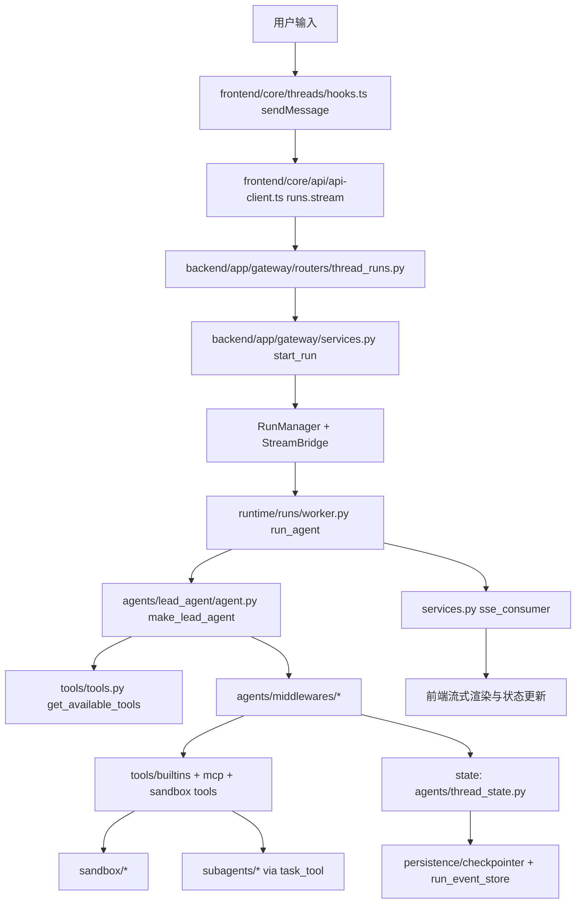

# 10｜DeerFlow 核心模块全景总览与调用链

> 本文是“总导航 + 架构地图 + 核心调用链总图”。
>
> 目标：你读完后，能够说清楚 DeerFlow 全部核心模块各自职责、边界和协作方式。

---

## 1. 核心模块全清单（覆盖后端 + 前端）

### 1.1 Backend / Harness 核心域

1. **Agent 编排域**：`backend/packages/harness/deerflow/agents/`
2. **Runtime 执行域**：`backend/packages/harness/deerflow/runtime/`
3. **工具域**：`backend/packages/harness/deerflow/tools/`
4. **沙箱域**：`backend/packages/harness/deerflow/sandbox/`
5. **子智能体域**：`backend/packages/harness/deerflow/subagents/`
6. **技能域**：`backend/packages/harness/deerflow/skills/`
7. **MCP 集成域**：`backend/packages/harness/deerflow/mcp/`
8. **模型工厂域**：`backend/packages/harness/deerflow/models/`
9. **记忆域**：`backend/packages/harness/deerflow/agents/memory/`
10. **持久化域**：`backend/packages/harness/deerflow/persistence/`
11. **配置域**：`backend/packages/harness/deerflow/config/`
12. **安全治理域（Guardrails/AuthZ）**：`backend/packages/harness/deerflow/guardrails/` + `backend/packages/harness/deerflow/authz/`
13. **可观测域（Tracing）**：`backend/packages/harness/deerflow/tracing/`
14. **上传与工作区变更域**：`backend/packages/harness/deerflow/uploads/` + `backend/packages/harness/deerflow/workspace_changes/`

### 1.2 Gateway / Application 核心域

1. **Gateway API 入口与路由**：`backend/app/gateway/routers/`
2. **Run 生命周期服务**：`backend/app/gateway/services.py`
3. **鉴权与会话体系**：`backend/app/gateway/auth/`
4. **IM 渠道接入**：`backend/app/channels/`

### 1.3 Frontend 核心域

1. **线程与流式会话域**：`frontend/src/core/threads/`
2. **API 客户端域**：`frontend/src/core/api/`
3. **任务/子任务展示域**：`frontend/src/core/tasks/`
4. **技能/模型/记忆/MCP 等管理域**：`frontend/src/core/skills/`、`frontend/src/core/models/`、`frontend/src/core/memory/`、`frontend/src/core/mcp/`

---

## 2. 一次请求的完整主链路（真实代码映射）

---

## 3. 模块间的“控制流”与“数据流”

### 3.1 控制流（谁驱动谁）

- 前端通过 `runs.stream` 发起 run；
- Gateway `start_run` 统一创建 run 并拉起后台 worker；
- worker 通过 agent factory 构建并执行图；
- 中间件/工具/子智能体在图执行期间被驱动；
- StreamBridge 把事件推给 SSE 消费方；
- 前端按事件持续更新 UI。

### 3.2 数据流（关键信息怎么走）

- 用户消息与附件路径从前端进入 run input；
- run context/config 从 Gateway 注入到 runtime；
- ThreadState 在图内持续演进并进入 checkpoint；
- run event / workspace changes 进入持久化层；
- 最终消息与子任务状态通过 SSE 回到前端。

---

## 4. 为什么这样分层（核心设计动机）

1. **前后端解耦**：UI 可以迭代，不影响执行内核；
2. **协议与执行解耦**：Router/Service 不等于 Agent Runtime；
3. **能力与治理解耦**：工具系统独立于安全治理；
4. **执行与传输解耦**：run 执行与 SSE 推送由 bridge 连接；
5. **状态与逻辑解耦**：ThreadState + reducer 保证多步一致性。

---

## 5. 文档阅读顺序（本批“完整版”）

1. `study/10-核心模块全景总览与调用链.md`（本篇）
2. `study/11-网关与运行时模块详解+落地方案.md`
3. `study/12-Agent编排模块详解+落地方案.md`
4. `study/13-能力层模块详解（工具-沙箱-技能-MCP-子智能体）+落地方案.md`
5. `study/14-基础设施模块详解（配置-模型-持久化-记忆-安全-追踪）+落地方案.md`
6. `study/15-前端与多渠道接入模块详解+落地方案.md`

---

## 6. 落地总路线（如果你要仿照 DeerFlow 做系统）

### Phase A：先打执行骨架

1. run 生命周期（create/run/cancel/wait）
2. stream bridge
3. agent factory + middlewares

### Phase B：再加执行能力

1. 工具装配
2. 沙箱执行
3. 子智能体委派

### Phase C：再加治理与可运维能力

1. 配置系统与动态重载
2. 持久化与事件审计
3. 安全治理与追踪

### Phase D：最后做产品化接入

1. 前端线程流式体验
2. IM 渠道复用 run path
3. 运维与故障恢复闭环

---

## 7. 本篇验收标准

你至少能回答：

- DeerFlow 所有核心模块有哪些？
- 每个模块在调用链中的位置是什么？
- 运行主链路是如何从前端走到 runtime 再回前端的？
- 如果你要做同类系统，为什么应按上述 Phase 顺序建设？

