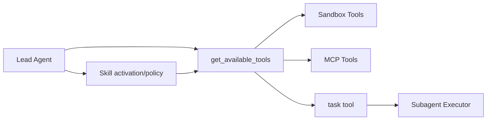

# 13｜能力层模块详解（工具 / 沙箱 / 技能 / MCP / 子智能体）+ 落地方案

> 本章回答：Agent 真正“干活”的能力是怎么落地到代码的。

---

## 1. 工具系统（Tools）

### 1.1 模块边界

- 目录：`backend/packages/harness/deerflow/tools/`
- 关键文件：`tools.py`、`builtins/task_tool.py`、`builtins/setup_agent_tool.py`

### 1.2 关键机制

`get_available_tools(...)` 完成：

1. 配置工具加载；
2. 内置工具拼装；
3. MCP 工具缓存加载；
4. 模型能力工具注入（如视觉）；
5. 同名去重与安全 gate。

### 1.3 落地建议

先实现“可用工具总线”，再引入策略过滤，不要一开始把工具散落在各节点中。

---

## 2. 沙箱系统（Sandbox）

### 2.1 模块边界

- 目录：`backend/packages/harness/deerflow/sandbox/`
- 关键文件：`sandbox.py`、`sandbox_provider.py`、`tools.py`、`middleware.py`、`local/local_sandbox.py`

### 2.2 关键机制

1. 抽象 `Sandbox` 能力接口；
2. 抽象 `SandboxProvider` 生命周期；
3. 虚拟路径映射与安全边界检查；
4. 读写工具统一走沙箱上下文。

### 2.3 落地建议

最低可用版：

- 先做 LocalProvider + 路径防穿越；
- 再做容器 provider；
- 最后做 provider 可插拔和 warm pool。

---

## 3. 技能系统（Skills）

### 3.1 模块边界

- 目录：`backend/packages/harness/deerflow/skills/`
- 关键文件：`catalog.py`、`slash.py`、`describe.py`、`security_static_scanner.py`

### 3.2 关键机制

1. 技能元数据目录（catalog）；
2. slash 激活路径；
3. 技能描述与加载策略；
4. 安全扫描与校验（SkillScan）。

### 3.3 落地建议

避免“全量技能一次性注入系统提示词”，应采用“元数据默认 + 按需加载”策略。

---

## 4. MCP 集成

### 4.1 模块边界

- 目录：`backend/packages/harness/deerflow/mcp/`
- 关键文件：`client.py`、`tools.py`、`cache.py`、`session_pool.py`

### 4.2 关键机制

1. MCP 工具会话管理；
2. 工具缓存与动态加载；
3. deferred tool promotion（延迟暴露）。

### 4.3 落地建议

先做静态 MCP tool 接入，再做 deferred promotion，最后做智能路由/自动提升。

---

## 5. 子智能体系统（Subagents）

### 5.1 模块边界

- 目录：`backend/packages/harness/deerflow/subagents/`
- 关键文件：`executor.py`、`registry.py`、`config.py`、`builtins/general_purpose.py`
- 工具入口：`backend/packages/harness/deerflow/tools/builtins/task_tool.py`

### 5.2 关键机制

1. 主 Agent 通过 `task` 工具委派；
2. executor 在后台管理子任务生命周期；
3. step events 记录执行过程；
4. 子任务结果回写 ToolMessage 附加元数据。

### 5.3 落地建议

最小版本优先：

- 单子任务串行；
- 状态可追踪（pending/running/completed/failed）；
- 再上并发、超时、取消与 token usage 汇总。

---

## 6. 五个能力域的协作关系

关键理解：

- 技能策略影响工具可见性；
- 工具执行可触发子智能体；
- 工具执行落到沙箱/MCP；
- 全部行为最终回写到线程状态与事件流。

---

## 7. 落地实施总步骤

1. 实现工具总线（本地内置工具）；
2. 接入沙箱执行；
3. 接入技能目录与激活；
4. 接入 MCP 工具；
5. 接入子智能体委派；
6. 引入策略过滤与审计。

---

## 8. 验收清单

- 工具 schema 可见性与执行权限一致；
- 沙箱路径访问不可越界；
- 技能激活后工具集按策略收敛；
- MCP 工具加载异常不会拖垮主链路；
- 子智能体失败可回传明确错误且主流程可继续决策。

