# 16｜DeerFlow 整体架构与业务流程图

> 基于 2026-10-12 当前工作区代码（Git HEAD：`b156ac1b`）及 `study/` 学习资料整理。
> 本文描述现有实现；可选能力是否运行取决于配置，并不意味着所有组件默认启用。
> 图表使用 Mermaid，可在支持 Mermaid 的 Markdown 阅读器中预览。实线表示调用、传递或读写，虚线表示配置、装配或可选依赖；时序图中的虚线表示返回。

## 阅读导航

- [1. 核心概念与模块边界](#1-核心概念与模块边界)
- [2. 系统整体架构图](#2-系统整体架构图)
- [3. 部署架构与请求路由](#3-部署架构与请求路由)
- [4. Web 对话业务流程与时序](#4-web-对话业务流程与时序)
- [5. Agent 内部编排与能力协作](#5-agent-内部编排与能力协作)
- [6. 子智能体委派流程](#6-子智能体委派流程)
- [7. 附件沙箱与产物交付](#7-附件沙箱与产物交付)
- [8. 多渠道接入流程](#8-多渠道接入流程)
- [9. 定时任务业务流程](#9-定时任务业务流程)
- [10. MCP 持久化长任务流程](#10-mcp-持久化长任务流程)
- [11. 状态持久化与长期记忆](#11-状态持久化与长期记忆)
- [12. Run 生命周期与异常处理](#12-run-生命周期与异常处理)
- [13. 扩展机制与横切治理](#13-扩展机制与横切治理)
- [14. 源码索引与资料核对](#14-源码索引与资料核对)

## 1. 核心概念与模块边界

DeerFlow 的主线是：**接入层提交任务 → Gateway 管理 Run → Harness 驱动 Agent 图 → 模型选择工具或委派子任务 → 状态与事件持续记录 → 结果返回用户**。

需要先区分以下概念：

- **Thread**：持续会话及其工作区归属。一个 Thread 可以先后产生多次 Run。
- **Run**：一次执行，拥有独立的 `run_id`、状态、事件、用量和取消控制。
- **Lead Agent**：本次 Run 中负责理解目标、选择能力、汇总结果的主智能体。
- **Harness**：提供 Agent 编排、运行时、工具、技能、沙箱、记忆和持久化接口的 Python 包，导入名为 `deerflow`。
- **Gateway**：FastAPI 应用及接入服务，导入名为 `app`；生产主链路的 Agent Runtime 嵌入在该进程内。
- **Subagent**：通过 `task` 工具委派的受限子执行，具有自己的生命周期；不等于新增一个 Gateway 服务。
- **Skill**：按需加载的操作知识与工具策略；**MCP** 提供外部工具协议；**Python Extension** 提供宿主级代码扩展。这三者的权限与装配位置不同。

职责分布如下：

1. **展示与接入**：`frontend/` 提供工作台；`backend/app/channels/` 将 IM、GitHub 等外部消息适配为统一输入；Nginx 提供 Web 统一入口。
2. **应用与生命周期**：`backend/app/gateway/` 负责身份、路由、线程归属和 Run 创建；`backend/app/scheduler/` 与 `backend/app/mcp_tasks/` 负责后台调度。
3. **执行与编排**：Harness 的 `runtime/` 驱动图并传输事件，`agents/` 装配模型、提示词、中间件和状态契约。
4. **能力**：`tools/`、`skills/`、`mcp/`、`sandbox/`、`subagents/` 相互协作，完成检索、文件处理、命令执行及委派。
5. **基础设施与治理**：`config/`、`models/`、`persistence/`、`agents/memory/`、`authz/`、`guardrails/`、`tracing/` 提供配置、存储、安全及观测。

## 2. 系统整体架构图

此图以模块协作关系为主。Gateway 框中的应用服务与 Harness 运行时一般处于同一后端进程；数据库、模型服务、MCP Server 与远程沙箱是外部依赖。

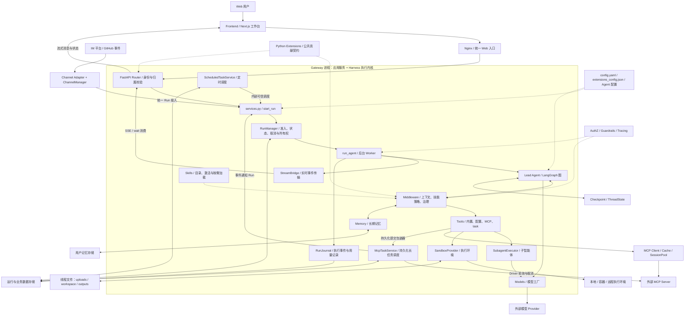

图中最重要的协作边界：

- **执行与传输分开**：Worker 生产事件，StreamBridge 传输事件，SSE 消费端负责 HTTP 编码。
- **模型与执行分开**：模型返回工具调用意图，工具和沙箱执行实际动作，再将结果送回模型。
- **调度与执行分开**：定时任务与 MCP 通知决定何时发起 Run，复用正常 Run 链路。
- **当前状态与历史事件分开**：Checkpoint 保存图状态，RunJournal/EventStore 保存过程，文件系统保存真实附件和产物。

## 3. 部署架构与请求路由

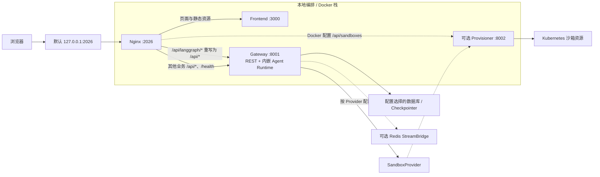

- 根目录 `make dev` / Docker 编排拉起协作服务；Frontend 固定使用本地端口 `3000`，根 `PORT` 配置用于 Docker 入口。
- Docker 默认只发布 Nginx 的 loopback 地址；Gateway 的容器内 `0.0.0.0:8001` 不意味着将 `8001` 发布到宿主公网。
- Provisioner 按沙箱模式启用。Docker Nginx 配置含独立 `/api/sandboxes` 代理；本地 Nginx 配置不具有完全相同的这一路由。
- LangGraph 是图执行底座和客户端协议兼容层；常规部署不另起一个必须存在的独立 LangGraph Server。Studio 是另一种开发使用场景。
- CORS/CSRF 与身份认证主要由 Gateway 的中间件和认证模块落实，Nginx 提供同源代理入口。

源码：[Docker Nginx](../docker/nginx/nginx.conf)、[本地 Nginx](../docker/nginx/nginx.local.conf)、[Gateway 启动](../backend/app/gateway/app.py)。

## 4. Web 对话业务流程与时序

### 4.1 从发送到交付的业务流程

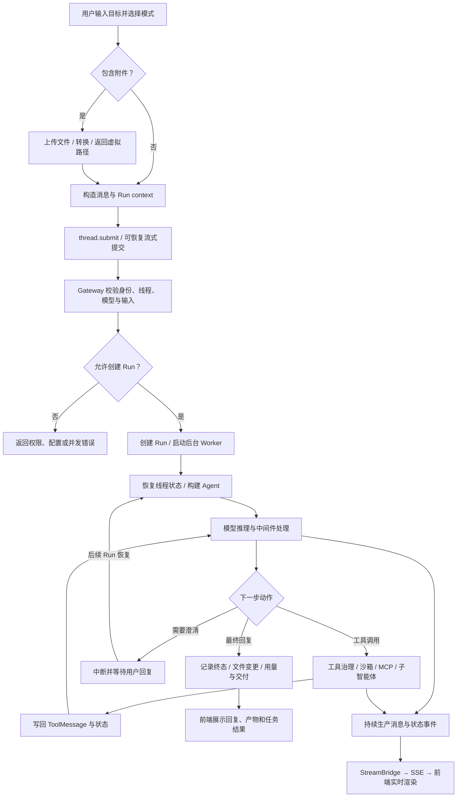

运行模式由前端转换成 context：`flash` 不启用 thinking；`pro` 与 `ultra` 请求计划能力，`ultra` 请求子智能体能力。后端仍根据配置、权限及运行限制决定最终可用能力。

### 4.2 主要调用时序

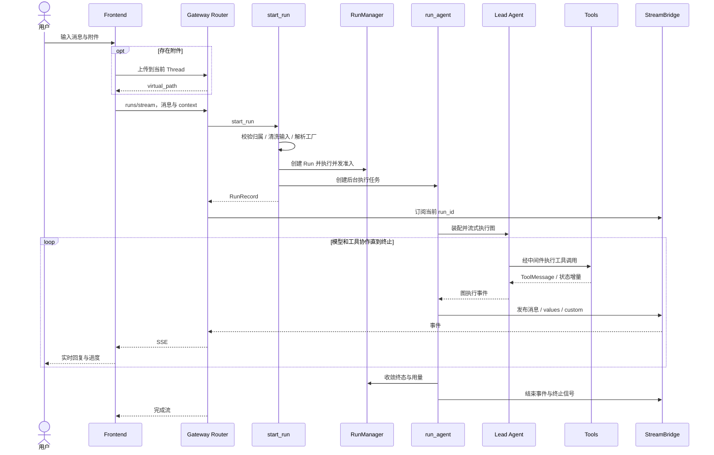

这是常见工具执行路径；纯文本回答可直接结束，不必调用工具。`runs/wait` 消费同一事件桥直到完成，`runs.create` 先返回后台 Run；三者不构成三套执行内核。

源码：[前端发送](../frontend/src/core/threads/hooks.ts)、[客户端](../frontend/src/core/api/api-client.ts)、[Run 路由](../backend/app/gateway/routers/thread_runs.py)、[生命周期服务](../backend/app/gateway/services.py)、[Worker](../backend/packages/harness/deerflow/runtime/runs/worker.py)。

## 5. Agent 内部编排与能力协作

### 5.1 构建阶段和执行阶段

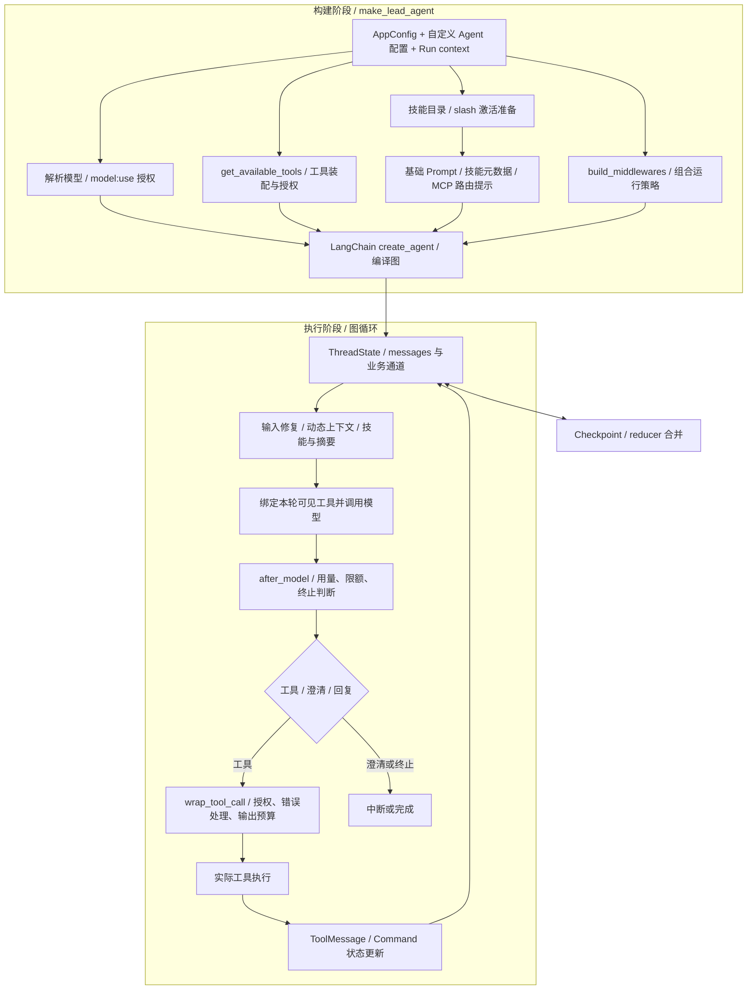

此图展示职责分组，**不是固定的中间件注册顺序**。状态钩子、模型包装钩子和工具包装钩子由框架在不同阶段触发；包装调用形成嵌套关系，`after_model` 的执行顺序也不能等同于列表正向顺序。

当前主 Agent 在 `lead_agent/agent.py` 中直接调用 LangChain `create_agent`；`agents/factory.py` 的 `create_deerflow_agent` 是另一通用装配入口，不能画成每次主 Run 都必经的下一跳。Worker 在运行阶段接入 Checkpointer/Store 等执行依赖。

### 5.2 技能、工具和 MCP 如何协作

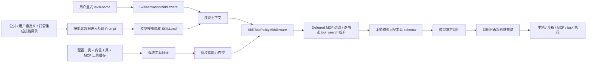

技能通常先暴露元数据，正文在显式激活或按需读取时加载；技能策略既影响模型可见工具，也约束实际执行。Deferred MCP 的提升状态与目录哈希进入线程状态，避免只在提示词层假装限制工具。

## 6. 子智能体委派流程

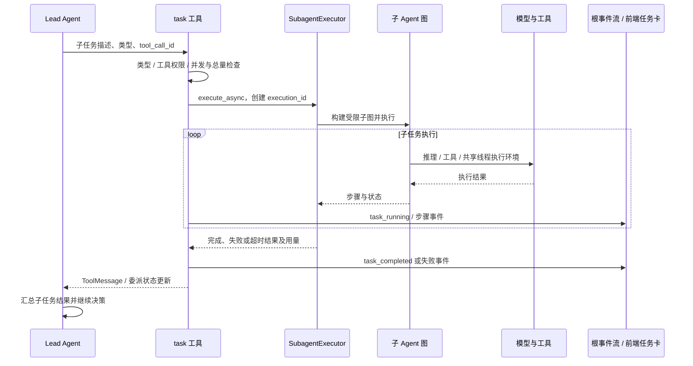

- 子 Agent 按类型拥有独立提示词、工具集合、轮数和超时限制；运行上下文可继承父线程的沙箱信息，它不必创建独立工作区。
- `tool_call_id` 是模型工具调用及 UI 事件的相关性标识；`execution_id` 是执行器和全局注册表的所有权标识，两者不能混用。
- 子任务终态回写 `ToolMessage` 与 `delegations`，用量汇总到当前 Run。失败交回主 Agent 决策，而不是自动宣告主 Run 必然失败。
- Web 当前不请求 `streamSubgraphs`。任务进度通过根命名空间 `task_*` 自定义事件展示，防止子图 `values` 覆盖主线程视图。

源码：[task 工具](../backend/packages/harness/deerflow/tools/builtins/task_tool.py)、[子执行器](../backend/packages/harness/deerflow/subagents/executor.py)、[状态契约](../backend/packages/harness/deerflow/agents/thread_state.py)。

## 7. 附件沙箱与产物交付

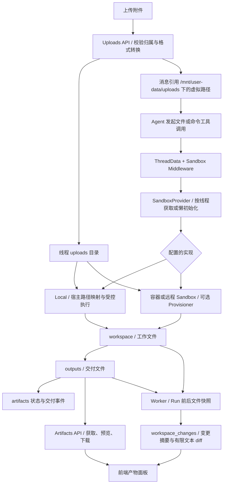

沙箱由两个抽象协作：`Sandbox` 定义执行与读写能力，`SandboxProvider` 管理获取、复用和释放。虚拟路径对模型稳定，实际映射由 Provider 处理；远程实现是否挂载或同步由具体实现决定。

Local 模式提供线程路径映射、路径检查和受控命令执行，**不等于容器级或操作系统级隔离**。模型凭据不应自动成为工具子进程的可见环境。

文件变更快照扫描 `workspace` 和 `outputs`，不扫描 uploads，也排除内部浏览器帧与工具结果外置目录。Checkpoint 保存文件引用与业务状态，不保存整个工作区文件内容。因此历史会话分支并不意味着文件也完整回到历史版本。

源码：[上传管理](../backend/packages/harness/deerflow/uploads/manager.py)、[沙箱接口](../backend/packages/harness/deerflow/sandbox/sandbox.py)、[Provider](../backend/packages/harness/deerflow/sandbox/sandbox_provider.py)、[产物路由](../backend/app/gateway/routers/artifacts.py)、[变更模块](../backend/packages/harness/deerflow/workspace_changes/)。

## 8. 多渠道接入流程

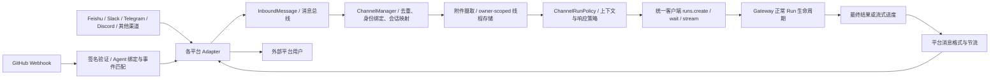

Web 与 IM 共享执行内核，差异集中在身份解析、外部会话到 Thread 的映射、附件摄取及输出适配。平台绑定将外部身份关联到 DeerFlow 用户，避免不同用户共享文件或运行权限。

GitHub 是特殊渠道：Webhook 经匹配后分发给自定义 Agent；默认 fire-and-forget，出站通道记录日志，Agent 在沙箱中通过 `gh` 自行回帖。忙碌期间的后续事件可缓冲并在 Run 完成后合并为后续 Run；该缓冲当前是进程内状态，不能视为跨实例可靠队列。

源码：[渠道管理](../backend/app/channels/manager.py)、[渠道策略](../backend/app/channels/run_policy.py)、[渠道说明](../backend/app/channels/AGENTS.md)。

## 9. 定时任务业务流程

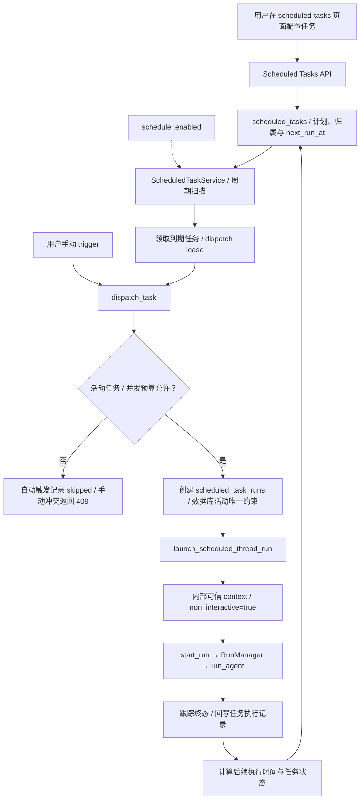

- Scheduler 只负责时间、准入、执行记录和恢复，Agent 执行仍走 `services.py` 的正常链路。
- 计划后台运行不允许等待用户澄清：主 Agent 工具集移除 `ask_clarification`。客户端伪造的 `non_interactive` 会被剥离，只有内部可信调用可注入。
- MVP `overlap_policy=skip` 的活动唯一索引保护同一任务不重叠，即使每轮创建新 Thread 也有效；仅有应用层“先查后写”不够。
- 默认单实例。多实例模式需要共享 Postgres、Run 所有权心跳及数据库事件存储等配置；租约与全局并发预算共同治理跨实例派发。

源码：[调度服务](../backend/app/scheduler/service.py)、[计划计算](../backend/packages/harness/deerflow/scheduler/schedules.py)、[任务 API](../backend/app/gateway/routers/scheduled_tasks.py)、[内部启动入口](../backend/app/gateway/services.py)。

## 10. MCP 持久化长任务流程

普通 MCP 工具调用将结果直接返回当前 Agent 循环。启用 durable MCP tasks 后，长任务通过显式 `task_toolsets` 配置提交、查询、取消协议，由独立后台服务追踪。

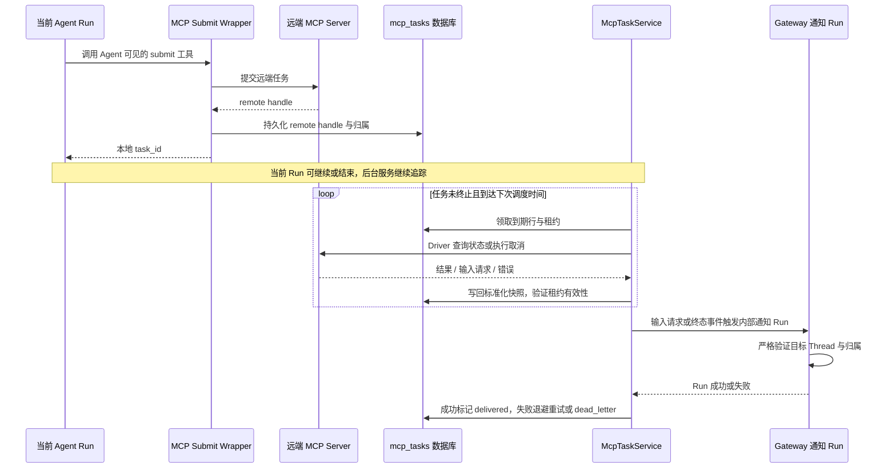

- 数据库是长任务事实来源；ThreadState 只接收有界、当前线程相关的投影。
- 原始远端 status/cancel 工具不需要暴露给模型，后台服务通过 Driver 执行。用户取消先写入持久化取消栅栏，再由后台调用远端。
- 已过期租约或取消栅栏后的迟到查询结果被丢弃，避免覆盖新状态；进程重启后通过过期租约恢复领取。
- 通知使用幂等 Agent Run，成功后才标记交付；失败有退避和死信处理，目标线程永久缺失或归属不匹配会终止交付。
- 远端事件是不可信数据；通知的可信指令与事件载荷分开处理。

源码：[后台服务](../backend/app/mcp_tasks/service.py)、[协议驱动](../backend/packages/harness/deerflow/mcp/tasks/)、[持久化仓库](../backend/packages/harness/deerflow/persistence/mcp_tasks/)、[前端查询 API](../backend/app/gateway/routers/mcp_tasks.py)。

## 11. 状态持久化与长期记忆

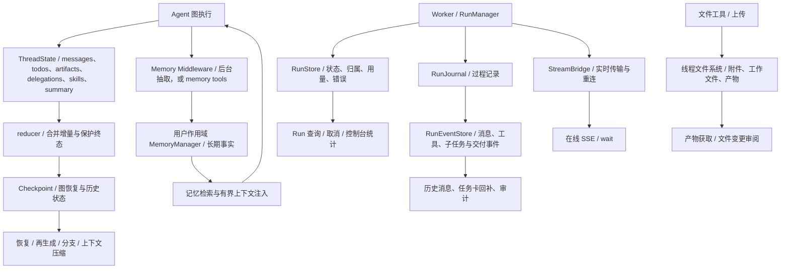

这些存储不能互相替代：

1. **Checkpoint** 回答“图当前处于什么状态”，支持恢复与状态历史；`full` 保存完整消息通道，`delta` 依赖写入增量及快照物化。读取应经过 `CheckpointStateAccessor`，不能把原始 delta blob 当完整消息。
2. **RunStore** 回答“哪次执行、谁拥有、执行到什么终态”，支撑管理与所有权控制。
3. **RunEventStore** 回答“执行过程中发生过什么”，历史消息与子任务步骤等可从事件读取；旧 checkpoint-only 历史存在兼容迁移入口。
4. **StreamBridge** 负责在线事件传输；memory 与 Redis 等实现按配置选择。它不替代业务状态与持久事件仓库。
5. **线程文件系统** 保存文件内容；产物状态字段仅表示引用或交付信息。
6. **长期 Memory** 保存跨会话可复用事实，按用户作用域管理；不是 ThreadState，也不是把整个聊天历史无限拼入 Prompt。

Checkpointer 支持 memory / SQLite / Postgres；事件仓库包含 memory / JSONL / DB 等实现。各自配置与能力约束需分别确认，不能推断所有接口都在内存模式下可用。

默认被动记忆链路会将对话送入去抖队列，由更新器抽取事实并写入记忆仓库，后续通过动态上下文或检索注入。工具模式改由模型调用记忆工具；特定后端可要求保留被动写入。记忆更新是独立的后台过程，不等于主回复必须等待记忆写入完成。

源码：[线程状态](../backend/packages/harness/deerflow/agents/thread_state.py)、[Checkpoint 访问层](../backend/packages/harness/deerflow/runtime/checkpoint_state.py)、[事件仓库](../backend/packages/harness/deerflow/runtime/events/store/)、[记忆模块](../backend/packages/harness/deerflow/agents/memory/)。

## 12. Run 生命周期与异常处理

以下为业务简化状态图，状态名对应 `RunStatus`。启动阶段失败或取消也可能由 `pending` 直接收敛，不必先进入 `running`。

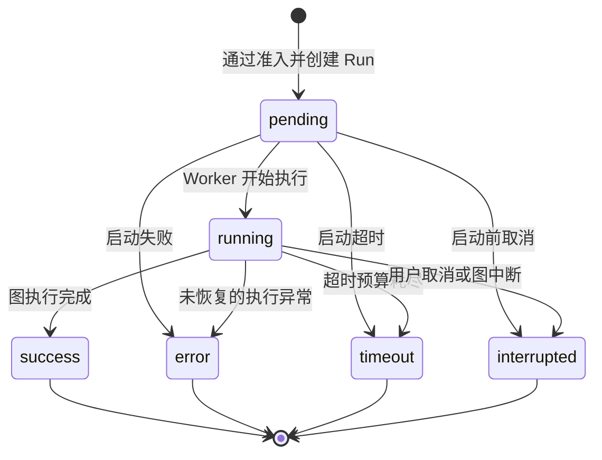

- **用户取消**：经过 RunManager 更新取消控制，再由 Worker 清理并收敛状态；不能只停止浏览器读取 SSE。
- **HTTP 断开**：按 `on_disconnect` 策略选择 cancel 或 continue。开启可恢复流式传输并不表示所有部署都能无限期保留所有事件。
- **等待澄清**：图进入中断，后续输入通过新 Run 恢复 Thread 的 checkpoint；不是同一个已经终止的 Run 无限等待。
- **同线程竞争**：Run 准入、checkpoint 写入、产物修改等线程操作需要互斥治理，数据库约束保护活动 Run 槽位。
- **工具异常**：可由工具错误处理中间件转换成 ToolMessage 供模型继续决策；未处理异常才进入 Run 错误路径。
- **回滚与再生成**：影响图状态；`full` 与 `delta` 的历史恢复实现不同，delta 恢复需避免分叉增量重放污染。文件系统不随 checkpoint 自动回滚。
- **跨实例运行恢复**：依赖持久化 Run 状态、所有权租约/心跳及事件配置；不能将进程内 `asyncio.Task` 或子任务注册表误认为持久队列。

源码：[状态枚举](../backend/packages/harness/deerflow/runtime/runs/schemas.py)、[RunManager](../backend/packages/harness/deerflow/runtime/runs/manager.py)、[Worker](../backend/packages/harness/deerflow/runtime/runs/worker.py)。

## 13. 扩展机制与横切治理

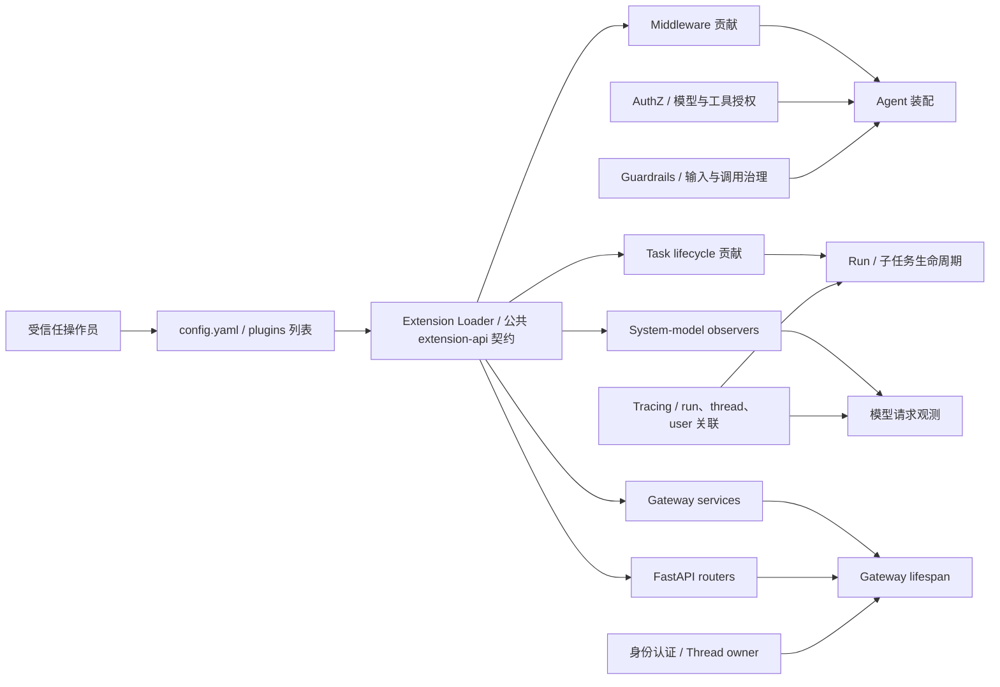

Python 扩展在宿主权限下导入和运行，所以由操作员控制的 `config.yaml -> plugins` 装载，并通过公共 `deerflow_extension_api` 契约贡献能力。扩展安装/启用/禁用之后需要重启 Gateway。

`extensions_config.json` 管理 MCP Server 和 Skill 配置，可由 Gateway API 更新；它不承担 Python 插件代码导入列表。部分配置支持热重载，但服务单例、Checkpoint 模式与插件等有启动时边界，不能一概说“修改配置立即全部生效”。

Tracing 在主图调用根部挂接，图内模型通常关闭重复挂接，避免重复 span 并保持 `thread_id/run_id/user_id` 的归属链。安全也分多层：Gateway 认证与归属、模型/工具授权、中间件策略、沙箱路径和执行环境，任何一层都不能代替其他层。

源码：[公共扩展包](../backend/packages/extension-api/)、[扩展指南](../backend/packages/harness/deerflow/extensions/AGENTS.md)、[扩展示例](../examples/deerflow-extension-example/)、[追踪模块](../backend/packages/harness/deerflow/tracing/)。

## 14. 源码索引与资料核对

### 14.1 建议源码阅读顺序

1. [前端线程发送与流状态](../frontend/src/core/threads/hooks.ts) → [API 客户端](../frontend/src/core/api/api-client.ts)：理解消息、附件、运行模式、可恢复流。
2. [Run 路由](../backend/app/gateway/routers/thread_runs.py) → [services.py](../backend/app/gateway/services.py)：理解入口校验、`start_run`、SSE/wait、可信内部调用。
3. [RunManager](../backend/packages/harness/deerflow/runtime/runs/manager.py) → [run_agent](../backend/packages/harness/deerflow/runtime/runs/worker.py)：理解后台执行、状态、终态与清理。
4. [Lead Agent 装配](../backend/packages/harness/deerflow/agents/lead_agent/agent.py) → [Prompt](../backend/packages/harness/deerflow/agents/lead_agent/prompt.py) → [运行中间件装配](../backend/packages/harness/deerflow/agents/middlewares/tool_error_handling_middleware.py)：理解图如何获得能力与策略。
5. [工具装配](../backend/packages/harness/deerflow/tools/tools.py) → [task](../backend/packages/harness/deerflow/tools/builtins/task_tool.py) → [SubagentExecutor](../backend/packages/harness/deerflow/subagents/executor.py)：理解工具和委派。
6. [Sandbox](../backend/packages/harness/deerflow/sandbox/) → [Skills](../backend/packages/harness/deerflow/skills/) → [MCP](../backend/packages/harness/deerflow/mcp/)：理解实际执行能力。
7. [CheckpointStateAccessor](../backend/packages/harness/deerflow/runtime/checkpoint_state.py) → [Persistence](../backend/packages/harness/deerflow/persistence/) → [Memory](../backend/packages/harness/deerflow/agents/memory/)：理解状态、历史与记忆的边界。
8. [渠道管理](../backend/app/channels/manager.py) → [Scheduler](../backend/app/scheduler/service.py) → [MCP 长任务](../backend/app/mcp_tasks/service.py) → [Extensions](../backend/packages/harness/deerflow/extensions/)：理解接入复用和后台协作。

### 14.2 与已有学习资料的关系

- [02｜主链路拆解](./02-主链路拆解：从用户输入到最终输出.md) 与 [10｜全景总览](./10-核心模块全景总览与调用链.md)：作为主链路基础，本篇补充部署边界、时序和数据落点。
- [11｜网关与运行时](./11-网关与运行时模块详解+落地方案.md) 与 [12｜Agent 编排](./12-Agent编排模块详解+落地方案.md)：用于理解职责；“落地方案”是复刻建议，不能当作当前实现的精确调用树。
- [13｜能力层](./13-能力层模块详解（工具-沙箱-技能-MCP-子智能体）+落地方案.md)、[14｜基础设施](./14-基础设施模块详解（配置-模型-持久化-记忆-安全-追踪）+落地方案.md)、[15｜前端与渠道](./15-前端与多渠道接入模块详解+落地方案.md)：按模块继续深入。
- [中间件专题](./DeerFlow-中间件链设计-深度讲解.md)、[沙箱专题](./DeerFlow-沙箱系统设计-深度讲解.md)、[子智能体专题](./DeerFlow-子智能体系统设计-深度讲解.md)、[工具专题](./DeerFlow-工具系统设计-深度讲解.md)：解释实现细节及设计取舍。

本篇针对当前代码核对了几处容易混淆的说法：主 Agent 直接使用 `create_agent`；Web 不开启子图流；Provisioner 为可选服务；Checkpoint、事件和文件是不同数据层；定时任务与 MCP 通知共用 Run 生命周期；MCP 长任务追踪不占据 Agent 的持续轮询循环；Python 插件与 Skill/MCP 配置属于不同信任边界。

维护本文时，应同时核对根 [AGENTS.md](../AGENTS.md)、[后端指南](../backend/AGENTS.md)、[前端指南](../frontend/AGENTS.md) 及对应模块源码。源码路径和图中状态名以当前实现为准，部署配置变化需要同步修改图中的可选依赖和路由说明。
