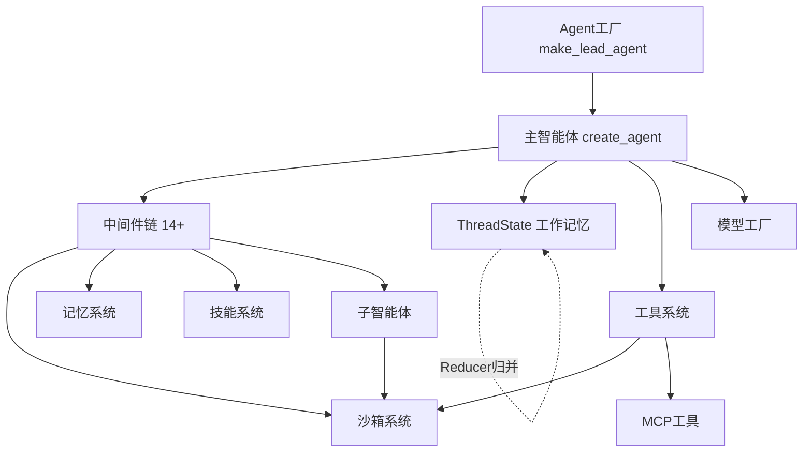

# DeerFlow Agent 核心模块讲解 + 优秀设计点

> 本文聚焦回答两个问题：
> 1. **项目 & Agent 的核心模块主要是哪些？**
> 2. **它有哪些优秀的设计点和特性？**
>
> 所有结论都附上真实代码位置，便于按图索骥。

---

## 一、项目核心模块总览

DeerFlow 后端核心代码位于 `backend/packages/harness/deerflow/`。从"Agent 视角"看，可分为下面 8 大核心模块：

| # | 模块 | 目录 | 一句话职责 |
|---|------|------|-----------|
| 1 | **Agent 工厂 / 主智能体** | `agents/factory.py`、`agents/lead_agent/` | 组装并创建可运行的 Agent |
| 2 | **中间件链** | `agents/middlewares/` | Agent 每步前后的横切逻辑（安全/上下文/预算…） |
| 3 | **线程状态** | `agents/thread_state.py` | Agent 的"工作记忆"数据结构 |
| 4 | **子智能体** | `subagents/` | 任务分解与并行执行 |
| 5 | **工具系统** | `tools/`、`community/` | Agent 的"手脚"——搜索/执行/文件 |
| 6 | **沙箱** | `sandbox/`、`community/aio_sandbox/` | Agent 的"电脑"——隔离执行环境 |
| 7 | **技能** | `skills/` | 可插拔的能力包（SKILL.md） |
| 8 | **记忆** | `agents/memory/` | 跨会话长期记忆 |

> 此外还有支撑层：`models/`（模型工厂）、`config/`（配置）、`runtime/`（运行调度）、`persistence/`（持久化）、`guardrails/`（授权守卫）、`tracing/`（可观测性）。

---

## 二、Agent 核心模块逐一详解

### 2.1 Agent 工厂与主智能体（构建入口）

**代码位置**：
- `agents/factory.py` → `create_deerflow_agent()`（SDK 级纯参数工厂）
- `agents/lead_agent/agent.py` → `make_lead_agent()`（配置驱动的应用级工厂）

DeerFlow 采用**两层工厂**设计，层次分明：

```
create_agent (LangChain 原语)
       ▲
create_deerflow_agent (纯参数 SDK 工厂, factory.py)  ← 不读配置文件
       ▲
make_lead_agent (配置驱动应用工厂, lead_agent/agent.py)  ← 读 config.yaml
```

工厂的本质就是把四大件组装进 LangChain 的 `create_agent`（`factory.py:141`）：

```python
return create_agent(
    model=model,               # 大脑：LLM
    tools=effective_tools,     # 手脚：工具集
    middleware=effective_middleware,  # 神经系统：中间件链
    state_schema=effective_state,     # 记忆结构：ThreadState
    checkpointer=checkpointer,        # 持久化
    name=name,
)
```

**设计点**：`create_deerflow_agent` 明确声明"工厂组装本身不读配置文件"（`factory.py:78`），把配置读取隔离在上层 `make_lead_agent`，让核心构建逻辑可测试、可复用、可作为 SDK 独立使用。

---

### 2.2 中间件链（Agent 的"神经系统"）

**代码位置**：`agents/middlewares/`（38+ 个文件），组装逻辑在 `agents/lead_agent/agent.py:242` 的 `build_middlewares()`。

中间件是 DeerFlow 最核心、最精华的设计。每个中间件负责一个**横切关注点**，按严格顺序执行。`make_lead_agent` 组装了 14 个中间件（`factory.py:166-179` 有完整顺序注释）：

| 顺序 | 中间件 | 作用 | 代码 |
|------|--------|------|------|
| 0 | ThreadDataMiddleware | 创建每线程隔离目录 | `thread_data_middleware.py` |
| 1 | UploadsMiddleware | 注入上传文件 | `uploads_middleware.py` |
| 2 | SandboxMiddleware | 获取沙箱环境 | `sandbox/middleware.py` |
| 3 | DanglingToolCallMiddleware | 修补悬空工具调用 | `dangling_tool_call_middleware.py` |
| 4 | GuardrailMiddleware | 工具调用前授权 | `guardrails/middleware.py` |
| 5 | ToolErrorHandlingMiddleware | 工具异常转 ToolMessage | `tool_error_handling_middleware.py` |
| 6 | SummarizationMiddleware | 上下文压缩 | `summarization_middleware.py` |
| 7 | TodoMiddleware | 规划模式任务追踪 | `todo_middleware.py` |
| 8 | TitleMiddleware | 自动生成标题 | `title_middleware.py` |
| 9 | MemoryMiddleware | 异步记忆抽取 | `memory_middleware.py` |
| 10 | ViewImageMiddleware | 视觉模型注入图片 | `view_image_middleware.py` |
| 11 | SubagentLimitMiddleware | 限制子智能体数量 | `subagent_limit_middleware.py` |
| 12 | LoopDetectionMiddleware | 死循环检测 | `loop_detection_middleware.py` |
| 13 | ClarificationMiddleware | 拦截澄清并中断（必须最后） | `clarification_middleware.py` |

除以上，还有更多进阶中间件保障长任务稳定性：
- **DynamicContextMiddleware**（`agent.py:282`）：把当前日期/记忆作为 `<system-reminder>` 注入首条 HumanMessage，**让系统提示保持完全静态以复用前缀缓存（prefix-cache）**——这是重要的降本设计。
- **SkillActivationMiddleware**（`agent.py:289`）：识别 `/skill-name` 前缀，确定性加载对应 SKILL.md。
- **SkillToolPolicyMiddleware**（`agent.py:303`）：技能的 `allowed-tools` 策略在激活后才生效。
- **DurableContextMiddleware**（`agent.py:317`）：在摘要压缩前捕获已完成的委派与已加载技能，注入"耐久上下文通道"（摘要 + 委派账本 + 技能）。
- 其他：token_budget（令牌预算）、tool_output_budget（工具输出预算）、input_sanitization（输入净化）、safety_finish_reason（安全终止）、read_before_write（先读后写）等。

**设计点（中间件定位系统）**：`agents/features.py` 提供了 `@Next` / `@Prev` 装饰器（`features.py:47`、`features.py:59`），可声明式地把一个中间件插入到某个锚点前/后，而不用手工维护整条链的顺序——非常优雅的可扩展设计。

---

### 2.3 线程状态 ThreadState（Agent 的"工作记忆"）

**代码位置**：`agents/thread_state.py`

`ThreadState` 继承自 LangChain 的 `AgentState`，是 Agent 在一次会话中的完整状态载体（`thread_state.py:231`）：

```python
class ThreadState(AgentState):
    sandbox: SandboxStateField                          # 沙箱 id
    thread_data: ...                                    # workspace/uploads/outputs 路径
    title: ...                                          # 会话标题
    artifacts: Annotated[list[str], merge_artifacts]    # 产物
    todos: Annotated[list | None, merge_todos]          # 待办
    goal: Annotated[GoalState | None, merge_goal]       # 会话目标
    viewed_images: ...                                  # 已查看图片元数据
    promoted: ...                                       # 提升的延迟工具
    delegations: Annotated[..., merge_delegations]      # 委派账本
    skill_context: Annotated[..., merge_skill_context]  # 技能上下文
    summary_text: ...                                   # 摘要
```

**设计精华：Reducer（归并器）模式**。每个状态字段都用 `Annotated[..., merge_xxx]` 绑定一个归并函数，解决并发状态更新冲突。举几个亮点：

1. **`merge_sandbox`（`thread_state.py:33`）**：同一线程出现不同 sandbox_id 时**直接抛错（fail closed）**，因为这意味着隔离性 bug，绝不静默选一个——安全优先的典范。
2. **`merge_viewed_images`（`thread_state.py:67`）**：只存图片元数据，**不把 base64 存进 checkpoint**，避免每个检查点重复巨大负载（注释引用了 issue #4138）——性能优化的细节。
3. **`merge_delegations`（`thread_state.py:149`）**：委派账本**终态永不被非终态覆盖**，且限制最多 50 条，防止状态无限膨胀。
4. **`merge_skill_context`（`thread_state.py:197`）**：技能上下文按 path 去重、按最近读取排序、上限 8 条，且会剥离遗留的正文键只保留引用。

---

### 2.4 子智能体系统（任务分解与并行）

**代码位置**：`subagents/`
- 内置智能体：`subagents/builtins/__init__.py`
- 注册表：`subagents/registry.py`
- 执行引擎：`subagents/executor.py`

**内置两个子智能体**（`builtins/__init__.py:12`）：
```python
BUILTIN_SUBAGENTS = {
    "general-purpose": GENERAL_PURPOSE_CONFIG,  # 全工具集
    "bash": BASH_AGENT_CONFIG,                  # 命令专家
}
```

**工作流程**：主智能体调用 `task()` 工具 → executor 在后台线程池运行子智能体 → 轮询完成 → 返回结构化结果。每轮最多 3 个、15 分钟超时。

**设计点**：
1. **配置分层解析**（`registry.py:48` 的 `get_subagent_config`）：内置 → config.yaml 的 custom_agents → 每-agent override，层次清晰，且**全局默认值只作用于内置 agent，不覆盖自定义 agent 自己的值**。
2. **能力感知暴露**（`registry.py:141` 的 `get_available_subagent_names`）：当宿主 bash 不可用时，`bash` 子智能体**自动从可见列表中剔除**——避免暴露无法工作的能力。
3. **上下文隔离**：子智能体在独立上下文运行，看不到主智能体上下文，其内部 AI/工具消息不进入父对话流。

---

### 2.5 工具系统（Agent 的"手脚"）

**代码位置**：`tools/builtins/`（内置）、`community/`（社区工具，20+ 个 Provider）

| 类别 | 代表工具 | 代码位置 |
|------|---------|---------|
| 沙箱 | bash / ls / read_file / write_file / str_replace | `sandbox/tools.py` |
| 内置 | present_files / ask_clarification / view_image / task | `tools/builtins/` |
| 社区搜索 | Tavily / Brave / Serper / Exa / DuckDuckGo / SearXNG | `community/tavily/` 等 |
| 社区抓取 | Jina AI / Crawl4AI / Firecrawl / fastCRW / InfoQuest | `community/jina_ai/` 等 |
| MCP | 任意 MCP 服务器 | `mcp/` |

**设计点**：**延迟工具（Deferred Tools）+ 工具搜索**。当工具很多时，不把所有工具 schema 都塞给模型（浪费 token），而是先"延迟"，通过 `tool_search` 让模型按需检索，再由 `DeferredToolFilterMiddleware` 和路由中间件按需"提升（promote）"（见 `ThreadState.promoted` 字段与 `agent.py` 的 deferred_setup）。这对 token 敏感模型极其友好。

---

### 2.6 沙箱（Agent 的"电脑"）

**代码位置**：
- 抽象接口：`sandbox/sandbox.py`
- 本地实现：`sandbox/local/`
- Docker 实现：`community/aio_sandbox/aio_sandbox_provider.py`
- 其他：`community/e2b_sandbox/`、`community/boxlite/`

**核心能力**：每线程隔离执行环境 + 虚拟路径翻译：
```
/mnt/user-data/uploads     ← 用户上传
/mnt/user-data/workspace   ← 工作目录
/mnt/user-data/outputs     ← 交付物
/mnt/skills                ← 技能
```

**设计点**：
1. **安全默认（fail-safe）**：`LocalSandboxProvider` 默认**禁用宿主 bash**，因为它不是安全隔离边界；需隔离 shell 请用 Docker 的 `AioSandboxProvider`。
2. **并发写安全**：`str_replace` 按 `(sandbox.id, path)` 串行化读改写，隔离沙箱即使虚拟路径相同也保持并发正确性。
3. **容器健康校验与 warm-pool 复用**：`AioSandboxProvider` 在获取/复用时校验容器存活，健康检查失败视为"未知"而非"已死"，避免误判。

---

### 2.7 技能系统（可插拔能力包）

**代码位置**：`skills/`（加载逻辑）、`skills/public/`（内置技能）

- **本质**：一个 `SKILL.md`（Markdown）定义工作流、最佳实践、资源引用。
- **渐进式加载**：仅在任务需要时加载，保持上下文精简。
- **激活方式**：`/skill-name` 前缀显式激活。
- **安全**：安装/编辑经 **SkillScan**（原生确定性扫描）+ LLM 扫描双重校验，`CRITICAL` 发现直接拦截。

**设计点（渐进式披露 Progressive Disclosure）**：基础系统提示只含技能**元数据**，完整 SKILL.md 只在激活后才注入（见 `SkillActivationMiddleware`）。这是控制上下文窗口成本的关键设计。

---

### 2.8 记忆系统（跨会话长期记忆）

**代码位置**：`agents/memory/`
- 管理器：`agents/memory/manager.py`
- 后端：`agents/memory/backends/deermem/`（默认 LLM 实现）、`backends/noop/`（空实现）

**工作机制**：MemoryMiddleware 异步排队 → LLM 抽取用户上下文/事实/偏好 → 去抖批量更新 → 结构化存储（JSON）→ 注入系统提示。

**设计点**：
1. **可插拔后端**：deermem / noop 通过统一接口切换。
2. **去重 apply**：重复事实在 apply 时跳过，避免跨会话无限累积。
3. **去抖（debounce）**：批量更新减少 LLM 调用成本。

---

## 三、优秀设计点与特性总结

下面把散落在各模块的"闪光点"集中提炼，这些是 DeerFlow 值得学习的工程智慧。

### 3.1 架构设计层面

| 设计点 | 说明 | 代码 |
|--------|------|------|
| **两层工厂** | SDK 纯参数工厂 + 配置驱动应用工厂，关注点分离 | `factory.py` / `lead_agent/agent.py` |
| **中间件定位系统** | `@Next`/`@Prev` 声明式插入锚点，链顺序可扩展 | `features.py:47` |
| **声明式特性标志** | `RuntimeFeatures` 用数据类开关能力，值可 True/False/自定义中间件 | `features.py:17` |
| **Harness 而非 Framework** | 开箱即用 + 完全可扩展 | README |
| **多入口共享内核** | Web/IM/TUI/嵌入式 Python 共享同一 config、checkpointer、技能、记忆 | `client.py` |

### 3.2 稳定性 / 容错层面

| 设计点 | 说明 | 代码 |
|--------|------|------|
| **Reducer 冲突处理** | 每个状态字段有归并器，冲突场景明确 | `thread_state.py` |
| **Fail-closed 沙箱** | 冲突 sandbox_id 直接抛错，绝不静默 | `thread_state.py:33` |
| **悬空工具调用修补** | 中断的 tool-call 注入占位结果，防历史损坏 | `dangling_tool_call_middleware.py` |
| **死循环检测** | LoopDetectionMiddleware 阻止无限循环 | `loop_detection_middleware.py` |
| **工具异常转消息** | 异常转 ToolMessage，模型可感知并恢复 | `tool_error_handling_middleware.py` |
| **安全终止检测** | safety_finish_reason 处理异常结束 | `safety_finish_reason_middleware.py` |

### 3.3 成本 / 性能层面

| 设计点 | 说明 | 代码 |
|--------|------|------|
| **静态系统提示 + 前缀缓存** | 动态内容用 `<system-reminder>` 注入首条 Human 消息，保系统提示静态以复用缓存 | `agent.py:282` |
| **技能渐进式披露** | 只加载需要的 SKILL.md | `SkillActivationMiddleware` |
| **延迟工具 + 工具搜索** | 工具多时按需检索提升，省 token | `ThreadState.promoted` |
| **图片元数据化** | checkpoint 只存图片元数据不存 base64 | `thread_state.py:67` |
| **上下文摘要压缩** | 接近上限时压缩旧上下文 | `summarization_middleware.py` |
| **记忆去抖** | 批量更新减少 LLM 调用 | `memory/manager.py` |

### 3.4 安全层面

| 设计点 | 说明 |
|--------|------|
| **SkillScan 双重扫描** | 原生确定性 + LLM，CRITICAL 拦截 |
| **技能工具策略** | allowed-tools 激活后才生效，过滤模型可见工具与执行 |
| **能力感知暴露** | bash 不可用时自动隐藏 bash 子智能体 |
| **授权守卫** | GuardrailMiddleware 工具调用前授权 |
| **本地可信优先** | 默认仅 127.0.0.1，高权限能力有明确安全边界 |

### 3.5 产品特性层面

| 特性 | 说明 |
|------|------|
| **会话目标 `/goal`** | 线程级完成条件，自动评估与隐式续跑（安全上限 8 次） |
| **手动压缩 `/compact`** | 主动摘要旧上下文 |
| **子智能体并行** | 复杂任务扇出多个子智能体并行探索再收敛 |
| **工作区变更摘要** | 运行后展示 created/modified/deleted 文件差异 |
| **定时任务** | once/cron 后台非交互执行 |
| **多渠道接入** | Telegram/Slack/Feishu/WeChat/WeCom/DingTalk 无需公网 IP |
| **终端工作台 TUI** | 内嵌运行无需任何服务 |
| **三种追踪并存** | LangSmith / Langfuse / Monocle |

---

## 四、Agent 核心模块关系图



**关系要点**：
1. 工厂组装出主智能体，主智能体 = 模型 + 工具 + 中间件链 + ThreadState。
2. 中间件链是"总控台"，把沙箱、记忆、技能、子智能体等基础设施接入 Agent 生命周期。
3. ThreadState 是贯穿全程的"工作记忆"，靠 Reducer 保证并发一致性。
4. 工具与子智能体都以沙箱为执行底座。

---

> 代码位置以 `backend/packages/harness/deerflow/` 为根。深入实现请直接阅读对应源码与 `backend/README.md`、`backend/CLAUDE.md`。整体架构概览见同目录 `DeerFlow-项目讲解.md`，概念入门见 `DeerFlow-Agent与运行时概念讲解.md`。