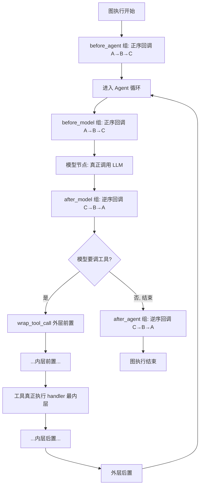

# 中间件钩子（Hooks）实现原理 + Java/SpringBoot AOP 等价实现

> 本文回答两个进阶问题：
> 1. **钩子到底是怎么实现的？框架"在生命周期节点自动触发钩子"具体是怎么做到的？**
> 2. **如果换成 Java + SpringBoot + AOP，同样的能力怎么落地？**
>
> 代码根目录：`backend/packages/harness/deerflow/`

---

## 第一部分：钩子机制到底是什么

### 1.1 先破除一个误解

很多人以为"钩子"是什么神秘的黑魔法。其实它非常朴素：

> **钩子（Hook）= 框架预先定义好的一批"空方法"，你（子类）覆写哪个，框架在跑到对应阶段时就回调哪个。**

这就是经典的**模板方法模式（Template Method）+ 回调（Callback）**。框架掌握"流程骨架"，把"骨架里的某几个点"开放出来让你填充——这些开放点就是钩子。

DeerFlow 的中间件全部继承 `AgentMiddleware` 基类。基类里这些钩子方法**默认什么都不做**（或返回 None）。你在子类里 `@override` 覆写它，框架就会在对应生命周期节点回调你的实现。

### 1.2 DeerFlow 里钩子的两种类型（关键区分）

看真实代码，DeerFlow 的中间件钩子分成**两大类**，机制不同：

#### 类型 A：状态钩子（State Hooks）——"观察 + 返回增量"

代表：`before_agent` / `before_model` / `after_model` / `after_agent`

**签名长这样**（真实代码，`thread_data_middleware.py:79`、`summarization_middleware.py:266`）：
```python
def before_model(self, state: AgentState, runtime: Runtime) -> dict | None:
    # 读 state，做处理
    # 返回 dict = 对 state 的"增量更新"；返回 None = 不改动
    return {"messages": new_messages}
```

**机制**：框架在每个节点**顺序调用**每个中间件的对应钩子，把返回的 `dict` 通过 **reducer（归并器）** 合并进全局 `state`。这就是为什么 `ThreadState` 每个字段都绑定了 `merge_xxx`（见 `thread_state.py`）——钩子返回的增量靠 reducer 合并。

- `before_*`：**正序**调用（链 A→B→C）
- `after_*`：**逆序**调用（链 C→B→A）

#### 类型 B：包装钩子（Wrap Hooks）——"洋葱包裹 + 显式放行"

代表：`wrap_tool_call` / `wrap_model_call`

**签名长这样**（真实代码，`tool_error_handling_middleware.py:122`）：
```python
def wrap_tool_call(
    self,
    request: ToolCallRequest,
    handler: Callable[[ToolCallRequest], ToolMessage | Command],  # ← 下一层
) -> ToolMessage | Command:
    # === 前置逻辑 ===
    try:
        result = handler(request)   # ← 显式调用下一层（放行），这就是洋葱的"穿透"
    except Exception as exc:
        return self._build_error_message(request, exc)  # ← 拦截异常，短路返回
    # === 后置逻辑 ===
    return normalize_tool_result(result)
```

**机制**：这就是**责任链 / 洋葱模型**的经典写法。每个 `wrap_tool_call` 拿到一个 `handler`（代表"内层所有中间件 + 最终的工具执行"），它可以：
- 在 `handler(request)` **之前**做前置处理（改 request、加锁、鉴权）；
- **决定是否调用** `handler`（不调 = 短路/拦截，如 `read_before_write_middleware.py:113` 的写入拦截）；
- 在 `handler(request)` **之后**做后置处理（改结果、捕获异常、埋点）。

> **对比记忆**：
> - **状态钩子** 像 Web 的"请求前置过滤器 + 响应后置过滤器"，各自独立执行，靠返回值影响共享状态。
> - **包装钩子** 像 Koa 的 `async (ctx, next) => { ...; await next(); ... }`，通过显式 `next()`（这里是 `handler`）把控制权交给下一层，形成嵌套包裹。

### 1.3 "框架自动触发"具体是怎么实现的？

这才是核心。"自动"不是魔法，拆开看是三步：

**第 1 步：框架扫描中间件列表，收集"实现了哪些钩子"**

`create_agent(middleware=[...])` 拿到中间件列表后，会检查每个中间件**覆写了哪些钩子方法**（Python 里就是判断该方法是否 ≠ 基类默认实现）。只有被覆写的钩子才会被编排进图。

**第 2 步：框架把钩子编织进 LangGraph 状态图的节点**

LangGraph 的 Agent 本质是一张**状态图（StateGraph）**，节点大致是：
```
[入口] → [before_agent 组] → [调模型节点(前置 before_model / 后置 after_model)]
       → [工具节点(被 wrap_tool_call 层层包裹)] → ...循环... → [after_agent 组] → [出口]
```
框架在编译图时，把"所有中间件的 before_model 钩子"**串成一段正序调用**、"所有 after_model 钩子"**串成一段逆序调用**，分别挂在模型节点的前后。包装钩子则**从外到内层层套上**工具执行，形成一个嵌套调用栈。

**第 3 步：图执行时，走到哪个节点就回调挂在那里的钩子**

当图被 `invoke`/`stream` 驱动时，执行引擎沿着节点走。走到模型节点前，就依次回调所有 `before_model`；模型返回后，逆序回调所有 `after_model`。这就是"在生命周期节点自动触发"的真相——

> **本质 = 框架把你的钩子方法，预先编排进了状态图的固定位置；图执行时经过那个位置，自然就回调了。没有反射轮询、没有事件总线，就是"编译期编织 + 运行期按图执行"。**

### 1.4 一张图看懂两类钩子如何协作



### 1.5 为什么这样设计（面试可讲的"为什么"）

| 设计选择 | 好处 |
|---------|------|
| 钩子默认空实现 | 中间件只覆写自己关心的阶段，不用管其它——**关注点分离** |
| 状态钩子返回增量 + reducer 合并 | 多个中间件可**并发/独立**修改同一 state 而不打架 |
| 包装钩子显式 `handler()` | 中间件能**决定是否放行**，天然支持"拦截/短路/改写"（如鉴权拒绝、写入门禁） |
| before 正序 / after 逆序 | 形成洋葱模型，**资源"先进后出"**（先加的锁后释放，先建的上下文后清理） |
| 编译期编织 | 运行期零反射开销，**性能好且顺序确定** |

---

## 第二部分：如果用 Java + SpringBoot + AOP 怎么实现

### 2.1 概念映射表（先建立对应关系）

| DeerFlow（Python） | Java / Spring 等价物 | 说明 |
|--------------------|---------------------|------|
| `AgentMiddleware` 基类 | 切面 `@Aspect` / 拦截器 `HandlerInterceptor` | 承载横切逻辑 |
| `before_model` 钩子 | `@Before` 通知 | 目标方法执行前 |
| `after_model` 钩子 | `@AfterReturning` / `@After` 通知 | 目标方法执行后 |
| `wrap_tool_call`（洋葱） | `@Around` 通知 + `ProceedingJoinPoint.proceed()` | 环绕，可决定是否放行 |
| `handler(request)` | `joinPoint.proceed()` | 显式调用下一层/目标 |
| 中间件顺序 | `@Order` 注解 / `Ordered` 接口 | 控制切面执行顺序 |
| `create_agent` 编织钩子 | Spring AOP 动态代理（JDK/CGLIB） | 运行期生成代理织入 |
| reducer 合并 state | 无直接对应（Spring 无共享 state 概念） | 需自行用 ThreadLocal/上下文对象模拟 |

**核心洞察**：
- DeerFlow 的**包装钩子 `wrap_tool_call`** ≈ Spring AOP 的 **`@Around` 环绕通知**——两者都通过"显式调用下一层"（`handler` / `proceed()`）实现洋葱包裹和短路控制。
- DeerFlow 的**状态钩子 `before/after_model`** ≈ Spring 的 **`@Before`/`@After` 通知** 或 **拦截器 `preHandle`/`postHandle`**。

### 2.2 用 `@Around` 复刻 `wrap_tool_call`（洋葱模型）

假设我们要给"工具执行"做统一的错误处理、鉴权、埋点，等价于 DeerFlow 的三个 `wrap_tool_call` 中间件叠加。

**定义目标：工具执行服务**
```java
@Service
public class ToolExecutor {
    public ToolResult execute(ToolCallRequest request) {
        // 真正的工具执行逻辑（相当于最内层 handler）
        return realToolInvoke(request);
    }
}
```

**切面 1：错误处理（等价 ToolErrorHandlingMiddleware）**
```java
@Aspect
@Component
@Order(30)   // 数字越大越靠"内层"（越晚执行前置、越早执行后置），用 @Order 精确控制洋葱层次
public class ToolErrorHandlingAspect {

    @Around("execution(* com.example.ToolExecutor.execute(..))")
    public Object handle(ProceedingJoinPoint pjp) throws Throwable {
        ToolCallRequest req = (ToolCallRequest) pjp.getArgs()[0];
        try {
            // 前置逻辑（可选）
            Object result = pjp.proceed();   // ← 等价 handler(request)：放行到下一层
            // 后置逻辑
            return normalize(result);
        } catch (GraphBubbleUp e) {
            throw e;                          // 保留控制流信号
        } catch (Exception ex) {
            log.error("Tool failed: {}", req.getName(), ex);
            return buildErrorMessage(req, ex);  // ← 拦截异常，短路返回，不再抛出
        }
    }
}
```

**切面 2：写入门禁（等价 ReadBeforeWriteMiddleware，演示"短路不放行"）**
```java
@Aspect
@Component
@Order(20)   // 比错误处理更外层
public class WriteGateAspect {

    @Around("execution(* com.example.ToolExecutor.execute(..))")
    public Object gate(ProceedingJoinPoint pjp) throws Throwable {
        ToolCallRequest req = (ToolCallRequest) pjp.getArgs()[0];
        if (isWriteTool(req) && !hasBeenRead(req.getPath())) {
            // 不调用 pjp.proceed() —— 直接短路，等价 DeerFlow 里 return blocked
            return ToolResult.blocked("必须先读取文件再写入");
        }
        return pjp.proceed();   // 放行
    }
}
```

> **关键对应**：Spring `@Around` 里"调不调 `pjp.proceed()`"完全等价于 DeerFlow "调不调 `handler(request)`"。这是两者能互相映射的根本原因——**都是责任链上"是否放行"的控制权**。

### 2.3 用拦截器/通知复刻 `before_model` / `after_model`（状态钩子）

状态钩子更像 Spring MVC 的 **`HandlerInterceptor`**（有天然的 pre/post 双阶段）：

```java
@Component
public class SummarizationInterceptor implements HandlerInterceptor {

    @Override
    public boolean preHandle(HttpServletRequest req, HttpServletResponse resp, Object handler) {
        // 等价 before_model：调模型前压缩上下文
        AgentContext ctx = AgentContextHolder.get();   // 用 ThreadLocal 模拟共享 state
        if (ctx.tokenCount() > THRESHOLD) {
            ctx.setMessages(summarize(ctx.getMessages()));
        }
        return true;   // 返回 false = 短路，等价 DeerFlow 拦截
    }

    @Override
    public void postHandle(...) {
        // 等价 after_model：模型返回后处理
    }
}
```

注册并控制顺序：
```java
@Configuration
public class WebConfig implements WebMvcConfigurer {
    @Override
    public void addInterceptors(InterceptorRegistry registry) {
        // 注册顺序 = preHandle 正序 / postHandle 逆序，天然的洋葱模型！
        registry.addInterceptor(new ThreadDataInterceptor()).order(0);
        registry.addInterceptor(new SummarizationInterceptor()).order(6);
        registry.addInterceptor(new ClarificationInterceptor()).order(99); // 永远最后
    }
}
```

> **注意**：Spring MVC 拦截器的 `preHandle` 正序、`postHandle` 逆序，**和 DeerFlow 的 before 正序 / after 逆序完全一致**——都是洋葱模型。这不是巧合，是同一套"责任链 + 环绕"思想的不同语言实现。

### 2.4 三种技术触发钩子的底层机制对比（最能体现深度）

| 维度 | DeerFlow（LangGraph 中间件） | Spring AOP | Spring MVC 拦截器 |
|------|----------------------------|-----------|------------------|
| **织入时机** | 编译状态图时静态编排 | 运行期生成动态代理（JDK 动态代理 / CGLIB 字节码增强） | 请求分发时按注册顺序调用 |
| **触发原理** | 图执行到节点 → 回调挂在该节点的钩子 | 调用代理对象方法 → 代理拦截 → 依次调用切面链 | DispatcherServlet 遍历拦截器链 |
| **是否用反射** | 否（编译期编织） | 是（动态代理基于反射/字节码） | 否（直接方法调用） |
| **放行控制** | `handler(request)` | `joinPoint.proceed()` | `preHandle` 返回 boolean |
| **顺序控制** | 代码 append 顺序 + @Next/@Prev | `@Order` / `Ordered` | `.order(n)` |
| **共享状态** | LangGraph state + reducer | 无（需 ThreadLocal 自建） | 无（需 request 属性/ThreadLocal） |

### 2.5 SpringBoot 完整落地骨架（可直接作为面试项目）

如果你要把这套 Agent 中间件思想搬到 Java 项目，推荐架构：

```
AgentRunController (入口)
      │
      ▼
AgentPipeline (等价 create_agent 编排)
   ├── List<AgentMiddleware>  (按 @Order 排序注入)
   └── execute(state):
         1. 正序调 middleware.beforeModel(state)   ← 状态钩子
         2. 用 @Around 切面包裹 modelCall()/toolCall()  ← 包装钩子(洋葱)
         3. 逆序调 middleware.afterModel(state)
      │
      ▼
ModelService / ToolExecutor (被切面环绕的目标)
```

**统一中间件接口（自定义，不依赖 Spring AOP 也能实现洋葱）**
```java
public interface AgentMiddleware extends Ordered {
    default AgentState beforeModel(AgentState s) { return s; }   // 默认空实现=钩子
    default AgentState afterModel(AgentState s)  { return s; }
    // 洋葱包装：自己拿 chain.next() 决定是否放行
    default ToolResult wrapToolCall(ToolCallRequest req, ToolChain chain) {
        return chain.next(req);   // 等价 handler(request) / proceed()
    }
}
```

**手写责任链（不用 Spring AOP，纯 Java 复刻洋葱）**
```java
public class ToolChain {
    private final List<AgentMiddleware> middlewares;
    private final ToolExecutor executor;
    private int index = 0;

    public ToolResult next(ToolCallRequest req) {
        if (index < middlewares.size()) {
            AgentMiddleware mw = middlewares.get(index++);
            return mw.wrapToolCall(req, this);   // 递归下探，形成洋葱
        }
        return executor.execute(req);            // 最内层：真正执行
    }
}
```

> 这个 `ToolChain.next()` 就是 DeerFlow `handler` 的 Java 手写版——**责任链 + 递归下探**，是 Koa/Express/Gin 中间件、Netty ChannelPipeline、MyBatis 插件链的同款套路。

### 2.6 选型建议（面试可答"什么时候用哪种"）

| 场景 | 推荐 |
|------|------|
| 只需在若干方法前后加通用逻辑（日志/事务/鉴权） | Spring AOP `@Around`——声明式、无侵入 |
| Web 请求级的前后处理 | Spring MVC 拦截器——天然 pre/post |
| 需要精确控制"是否放行 + 顺序 + 共享状态"的复杂流水线 | **手写责任链**（如上）——最灵活，DeerFlow 走的就是这条路 |
| 极致性能、顺序完全确定 | 编译期/启动期编织（如 DeerFlow 的静态图） |

---

## 第三部分：一句话总结（面试收尾）

> "钩子的本质是**模板方法 + 责任链**：框架掌握流程骨架，把关键节点开放成默认空的钩子方法；子类覆写即插入逻辑。DeerFlow 用两类钩子——**状态钩子**（返回增量、靠 reducer 合并，before 正序/after 逆序）和**包装钩子**（显式调 `handler` 放行、可短路，就是洋葱模型）。所谓'框架自动触发'不是反射轮询，而是**框架在编译状态图时把钩子静态编排进固定节点，运行时按图执行经过节点自然回调**。换成 Java，`wrap_tool_call` 对应 Spring AOP 的 `@Around` + `proceed()`，`before/after_model` 对应 MVC 拦截器的 `preHandle`/`postHandle`；而要完整复刻'可短路 + 可排序 + 共享状态'的能力，最贴切的是**手写责任链**——这也是 Koa、Netty、MyBatis 插件的同一套思想。"

---

> 代码证据：`tool_error_handling_middleware.py:122`（wrap_tool_call 洋葱写法）、`read_before_write_middleware.py:113`（短路不放行）、`summarization_middleware.py:266`（before_model 状态钩子）、`thread_state.py`（reducer 合并）。配套文档见同目录 `DeerFlow-中间件链设计-深度讲解.md`。