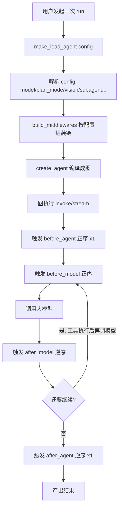
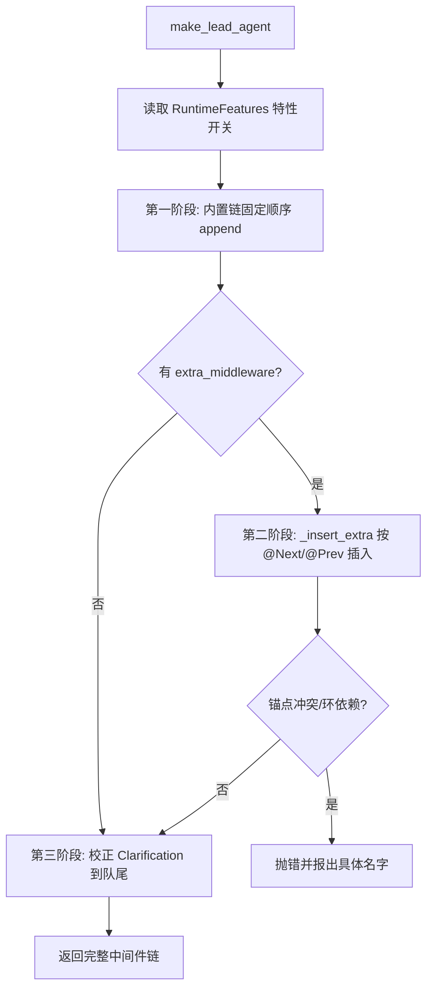
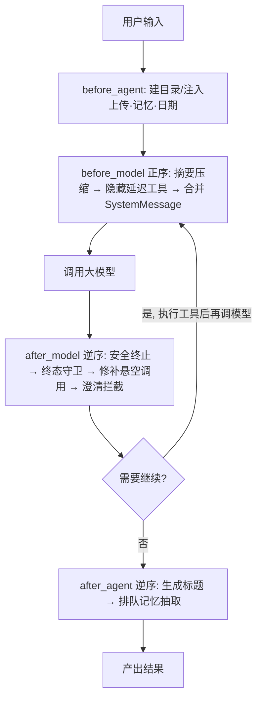
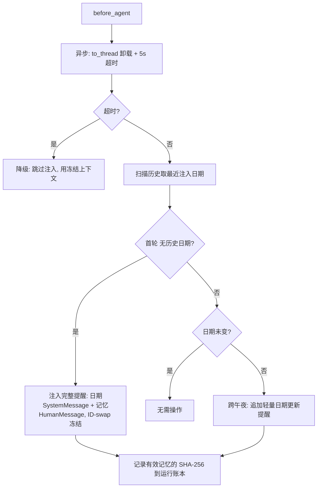

# Agent 中间件链（Middleware Chain）设计与实现 — 面试深度讲解

> 面向面试准备的完整拆解：业务背景 → 业务难点 → 技术难点 → 技术亮点 → 技术方案 → 面试话术 → 业务流程图。
> 代码根目录：`backend/packages/harness/deerflow/`

---

## 〇、一句话电梯陈述（先背这段）

> "我做的是一个 AI Agent 运行时里的**中间件链（Middleware Chain）**。它把 Agent 每一次'调用大模型 / 执行工具'的生命周期切成若干个钩子（before_agent / before_model / after_model / after_agent），让沙箱、记忆、上下文压缩、安全守卫、死循环检测等**横切关注点**以**可插拔、可排序、可组合**的方式解耦。核心解决三个问题：**长任务下的上下文与成本失控、多关注点的耦合与顺序依赖、大模型/工具调用的不可靠性容错**。整条链有 14+ 个中间件，通过一套 `@Next`/`@Prev` 声明式定位算法自动装配，并保证若干关键不变量（如澄清中间件永远在最后、安全中间件在 after_model 反向分发中最先执行）。"

---

## 一、业务背景

### 1.1 Agent 是什么样的执行流

一个 AI Agent 的一次运行，本质是一个循环：

```
用户输入 → [调大模型决策] → [执行工具] → 观察结果 → [再调大模型] → ... → 产出结果
```

在这个循环外围和每一步之间，有大量"与业务无关但必须做"的事情：

- 运行前要准备好隔离的工作目录、沙箱、把上传文件塞进上下文；
- 每次调模型前要注入当前日期、用户记忆、控制 token 预算；
- 每次模型返回后要处理异常终止、修补悬空工具调用、检测死循环；
- 运行结束后要生成会话标题、异步抽取记忆。

### 1.2 为什么需要"中间件链"这个抽象

如果把这些逻辑全写进 Agent 主循环，会得到一个几千行、无法维护、无法测试、无法按场景裁剪的巨型函数。中间件链的目标就是：

> **把 Agent 生命周期的横切关注点，拆成一个个独立、有序、可组合的钩子单元。**

这与 Web 框架的中间件（如 Koa/Express/Gin 的 middleware、Java 的 Filter 链、Python 的 WSGI middleware）是同一思想，但**运行在 LLM Agent 的生命周期上**，而不是 HTTP 请求上。

### 1.3 落地场景

- **Web UI / IM 渠道 / TUI / 嵌入式 SDK** 四种入口共享同一条链（`build_middlewares` 是跨模块的稳定入口，见 `agents/lead_agent/agent.py:242`）。
- 不同场景通过**特性开关**裁剪链：如非交互的定时任务禁用澄清工具，不支持视觉的模型不挂载图片中间件。

---

## 二、业务难点

| # | 业务难点 | 具体表现 |
|---|---------|---------|
| 1 | **长任务上下文爆炸** | 一个研究任务可能跑几十轮、几小时，上下文无限增长，撞爆 token 窗口、成本飙升 |
| 2 | **多入口一致性** | Web/IM/TUI/SDK 四个入口必须表现一致，不能各写一套逻辑 |
| 3 | **能力按场景裁剪** | 交互场景要"澄清提问"，定时任务不能有；视觉模型才需要图片处理 |
| 4 | **成本敏感** | 面向 token 计费的模型，任何冗余上下文都是真金白银 |
| 5 | **可扩展性** | 社区/自定义要能插入自己的中间件，且不能破坏内置链的关键顺序 |

---

## 三、技术难点（面试官最爱追问的部分）

### 难点 1：中间件的**执行顺序**极其敏感，且前后钩子顺序相反

LangChain 的中间件有多个钩子，`after_model` 是**逆序分发**的。也就是说：

- `before_model`：按链的**正序**执行（A→B→C）
- `after_model`：按链的**逆序**执行（C→B→A）

这导致"我想让某个中间件在模型返回后**最先**处理"，就必须把它放在链的**靠后**位置。代码里有真实案例（`agent.py:411-418`）：

> `SafetyFinishReasonMiddleware` 被**故意注册在** `TerminalResponseMiddleware` 和自定义中间件**之后**，这样在 `after_model` 的逆序分发中它**最先执行**——先清掉被安全终止的 tool_calls，后续的记账/终态守卫才不会误报警。

**这是典型的"顺序即正确性"难点。**

### 难点 2：可扩展插入不能破坏关键不变量

允许外部插入中间件（`extra_middleware`），但必须保证：
- `ClarificationMiddleware`（澄清）**永远在最后**——否则澄清中断会被后续中间件干扰；
- 若外部用 `@Next(ClarificationMiddleware)` 想插到它后面，会把它挤下队尾，必须检测并纠正（`factory.py:322-326`）。

### 难点 3：并发下的事件循环阻塞

中间件里有同步文件 I/O（读记忆 JSON）和潜在的网络阻塞（首次 tiktoken 编码下载）。如果直接在异步路径里同步执行，会**阻塞整个事件循环**，饿死所有并发 HTTP handler（认证、SSE 心跳等）。见 `dynamic_context_middleware.py` 的 `abefore_agent`（issue #3402）。

### 难点 4：注入内容的**安全信任边界**

给模型注入"记忆"时，记忆内容是用户可影响的（untrusted）。若把它当作 SystemMessage 注入，等于让不可信内容获得系统权限（OWASP LLM01 提示注入）。

### 难点 5：注入内容不能破坏 prefix-cache（前缀缓存）

大模型的前缀缓存要求"系统提示前缀完全一致"才能命中。如果每轮把动态的日期/记忆拼进系统提示，前缀每次都变，**缓存永远打不中**，成本大增。

---

## 四、技术亮点（你的加分项）

### 亮点 1：`@Next` / `@Prev` 声明式中间件定位系统

**代码**：`agents/features.py:47`（装饰器）+ `agents/factory.py:336`（`_insert_extra` 插入算法）

不用手工维护整条链的下标，外部中间件只需声明"我要在 X 之后 / 之前"：

```python
@Next(SandboxMiddleware)
class MyMiddleware(AgentMiddleware): ...
```

插入算法的精彩之处（`factory.py:336-409`）：
1. **冲突检测**：两个中间件锚定同一目标（同向或反向）直接报错；
2. **迭代插入**：支持"外部中间件锚定另一个外部中间件"（跨外部锚定），用最多 N+1 轮迭代解析；
3. **环检测**：若一轮下来没有任何一个能插入，判定为循环依赖并报出具体名字。

这是一个小型的**依赖拓扑排序**，是面试里能讲很久的算法亮点。

### 亮点 2：ID-Swap + 冻结快照，兼顾"动态注入"和"前缀缓存命中"

**代码**：`dynamic_context_middleware.py` 的 `_make_reminder_and_user_messages`

核心手法：
- 第一轮对话时，把日期/记忆作为独立的 `<system-reminder>` 消息**预置到第一条用户消息前，并复用原消息 ID（ID-swap）**，让 `add_messages` reducer **原地替换**。
- 此后**第一条消息内容被冻结**，整个会话再也不变——于是**系统提示保持完全静态，前缀缓存每轮都能命中**。
- 跨越午夜时才追加一条轻量"日期更新"提醒。

### 亮点 3：安全的角色隔离（OWASP LLM01）

**代码**：同上 `_build_full_reminder` / `_make_reminder_and_user_messages`

- **框架拥有的数据（日期）** → 放进 `SystemMessage`（有系统权威）；
- **用户可影响的数据（记忆）** → 故意放进 `HumanMessage`（`{id}__memory`），**绝不给它系统权限**；
- 日期检测不用正则扫描 content，而是读 `additional_kwargs` 里的 `reminder_date`，**防止用户在消息里伪造 `<current_date>` 骗过检测**（date-spoofing）。

### 亮点 4：事件循环友好 + 超时降级

**代码**：`dynamic_context_middleware.py:abefore_agent`

- 用 `asyncio.to_thread` 把同步 I/O 卸载到线程，不阻塞事件循环；
- 用 `asyncio.wait_for` 加 5 秒超时上限：万一冷启动 tiktoken 下载卡住（OS TCP 超时可达 26 分钟），**优雅降级**——本轮跳过新注入，用已冻结的上下文继续，而不是把请求挂死。

### 亮点 5：SystemMessage 合并适配严格后端

**代码**：`system_message_coalescing_middleware.py`（`agent.py:379` 注册）

vLLM / SGLang / Qwen / Anthropic 等严格后端**拒绝非首位的 SystemMessage**。中间件在请求到达 provider 前把所有 SystemMessage 合并成一条前置的——这是**兼容性适配层**的典型价值。

### 亮点 6：全链容错闭环

- `DanglingToolCallMiddleware`：中断的 tool-call 注入占位结果，防止严格校验 `tool_call_id` 的模型报"历史损坏"；
- `ToolErrorHandlingMiddleware`：工具异常转 `ToolMessage`，模型能感知并恢复；
- `TerminalResponseMiddleware`：模型返回空 AIMessage 时重试一次，否则给可见错误而非"静默成功"；
- `LoopDetectionMiddleware` / `TokenBudgetMiddleware`：死循环与预算硬约束。

---

## 五、技术方案

### 5.1 核心抽象：钩子（Hooks）

每个中间件继承 `AgentMiddleware`，可实现以下生命周期钩子（同步/异步成对）：

| 钩子 | 触发时机 | 分发顺序 | 典型用途 |
|------|---------|---------|---------|
| `before_agent` / `abefore_agent` | 整个运行开始前 | 正序 | 建目录、注入上传/记忆/日期 |
| `before_model` / `abefore_model` | 每次调模型前 | 正序 | 摘要压缩、隐藏延迟工具、合并 SystemMessage |
| `after_model` / `aafter_model` | 每次模型返回后 | **逆序** | 安全终止、修补悬空调用、终态检查、记账 |
| `after_agent` / `aafter_agent` | 整个运行结束后 | 逆序 | 生成标题、排队记忆抽取 |

> **关键认知**：`before_*` 正序、`after_*` 逆序，像"洋葱模型"——请求穿入是正序，响应穿出是逆序。这是所有顺序推理的基础。

### 5.2 两层装配策略

**代码**：`factory.py` 的 `_assemble_from_features`

```
第一阶段：内置链固定顺序 append（0~14 号位）
第二阶段：外部 extra_middleware 用 @Next/@Prev 插入
第三阶段：校正不变量（Clarification 必须在最后）
```

内置链的装配用**特性开关三态**（`features.py:17`）：
- `False`：跳过；
- `True`：用内置默认实现；
- `AgentMiddleware` 实例：用自定义实现替换。

这让"裁剪 / 替换 / 扩展"统一到一个数据结构里。

### 5.3 `_insert_extra` 插入算法（核心算法，务必讲清）

**代码**：`factory.py:336-409`

```
输入：内置 chain（已排好）、extras（带 @Next/@Prev 锚点）
步骤：
1) 分类：把 extras 分成 anchored（有锚点）和 unanchored（无锚点）
2) 校验：
   - 同一个中间件不能同时有 @Next 和 @Prev
   - 两个 extra 锚定同一目标（同向或反向）→ 冲突报错
3) unanchored → 统一插到 ClarificationMiddleware 之前
4) anchored → 迭代插入（最多 N+1 轮）：
   - 每轮扫描 pending，能在 chain 中找到锚点的就插入
   - 支持"锚点是另一个 extra"（跨外部锚定）
   - 若某一轮 pending 数量没减少 → 检测环 → 报出循环依赖名字
5) 校正：若 Clarification 被挤离队尾，pop 出来重新 append
```

**复杂度**：最坏 O(N²)（N 为 extras 数），因为每轮要扫 chain 找锚点。N 通常个位数，可接受。

### 5.4 关键中间件的实现要点

| 中间件 | 钩子 | 实现要点 | 代码 |
|--------|------|---------|------|
| DynamicContextMiddleware | before_agent | ID-swap 冻结快照 + 角色隔离 + 超时降级 | `dynamic_context_middleware.py` |
| SummarizationMiddleware | before_model | 接近 token 上限时压缩旧消息 | `summarization_middleware.py` |
| DanglingToolCallMiddleware | before_model | 为悬空 tool_call 注入占位 ToolMessage | `dangling_tool_call_middleware.py` |
| SystemMessageCoalescingMiddleware | before_model | 合并多条 SystemMessage 为首位一条 | `system_message_coalescing_middleware.py` |
| SafetyFinishReasonMiddleware | after_model | 清空被安全终止的 tool_calls（逆序最先跑） | `safety_finish_reason_middleware.py` |
| TerminalResponseMiddleware | after_model | 空响应重试一次，否则可见报错 | `terminal_response_middleware.py` |
| ClarificationMiddleware | after_model | 拦截澄清请求并中断（永远最后） | `clarification_middleware.py` |

### 5.5 落地的 14+ 号位内置链（`make_lead_agent` 实际顺序）

```
0  ThreadDataMiddleware          建每线程隔离目录
1  UploadsMiddleware             注入上传文件
2  SandboxMiddleware             获取沙箱
3  DanglingToolCallMiddleware    修补悬空工具调用
4  ToolErrorHandling(runtime)    工具异常转消息
5  DynamicContextMiddleware      注入日期/记忆（前缀缓存友好）
6  SkillActivationMiddleware     /skill 激活加载 SKILL.md
7  SkillToolPolicyMiddleware     技能 allowed-tools 策略
8  DurableContextMiddleware      压缩前捕获委派/技能，注入耐久上下文
9  SummarizationMiddleware       上下文压缩（可选）
10 TodoMiddleware                规划模式（可选）
11 TokenUsageMiddleware          token 计量（可选）
12 TitleMiddleware               自动标题
13 MemoryMiddleware              异步记忆抽取
14 ViewImageMiddleware           视觉模型注入图片（条件）
15 McpRouting / DeferredFilter   延迟工具路由与过滤
16 SystemMessageCoalescing       合并 SystemMessage
17 SubagentLimitMiddleware       子智能体数量约束
18 LoopDetectionMiddleware       死循环检测
19 TokenBudgetMiddleware         token 预算硬约束
20 (custom middlewares)          自定义
21 TerminalResponseMiddleware    终态守卫
22 SafetyFinishReasonMiddleware  安全终止（after_model 逆序最先）
23 ClarificationMiddleware       澄清中断（永远最后）
```

> 注意 22 号位在 21 号位之后注册，正是为了让它在 `after_model` 逆序分发中**最先**执行。

---

## 五·补、配置机制与调用时机（面试高频，务必讲清）

### 5B.1 中间件链是怎么配置的？是硬编码顺序吗？

**结论：混合模式 —— "硬编码骨架顺序 + 运行时配置驱动开关/替换/裁剪"，不是纯硬编码。**

分三个层面（都在 `agent.py:242` 的 `build_middlewares` 里）：

**① 顺序：硬编码（代码即顺序）**

中间件的相对顺序由代码里 `middlewares.append(...)` 的**书写先后**决定，**不从 config.yaml 读**。例如：
```python
middlewares.append(SystemMessageCoalescingMiddleware())   # agent.py:379/381
...
middlewares.append(ClarificationMiddleware())             # agent.py:421 永远最后
```
为什么顺序不开放给配置？因为顺序涉及**正确性不变量**（如安全中间件靠后注册，才能在 `after_model` 逆序分发中最先执行）。开放给用户配置 = 把灾难开关交给用户，所以**故意硬编码**。

**② 是否挂载：配置驱动（每个环节一个 if 网关）**

每个中间件外面都有一个条件网关，条件来自 `AppConfig` 或运行时 `config["configurable"]`：
```python
if resolved_app_config.token_usage.enabled:   middlewares.append(TokenUsageMiddleware())   # agent.py:339
if is_plan_mode:                               ... TodoMiddleware ...                        # agent.py:334
if model_config.supports_vision:               ... ViewImageMiddleware ...                   # agent.py:356
if loop_detection_config.enabled:              ... LoopDetectionMiddleware ...              # agent.py:392
if token_budget_config.enabled:                ... TokenBudgetMiddleware ...                # agent.py:397
```
配置控制的是**开 / 关**，而非顺序。

**③ 用哪个实现：可配置替换 / 插入**

SDK 层的 `RuntimeFeatures`（`features.py:17`）对每个特性支持**三态**：
- `False` → 跳过
- `True` → 用内置默认实现
- 传一个 `AgentMiddleware` 实例 → 用自定义实现替换

外部还能用 `@Next`/`@Prev`（`features.py:47`）声明式插入自定义中间件。

> **一句话**：核心内置链的**顺序硬编码**（涉及正确性，不能配），但**每个环节的启用与否、可选的自定义替换/插入是配置驱动**的。

### 5B.2 执行逻辑是硬编码在中间件链里吗？

**不是。** 中间件本身**只声明钩子**（`before_agent`/`before_model`/`after_model`/`after_agent`），**真正的调度执行引擎属于 LangChain/LangGraph 的 `create_agent`**（`agent.py:640`）。

DeerFlow 做的只是"把一个**有序的中间件列表**交给 `create_agent`"，由框架负责按洋葱模型分发（before 正序、after 逆序）。DeerFlow **利用**这个"注册顺序 → 执行顺序"的规则来编排，但执行引擎不是它自己写的。

### 5B.3 中间件链什么时候被调用？（构建时机 ≠ 调用时机）

**构建时机（每次运行前，现场组装）：**
```
用户发起一次 run
  → LangGraph 调用图工厂 make_lead_agent(config)          # agent.py:447
  → _make_lead_agent 读 config 解析 模型/plan_mode/vision   # agent.py:454 起
  → build_middlewares(...) 按当次配置组装中间件链          # agent.py:643
  → create_agent(model, tools, middleware=..., ...) 编译图  # agent.py:640
```
`make_lead_agent` 是 LangGraph 的**图工厂**，每次 run 按**当次** `config` 现场组装。所以同一个用户 plan_mode 开/关、换个 vision 模型，得到的链是**不同**的 —— 这正是"配置驱动裁剪"的落地点。

**调用时机（运行期间反复触发）：** 编译出的图被 `invoke`/`stream` 执行时，框架在 Agent 生命周期的对应节点**自动触发**各中间件钩子：

| 生命周期节点 | 触发的钩子 | 分发顺序 | 一次 run 内触发次数 |
|-------------|-----------|---------|------------------|
| 运行开始 | `before_agent` | 正序 | 1 次 |
| 每次调大模型前 | `before_model` | 正序 | **多次**（每轮一次） |
| 每次模型返回后 | `after_model` | 逆序 | **多次**（每轮一次） |
| 运行结束 | `after_agent` | 逆序 | 1 次 |

由于 Agent 是"调模型 → 执行工具 → 再调模型"的循环，`before_model`/`after_model` 在一次 run 内会被**触发多轮**。

### 5B.4 构建/调用时序图



---

## 六、面试话术

### 6.1 项目介绍（STAR：Situation-Task-Action-Result）

> **S**：我在做一个 AI Agent 运行时，Agent 会自主调大模型和工具跑几十轮、可能几小时的长任务。
> **T**：这类长任务有三个核心痛点——上下文/成本失控、多横切关注点耦合、模型和工具调用不可靠。我负责设计并实现串起整个 Agent 生命周期的**中间件链**。
> **A**：我把生命周期切成 before/after_agent、before/after_model 四类钩子，用洋葱模型组织 20+ 个中间件；设计了 `@Next/@Prev` 声明式定位算法自动装配并保证关键不变量；在上下文注入上用 ID-swap 冻结快照命中前缀缓存、用角色隔离防提示注入、用线程卸载+超时防事件循环阻塞。
> **R**：最终一条链被 Web/IM/TUI/SDK 四个入口复用，长任务稳定运行、token 成本显著下降，新关注点可插拔接入而不动核心代码。

### 6.2 高频追问与应答

**Q：为什么不直接写在主循环里？**
A：横切关注点有 20+ 个，写在一起是几千行的巨型函数，无法测试、无法按场景裁剪、无法扩展。中间件把每个关注点解耦成独立单元，可单测、可开关、可替换、可扩展——本质是 AOP（面向切面）思想在 Agent 生命周期上的落地。

**Q：中间件顺序为什么重要？举个例子。**
A：`after_model` 是逆序分发的。安全终止中间件必须在模型返回后**最先**清掉被安全策略截断的 tool_calls，否则后续记账、终态守卫会对这些"半截"调用误报警。所以我把它**故意注册在靠后**，利用逆序让它最先跑。这是"注册顺序 ≠ 执行顺序"的经典陷阱。

**Q：前缀缓存那块具体怎么做的？**
A：难点是"既要每轮注入动态的日期/记忆，又要系统提示前缀完全不变"。我的做法是——只在第一轮把动态内容作为独立的 system-reminder 消息**预置**到首条用户消息前，并**复用原消息 ID** 让 reducer 原地替换，之后这条消息**冻结不再变**。系统提示本身始终静态，所以前缀缓存每轮都命中。跨午夜才追加一条轻量日期更新。

**Q：注入记忆有什么安全风险？怎么防？**
A：记忆内容是用户可影响的。如果当 SystemMessage 注入，等于让不可信内容拿到系统权限，就是 OWASP LLM01 提示注入。我把框架数据（日期）放 SystemMessage、把用户记忆放 HumanMessage，严格角色隔离；日期检测读结构化字段而非正则扫 content，防止用户伪造 `<current_date>` 骗过检测。

**Q：异步里同步 I/O 有什么坑？**
A：中间件要读记忆 JSON、首次可能触发 tiktoken 下载。直接同步执行会阻塞事件循环，饿死所有并发请求。我用 `asyncio.to_thread` 卸载到线程，并用 `wait_for` 加 5 秒超时——冷启动网络卡住时优雅降级（跳过本轮注入用冻结上下文继续），而不是把请求挂死几十分钟。

**Q：可扩展插入怎么保证不破坏关键顺序？**
A：`@Next/@Prev` 插入算法做了三件事：拒绝同时带两个锚点、检测锚定冲突、迭代解析并检测环依赖。最后还有一道兜底——校验 ClarificationMiddleware 是否被挤离队尾，若是就重新放回队尾，保证"澄清永远最后"这个不变量。

**Q：中间件链的顺序是硬编码还是配置的？**
A：混合。核心内置链的**相对顺序是硬编码**的——由代码里 append 的先后决定，不从 config 读，因为顺序涉及正确性不变量（比如安全中间件靠后注册才能在 after_model 逆序里最先跑），开放给配置等于把灾难开关交给用户。但**每个环节是否挂载是配置驱动**的：每个中间件外面都有一个 if 网关，条件来自 AppConfig 或运行时 configurable，比如 plan_mode 才挂 Todo、vision 模型才挂图片中间件。SDK 层还支持三态开关和自定义替换/插入。一句话：顺序硬编码、开关和替换配置化。

**Q：执行调度逻辑是你自己写的吗？**
A：不是。中间件只声明钩子（before/after_agent、before/after_model），真正的分发引擎是 LangChain/LangGraph 的 create_agent。我做的是把一个有序中间件列表交给它，由框架按洋葱模型分发。我利用的是"注册顺序→执行顺序"这个规则来编排。

**Q：中间件链什么时候被构建、什么时候被调用？**
A：要区分构建时机和调用时机。构建：每次 run 前，LangGraph 调图工厂 make_lead_agent(config)，它读当次 config 解析模型/plan_mode/vision，调 build_middlewares 现场组装链，再 create_agent 编译成图——所以同一用户不同配置得到的链是不同的。调用：编译出的图被 invoke/stream 执行时，框架在生命周期节点自动触发钩子；before_agent/after_agent 各一次，而 before_model/after_model 因为 Agent 是"调模型→执行工具→再调模型"的循环，一次 run 内会触发多轮。

**Q：这套设计的局限 / 你会怎么改进？**
A：局限一是顺序靠人工推理+注释维护，容易出错，可以引入声明式依赖 + 启动时拓扑校验；二是插入算法 O(N²)，虽然 N 小但可优化为建锚点索引；三是钩子内异常隔离目前靠各中间件自律，可以做统一的错误边界与降级策略。

### 6.3 一句话总结（结尾用）

> "这套中间件链的价值在于：用一套可插拔、可排序、可组合的钩子体系，把 Agent 长任务运行中所有'脏活累活'——上下文管理、成本优化、安全隔离、容错恢复——从主流程里彻底解耦出来，让核心 Agent 逻辑保持干净，同时支撑四种入口复用和无限扩展。"

---

## 七、业务流程图

### 7.1 中间件链装配流程



### 7.2 一次模型调用的洋葱模型（before 正序 / after 逆序）



### 7.3 DynamicContextMiddleware 注入决策流程



---

> 代码位置均以 `backend/packages/harness/deerflow/` 为根。建议面试前把 `factory.py`（装配算法）、`dynamic_context_middleware.py`（注入与安全）、`agent.py:242-422`（真实链顺序）三处源码通读一遍，能应对绝大多数追问。相关文档见同目录 `DeerFlow-Agent核心模块讲解.md`。

---

# 附：大厂 SSP 面试终极宝典（结合代码逐条拆解）

> 以下章节全部基于本仓库真实代码。凡代码未实现的能力，均明确标注「代码中没有实现该能力，不能回答成实际做过」。禁止编造业务与虚构优化。

## 八、简历逐句拆解

### 8.1 «设计并实现 AI Agent 运行时的可插拔中间件链，将沙箱/记忆/上下文压缩/安全守卫/死循环检测等横切关注点解耦为 20+ 个有序钩子单元»

- **这句话真正表达了什么**：你在 Agent 生命周期上做了一套 AOP（面向切面）编排，把非业务的「脏活」从主循环剥离。核心动词是「设计并实现」+「可插拔」+「有序」。
- **为什么写这句话**：一句话覆盖三个考点——架构抽象能力（切面/洋葱模型）、工程规模感（20+ 个）、可维护性思维（解耦）。
- **删掉这句的影响**：简历会退化成「用了 LangChain 做 Agent」，失去架构深度信号，面试官会认为你只是 API 调用者。
- **最容易被问**：「20+ 个中间件的顺序是谁定的？为什么这个顺序？」（见 `factory.py:_assemble_from_features`、`agent.py:242`）。
- **最危险的问题**：「顺序错了会怎样？举一个真实例子。」——如果答不出 `SafetyFinishReasonMiddleware` 靠后注册利用 `after_model` 逆序最先执行（`agent.py:411-418`、`safety_finish_reason_middleware.py:26-32`），会被判定为「没真正做过」。
- **隐藏知识点**：LangChain `after_model` 逆序分发；洋葱模型；拓扑排序插入算法（`factory.py:336`）。
- **可主动引导面试官**：「其中最难的是顺序即正确性，我可以讲一个安全中间件靠后注册反而最先执行的例子」——把话题引到你最熟的 `SafetyFinishReasonMiddleware`。

### 8.2 «设计 @Next/@Prev 声明式定位算法，支持外部中间件按锚点自动装配，并做冲突检测与环依赖检测»

- **真正表达**：你实现了一个小型依赖拓扑排序，让扩展方无需知道链下标即可插入。
- **为什么写**：这是纯算法亮点，能撑起 10 分钟白板讲解（`factory.py:336-409` 的 `_insert_extra`）。
- **删掉的影响**：失去「可扩展性 + 算法」双重信号。
- **最容易被问**：「你的插入算法复杂度？环怎么检测？」——答 O(N²)（每轮扫 chain 找锚点），环检测靠「一轮 pending 数量没减少则判环」（`factory.py:398-406`）。
- **最危险的问题**：「为什么不用真正的拓扑排序（Kahn 算法）？」——需说明 N 是个位数，迭代解析更简单且能支持「外部锚定外部」的跨引用。
- **隐藏知识点**：类属性 `_next_anchor`/`_prev_anchor`（`features.py:47-71`）通过装饰器写入 `cls`，而非实例。

### 8.3 «在动态上下文注入上用 ID-Swap 冻结快照命中前缀缓存，用角色隔离防提示注入，用线程卸载+超时防事件循环阻塞»

- **真正表达**：一句话塞了三个高含金量技术点（成本优化 / 安全 / 高并发）。
- **为什么写**：这是能同时应对「Redis 式缓存」「OWASP 安全」「asyncio 并发」三类追问的钩子句。
- **删掉的影响**：中间件章节会显得只有「编排」没有「深度」。
- **最容易被问**：「前缀缓存为什么会命中？ID-swap 具体怎么做？」（`dynamic_context_middleware.py:_make_reminder_and_user_messages`）。
- **最危险的问题**：「记忆放 SystemMessage 不行吗？」——必须答 OWASP LLM01：用户可影响的记忆放 `HumanMessage`（`{id}__memory`），框架数据（日期）放 `SystemMessage`，绝不给不可信内容系统权限（`dynamic_context_middleware.py:154-171`）。
- **隐藏知识点**：日期检测读 `additional_kwargs.reminder_date`（`_REMINDER_DATE_KEY`）而非正则扫 content，防 date-spoofing（`dynamic_context_middleware.py:79-104`）；冷启动 tiktoken 下载可阻塞至 OS TCP 超时（约 26 分钟），故 5s `wait_for` 兜底（`dynamic_context_middleware.py:51-55`、`abefore_agent`）。

---

## 九、面试官追问树（连续深挖，务必逐层能接住）

### 追问树 A：中间件顺序（8 层）

```
第1层：你的中间件链顺序是硬编码还是配置的？
  → 混合：相对顺序硬编码（append 先后，agent.py:242），是否挂载由 if 网关配置驱动
第2层：为什么顺序不开放给配置？
  → 顺序涉及正确性不变量，开放=把灾难开关交给用户
第3层：举一个"顺序即正确性"的真实例子？
  → SafetyFinishReasonMiddleware 注册在 TerminalResponse/custom 之后（agent.py:411-418）
第4层：为什么靠后注册反而"最先"执行？
  → LangChain after_model 逆序分发：add_edge("model", mw[-1]) 再 range(len-1,0,-1)（源码注释见 safety_finish_reason_middleware.py:26-32）
第5层：如果 Safety 不最先执行会怎样？
  → 被安全截断的半截 tool_calls 会先被 TerminalResponse/记账当成正常调用误报警，甚至被 LangChain 路由去执行截断的 write_file
第6层：为什么 Safety 用 after_model 而不是 wrap_model_call？
  → 因为它是正常返回不是异常，要和 LoopDetection 共享同一条 after_model 链（safety_finish_reason_middleware.py:21-24）
第7层：LoopDetection 为什么反而用 wrap_model_call 注入警告？
  → after_model 注入会插在 AIMessage(tool_calls) 和 ToolMessage 之间，OpenAI/Moonshot 报 "tool_call_ids did not have response messages"（loop_detection_middleware.py:18-32）
第8层：那 DanglingToolCall 又为什么用 wrap_model_call？
  → 要把合成 ToolMessage 插到每个悬空 AIMessage 紧后面的正确位置，而 before_model+add_messages reducer 只会 append 到末尾（dangling_tool_call_middleware.py:16-18）
```

### 追问树 B：前缀缓存与上下文注入（7 层）

```
第1层：长任务上下文爆炸怎么控制？
  → SummarizationMiddleware 接近 token 上限时压缩 + DynamicContext 冻结快照 + TokenBudget 硬约束
第2层：每轮注入动态日期/记忆，前缀缓存不就失效了吗？
  → 关键设计：只在第一轮注入并冻结，之后系统提示恒定静态
第3层：怎么做到"注入后又冻结"？
  → ID-swap：SystemMessage 复用原 HumanMessage 的 id，add_messages reducer 原地替换（dynamic_context_middleware.py:181-206）
第4层：为什么用 endswith("__user") 判断而不是 in？
  → 防递归 ID-swap 导致 id__user__user... 无限增长和幽灵消息重放（dynamic_context_middleware.py:106-124）
第5层：跨午夜日期变了怎么办？
  → 检测 last_date != current_date，对当前 HumanMessage 追加轻量日期更新提醒并持久化（_inject 末段）
第6层：怎么知道"上次注入的日期"？会被用户伪造吗？
  → 读 SystemMessage.additional_kwargs.reminder_date（结构化字段），不扫 content，防 date-spoofing
第7层：注入记忆是不可信内容，安全边界怎么划？
  → 框架数据(日期)→SystemMessage；用户记忆→HumanMessage({id}__memory)，绝不给系统权限（OWASP LLM01）
```

### 追问树 C：异步事件循环阻塞（6 层）

```
第1层：中间件里有同步 I/O 会有什么问题？
  → abefore_agent 里读记忆 JSON + 首次 tiktoken 下载，直接同步执行会阻塞事件循环
第2层：阻塞事件循环的后果？
  → 饿死所有并发 HTTP handler：认证、SSE 心跳全部卡住（issue #3402）
第3层：怎么解决？
  → asyncio.to_thread 把同步 _inject 卸载到线程池（dynamic_context_middleware.py:abefore_agent）
第4层：卸载到线程还不够？还有什么坑？
  → 冷启动 tiktoken BPE 下载可能卡到 OS TCP 超时（约26分钟），线程也回不来
第5层：那怎么兜底？
  → asyncio.wait_for 加 5s 超时，超时则降级：跳过本轮注入用已冻结上下文继续（_INJECT_TIMEOUT_SECONDS=5.0）
第6层：降级会不会丢数据？
  → 不会。frozen context 已在 state 里，只是本轮不追加新日期/记忆，下一轮再补
```

---

## 十、深度模拟面试（STAR 格式）

### 问题 1：你这套中间件为什么不直接写进 Agent 主循环？

⭐ **高分回答（STAR）**
- **S**：Agent 一次运行是「调模型→执行工具→再调模型」的循环，长任务可能几十轮几小时。围绕这个循环有 20+ 个横切关注点（沙箱、记忆、上下文压缩、安全、死循环、计费、标题…）。
- **T**：如果全写进主循环，就是一个几千行、无法单测、无法按场景裁剪、无法扩展的巨型函数。
- **A**：我把生命周期切成 `before/after_agent`、`before/after_model` 四类钩子（`AgentMiddleware`），每个关注点是一个独立中间件；用 `RuntimeFeatures` 三态开关（`features.py:17`）做启停/替换，用 `@Next/@Prev`（`features.py:47`）做扩展插入。真正的分发引擎复用 LangChain/LangGraph 的 `create_agent`（`agent.py:640`），我只负责交付「一个有序的中间件列表」。
- **R**：一条链被 Web/IM/TUI/SDK 四入口复用（`build_middlewares` 是稳定入口，`agent.py:242`），新关注点可插拔接入不动核心代码，每个中间件可独立单测。

🧠 **面试官真正考察**：不是「会不会用中间件」，而是**AOP 分层思维**和**框架 vs 自研的边界判断**。

📚 **底层原理**：洋葱模型；LangGraph 图节点（model 节点前后挂钩子）；装饰器写类属性 `cls._next_anchor`。

⚠ **常见错误回答**：只说「解耦、好维护」这种泛泛而谈，不结合真实链和框架边界，会被判为背概念。

⭐⭐⭐⭐⭐ **优秀回答加一句**：「而且我很清楚哪些是我做的、哪些是框架做的——调度是 LangChain 的，我利用的是它『注册顺序→执行顺序』的规则来编排，这条边界我不会越界去自己写调度器。」

---

### 问题 2：中间件顺序错了会怎样？给我一个真实的坑。

⭐ **高分回答（STAR）**
- **S**：某些 provider（OpenAI `content_filter`、Anthropic `refusal`、Gemini `SAFETY`）会在生成中途被安全策略截断，但仍返回**半截的 `tool_calls`**（`safety_finish_reason_middleware.py:5-12`）。
- **T**：LangChain 的路由把任何带非空 `tool_calls` 的 AIMessage 当成「去执行」，于是一个截断到一半的 `write_file` 会被真的派发，写出损坏文件，Agent 再想修复又被过滤，形成死循环。
- **A**：我用 `SafetyFinishReasonMiddleware`（`after_model` 钩子）在检测到安全终止时清空 `tool_calls`。关键是**注册位置**：它被故意注册在 `TerminalResponseMiddleware` 和自定义中间件**之后**（`agent.py:411-418`）。因为 LangChain `after_model` 是**逆序分发**——`add_edge("model", mw[-1])` 再 `range(len-1,0,-1)`——所以最后注册的最先执行。这样 Safety 先清掉半截调用，后续的记账/终态守卫才不会对「半截调用」误报警。
- **R**：安全截断被优雅拦截并给用户可见解释（`_USER_FACING_MESSAGE`），不再出现损坏文件死循环。

🧠 **考察**：对「注册顺序 ≠ 执行顺序」这个经典陷阱是否真踩过、真理解。

📚 **底层原理**：LangGraph 边构建顺序；洋葱模型 after 逆序。

⚠ **常见错误**：说「按重要性排序」——这是错的，顺序服务于**分发方向下的正确性**，不是重要性。

⭐⭐⭐⭐⭐ **加分**：主动对比 LoopDetection/Dangling 为什么反而用 `wrap_model_call`（消息配对约束），说明「不同中间件按各自需要选钩子」。

---

### 问题 3：每轮都要注入日期/记忆，你怎么还能命中前缀缓存？

⭐ **高分回答（STAR）**
- **S**：大模型前缀缓存要求「系统提示前缀完全一致」才命中，命不中就每轮全量重算，token 成本飙升。但我们又必须注入动态的当前日期和用户记忆。
- **T**：矛盾在于「动态注入」和「前缀恒定」不可兼得。
- **A**：我的做法是**只在第一轮注入并冻结**。第一轮把日期作为独立 `<system-reminder>` 的 `SystemMessage`、记忆作为 `HumanMessage({id}__memory)` 预置到首条用户消息前，且 `SystemMessage` **复用原消息 id（ID-swap）**，让 `add_messages` reducer **原地替换**而不是新增（`dynamic_context_middleware.py:181-206`）。此后首条消息内容冻结，系统提示始终静态，前缀缓存每轮命中。仅当跨午夜（`last_date != current_date`）才追加一条轻量日期更新。为防递归 ID-swap，用 `endswith("__user")` 判断已处理过的消息（`_is_user_injection_target`）。
- **R**：动态上下文注入与前缀缓存命中兼得，长任务 token 成本显著下降。（**具体降幅百分比代码/文档未提供，属未知，不做虚构。**）

🧠 **考察**：成本敏感意识 + 对 reducer 语义（按 id 合并）的理解。

📚 **底层原理**：LangGraph `add_messages` 按 id 去重合并；KV/prefix cache 命中条件。

⚠ **常见错误**：说「用缓存装饰器缓一下」——答非所问，前缀缓存是模型侧的，不是应用缓存。

⭐⭐⭐⭐⭐ **加分**：主动补安全边界（问题 4）和事件循环阻塞（问题 5），一口气把这句简历的三个点讲透。

---

### 问题 4：注入记忆有什么安全风险？怎么防？

⭐ **高分回答（STAR）**
- **S**：记忆内容来自用户历史，是**用户可影响的不可信数据**。
- **T**：若把记忆当 `SystemMessage` 注入，等于让不可信内容获得系统权威，就是 OWASP LLM01 提示注入。
- **A**：我做**严格角色隔离**——框架拥有的数据（日期）放 `SystemMessage`（有系统权威），用户可影响的记忆放 `HumanMessage({id}__memory)`，**绝不给它系统权限**（`dynamic_context_middleware.py:154-171`、`186-215`）。此外日期检测读 `additional_kwargs.reminder_date` 结构化字段（`_REMINDER_DATE_KEY`），**不正则扫 content**，防止用户在消息里伪造 `<current_date>` 骗过检测（date-spoofing，`_last_injected_date` 里对 content 正则仅限 `SystemMessage`，`dynamic_context_middleware.py:90-104`）。
- **R**：不可信内容永远停留在 `role:user`，无法越权；日期无法被伪造。

🧠 **考察**：LLM 安全的信任边界意识（很多候选人完全没有）。

📚 **底层原理**：OWASP LLM Top10 之 LLM01；消息角色权威模型。

⚠ **常见错误**：「加个正则过滤敏感词」——治标不治本，且正则本身就是被绕过的洞。

⭐⭐⭐⭐⭐ **加分**：提 `_effective_memory_message` 用运行前已存在的消息 id 集合（`CURRENT_RUN_PRE_EXISTING_MESSAGE_IDS_KEY`）校验记忆来源，防伪造 provenance。

---

### 问题 5：异步中间件里做同步 I/O 有什么后果？你怎么处理？

⭐ **高分回答（STAR）**
- **S**：`abefore_agent` 里要读记忆 JSON 文件，首次还可能触发 tiktoken BPE 下载。
- **T**：在 asyncio 路径里直接同步执行会**阻塞整个事件循环**，饿死所有并发 HTTP handler（认证、SSE 心跳），这是 issue #3402 的真实事故。
- **A**：用 `asyncio.to_thread` 把同步 `_inject` 卸载到线程池，不阻塞 loop；再用 `asyncio.wait_for` 加 **5 秒超时**（`_INJECT_TIMEOUT_SECONDS=5.0`）。因为冷启动 tiktoken 下载若网络异常可卡到 OS TCP 超时（约 26 分钟），线程也回不来。超时则**优雅降级**：跳过本轮注入，用 state 里已冻结的上下文继续（`dynamic_context_middleware.py:abefore_agent`）。
- **R**：高并发下事件循环不再被单个请求拖垮；冷启动异常时请求降级而非挂死几十分钟。

🧠 **考察**：asyncio 事件循环模型（单线程协作式调度）是否真懂。

📚 **底层原理**：Python GIL + 事件循环单线程；`to_thread` 用线程池执行器；OS `connect()` 超时。

⚠ **常见错误**：「加个 async 就行了」——同步 I/O 套 async def 并不会非阻塞。

⭐⭐⭐⭐⭐ **加分**：强调「降级不丢数据」——frozen context 已在 state，只是本轮不追加。

---

### 问题 6：`@Next/@Prev` 插入算法讲一下，复杂度多少，怎么检测环？

⭐ **高分回答（STAR）**
- **S**：允许外部插入自定义中间件，但外部方不该知道内置链的下标。
- **T**：需要一套声明式定位 + 冲突/环检测，且不能破坏关键不变量（Clarification 永远最后）。
- **A**：`@Next(X)`/`@Prev(X)` 装饰器把锚点写到类属性 `_next_anchor`/`_prev_anchor`（`features.py:47-71`）。`_insert_extra`（`factory.py:336-409`）分四步：①分类 anchored/unanchored；②校验（同一 mw 不能同时带两个锚点、两个 extra 锚定同一目标同向或反向→报错）；③unanchored 统一插到 Clarification 之前；④anchored **迭代插入**，最多 N+1 轮，每轮扫 chain 找锚点能找到就插，支持「锚点是另一个 extra」的跨引用；若某轮 pending 数量没减少→判定环，报出 `anchor_types & remaining_types` 的具体名字。最后兜底：若 Clarification 被挤离队尾，pop 再 append（`factory.py:317-326`）。
- **R**：外部只需声明相对位置即可自动装配，冲突/环在装配期就报错而非运行期炸。

🧠 **考察**：能否把一个「像拓扑排序」的实际算法讲清楚，并说清复杂度权衡。

📚 **底层原理**：拓扑排序思想；O(N²)（N=extras 数，每轮 O(N) 扫 chain）。

⚠ **常见错误**：说「用图库跑拓扑排序」——过度设计，N 是个位数，迭代解析更简单且支持跨外部锚定。

⭐⭐⭐⭐⭐ **加分**：主动说局限——「顺序目前靠人工推理 + 注释维护内置链，可以引入声明式依赖 + 启动时拓扑校验」。

---

## 十一、源码分析（核心类/接口/钩子逐个拆）

### 11.1 核心抽象层

| 符号 | 位置 | 职责 | 为什么这样写 |
|------|------|------|------------|
| `AgentMiddleware`（LangChain 基类） | — | 声明 `before/after_agent`、`before/after_model`、`wrap_model_call` 钩子（同步/异步成对） | 复用框架抽象，不自造调度器 |
| `RuntimeFeatures`（dataclass） | `features.py:17` | 三态特性开关：`False`/`True`/`AgentMiddleware` 实例 | 把「跳过/默认/替换」统一到一个数据结构，避免布尔泛滥 |
| `Next`/`Prev`（装饰器） | `features.py:47`、`features.py:60` | 把锚点类写入 `cls._next_anchor`/`_prev_anchor` | 装饰器写**类属性**而非实例——定位信息属于类型层面 |
| `create_deerflow_agent`（SDK 工厂） | `factory.py:63` | 纯参数入口，`middleware`/`features` 互斥校验 | SDK 层不读 YAML，全参数注入，便于测试 |
| `_assemble_from_features`（装配器） | `factory.py:159` | 两阶段装配：内置链固定 append + extra 插入 | 骨架硬编码保正确性，扩展点开放 |
| `_insert_extra`（插入算法） | `factory.py:336` | `@Next/@Prev` 迭代插入 + 冲突/环检测 | 见追问树 C / 问题 6 |
| `build_middlewares`（应用工厂） | `agent.py:242` | 配置驱动组装真实 20+ 链 | 跨模块稳定入口，`client.py` 也依赖它 |
| `make_lead_agent`（图工厂） | `agent.py:447` | 每次 run 现场组装并 `create_agent` 编译图 | 同一用户不同配置得到不同链 |

### 11.2 关键中间件逐个分析（钩子选择的 Trade-off）

| 中间件 | 钩子选择 | 为什么选这个钩子（而非另一种） | 设计思想 |
|--------|---------|------------------------------|---------|
| `DynamicContextMiddleware` | `before_agent`/`abefore_agent` | 运行开始注入一次即可，无需每次调模型都跑 | ID-swap 冻结 + 角色隔离 + 超时降级 |
| `DanglingToolCallMiddleware`（`dangling_tool_call_middleware.py:16-18`） | `wrap_model_call` | 若用 `before_model`+`add_messages`，合成 ToolMessage 只会 append 到末尾，无法插到悬空 AIMessage 紧后 | 修补消息配对，防严格后端 HTTP 400 |
| `LoopDetectionMiddleware`（`loop_detection_middleware.py:18-32`） | 计数 `after_model`，警告注入 `wrap_model_call` | after_model 注入会插在 tool_calls 与 ToolMessage 之间，OpenAI/Moonshot 报「tool_call_ids did not have response」 | 滑窗计数 + 软警告 + 硬清空 tool_calls |
| `SafetyFinishReasonMiddleware`（`safety_finish_reason_middleware.py:21-24`） | `after_model` | 安全终止是正常返回不是异常，要和 Loop 共享 after_model 链 | 靠后注册 → 逆序最先执行 |
| `TerminalResponseMiddleware`（`terminal_response_middleware.py:74`） | `wrap_model_call` | 空响应需重发一次模型调用 | 重试一次 + 可见错误兜底，`BoundedDict` 限制重试计数内存 |
| `SystemMessageCoalescingMiddleware` | `before_model` | 请求到 provider 前合并 | 兼容严格后端（vLLM/SGLang/Qwen/Anthropic 拒绝非首位 SystemMessage） |
| `ClarificationMiddleware`（`clarification_middleware.py:25`） | 拦截 `ask_clarification` 工具调用 | 用 `Command` 中断执行等用户输入（替代 tool 续流） | 永远最后 + 稳定 message id 防重复追加 |

### 11.3 值得关注的实现细节 / 改进点

- **`BoundedDict`**（`_bounded_dict.py`）：`TerminalResponseMiddleware`/`LoopDetectionMiddleware` 用它做「(thread, run)→计数」的有界字典，防长期运行内存无限增长——**中间件状态内存安全**的典型考量。
- **合成 tool_call_id 的确定性**（`dangling_tool_call_middleware.py:72-90`）：合成 id 由「消息位置 + source + position」派生，保证配对 pass 与模型绑定消息对同一 id 达成一致，**无需两趟间传状态**——无状态化设计。
- **改进空间（可主动承认）**：① 内置链顺序靠人工推理 + 注释维护，缺启动期拓扑校验；② `_insert_extra` O(N²)，可为锚点建索引；③ 钩子内异常隔离靠各中间件自律（如 detector 的 try/except，`safety_finish_reason_middleware.py:106-110`），可做统一错误边界。

---

## 十二、架构 Trade-off（SSP 最爱问）

### 12.1 自研编排 vs 全用框架

| 方案 | 优点 | 缺点 | 是否选用 |
|------|------|------|---------|
| 纯 LangChain 默认链 | 零成本、官方维护 | 无法表达 20+ 关注点与顺序不变量 | ❌ 表达力不足 |
| 全自研调度引擎 | 完全可控 | 重造轮子、要自己维护洋葱模型分发 | ❌ 越界 |
| **框架分发 + 自研编排（当前）** | 复用成熟分发，专注编排与不变量 | 依赖框架「注册顺序→执行顺序」隐含契约 | ✅ **最终方案** |

### 12.2 顺序控制：硬编码 vs 配置化 vs 声明式

| 方案 | 优点 | 缺点 | 取舍 |
|------|------|------|------|
| 完全配置化（YAML 读顺序） | 用户可调 | 把正确性灾难开关交给用户 | ❌ 拒绝 |
| 完全硬编码 | 正确性可控 | 扩展方无法插入 | ⚠ 仅用于内置骨架 |
| **硬编码骨架 + @Next/@Prev 插入（当前）** | 骨架保正确 + 扩展方声明相对位置 | 插入算法需环检测 | ✅ **最终方案** |

### 12.3 动态注入：system prompt 拼接 vs 独立冻结消息

| 方案 | 优点 | 缺点 | 取舍 |
|------|------|------|------|
| 每轮拼进 system prompt | 实现简单 | 前缀每轮变缓存永不命中，成本暴涨；记忆混入系统权限有注入风险 | ❌ |
| **独立消息 + ID-swap 冻结（当前）** | 前缀缓存命中 + 角色隔离防注入 | ID-swap 逻辑复杂，需防递归 | ✅ **最终方案** |

### 12.4 注入钩子：before_model vs after_model vs wrap_model_call

| 关注点 | after_model 会怎样 | before_model 会怎样 | 当前选择 | 原因 |
|--------|------------------|-------------------|---------|------|
| Loop 警告注入 | 插在 tool_calls 与 ToolMessage 间→provider 400 | 位置不精确 | `wrap_model_call` | 请求已含全部 ToolMessage，末尾追加配对完整 |
| Dangling 修补 | append 末尾位置错 | append 末尾位置错 | `wrap_model_call` | 需插到悬空 AIMessage 紧后 |
| Safety 清 tool_calls | ✅ 逆序最先执行 | 太早（模型未返回） | `after_model` | 正常返回、与 Loop 共享链 |

### 12.5 异步阻塞：直接 async vs to_thread vs to_thread+超时

| 方案 | 优点 | 缺点 | 取舍 |
|------|------|------|------|
| 同步 def 套 async | 无 | 同步 I/O 仍阻塞事件循环 | ❌ |
| to_thread 卸载 | 不阻塞 loop | 冷启动 tiktoken 下载卡死线程也回不来 | ⚠ 不够 |
| **to_thread + wait_for 5s 降级（当前）** | 不阻塞 + 优雅降级 | 超时本轮不注入 | ✅ **最终方案** |

> 注：本项目是 LLM Agent 运行时，不涉及 Redis List/Stream、Kafka、RocketMQ、Redisson、乐观/悲观锁、ZooKeeper、Disruptor 等库存/消息队列组件。**代码中没有实现这些能力，因此不能把它们回答成实际做过。** 若面试官问及，应如实说明「本项目的 Trade-off 集中在中间件编排/钩子选择/上下文注入/异步阻塞四个维度」。

---

## 十三、线上故障模拟与排查（均基于本项目真实防护点）

> 只列本代码库真实存在防护逻辑的场景；库存负数、MySQL 死锁、MQ 积压等本项目不涉及，**代码未实现，不编造**。

### 故障 1：Provider 安全截断导致「损坏文件死循环」

- **现象**：模型被 provider 安全策略中途截断（`content_filter`/`refusal`/`SAFETY`），却带回半截 `tool_calls`，`write_file` 写出损坏内容，Agent 反复修复又被过滤。
- **原因**：LangChain 路由把带 `tool_calls` 的 AIMessage 一律派发执行（`safety_finish_reason_middleware.py:5-12`）。
- **排查**：看 `additional_kwargs.safety_termination` 观测字段、SSE 日志里的 detector 名与 reason。
- **恢复/优化**：`SafetyFinishReasonMiddleware`（`after_model`）检测到即清空 `tool_calls` 并给可见解释；注册靠后确保逆序最先执行。

### 故障 2：严格后端 HTTP 400「tool_call_ids did not have response」

- **现象**：切到 OpenAI/Moonshot/vLLM 后请求 400。
- **原因**：① 用户中断产生悬空 tool_call；② 摘要/分支丢上游 AIMessage 产生孤儿 ToolMessage；③ 有中间件在 tool_calls 与 ToolMessage 之间插消息。
- **排查**：检查消息序列里 tool_call 与 ToolMessage 配对完整性。
- **恢复/优化**：`DanglingToolCallMiddleware`（`wrap_model_call`）为悬空 tool_call 注入合成 ToolMessage、丢弃孤儿、修正非法 id；其它注入一律改到 `wrap_model_call` 末尾追加，保证配对。

### 故障 3：Agent 死循环（同工具同参数反复调用）

- **现象**：Agent 反复调同一工具同参数，直到撞 recursion limit 才被杀。
- **排查**：看 LoopDetection 滑窗命中日志与 `_stop_reason`（`loop_detection_middleware.py:40-49`）。
- **恢复/优化**：滑窗对 (name+args) 哈希计数；≥warn 在下次 `wrap_model_call` 注入「你在重复，请收尾」；≥hard_limit 清空 tool_calls 强制出最终答案，并记录 `loop_capped`。

### 故障 4：模型返回空响应导致「静默成功」

- **现象**：工具执行后模型返回空 AIMessage，无 tool_call 路由直接结束，用户看到「成功但无输出」。
- **恢复/优化**：`TerminalResponseMiddleware` 检测「本轮有 tool 结果但 AIMessage 无可见内容」，重试一次；仍空则写可见错误 `_FALLBACK_CONTENT`；`BoundedDict` 限制重试计数防内存膨胀。

### 故障 5：高并发下事件循环被单请求拖垮（issue #3402）

- **现象**：并发上来后所有请求（含认证、SSE 心跳）一起卡顿。
- **原因**：`abefore_agent` 同步读记忆 JSON / 首次 tiktoken 下载阻塞事件循环。
- **排查**：看 loop lag / P99 突增、注入超时告警。
- **恢复/优化**：`asyncio.to_thread` 卸载 + `wait_for(5s)` 超时降级（用冻结上下文继续）。

### 故障 6：跨午夜日期错乱 / 用户伪造日期

- **现象**：长会话跨天日期仍是昨天；或用户塞 `<current_date>` 骗过检测。
- **恢复/优化**：检测读 `additional_kwargs.reminder_date` 结构化字段（不扫 content）；跨午夜追加轻量日期更新并持久化。

### 故障 7：非首位 SystemMessage 被严格后端拒绝

- **原因**：链中多个中间件各自产生 SystemMessage，出现非首位 system 消息。
- **恢复/优化**：`SystemMessageCoalescingMiddleware`（`before_model`）在请求到 provider 前合并为首位一条。

---

## 十四、项目关联八股（结合代码讲，不空谈）

- **AOP / 洋葱模型**：中间件链本质是 AOP 切面；before 正序、after 逆序=洋葱模型。结合 `agent.py:242`。
- **asyncio 事件循环**：单线程协作调度；同步 I/O 阻塞饿死协程；`to_thread` 线程池、`wait_for` 超时。结合 `dynamic_context_middleware.py`。
- **拓扑排序 / 依赖解析**：`_insert_extra` 迭代插入 + 环检测=简化拓扑排序。结合 `factory.py:336`。
- **前缀缓存 / KV Cache**：模型侧缓存要求前缀恒定；ID-swap 冻结让系统提示静态。
- **LLM 安全（OWASP LLM01）**：角色隔离，不可信内容不给系统权限；结构化字段防伪造。
- **幂等 / 稳定 ID**：Clarification 稳定 message id 防重复追加（`clarification_middleware.py:40-45`）；ID-swap 按 id 原地替换。
- **内存安全**：`BoundedDict` 防长运行内存无限增长。
- **容错 / 降级 / 兜底**：重试→可见错误；超时→降级；死循环→硬清空。
- **兼容性适配层**：SystemMessage 合并适配严格后端。

> 需回避的八股：本项目**不涉及** MySQL 事务隔离级别、Redis RDB/AOF、MQ 幂等消费、分库分表、JVM GC 调优等——被问时如实说明本项目是 Python LLM Agent 运行时，避免硬套。

---

## 十五、最终总结（面试复习索引）

### 项目星级：★★★★★（架构抽象 + 算法 + 安全 + 并发 四维齐全）

### 最容易被问 Top（高频）
1. 中间件顺序硬编码还是配置？为什么？
2. after_model 逆序分发是什么？举例。
3. 前缀缓存怎么命中？ID-swap 讲一下。
4. 记忆注入的安全边界怎么划？
5. 异步中间件同步 I/O 的坑与解法。
6. `@Next/@Prev` 插入算法与环检测。
7. 构建时机 vs 调用时机的区别。
8. before/after_model/wrap_model_call 怎么选。
9. 空响应/死循环/悬空调用分别怎么兜底。
10. 调度是你写的吗？框架与自研的边界。

### 最容易挂 Top（答不出=判没做过）
1. 说不出 Safety 靠后注册利用逆序最先执行的因果链。
2. 把「顺序=重要性」当答案。
3. 说不清 ID-swap 为什么命中前缀缓存。
4. 把记忆放 SystemMessage 还觉得没问题（安全零意识）。
5. 「加个 async 就非阻塞」这类 asyncio 误解。
6. 分不清 before_model / wrap_model_call 的消息配对约束。
7. 硬套 MySQL/MQ/Redis 库存八股露馅。

### 最容易被追问到底 Top
1. 顺序不变量链（追问树 A，可追 8 层）。
2. 前缀缓存 + 安全 + 异步（三点串讲）。
3. 插入算法复杂度与环检测。

### 最能体现亮点 Top
1. Safety 的「靠后注册→逆序最先」。
2. DynamicContext 的 ID-swap 冻结 + 角色隔离 + 超时降级三合一。
3. `@Next/@Prev` 声明式拓扑装配。
4. 全链容错闭环（Dangling/ToolError/Terminal/Loop/Safety）。

### 面试临场动作清单
- **一定画图**：洋葱模型、装配两阶段、DynamicContext 注入决策流（第七章已备）。
- **一定讲源码**：`factory.py:336`、`agent.py:411-421`、`dynamic_context_middleware.py`。
- **一定讲线上数据**：#3402（事件循环阻塞）、#3028（安全截断）、#3630（角色隔离）等 issue 编号。（**QPS/成本降幅未提供，属未知，主动说明不虚构。**）
- **一定主动说 Trade-off**：第十二章五张对比表任选。
- **一定主动承认不足**：顺序靠人工维护缺拓扑校验、插入算法 O(N²)、钩子异常隔离靠自律。