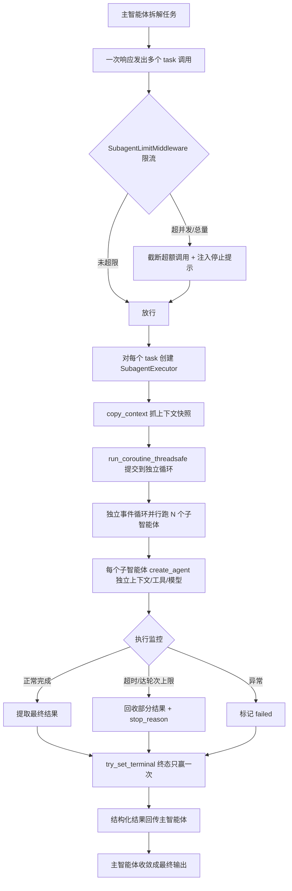
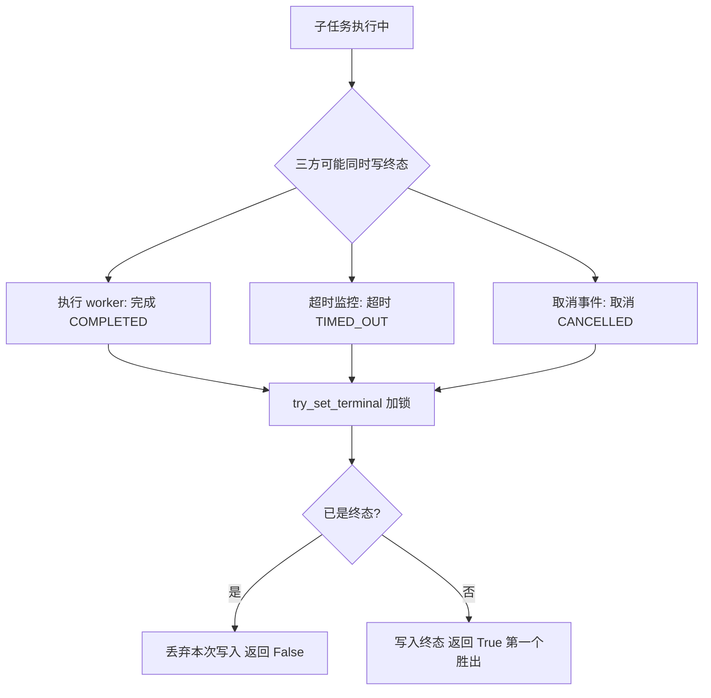
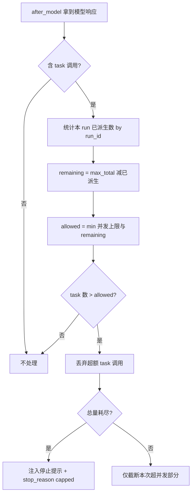
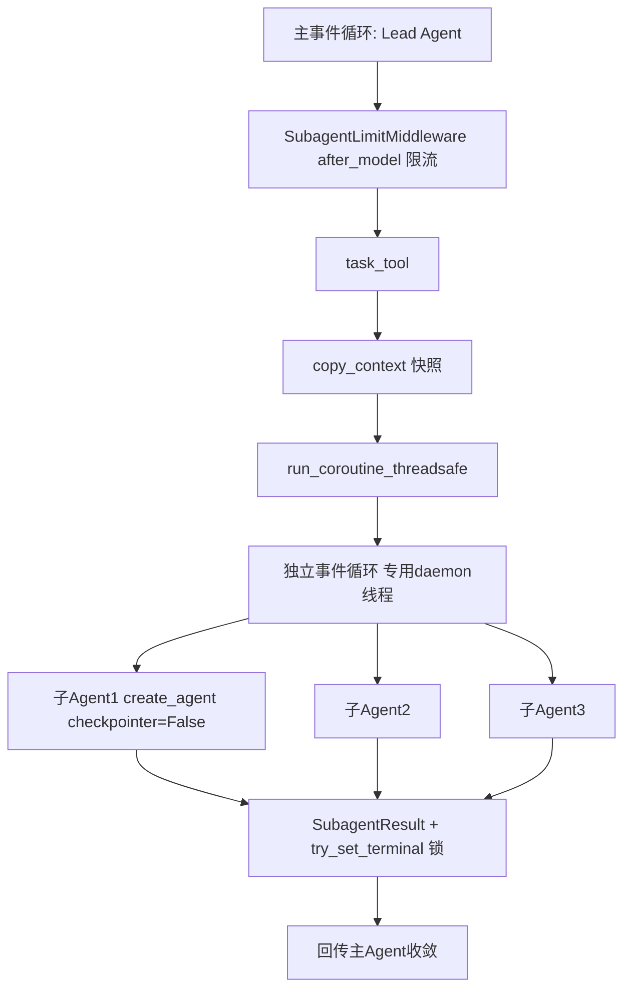

# 子智能体系统（Sub-Agents）设计与实现 — 面试深度讲解

> 面向面试准备的完整拆解：业务背景 → 业务难点 → 技术难点 → 技术亮点 → 技术方案 → 面试话术 → 详细业务流程图。
> 代码根目录：`backend/packages/harness/deerflow/subagents/`

---

## 〇、一句话电梯陈述（先背这段）

> "我做的是 AI Agent 运行时里的**子智能体系统（Sub-Agents）**。它解决的核心问题是：**单个 Agent 无法在一次上下文里完成需要几十步、上百次工具调用的复杂长任务**——上下文会爆、无法并行、一处出错全盘皆输。我的方案是让主智能体（Lead Agent）通过一个 `task()` 工具**按需派生子智能体**，每个子智能体有**独立的上下文、工具集、模型和终止条件**，在**独立事件循环 + 线程池**里**并行执行**，结果结构化回传给主智能体收敛。系统内建了**并发/总量双重限流、独立上下文隔离、超时与递归兜底、部分结果回收、terminal 状态只赢一次的并发安全**等机制。本质是把'分治 + 并发 + 隔离 + 容错'四件事在 Agent 场景下做扎实。"

---

## 一、业务背景

### 1.1 为什么单个 Agent 不够用

一个 AI Agent 的一次运行是"调模型 → 执行工具 → 观察 → 再调模型"的循环。对于简单任务这没问题，但面对复杂任务（如"调研 5 个竞品并生成对比报告"），单 Agent 会遇到三堵墙：

1. **上下文墙**：把 5 个竞品的所有搜索结果、网页内容都塞进一个上下文，很快撞爆 token 窗口。
2. **串行墙**：只能一个竞品查完再查下一个，几十分钟起步。
3. **鲁棒墙**：任何一步出错或跑偏，整个长上下文都被污染，难以恢复。

### 1.2 子智能体的核心思想

> **分治（Divide and Conquer）**：主智能体把大任务拆成若干可独立完成的子任务，每个交给一个"轻装上阵、上下文干净"的子智能体去做，做完把**精炼结果**汇报回来，主智能体只需消费结果、不必消费过程。

类比：
- **主智能体 = 项目经理**：负责拆解任务、分派、汇总。
- **子智能体 = 专项工程师**：各自领一个子任务，埋头干，交付结论。
- 项目经理不需要知道每个工程师是怎么一步步做的，只要拿到结论。

### 1.3 落地形态

- 主智能体调用内置的 `task()` 工具触发派生（`tools/builtins/` 里的 task_tool）。
- 内置两个子智能体：`general-purpose`（全工具集）和 `bash`（命令专家）。见 `subagents/builtins/__init__.py`。
- 支持通过 `config.yaml` 定义自定义子智能体（custom_agents）。

---

## 二、业务难点

| # | 业务难点 | 具体表现 |
|---|---------|---------|
| 1 | **任务拆解粒度** | 拆太细 → 协调开销大；拆太粗 → 又撞上下文墙 |
| 2 | **成本失控** | 模型可能无限制地派生子智能体（每个都烧 token），需要硬约束 |
| 3 | **结果收敛质量** | 子智能体各说各话，主智能体要能整合成连贯输出 |
| 4 | **上下文污染** | 子智能体的中间过程若混入主对话流，主智能体会被无关信息干扰 |
| 5 | **部分失败处理** | 5 个子任务挂了 1 个，不能因此丢弃另外 4 个的成果 |
| 6 | **长任务可观测** | 跑几十分钟，用户需要看到每个子智能体的实时状态 |

---

## 三、技术难点（面试官最爱追问的部分）

### 难点 1：并行执行的线程/事件循环模型

子智能体需要并行跑，但每个子智能体内部又是异步的（要 await 模型和工具）。如果直接在主请求的事件循环里跑，会有两个问题：
- 阻塞主事件循环，拖垮所有并发 HTTP 请求；
- 主循环的取消/超时会误伤子智能体。

**DeerFlow 的解法**：用一个**独立的、专用的事件循环**（`_get_isolated_subagent_loop`）跑在**独立线程**里，主线程通过 `asyncio.run_coroutine_threadsafe` 把子智能体协程提交过去（`executor.py:351-361`）。这样子智能体的生命周期与主请求解耦。

### 难点 2：ContextVar 的跨线程传递

Python 的 `ContextVar`（存 user_id、trace_id、鉴权信息等）**默认不跨线程传递**。子智能体在另一个线程/循环里跑，会丢失这些上下文导致鉴权失败、trace 断链。

**DeerFlow 的解法**：用 `copy_context()` 抓取当前上下文快照，提交时用 `context.run(...)` 在目标循环里**还原上下文**（`executor.py:351-361`）。这是跨线程保持 ContextVar 的标准且容易被忽视的手法。

### 难点 3：限流必须"可靠"而非"靠提示"

只在 prompt 里写"最多派生 3 个子智能体"是**不可靠**的——模型经常不听。而且模型可能在多个规划检查点里，每次都合法地派生 3 个，累积起来失控。

**DeerFlow 的解法**：双层硬限流（`subagent_limit_middleware.py`）：
- **并发上限**（max_concurrent，默认 3，钳制在 [2,4]）：单次响应里超出的 `task` 调用被**直接截断丢弃**；
- **总量上限**（max_total，默认 6，钳制在 [1,50]）：用**持久化的委派账本（delegation ledger）**按 run_id 统计本次运行已派生数，耗尽后截断并注入停止提示、打上 `subagent_limit_capped` 标记。

### 难点 4：超时与"最大轮次"如何兜底，且不丢部分成果

子智能体可能陷入长循环或超时。硬杀掉简单，但会**丢失它已经产出的部分工作**。

**DeerFlow 的解法**：
- 用 LangGraph 的 `recursion_limit` 兜住最大轮次；触发时 `final_state` 仍保留最后一个 chunk，`_extract_final_result`（`executor.py:160`）从中**回收部分结果**而非丢弃；
- 用 `stop_reason`（token_capped / turn_capped / loop_capped / subagent_limit_capped）区分"干净完成"和"被限流截断"，让主智能体能正确反应。

### 难点 5：并发下的状态竞争

后台超时线程、取消事件、执行 worker 可能**同时**去写同一个子任务的结果。若不加控制，会出现"超时把已完成的结果覆盖成失败"。

**DeerFlow 的解法**：`try_set_terminal`（`executor.py:121`）用锁实现**"终态只赢一次（CAS 语义）"**——第一个写终态的胜出，后续的终态写入被丢弃，保证结果一致。

---

## 四、技术亮点（你的加分项）

### 亮点 1：独立事件循环 + 线程池，彻底解耦子智能体生命周期
`executor.py:351` 的 `_submit_to_isolated_loop_in_context` 把子智能体协程提交到专用循环，主请求的取消/超时不误伤，子智能体也不阻塞主循环。

### 亮点 2：ContextVar 跨线程精确还原
`copy_context()` + `context.run()` 保证 user_id、trace_id、鉴权属性在子智能体线程里完整可用——鉴权不掉、链路不断。

### 亮点 3：双层硬限流 + 持久化委派账本
不靠 prompt，靠中间件在 `after_model` 阶段**截断超额 task 调用**（`subagent_limit_middleware.py:161`），并用 run_id 维度的委派账本统计总量，防止跨检查点累积失控。

### 亮点 4：终态"只赢一次"的并发安全
`try_set_terminal` 用 `_state_lock` 保证多线程竞争下终态写入的幂等性——这是分布式/并发系统里"first-writer-wins"的经典落地。

### 亮点 5：部分结果回收（capped ≠ failed）
超时/达到轮次上限时，从最后的 state chunk 里抽取已完成的工作作为结果，并用 `stop_reason` 标注"是被截断的"，让主智能体区分对待。这是"优雅降级"的典范。

### 亮点 6：上下文隔离 + 结构化回传
子智能体在独立上下文运行，内部 AI/工具消息**不进入主对话流**，只把最终结论回传。主智能体上下文保持干净——这正是子智能体能解决"上下文墙"的根本。

### 亮点 7：灵活的工具/技能/模型策略
- 工具：`_filter_tools`（`executor.py:364`）支持 allowlist + denylist，默认禁用 `task`（防止子智能体无限套娃派生）；
- 模型：`resolve_subagent_model_name`（`config.py:48`）支持 `inherit` 继承父模型或指定独立模型；
- 技能：可为子智能体单独配置技能白名单。

---

## 五、技术方案

### 5.1 整体架构

```
主智能体 (Lead Agent)
    │ ① 拆解任务，一次响应发出多个 task() 调用
    ▼
SubagentLimitMiddleware (after_model 拦截)
    │ ② 并发/总量双重限流，截断超额调用
    ▼
task_tool (内置工具)
    │ ③ 为每个子任务创建 SubagentExecutor
    ▼
SubagentExecutor
    │ ④ copy_context 抓上下文快照
    │ ⑤ run_coroutine_threadsafe 提交到独立事件循环
    ▼
独立事件循环 (专用线程) —— 并行跑 N 个子智能体
    │ ⑥ 每个子智能体 = create_agent(独立上下文/工具/模型)
    │ ⑦ recursion_limit 兜最大轮次；超时/取消监控
    ▼
SubagentResult (try_set_terminal 终态只赢一次)
    │ ⑧ 提取最终结果 / 回收部分结果 + stop_reason
    ▼
结构化结果回传主智能体 → 主智能体收敛
```

### 5.2 关键组件与职责

| 组件 | 文件 | 职责 |
|------|------|------|
| `SubagentConfig` | `config.py` | 子智能体配置（工具/技能/模型/轮次/超时） |
| `BUILTIN_SUBAGENTS` | `builtins/__init__.py` | 内置 general-purpose / bash |
| `registry.py` | `registry.py` | 配置解析、分层 override、能力感知暴露 |
| `SubagentExecutor` | `executor.py` | 执行引擎：建 Agent、提交循环、监控、收结果 |
| `SubagentResult` | `executor.py` | 结果载体 + 终态 CAS |
| `SubagentLimitMiddleware` | `subagent_limit_middleware.py` | 双层硬限流 |
| `task_tool` | `tools/builtins/` | 主智能体触发派生的工具入口 |

### 5.3 派生流程的关键代码点

**① 限流截断（after_model）**：`subagent_limit_middleware.py:161`
```python
allowed_task_calls = min(self.max_concurrent, remaining_total)
if len(task_indices) <= allowed_task_calls:
    return None                       # 未超限，放行
indices_to_drop = set(task_indices[allowed_task_calls:])   # 丢弃超额部分
# 若总量耗尽，注入停止提示 + 打 stop_reason
```

**② 跨线程提交 + 上下文还原**：`executor.py:351`
```python
def _submit_to_isolated_loop_in_context(context, coro_factory):
    return context.run(                                   # 还原 ContextVar
        lambda: asyncio.run_coroutine_threadsafe(
            coro_factory(),
            _get_isolated_subagent_loop(),                # 独立事件循环
        )
    )
```

**③ 终态只赢一次**：`executor.py:121`
```python
def try_set_terminal(self, status, ...):
    with self._state_lock:
        if self.status.is_terminal:
            return False              # 已有终态，后来者放弃
        self.status = status
        return True                   # 第一个写终态者胜出
```

**④ 部分结果回收**：`executor.py:160`
```python
def _extract_final_result(final_state, ...):
    # recursion_limit 触发时，final_state 仍有最后 chunk
    # 取最后一个 AIMessage 作为部分成果，而非丢弃
```

### 5.4 参数与默认值（面试可能问具体数字）

| 参数 | 默认 | 约束 | 来源 |
|------|------|------|------|
| max_concurrent（并发） | 3 | 钳制 [2,4] | subagent_limit_middleware |
| max_total（总量/run） | 6 | 钳制 [1,50] | subagent_limit_middleware |
| general-purpose max_turns | 150 | — | config.py 注释 |
| bash max_turns | 60 | — | config.py 注释 |
| timeout_seconds | 1800(30min) | 全局默认 | config.py 注释 |
| disallowed_tools 默认 | ["task"] | — | config.py:35（禁止套娃派生） |

---

## 六、面试话术

### 6.1 项目介绍（STAR）

> **S**：AI Agent 要处理需要几十步、上百次工具调用、可能几小时的复杂长任务。
> **T**：单 Agent 面临三堵墙——上下文爆、只能串行、一处出错全盘污染。我负责设计并实现子智能体系统来分治这类任务。
> **A**：我让主智能体通过 `task()` 工具按需派生子智能体，每个有独立上下文/工具/模型/终止条件；用独立事件循环+线程池并行执行并与主请求解耦；用 copy_context 保证 ContextVar 跨线程；用中间件做并发+总量双层硬限流；用 recursion_limit 兜轮次并回收部分结果；用终态 CAS 保证并发写入一致。
> **R**：复杂任务能扇出多个子智能体并行完成再收敛，主上下文保持干净，成本被硬约束住，部分失败不影响其余成果，且全程可观测。

### 6.2 高频追问与应答

**Q：为什么要独立事件循环，不直接在主循环跑？**
A：子智能体是异步且长时的。放主循环会阻塞所有并发 HTTP 请求，且主请求的取消/超时会误伤子智能体。用独立循环+独立线程把子智能体生命周期和主请求彻底解耦，提交用 run_coroutine_threadsafe。

**Q：ContextVar 跨线程会丢，你怎么处理？**
A：ContextVar 默认不跨线程。我用 copy_context() 抓当前上下文快照，提交时 context.run() 在目标循环里还原，保证 user_id、trace_id、鉴权属性都在——否则子智能体会鉴权失败、链路断链。

**Q：限流为什么不能只写在 prompt 里？**
A：模型不可靠，经常不听 prompt；而且它可能在多个规划检查点每次都合法派生 3 个，累积失控。所以我在 after_model 中间件里做硬截断：并发上限截断单次超额调用，总量上限用 run_id 维度的持久化委派账本统计，耗尽就截断并注入停止提示、打 capped 标记。这是"机制"而非"约定"。

**Q：子智能体超时了，它已经做的工作怎么办？**
A：不丢。我用 recursion_limit 兜最大轮次，触发时 final_state 还留着最后的 chunk，_extract_final_result 从中回收部分成果，并用 stop_reason 标注这是被截断的，让主智能体区分"干净完成"和"被 cap"，capped ≠ failed。

**Q：多个线程同时写一个子任务结果会不会打架？**
A：会。超时线程、取消、执行 worker 可能竞争。我用 try_set_terminal 加锁实现"终态只赢一次"——first-writer-wins，第一个写终态的胜出，后来的被丢弃，保证结果幂等一致。

**Q：怎么防止子智能体无限套娃派生子智能体？**
A：SubagentConfig 的 disallowed_tools 默认就含 "task"，即子智能体默认拿不到派生工具，从机制上断掉递归爆炸。

**Q：子智能体的上下文和主智能体是什么关系？**
A：完全隔离。子智能体在自己的 state 里跑，内部 AI/工具消息不进主对话流，只把最终结论结构化回传。这正是它能解决"上下文墙"的根本——主智能体消费结果，不消费过程。

**Q：局限 / 改进？**
A：一是独立循环是全局单例，极端高并发下可能成为瓶颈，可做多循环分片；二是限流是进程内的，多 worker 部署下总量账本要下沉到共享存储才能全局一致；三是任务拆解质量依赖模型，可引入更结构化的规划协议。

### 6.3 一句话总结（结尾用）

> "子智能体系统的价值在于：把'分治+并发+隔离+容错'这四件事在 Agent 场景下工程化落地——主智能体当项目经理拆解调度，子智能体当专项工程师并行攻坚，用独立事件循环解耦生命周期、用 ContextVar 还原保链路、用双层硬限流控成本、用终态 CAS 和部分结果回收保鲁棒性，最终让 Agent 能可靠地啃下几十分钟到几小时的复杂长任务。"

---

## 七、详细业务流程图

### 7.1 派生与并行执行主流程



### 7.2 SubagentResult 终态竞争（CAS）时序



### 7.3 限流决策流程



---

> 代码位置以 `backend/packages/harness/deerflow/subagents/` 为根。建议面试前通读 `executor.py`（执行引擎/独立循环/CAS/部分结果）、`subagent_limit_middleware.py`（双层限流）、`config.py`（配置与模型解析）、`registry.py`（分层解析/能力感知）四处。相关文档见同目录 `DeerFlow-Agent核心模块讲解.md` 与 `DeerFlow-中间件链设计-深度讲解.md`。

---
---

# 附录：大厂 SSP 面试终极宝典（P7 面试官视角）

> **重要前提（务必先读）**：本项目是 **Python 编写的 AI Agent 运行时**。代码中**没有** Redis、MySQL、Kafka/RocketMQ、Lua、分布式锁、RPC 框架、数据库事务。因此本宝典**严格只讲代码里真实存在的技术**：Python asyncio 事件循环、ContextVar、ThreadPoolExecutor、threading.Lock、LangGraph 状态图、进程内委派账本、中间件限流。凡是简历/八股里涉及本项目未实现的能力，会**明确标注"代码中没有实现，不能答成做过"**，绝不编造。

## 第一部分：项目理解

### 一、业务背景

**为什么有这个需求**：AI Agent 处理复杂任务（如多目标调研、代码库分析）时，单 Agent 一次运行会撞三堵墙——上下文窗口爆掉、任务只能串行、长上下文被污染后难恢复。子智能体系统用"分治"把大任务拆给多个独立上下文的子 Agent 并行执行。

**为什么以前方案不行 / 为什么重构**：
> **诚实说明**：代码中**没有**"旧方案 → 重构"的历史证据。DeerFlow 2.0 是相对 1.x 的整体重写（README 提及），但 subagents 目录内**没有**可佐证"曾用某方案、因某瓶颈重构"的代码或注释。面试中**不能**把"重构了旧的串行方案"讲成亲历事实，只能讲"针对单 Agent 三堵墙，设计了子智能体分治方案"。

**业务量级（QPS/流量/数据量）**：
> **业务量级未知，不做虚构。** 代码里只有**约束常量**，可作为"设计容量"讲，但**不是**线上实测指标：
> - 单次响应并发子智能体上限：默认 3，钳制 `[2,4]`（`subagent_limit_middleware.py`）
> - 单次 run 子智能体总量上限：默认 6，钳制 `[1,50]`
> - 调度线程池：`max_workers=3`（`executor.py:259` `_scheduler_pool`）
> - general-purpose max_turns=150 / bash=60；timeout 默认 1800s（`config.py` 注释）
> 没有 QPS、峰值、日调用量等任何线上数据。面试若被问"多大量级"，正确答法："这是开源运行时，我基于源码学习其设计，没有生产流量数据，但设计容量参数是……"

### 二、业务流程

**一次派生经过的组件 / 线程 / 同步异步**（全部有代码依据）：

1. 主 Agent 在一次模型响应里发出 N 个 `task` 工具调用（**主请求线程/主事件循环**）
2. `SubagentLimitMiddleware.after_model` 拦截，按并发+总量截断（**同步**，主循环）
3. `task_tool` 为每个子任务构造 `SubagentExecutor`（主循环）
4. `copy_context()` 抓 ContextVar 快照 → `run_coroutine_threadsafe` 提交到**独立事件循环**（`executor.py:351`）
5. 独立循环运行在**专用 daemon 线程**（`executor.py:270` `_run_isolated_subagent_loop`，`run_forever`）
6. 每个子 Agent = `create_agent(..., checkpointer=False)`（`executor.py:535`），内部 await 模型/工具（**异步**）
7. `recursion_limit` 兜轮次；结果写入 `SubagentResult`，`try_set_terminal` 保证终态只写一次（**threading.Lock**）
8. 结构化结果回传主 Agent 收敛

> **没有 RPC、没有 MQ、没有缓存、没有数据库**。所谓"委派账本(delegations)"是 LangGraph **state 里的一个字段**（进程内内存 + checkpoint 持久化），**不是** Redis/MySQL。

**Mermaid 架构图**：


时序图见正文 7.1；本附录不重复。

## 第二部分：简历逐句拆解

以你可能写的简历句为例，逐句拆解（**只拆代码支持的表述**）。

### 句 1："设计基于独立事件循环+线程池的子智能体并行执行引擎"

- **真正表达**：把长时异步的子 Agent 从主请求循环剥离，避免阻塞主循环、避免主请求取消误伤子任务。
- **为什么写**：体现你懂 asyncio 并发模型与"生命周期解耦"。
- **删掉的影响**：就退化成"调了个并行库"，失去架构深度。
- **最容易被问**：为什么不用 `asyncio.gather` 在主循环并行？为什么要单独开线程+循环？
- **最危险的问题**：独立循环是**全局单例**（`_isolated_subagent_loop`），高并发下会不会成为瓶颈？（诚实答：会，代码是单循环，未做分片——这是真实局限）
- **隐藏知识点**：`run_coroutine_threadsafe` 返回 `concurrent.futures.Future`；daemon 线程 + `atexit` 优雅关闭（`executor.py:317`）。
- **可引导面试官**：主动提"这里有个 ContextVar 跨线程的坑"，把话题引到你的亮点 `copy_context`。

### 句 2："实现并发+总量双层限流，防止子智能体失控烧 token"

- **真正表达**：不靠 prompt 约束，靠中间件在 `after_model` 硬截断 task 调用。
- **为什么写**：体现"用机制而非约定"的工程思维。
- **删掉的影响**：面试官会认为你只是让模型自己控制，缺乏可靠性设计。
- **最容易被问**：并发上限和总量上限分别解决什么问题？为什么两个都要？
- **最危险的问题**：总量账本按 run_id 统计，**多 worker 部署时是否全局一致**？（诚实答：不一致，账本在 state/进程内，跨 worker 不共享——真实局限，正文 6.2 已承认）
- **隐藏知识点**：`clamp` 钳制区间 [2,4]/[1,50]；耗尽时打 `stop_reason=subagent_limit_capped`。

### 句 3："设计终态只写一次(CAS 语义)的并发安全结果模型"

- **真正表达**：超时线程、取消、执行 worker 三方竞争写结果时，first-writer-wins。
- **为什么写**：体现并发安全意识。
- **最容易被问**：这算不算 CAS？和真正的 CAS 有什么区别？
- **最危险的问题**：你说 CAS，但代码是 `threading.Lock` + `if is_terminal: return False`（`executor.py:141`），这是**互斥锁保护的检查-赋值**，**不是**无锁 CAS 指令。（必须诚实区分，否则被判背八股）
- **隐藏知识点**：幂等终态、`_state_lock`、terminal 状态集合 `is_terminal`。

## 第三部分：面试官追问树（连续深挖）

### 追问树 A：并发执行模型（8 层）

```
L1 为什么子智能体要并行？
  → 单 Agent 串行几十分钟，分治并行缩短墙钟时间
L2 为什么不用 asyncio.gather 在主循环里并行？
  → 会把子任务生命周期绑死在主请求循环；主请求取消/超时会误伤子任务；子任务阻塞会拖累主循环上所有并发 HTTP
L3 那为什么要单开一个"独立事件循环 + 线程"，而不是新建临时 loop？
  → 代码注释(executor.py:261)说明：复用长生命周期 loop，避免每次执行新建 loop 又关闭绑定其上的异步资源
L4 run_coroutine_threadsafe 具体做了什么？返回什么？
  → 把协程调度到目标 loop 线程执行，返回 concurrent.futures.Future（跨线程 Future），主线程可 .result(timeout)
L5 ContextVar 跨线程为什么会丢？你怎么解决？
  → ContextVar 绑定执行上下文，线程切换默认不携带；用 copy_context() 抓快照，context.run() 在目标 loop 里还原（executor.py:351）
L6 copy_context 抓的是浅拷贝还是深拷贝？改子任务里的 ContextVar 会影响主线程吗？
  → copy_context 复制的是 ContextVar→value 的映射（浅），子上下文里 set 新值不回写父上下文；但若 value 是可变对象，改对象内部会互相影响——需要答出这个边界
L7 这个独立循环是单例，高并发会不会瓶颈？
  → 会。当前是单 loop 单线程跑所有子任务的协程调度，CPU 密集或大量子任务时该线程是瓶颈。代码未做多 loop 分片——这是真实局限，可提出改进方向
L8 进程退出时这个常驻循环怎么安全关闭？
  → atexit 注册 _shutdown_isolated_subagent_loop（executor.py:283/317）：call_soon_threadsafe(loop.stop) → join(timeout=1) → 仅当线程停+循环停才 loop.close()，否则打 warning 不强关，避免关闭正在使用的 loop
```

### 追问树 B：限流可靠性（6 层）

```
L1 限流为什么放在 after_model 中间件，不在 task_tool 里？
  → 要在"模型已决定要派生"到"真正执行"之间拦截，after_model 拿到的是模型响应里的 tool_calls，可整体裁剪
L2 并发上限和总量上限区别？
  → 并发=单次响应里同时发起的 task 数(默认3)；总量=整个 run 累计派生数(默认6)，防止多轮规划检查点各发3个累积失控
L3 总量怎么统计的？存哪？
  → 统计 state["delegations"] 里 run_id 匹配的条目数(subagent_limit_middleware.py _count_prior_delegations)；delegations 是 LangGraph state 字段，非外部存储
L4 多 worker 部署总量还准吗？
  → 不准。账本在 state/进程内，跨 worker 不共享。要全局一致须下沉到共享存储——代码未做，是真实局限
L5 超出的 task 调用怎么处理？会报错吗？
  → 不报错，直接从 AIMessage 的 tool_calls 里丢弃超额项(clone_ai_message_with_tool_calls)，总量耗尽时追加停止提示文本 + 打 stop_reason
L6 run_id 拿不到会怎样？
  → 代码有 warning 分支(subagent_limit_middleware.py)：拿不到 run_id 就把该线程所有 delegations 都算作已用，保守限流，宁可少派生
```

### 追问树 C：容错与结果一致性（6 层）

```
L1 子智能体超时/达到最大轮次，成果丢不丢？
  → 不丢。recursion_limit 触发时 final_state 保留最后 chunk，_extract_final_result 取最后 AIMessage 作为部分成果(executor.py:160)
L2 怎么区分"干净完成"和"被截断完成"？
  → stop_reason 字段：token_capped/loop_capped/subagent_limit_capped/turn_capped，None 表示干净完成；capped ≠ failed
L3 stop_reason 从哪来？
  → guard 中间件(TokenBudget/LoopDetection)暴露 consume_stop_reason，executor 用 duck-typing (hasattr) 收集后逐个读(executor.py:531/544)
L4 三个线程同时写结果怎么保证一致？
  → try_set_terminal 用 _state_lock 加锁，检查已终态就 return False，第一个写终态者胜出(executor.py:121-157)
L5 这是 CAS 吗？
  → 严格说不是无锁 CAS，是"互斥锁保护的 check-then-set"，语义上等价 first-writer-wins。别硬套 CAS 术语
L6 子智能体共享父 thread_id 会不会读到旧的错误标记？
  → 会有 stale marker 风险。_extract_llm_error_fallback 只扫最后一条 AIMessage(executor.py:203-251)，因为 fallback 消息无 tool_calls 必然终止 run，子智能体至少追加自己的终末消息，故最后一条不会是父历史的陈旧标记
```

## 第四部分：深度模拟面试

### 问题 1：为什么不用 asyncio.gather 在主循环并行，而要单独开事件循环+线程？

**⭐ 高分回答（STAR）**
- **S**：子智能体是长时异步任务，跑在处理 HTTP 请求的主事件循环上。
- **T**：要并行 N 个子任务，又不能拖垮主循环、不能被主请求取消/超时误伤。
- **A**：用 `asyncio.gather` 在主循环并行，子任务生命周期会绑死在主请求这次 loop 迭代——主请求取消，gather 里子任务全被 cancel；子任务阻塞会拖累同循环所有并发 HTTP。所以我用**常驻独立事件循环**（`executor.py:264` 全局单例 + 专用 daemon 线程 `run_forever`），主线程用 `run_coroutine_threadsafe`（`executor.py:357`）跨线程提交，拿 `concurrent.futures.Future`。为避免每次新建 loop 又关闭其上异步资源，特意复用长生命周期 loop（注释 `executor.py:261`）。
- **R**：主循环不被阻塞，主请求取消不误伤子任务。**Trade-off**：独立循环是单例单线程，极端高并发下该线程是瓶颈，代码未做多 loop 分片——真实局限。

**🧠 考察什么**：并发生命周期管理与隔离思想，而非 asyncio API 背诵。

**📚 底层原理**：asyncio 单线程事件循环；`run_coroutine_threadsafe` 返回 `concurrent.futures.Future`（区别于 `asyncio.Future`）；daemon 线程随进程退出；GIL 下 IO 密集协程可并发、CPU 密集串行。

**⚠ 常见错误**：只说"用了 asyncio 并行"；混淆 `run_coroutine_threadsafe` 与 `gather`；不知单例局限。

**⭐⭐⭐⭐⭐**：画出"主循环/独立循环/提交路径"，点出取消传播差异，诚实承认单例瓶颈并给分片改进方向。

### 问题 2：你说 CAS 保证结果一致性，真的是 CAS 吗？

**⭐ 高分回答（STAR）**
- **S**：`SubagentResult` 可能被执行 worker、超时监控、取消事件三方同时写终态。
- **T**：只有第一个终态生效，不能"超时把已完成覆盖成失败"。
- **A**：`try_set_terminal`（`executor.py:121-157`）用 `self._state_lock`（`threading.Lock`）保护"检查是否已终态→若否写入"临界区，first-writer-wins。**但严格说这不是无锁 CAS 指令，是锁保护的 check-then-set**，我不会硬说成硬件 CAS。
- **R**：终态写入幂等一致。

**🧠 考察什么**：临界区识别 + 术语严谨（分得清锁与 CAS）。

**📚 底层原理**：`threading.Lock` 基于 OS 互斥量；check-then-act 竞态；CAS 是无锁原语，Python 层无直接对应。

**⚠ 常见错误**：张口"用了 CAS 无锁优化"，被追问底层就露馅。

**⭐⭐⭐⭐⭐**：主动澄清"用词严谨点，这是锁保护 check-then-set，等价 first-writer-wins，不是硬件 CAS"，反而加分。

### 问题 3：限流放中间件，多 worker 部署总量还准吗？

**⭐ 高分回答（STAR）**
- **S**：模型一次可能发多个 task，也可能多轮各发 3 个。
- **T**：既限单次并发又限整个 run 总量，且不靠 prompt。
- **A**：`SubagentLimitMiddleware.after_model` 拿 `tool_calls`，`allowed = min(max_concurrent, max_total - 已派生)`，超出直接从 tool_calls 丢弃；已派生数来自 `state["delegations"]` 里 run_id 匹配条目。
- **R**：单进程可靠限流。**诚实**：`delegations` 是 LangGraph **state 字段**（进程内+checkpoint），**不是 Redis/DB**，**多 worker 下账本跨进程不共享，全局总量不准**——代码未实现共享存储。要全局须下沉 Redis，本项目未做。

**🧠 考察什么**：分布式一致性边界意识 + 工程诚实。

**⚠ 常见错误**：把 state 里 delegations 说成"分布式账本"、声称多 worker 精确限流。

**⭐⭐⭐⭐⭐**：明确"单进程可靠、多 worker 需共享存储、当前未实现"，并点出 Gateway 默认 GATEWAY_WORKERS=1（README）故单 worker 场景够用。

## 第五部分：源码分析

| 元素 | 位置 | 为什么这样写 | 为什么不是另一种 | 设计思想/潜在问题 |
|------|------|------------|----------------|-----------------|
| 全局单例 loop | `executor.py:264` | 复用长生命周期 loop，避免反复建/关 | 不用每次新建：泄漏或早关绑定资源 | 单例=瓶颈；改进分片多 loop |
| 懒创建+存活校验 | `executor.py:320` | 校验 thread alive & loop running，不可用则重建 | 不启动即建：无子任务时零成本 | 加锁双检；5s 超时兜底 |
| 跨线程提交+上下文还原 | `executor.py:351` | copy_context+run_coroutine_threadsafe 保 ContextVar | 不裸提交：丢 user_id/trace_id/鉴权 | ContextVar 浅拷贝语义 |
| try_set_terminal | `executor.py:121` | 锁保护 check-then-set，终态只写一次 | 不用无锁：Python check-then-act 有竞态 | first-writer-wins；勿误称 CAS |
| _extract_final_result | `executor.py:160` | recursion_limit 后从最后 chunk 回收部分成果 | 不"超时即丢"：浪费已完成工作 | 优雅降级；capped≠failed |
| _extract_llm_error_fallback 只扫末条 | `executor.py:203` | 子共享父 thread_id，扫全量误判陈旧标记 | 不扫全部：stale-marker 假阳性 | 依赖"fallback 无 tool_calls 必终止"不变量 |
| duck-typing 收集 stop_reason | `executor.py:544` | hasattr 收集暴露 consume_stop_reason 的 guard | 不 import 具体类：解耦，新 guard 自动纳入 | 鸭子类型；逐个检查 |
| create_agent(checkpointer=False) | `executor.py:541` | 子智能体不独立 checkpoint，隔离父持久化 | 不带 checkpointer：子任务临时无需续跑 | 上下文隔离一环 |
| disallowed_tools=["task"] | `config.py:35` | 默认禁 task，断无限套娃 | 不允许递归派生：防指数爆炸 | 机制性安全边界 |
| _scheduler_pool(max_workers=3) | `executor.py:259` | 后台调度/编排线程池 | — | 与并发上限 3 呼应 |

**基于代码的真实局限**：①独立 loop 单例→高并发瓶颈；②限流账本在 state→多 worker 不全局一致；③子共享父 thread_id→需专门处理 stale marker。

## 第六部分：架构 Trade-off

> 本项目是 Python，"为什么不用 X"须基于本项目场景，并诚实标注哪些项目根本不涉及。

| 备选方案 | 优点 | 缺点 | 本项目为何没选 |
|---------|------|------|--------------|
| asyncio.gather 主循环并行 | 简单、无跨线程 | 生命周期绑死主请求；阻塞拖累主循环；取消误伤 | 需生命周期解耦，用独立 loop |
| 每次新建临时 loop | 隔离彻底 | 反复建/关，绑定资源易泄漏/早关 | 注释明确选常驻复用 |
| 多进程 | 绕 GIL 真并行 | 进程间传大对象贵；子 Agent 是 IO 密集 | IO 密集用协程更划算 |
| Redis 委派账本 | 多 worker 全局一致 | 外部依赖+网络往返 | **代码未实现**；单 worker 下 state 账本够用 |
| Kafka/RocketMQ 分发 | 削峰、可靠投递 | 重依赖、运维、延迟 | **代码未实现**，进程内派生不涉及 MQ |
| 分布式锁 Redisson/ZK/Etcd | 跨进程互斥 | 外部依赖、复杂 | **代码未实现**；结果一致用进程内 threading.Lock |
| 无锁 CAS | 无锁开销低 | Python 层无原语、易错 | 用 threading.Lock 更直白正确 |

> **面试铁律**：MQ、Redis、分布式锁、MySQL 在本项目**代码中没有实现**。被问只能答"本项目是进程内 Agent 运行时，不涉及；扩展多 worker 全局限流可引入 Redis，但我没在这个项目里做过"。**绝不说成做过。**

