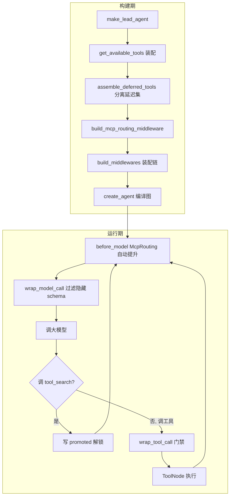
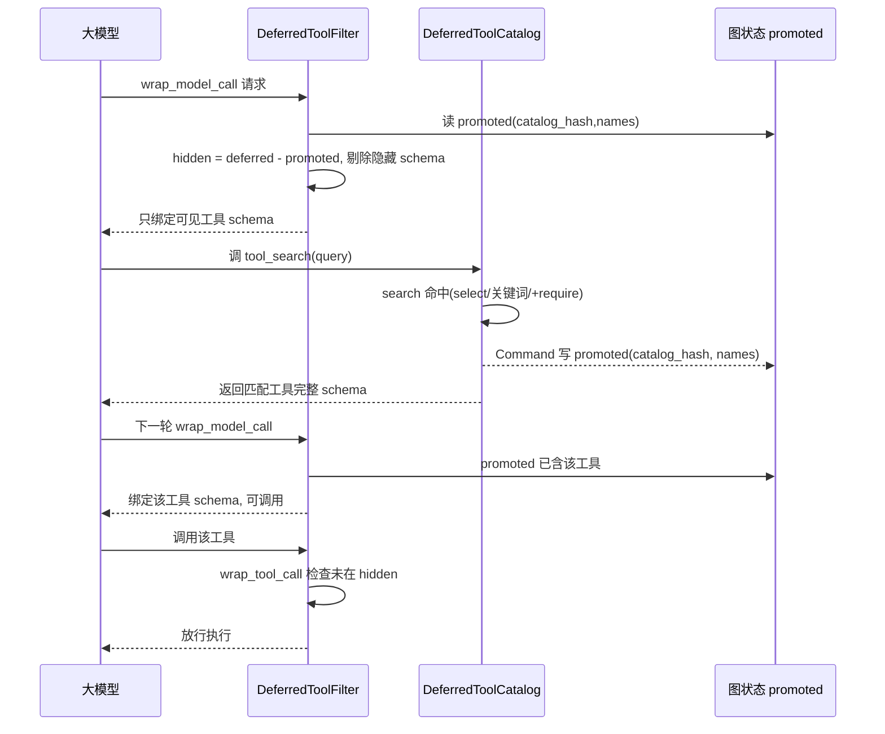
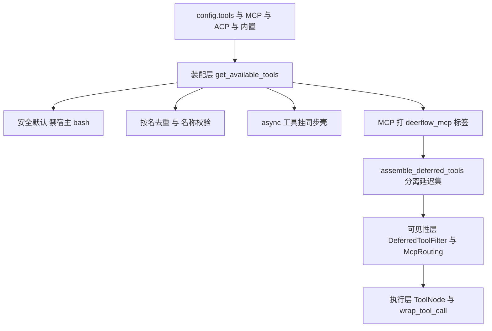
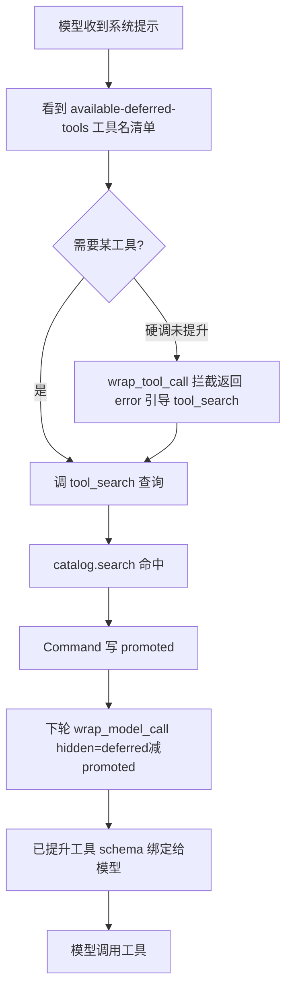
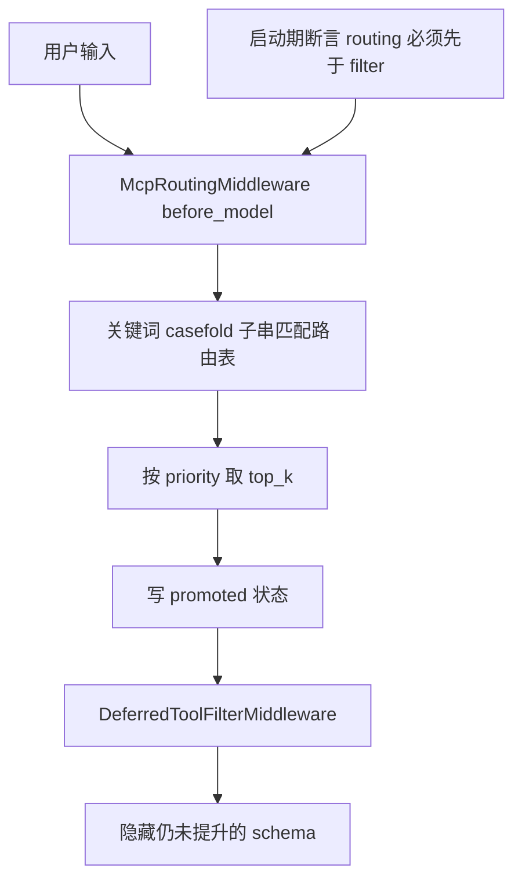
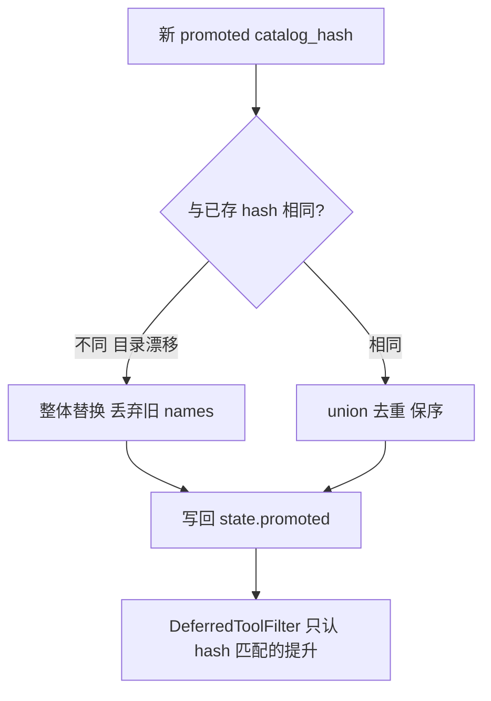

# Agent 工具系统（Tool System）设计与实现 — 面试深度讲解

> 面向面试准备的完整拆解：业务背景 → 业务难点 → 技术难点 → 技术亮点 → 技术方案 → 源码分析 → 面试话术 → 业务流程图。
> 代码根目录：`backend/packages/harness/deerflow/`
> 全文基于本仓库真实代码。凡代码未实现的能力，均明确标注「代码中没有实现该能力，不能回答成实际做过」。

---

## 〇、一句话电梯陈述（先背这段）

> "我做的是一个 AI Agent 运行时的**工具系统（Tool System）**——Agent 的『手脚』，负责把搜索、抓取、沙箱执行、文件操作、子智能体、MCP 等能力统一装配成模型可调用的工具。核心解决四个问题：**① 工具爆炸下的 token 成本失控**（20+ Provider + 任意 MCP 服务器，全塞给模型会撑爆上下文）；**② 工具装配的一致性与安全默认**（多入口共享、宿主 bash 默认禁用、名称冲突去重）；**③ 同步/异步执行的兼容**（同步 Agent 调异步工具不能阻塞）；**④ 运行期按需暴露与授权**（延迟工具 + 工具搜索 + 技能策略过滤）。最核心的亮点是**延迟工具（Deferred Tools）+ tool_search 按需发现 + 提升（promote）状态机**：模型初始只看到工具名清单，通过 `tool_search` 检索才拿到完整 schema 并解锁调用，schema 隐藏与解锁由 `DeferredToolFilterMiddleware` 读图状态 `promoted` 字段控制，并有 catalog_hash 防止目录漂移导致的错误暴露。"

---

## 一、业务背景

### 1.1 工具系统在 Agent 里的位置

一个 AI Agent 的一次运行是「调大模型决策 → 执行工具 → 观察结果 → 再调模型」的循环。**工具（Tool）就是 Agent 与外部世界交互的唯一手段**：搜网页、抓正文、跑 shell、读写文件、调用子智能体、访问 MCP 服务器……没有工具，Agent 只能空谈。

工具系统要回答三个问题：
1. **有哪些工具**（装配来源：内置 / 配置 / MCP / ACP / 子智能体 / 视觉）；
2. **模型能看到哪些工具 schema**（可见性：全量绑定 vs 延迟按需）；
3. **哪些工具允许被执行**（授权：安全默认、技能策略、提升门禁）。

### 1.2 落地场景（本仓库真实）

- 工具装配的稳定入口是 [`get_available_tools()`](backend/packages/harness/deerflow/tools/tools.py:44)，被 lead agent、嵌入式 client、subagent 多路径复用。
- 工具类别（`tools.py` + `community/`）：

| 类别 | 代表工具 | 代码位置 |
|------|---------|---------|
| 沙箱执行 | bash / ls / read_file / write_file / str_replace | `sandbox/tools.py` |
| 内置 | present_files / ask_clarification / view_image / task / tool_search | `tools/builtins/` |
| 社区搜索 | Tavily / Brave / Serper / Exa / DuckDuckGo / SearXNG | `community/tavily/` 等 |
| 社区抓取 | Jina AI / Crawl4AI / Firecrawl / fastCRW / InfoQuest | `community/jina_ai/` 等 |
| MCP | 任意 MCP 服务器工具 | `mcp/` |
| ACP | invoke_acp_agent（跨 Agent 协议） | `tools/builtins/invoke_acp_agent_tool.py` |

### 1.3 为什么必须有「延迟工具」这个设计

面向 token 计费的模型，每个工具的 JSON schema 都占上下文。当接入 20+ 社区 Provider + 任意数量的 MCP 服务器时，全部 schema 绑定给模型可能占用**几万 token**，既贵又稀释注意力。**延迟工具**就是为解决这个「工具爆炸」而生：先只给名字，模型需要时再检索 schema。

> **业务量级**：本仓库未提供线上 QPS / token 成本降幅等量化数据，**属未知，不做虚构**。可讲的是设计意图（token 敏感）与机制，不编造具体百分比。

---

## 一·补、业务流程（请求进入后每一步经过什么）

> 说明：本项目是 **Python LLM Agent 运行时**，不涉及 RPC / MQ / MySQL / 分布式缓存。下面标注真实涉及的组件、线程、同步/异步边界。**代码未实现的组件（MQ/DB/RPC）绝不编造**。

### 流程分两个阶段：构建期（每次 run 前一次）+ 运行期（每轮循环）

**A. 构建期（同步，主流程，一次 run 触发一次）**

1. LangGraph 图工厂 `make_lead_agent(config)` → `_make_lead_agent`（`agent.py:447/454`）；
2. 调 `get_available_tools(...)`（`tools.py:44`，**同步**）：反射加载 config 工具 → 剔除宿主 bash → 名称校验/去重 → async 工具挂同步壳 → 取**缓存的** MCP 工具并打标签；
3. `assemble_deferred_tools(candidate_tools, enabled)`（`tool_search.py:187`）：分离 MCP 延迟集，产出 `DeferredToolSetup`（含 catalog_hash）+ 追加 `tool_search` 工具；
4. `build_mcp_routing_middleware(...)` 从延迟工具的路由元数据构建自动提升中间件；
5. `build_middlewares(...)` 装配链：`McpRoutingMiddleware`（先）→ `DeferredToolFilterMiddleware`（后），并 `assert_mcp_routing_before_deferred_filter` 断言顺序；
6. `create_agent(...)` 编译成图。

**B. 运行期（每轮"调模型→执行工具"循环）**

- `before_model`（正序）：`McpRoutingMiddleware` 读最近用户消息，关键词匹配 → 写 `state["promoted"]`（**图状态，非全局变量**）；
- `wrap_model_call`：`DeferredToolFilterMiddleware._filter_tools` 计算 `hidden = deferred - promoted`，`request.override(tools=active)` 剔除隐藏 schema → 绑定给模型 → **调大模型（异步网络 I/O）**；
- 模型若调 `tool_search`：命中 `catalog.search`，返回 `Command(update={"promoted":..., "messages":...})` 解锁；
- 模型若调普通工具：进 ToolNode 执行；`wrap_tool_call` 先查 `_hidden`，未提升 → 返回 error ToolMessage 拦截；已提升 → 真正执行；
- async-only 工具在同步路径被调用时，`make_sync_tool_wrapper` 用 `copy_context` + **独立线程池**（`_SYNC_TOOL_EXECUTOR`，`sync.py:16`）跑 `asyncio.run`，**不阻塞主事件循环**。

### 涉及的线程/同步异步边界（真实）

| 环节 | 同步/异步 | 线程 | 说明 |
|------|----------|------|------|
| get_available_tools 装配 | 同步 | 主线程 | 反射加载、去重，构建期一次 |
| MCP 工具获取 | 读缓存（同步） | 主线程 | `get_cached_mcp_tools`，非现场拉取 |
| 调大模型 | 异步 | 事件循环 | 网络 I/O |
| async-only 工具（同步路径调用） | 异步转同步 | `tool-sync` 线程池（max_workers=10） | copy_context 保上下文 |
| promoted 状态写入 | 同步 | 事件循环 | 写图状态，reducer 合并 |

### 架构图（Mermaid）



### 时序图（一次工具从"看不见"到"可调用"，Mermaid）



---

## 二、业务难点

| # | 业务难点 | 具体表现 |
|---|---------|---------|
| 1 | **工具爆炸** | 20+ Provider + 任意 MCP，全量 schema 撑爆上下文、稀释模型注意力、成本飙升 |
| 2 | **多入口一致性** | lead / client / subagent 三条装配路径必须行为一致，不能各写一套 |
| 3 | **安全默认** | 宿主 bash 不是安全隔离边界，默认必须禁用，否则 Agent 能直接操作宿主机 |
| 4 | **名称冲突** | config、MCP、内置工具可能重名，重名会让模型收到歧义/拼接的 function schema（issue #1803） |
| 5 | **同步/异步混用** | 部分工具只有 async 实现，但同步 Agent 路径要能调用，不能阻塞事件循环 |
| 6 | **运行期授权** | 技能激活后要按 allowed-tools 过滤，延迟工具未提升前不能被调用 |

---

## 三、技术难点（面试官最爱追问的部分）

### 难点 1：延迟工具的「可见但不可调用」双态一致性

延迟工具有一个微妙状态机：
- **对模型可见性**：名字在 `<available-deferred-tools>` 里，但 schema 不绑定给模型（`DeferredToolFilterMiddleware._filter_tools`）；
- **对执行的门禁**：即使模型硬凑出一个调用，未提升的工具会被 `wrap_tool_call` 拦截返回错误（`_blocked_tool_message`）；
- **对 ToolNode 的存在性**：工具本体始终在 ToolNode 里（用于执行路由），只是 schema 被藏起来。

**难点在于**：这三态必须由同一份「提升状态」（`state["promoted"]`）驱动且一致，否则会出现「模型看不到却能调用」或「提升了却仍被拦」的错乱。

### 难点 2：提升状态的持久化漂移（catalog drift）

`promoted` 是持久化到图状态（checkpoint）的。如果工具目录变了（增删 MCP 工具），旧 checkpoint 里的 `promoted.names` 可能指向一个**已经改名或换了 schema 的工具**，造成错误暴露。难点是如何让「旧的提升记录」在目录变化后自动失效。

### 难点 3：同步路径调用异步工具，不能阻塞、不能丢 contextvar

同步 Agent 调用 async-only 工具时：直接 `asyncio.run` 在已有事件循环里会报错；跨线程执行又会丢失 `contextvars`（用户上下文、trace 上下文）。难点是**既要在运行中的 loop 里安全执行 async 工具，又要保留 contextvar**。

### 难点 4：中间件顺序即正确性（自动提升必须先于 schema 过滤）

有一个「自动提升」中间件 `McpRoutingMiddleware`（`before_model`）会根据用户输入关键词提前 promote 工具。它**必须**在 `DeferredToolFilterMiddleware`（过滤 schema）之前执行，否则本轮提升不生效、schema 仍被藏。这是一个硬约束，靠 `assert_mcp_routing_before_deferred_filter` 启动期断言。

### 难点 5：外部 MCP 工具名不可信（提示注入面）

MCP 工具名来自外部服务器，是**不可信输入**。渲染进 `<available-deferred-tools>` / `<mcp_routing_hints>` 时，一个精心构造的工具名可能闭合标签伪造框架标签。难点是渲染时必须转义。

---

## 四、技术亮点（你的加分项）

### 亮点 1：Deferred Tools + tool_search「按需发现」闭环

**代码**：[`tool_search.py`](backend/packages/harness/deerflow/tools/builtins/tool_search.py:1)

- `DeferredToolCatalog`：不可变、可搜索的延迟工具目录（`@dataclass(frozen=True)` + `@cached_property` 缓存 `names`/`hash`）；
- `tool_search` 工具支持三种查询语法：`select:Read,Edit`（精确取名，不限量）、`notebook jupyter`（关键词排序取 top5）、`+slack send`（要求 name 含 slack，其余排序）；
- 命中后用 `Command(update={"promoted": {...}, "messages": [...]})` **把提升写进图状态**，而非全局变量——天然线程隔离、可回放。

### 亮点 2：schema 隐藏 + 执行拦截 双保险

**代码**：[`deferred_tool_filter_middleware.py`](backend/packages/harness/deerflow/agents/middlewares/deferred_tool_filter_middleware.py:1)

- `wrap_model_call`：把仍延迟的工具从 `request.tools` 里剔除（`request.override(tools=active)`），模型压根看不到 schema；
- `wrap_tool_call`：即使模型硬调未提升工具，返回一条明确的 error ToolMessage 引导它先 `tool_search`；
- ToolNode 仍持有全部工具用于执行路由——**可见性与可执行性彻底解耦**。

### 亮点 3：catalog_hash 防目录漂移

**代码**：[`merge_promoted()`](backend/packages/harness/deerflow/agents/thread_state.py:107)

`promoted` 带 `catalog_hash`（目录内容的 SHA-256 前 16 位）。reducer 逻辑：
- 新 hash 与旧不同 → **整体替换**，丢弃陈旧 names（防旧记录暴露改名后的工具）；
- 相同 hash → **union + 去重 + 保序**。

这是「持久化状态用内容哈希做版本护栏」的经典手法。

### 亮点 4：安全默认（宿主 bash 默认禁用）

**代码**：[`get_available_tools()`](backend/packages/harness/deerflow/tools/tools.py:70) + `_is_host_bash_tool`

当 `LocalSandboxProvider` 生效（非 Docker 隔离）时，装配阶段直接过滤掉宿主 bash 工具（group=="bash" 或 use 指向 `bash_tool`）。**fail-safe：默认最安全，要隔离 shell 请显式用 Docker 沙箱。**

### 亮点 5：名称冲突去重（issue #1803 根因治理）

**代码**：`get_available_tools()` 末段

- 装配期比对 `config.name` 与工具对象 `.name`，不一致就告警（绑定用 `.name`，防「模型看到的名 ≠ 运行时识别的名」）；
- 合并 config/内置/MCP/ACP 后**按名去重**（config 优先），重名跳过并告警——避免模型收到歧义/拼接 function schema。

### 亮点 6：同步桥接 async 工具（保 contextvar + 不阻塞）

**代码**：[`make_sync_tool_wrapper()`](backend/packages/harness/deerflow/tools/sync.py:36)

- 检测到工具只有 `coroutine` 无 `func` 时自动挂同步包装器；
- 运行中已有 loop → 用 `contextvars.copy_context()` 复制上下文，提交到**独立线程池** `_SYNC_TOOL_EXECUTOR` 里 `asyncio.run`，既不阻塞当前 loop 又不丢 contextvar；
- 无 loop → 直接 `asyncio.run`；
- 还能识别工具声明的 `RunnableConfig` 参数并透传（如 `invoke_acp_agent`）。

### 亮点 7：fail-closed 装配保证

**代码**：[`assemble_deferred_tools()`](backend/packages/harness/deerflow/tools/builtins/tool_search.py:187)

若 tool_search 启用且存在 MCP 候选、却没恢复出延迟集合，**直接抛错拒绝绑定**，而不是静默把 MCP schema 全暴露给模型。这是「宁可失败也不泄露」的安全工程思维。

---

## 五、技术方案

### 5.1 三层结构

```
装配层 get_available_tools()  →  可见性层 DeferredToolFilter/McpRouting  →  执行层 ToolNode + wrap_tool_call
   （有哪些工具）                    （模型看到哪些 schema）                （谁允许被执行）
```

### 5.2 装配层：`get_available_tools`（`tools.py:44`）

装配顺序与规则：
1. 从 `config.tools` 按 group 过滤，`resolve_variable` 反射加载工具对象；
2. **安全默认**：`is_host_bash_allowed` 为假时剔除宿主 bash；
3. 名称不一致告警（防 #1803）；
4. async-only 工具挂同步包装器（`_ensure_sync_invocable_tool`）；
5. 条件追加：skill_evolution → skill_manage_tool；subagent_enabled → task_tool；vision → view_image_tool；
6. MCP 工具从缓存取并打 `deerflow_mcp` 标签（`tag_mcp_tool`）；
7. ACP 工具按配置追加；
8. **按名去重**（config > 内置 > MCP > ACP）。

### 5.3 可见性层：延迟工具三件套

| 组件 | 钩子/角色 | 职责 | 代码 |
|------|----------|------|------|
| `DeferredToolCatalog` | 数据 | 不可变目录 + 搜索 + hash | `tool_search.py:60` |
| `tool_search` 工具 | 工具 | 检索 schema + 写 promoted | `tool_search.py:139` |
| `DeferredToolFilterMiddleware` | `wrap_model_call` + `wrap_tool_call` | 隐藏未提升 schema + 拦截未提升调用 | `deferred_tool_filter_middleware.py` |
| `McpRoutingMiddleware` | `before_model` | 按用户关键词自动提升 top_k | `mcp_routing_middleware.py` |

**提升状态**：`ThreadState.promoted: Annotated[PromotedTools, merge_promoted]`（`thread_state.py:249`）——`{catalog_hash, names}`，由 reducer 合并。

### 5.4 装配到链的接线（`agent.py`）

`_make_lead_agent` 里：
1. `assemble_deferred_tools(candidate_tools, enabled=tool_search.enabled)` → 得到 `final_tools` + `deferred_setup`；
2. `build_mcp_routing_middleware(...)` → 自动提升中间件；
3. `build_middlewares(...)` 里按序挂 `McpRoutingMiddleware`（先）→ `DeferredToolFilterMiddleware`（后），并 `assert_mcp_routing_before_deferred_filter` 断言顺序。

### 5.5 执行层：工具本体形态

- 工具用 LangChain `@tool` 定义（如 `present_file_tool`），返回 `Command(update=...)` 直接改图状态（如 `artifacts`），由 reducer 合并（`merge_artifacts` 去重保序）；
- 需要运行时上下文的工具通过注入的 `Runtime`（`tools/types.py`）拿 `thread_id`、`state`、`context`；
- 路径安全：`present_files` 只允许 `/mnt/user-data/outputs` 下的文件（虚拟路径翻译 + `relative_to` 越界校验）。

---

## 六、源码分析（核心类/接口逐个拆）

### 6.1 装配层

| 符号 | 位置 | 职责 | 为什么这样写 |
|------|------|------|------------|
| `get_available_tools` | `tools.py:44` | 唯一装配入口 | 多路径复用，安全默认 + 去重集中一处 |
| `_is_host_bash_tool` | `tools.py:26` | 识别宿主 bash 执行面 | 支持 group 与 use 两种匹配，防绕过 |
| `_ensure_sync_invocable_tool` | `tools.py:37` | 给 async-only 工具挂同步壳 | 兼容同步 Agent 调用 |
| `tag_mcp_tool`/`is_mcp_tool` | `mcp_metadata.py:26` | MCP 标签写/读单一真源 | 魔法字符串只存在一处，防跨模块耦合 |

### 6.2 延迟工具核心

| 符号 | 位置 | 关键设计 |
|------|------|---------|
| `DeferredToolCatalog` | `tool_search.py:60` | `frozen=True` **不加 slots**（保留 `__dict__` 让 `cached_property` 能写缓存）；`hash` 用规范化 schema 的 SHA-256 前16位 |
| `DeferredToolCatalog.search` | `tool_search.py:76` | 三语法：`select:`（不限量）/ `+`（require）/ 正则（name 命中权重更高，取 top5）；非法正则降级为字面量匹配 |
| `build_tool_search_tool` | `tool_search.py:139` | 闭包捕获 catalog_hash；命中写 `Command(update={"promoted":..., "messages":...})` |
| `build_deferred_tool_setup` | `tool_search.py:172` | 只把带 `deerflow_mcp` 标签的工具设为延迟；无 MCP 则返回空 setup |
| `assemble_deferred_tools` | `tool_search.py:187` | **fail-closed**：启用+有MCP候选却没恢复延迟集 → 抛错拒绝暴露 |
| `DeferredToolSetup` 不变量 | `tool_search.py:118` | `tool_search_tool is None ⟺ deferred_names 空 ⟺ catalog_hash is None`，三字段同生同灭 |

### 6.3 中间件与状态

| 符号 | 位置 | 关键设计 |
|------|------|---------|
| `DeferredToolFilterMiddleware._filter_tools` | `deferred_tool_filter_middleware.py:50` | `_hidden = deferred - promoted`；`request.override(tools=active)` 剔除隐藏 schema |
| `._blocked_tool_message` | 同上:62 | 未提升工具被调用 → 返回 status="error" 的 ToolMessage 引导先 tool_search |
| `McpRoutingMiddleware._matched_names` | `mcp_routing_middleware.py:79` | 取最近真实用户消息文本，关键词 casefold 匹配，按 priority 排序取 top_k |
| `assert_mcp_routing_before_deferred_filter` | `mcp_routing_middleware.py:130` | 启动期断言：routing 必须在 filter 之前，否则抛错 |
| `merge_promoted` | `thread_state.py:107` | hash 变→整体替换（防漂移）；hash 同→union 去重保序 |
| `merge_artifacts` | `thread_state.py:57` | `dict.fromkeys` 去重保序，支持工具并行 present |
| `make_sync_tool_wrapper` | `sync.py:36` | loop 运行中→copy_context+线程池 asyncio.run；透传 RunnableConfig |

### 6.4 值得关注的细节 / 改进点

- **frozen dataclass 不加 slots**（`tool_search.py:57` 注释）：这是为让 `cached_property` 写 `__dict__` 而故意的，加 slots 会在运行时炸——典型「注释即契约」。
- **搜索查询来自模型**：非法正则不能抛异常，降级为字面量（`_compile_catalog_regex`）——**信任边界处理**。
- **外部工具名转义**：`get_deferred_tools_prompt_section` / `get_mcp_routing_hints_prompt_section` 用 `html.escape` 防标签伪造。
- **改进空间（可主动承认）**：① tool_search 搜索是线性扫描 + 正则，工具极多时可上倒排索引；② 关键词自动提升是子串匹配，可升级为语义匹配；③ 提升状态无 TTL，长会话可能累积。

---

## 七、面试话术

### 7.1 项目介绍（STAR）

> **S**：AI Agent 运行时里，工具是 Agent 与外部交互的唯一手段，我们接了 20+ 社区 Provider 加任意数量的 MCP 服务器。
> **T**：核心痛点是工具爆炸——全部工具 schema 绑给模型会占几万 token、稀释注意力、成本飙升；同时要保证多入口装配一致、安全默认、名称不冲突、同步异步兼容。我负责设计并实现工具系统。
> **A**：我做了三层——装配层 `get_available_tools` 统一来源并做安全默认（宿主 bash 默认禁用）和按名去重；可见性层用**延迟工具 + tool_search** 让模型初始只看到工具名，检索后才拿 schema 并解锁调用，schema 隐藏与执行拦截由 `DeferredToolFilterMiddleware` 双保险，提升状态存图状态并用 catalog_hash 防目录漂移；还有自动提升中间件按用户关键词提前 promote，且用启动期断言保证它在 schema 过滤之前跑；执行层用 Command 改图状态 + reducer 合并，同步桥接用 copy_context + 线程池保上下文不阻塞。
> **R**：一套装配被 lead/client/subagent 三路径复用，工具爆炸下上下文可控，安全默认与 fail-closed 保证不误暴露。（**具体 token 降幅未提供，属未知，不虚构。**）

### 7.2 高频追问与应答

**Q：工具太多怎么办？** A：延迟工具——初始只在 `<available-deferred-tools>` 给名字，schema 不绑定；模型调 `tool_search` 检索才拿 schema 并写 `promoted` 状态解锁。schema 隐藏在 `wrap_model_call` 里剔除，未提升的调用在 `wrap_tool_call` 里拦截。

**Q：提升状态存哪？会不会被历史脏数据坑？** A：存图状态 `state["promoted"]`（`{catalog_hash, names}`），线程隔离可回放。用 catalog_hash 防漂移——目录变了 hash 变，reducer 整体替换丢弃旧 names，避免旧记录暴露改名后的工具。

**Q：模型看不到 schema 还能硬调吗？** A：能尝试，但 `wrap_tool_call` 会拦截返回明确 error 引导它先 tool_search。可见性和可执行性彻底解耦——ToolNode 始终持有全部工具用于路由，只是 schema 藏起来。

**Q：宿主 bash 安全吗？** A：本地沙箱下装配阶段直接禁用宿主 bash（不是安全隔离边界），要隔离 shell 用 Docker 沙箱。fail-safe 默认。

**Q：同步 Agent 调 async 工具怎么不阻塞？** A：`make_sync_tool_wrapper`——运行中已有 loop 就 copy_context 提交独立线程池里 asyncio.run，既不阻塞当前 loop 又保住 contextvar；并透传 RunnableConfig。

**Q：自动提升和 schema 过滤谁先跑？** A：自动提升 `McpRoutingMiddleware`(before_model) 必须先于 `DeferredToolFilterMiddleware`，否则本轮提升不生效。靠 `assert_mcp_routing_before_deferred_filter` 启动期断言硬保证。

### 7.3 一句话总结

> "工具系统的价值在于：用『装配统一 + 延迟按需 + 可见/可执行解耦 + 安全默认 + 哈希护栏』这套组合，让 Agent 在接入海量工具（含任意 MCP）时既保持上下文成本可控，又保证安全不误暴露、多入口行为一致。"

---

## 八、面试官追问树（连续深挖）

### 追问树 A：延迟工具（8 层）

```
第1层：工具太多，schema 占 token，怎么办？
  → 延迟工具：初始只给工具名，schema 不绑定
第2层：模型怎么拿到 schema？
  → 调 tool_search 检索（tool_search.py:139），命中返回 schema
第3层：拿到 schema 后怎么"解锁"调用？
  → tool_search 返回 Command(update={"promoted":{catalog_hash,names}})，写图状态
第4层：schema 是怎么"藏起来"的？
  → DeferredToolFilterMiddleware.wrap_model_call 里 _hidden=deferred-promoted，request.override(tools=active) 剔除
第5层：模型没看到 schema 硬调会怎样？
  → wrap_tool_call 里 _blocked_tool_message 拦截，返回 error 引导先 tool_search
第6层：工具本体还在吗？为什么能拦截？
  → 在。ToolNode 始终持有全部工具用于执行路由，只是 schema 对模型隐藏——可见性与可执行性解耦
第7层：promoted 存图状态，历史脏数据会不会暴露错误工具？
  → catalog_hash 防漂移：目录变→hash 变→merge_promoted 整体替换丢弃旧 names（thread_state.py:107）
第8层：catalog_hash 怎么算的？为什么是内容哈希？
  → 对排序后每个工具的 {name, openai_function schema} 规范化 JSON 求 SHA-256 取前16位（tool_search.py:70），schema 变则 hash 变
```

### 追问树 B：自动提升与顺序（6 层）

```
第1层：每次都要模型主动 tool_search 不麻烦吗？
  → 有自动提升 McpRoutingMiddleware：按用户输入关键词提前 promote top_k
第2层：它怎么匹配？
  → 取最近真实用户消息文本 casefold，子串匹配路由关键词，按 priority 排序取 top_k（mcp_routing_middleware.py:79）
第3层：它挂在哪个钩子？
  → before_model，在模型调用前写 promoted 状态
第4层：它和 DeferredToolFilter 谁先跑？错了会怎样？
  → 必须先于 filter。若 filter 先跑，本轮 promote 不生效，schema 仍被藏
第5层：怎么保证顺序？
  → assert_mcp_routing_before_deferred_filter 启动期断言，routing_idx>filter_idx 直接抛错（mcp_routing_middleware.py:130）
第6层：这个中间件持有 BaseTool 对象吗？
  → 不。它只收扁平的可序列化 routing_index，不持工具、不执行、不过滤——职责单一，过滤仍归 DeferredToolFilter
```

### 追问树 C：装配安全（6 层）

```
第1层：Agent 能直接跑宿主机 bash 吗？
  → 本地沙箱下默认禁用宿主 bash（get_available_tools 装配阶段剔除）
第2层：怎么识别宿主 bash？
  → _is_host_bash_tool：group=="bash" 或 use=="deerflow.sandbox.tools:bash_tool"，两种匹配防绕过
第3层：要隔离 shell 怎么办？
  → 显式用 Docker 的 AioSandboxProvider，fail-safe：默认最安全
第4层：工具重名会怎样？
  → 模型收到歧义/拼接 function schema（issue #1803），运行时"不是有效工具"报错
第5层：怎么治？
  → 装配期比对 config.name 与 .name 不一致告警；合并后按名去重（config>内置>MCP>ACP）
第6层：tool_search 启用但延迟集恢复失败呢？
  → assemble_deferred_tools fail-closed：抛错拒绝绑定 MCP schema，宁可失败不泄露
```

---

## 九、深度模拟面试（STAR 格式）

### 问题 1：工具很多，你怎么控制上下文成本？

⭐ **高分回答（STAR）**
- **S**：我们接入了 20+ 社区搜索/抓取 Provider，外加用户可配置任意数量的 MCP 服务器工具。
- **T**：把所有工具 schema 都绑给模型会占几万 token、稀释注意力、每轮都付费，这是"工具爆炸"问题。
- **A**：我实现了延迟工具机制。装配时用 `deerflow_mcp` 标签标记 MCP 工具（`mcp_metadata.py`），`build_deferred_tool_setup` 把它们放进 `DeferredToolCatalog`，只在系统提示里列出 `<available-deferred-tools>` 工具名。模型需要时调 `tool_search`（支持 `select:`/关键词/`+require` 三种查询），命中返回 schema 并写 `promoted` 图状态解锁。schema 隐藏由 `DeferredToolFilterMiddleware.wrap_model_call` 在绑定前剔除，未提升的调用由 `wrap_tool_call` 拦截。
- **R**：模型只为真正需要的工具付 schema token，工具爆炸下上下文可控。（**具体降幅未提供，属未知，不虚构。**）

🧠 **考察**：token 成本意识 + 状态机设计能力。
📚 **底层原理**：LLM function calling schema 占 token；LangGraph 图状态 + reducer；闭包捕获。
⚠ **常见错误**：「加个缓存」——答非所问，问题是 schema 绑定量。
⭐⭐⭐⭐⭐ **加分**：主动补 catalog_hash 防漂移 + fail-closed 装配。

### 问题 2：模型看不到 schema，为什么还能拦截它的调用？

⭐ **高分回答（STAR）**
- **S**：延迟工具的 schema 对模型隐藏，但工具本体要能执行。
- **T**：需要「可见性」和「可执行性」分离——模型看不到 schema，但万一它硬凑一个调用（比如从历史学到名字），也不能真执行未解锁工具。
- **A**：ToolNode 始终持有全部工具（含延迟）用于执行路由，`DeferredToolFilterMiddleware` 只在 `wrap_model_call` 里把未提升工具从 `request.tools` 剔除（模型看不到 schema），同时在 `wrap_tool_call` 里检查：若被调用的工具名在 `_hidden` 集合里，返回一条 `status="error"` 的 ToolMessage 引导它先 `tool_search`，不进入真正执行。
- **R**：可见性与可执行性彻底解耦，既省 token 又防越权调用。

🧠 **考察**：对「绑定给模型的 schema」与「ToolNode 执行集」两个概念的区分。
📚 **底层原理**：LangChain bind_tools（schema） vs ToolNode（执行）；wrap_model_call/wrap_tool_call 钩子。
⚠ **常见错误**：以为「模型看不到就调不了」——模型可能从历史消息学到工具名硬调。
⭐⭐⭐⭐⭐ **加分**：强调 error 消息是「引导性」的，让模型学会先检索。

### 问题 3：promoted 状态持久化了，工具目录变了会不会出问题？

⭐ **高分回答（STAR）**
- **S**：`promoted`（已解锁工具集）持久化到 checkpoint，跨轮复用。
- **T**：如果 MCP 工具增删改，旧 checkpoint 里的 `promoted.names` 可能指向改名/换 schema 的工具，造成错误暴露。
- **A**：`promoted` 结构是 `{catalog_hash, names}`，catalog_hash 是当前延迟目录内容（排序后每个工具的 name+schema）的 SHA-256 前16位。reducer `merge_promoted`：新 hash 与旧不同→整体替换丢弃旧 names；相同→union 去重保序。`DeferredToolFilterMiddleware._promoted` 也只认 catalog_hash 匹配的记录。
- **R**：目录一变，旧提升记录自动失效，杜绝陈旧状态暴露漂移后的工具。

🧠 **考察**：持久化状态的版本护栏意识。
📚 **底层原理**：内容哈希做版本键；LangGraph Annotated reducer。
⚠ **常见错误**：「加个版本号手动维护」——内容哈希自动、无需人工 bump。

### 问题 4：同步 Agent 调只有 async 实现的工具，怎么不阻塞、不丢上下文？

⭐ **高分回答（STAR）**
- **S**：部分工具（如 MCP、`invoke_acp_agent`）只有 async 实现，但同步 Agent 路径要能调。
- **T**：直接在运行中的 loop 里 `asyncio.run` 会报错；换线程执行又丢 contextvars（用户/trace 上下文）。
- **A**：`make_sync_tool_wrapper`——检测工具只有 coroutine 无 func 时挂同步壳。运行时：若已有 loop 在跑，用 `contextvars.copy_context()` 复制上下文，提交到独立线程池 `_SYNC_TOOL_EXECUTOR` 里 `context.run(asyncio.run(...))`，既不阻塞当前 loop 又保住 contextvar；无 loop 直接 `asyncio.run`。还会识别工具声明的 `RunnableConfig` 参数并透传。
- **R**：同步、异步工具在同一 Agent 里无缝共存，上下文不丢、事件循环不阻塞。

🧠 **考察**：asyncio + contextvars 的实战理解。
📚 **底层原理**：事件循环单线程；`copy_context` 快照 contextvar；线程池执行器。
⚠ **常见错误**：「run_until_complete 就行」——在运行中的 loop 上会 RuntimeError。

---

## 十、架构 Trade-off

### 10.1 工具可见性：全量绑定 vs 延迟按需

| 方案 | 优点 | 缺点 | 取舍 |
|------|------|------|------|
| 全量绑定所有 schema | 模型一步到位、无需检索 | 工具多时几万 token、稀释注意力、贵 | ❌ 工具爆炸场景不可行 |
| **延迟 + tool_search（当前）** | schema 按需付费、上下文可控 | 多一步检索交互；需状态机管理 | ✅ **最终方案** |
| 静态分组只绑当前组 | 实现简单 | 组划分僵硬，跨组任务受限 | ⚠ 表达力不足 |

### 10.2 提升状态存储：全局变量 vs ContextVar vs 图状态

| 方案 | 优点 | 缺点 | 取舍 |
|------|------|------|------|
| 全局变量 | 简单 | 并发线程互相污染、不可回放 | ❌ |
| ContextVar | 线程隔离 | 不随 checkpoint 持久化、跨轮丢失 | ❌ |
| **图状态 promoted + reducer（当前）** | 线程隔离 + 持久化 + 可回放 + hash 护栏 | 需设计 reducer | ✅ **最终方案** |

### 10.3 自动提升匹配：关键词子串 vs 语义向量

| 方案 | 优点 | 缺点 | 取舍 |
|------|------|------|------|
| **关键词 casefold 子串（当前）** | 零依赖、快、可解释 | 无法处理同义/多语言 | ✅ 当前够用 |
| 语义向量匹配 | 召回更好 | 需 embedding 模型、延迟/成本 | ⚠ 可作未来演进 |

### 10.4 装配失败策略：fail-open vs fail-closed

| 方案 | 优点 | 缺点 | 取舍 |
|------|------|------|------|
| fail-open（恢复失败就全暴露） | 不中断 | 误把 MCP schema 全暴露，安全事故 | ❌ |
| **fail-closed（抛错拒绝，当前）** | 宁可失败不泄露 | 需人工排查配置 | ✅ **最终方案** |

### 10.5 搜索实现：线性正则 vs 倒排索引

| 方案 | 优点 | 缺点 | 取舍 |
|------|------|------|------|
| **线性扫描 + 正则（当前）** | 实现简单、工具数不大时够快 | 工具极多时 O(N·regex) | ✅ 当前规模适用 |
| 倒排索引 | 大规模快 | 构建/维护成本 | ⚠ 规模上来再上 |

---

## 十一、线上故障模拟与排查（均基于本项目真实防护点）

> 只列本代码库真实存在防护逻辑的场景；库存/MQ/MySQL 类本项目不涉及，**代码未实现，不编造**。

### 故障 1：模型报「not a valid tool」（issue #1803）

- **现象**：模型调用工具报无效，或收到拼接/歧义的 function schema。
- **原因**：config、MCP、内置工具重名，或 `config.name` 与 `.name` 不一致。
- **排查**：看装配期告警「Tool name mismatch」「Duplicate tool name」。
- **恢复/优化**：`get_available_tools` 装配期比对告警；合并后按名去重（config 优先），绑定统一用 `.name`。

### 故障 2：延迟工具「检索到了却调不了」

- **现象**：tool_search 检索到，但调用被拦截。
- **原因**：目录漂移——`promoted.catalog_hash` 与当前目录 hash 不符。
- **排查**：对比 `state["promoted"].catalog_hash` 与 `DeferredToolCatalog.hash`。
- **恢复/优化**：这是**护栏预期行为**。重新 tool_search 即可，reducer 用新 hash 整体替换。

### 故障 3：自动提升不生效

- **原因**：`McpRoutingMiddleware` 排在 `DeferredToolFilterMiddleware` 之后。
- **排查**：`assert_mcp_routing_before_deferred_filter` 启动期抛错报出索引。
- **恢复/优化**：调整注册顺序让 routing 先于 filter。

### 故障 4：Agent 直接操作宿主机（安全事故）

- **原因**：本地沙箱下未禁用宿主 bash。
- **恢复/优化**：`is_host_bash_allowed` 为假时装配阶段剔除宿主 bash；隔离用 Docker 沙箱。

### 故障 5：同步路径调 async 工具报 RuntimeError / 丢上下文

- **现象**：`asyncio.run() cannot be called from a running event loop`，或拿不到用户/trace 上下文。
- **恢复/优化**：`make_sync_tool_wrapper` 检测运行中 loop → copy_context + 独立线程池 asyncio.run。

### 故障 6：MCP 工具名伪造框架标签（提示注入）

- **恢复/优化**：渲染 prompt section 用 `html.escape` 转义工具名（成员判断用原始名）。

---

## 十二、项目关联八股（结合代码讲）

- **LLM function calling / token 成本**：schema 占上下文；延迟工具按需绑定。
- **状态机 + 持久化**：promoted 三态一致性、catalog_hash 版本护栏、reducer 合并语义。
- **asyncio + contextvars**：同步桥接 async、copy_context、线程池不阻塞。
- **中间件顺序即正确性**：routing 必须先于 filter，启动期断言。
- **安全默认 / fail-safe / fail-closed**：宿主 bash 默认禁用；装配失败拒绝暴露。
- **LLM 安全（提示注入）**：外部工具名转义；不可信输入信任边界。
- **反射装配**：`resolve_variable(cfg.use)` 按配置字符串加载工具类。
- **幂等 / 去重**：按名去重、artifacts `dict.fromkeys` 去重保序。

> 需回避：本项目**不涉及** MySQL/Redis/MQ/分布式锁——被问时如实说明是 Python LLM Agent 工具系统，避免硬套。

---

## 十三、最终总结（面试复习索引）

### 项目星级：★★★★★（状态机 + 安全 + 并发 + token 成本 四维齐全）

### 最容易被问 Top
1. 工具太多怎么控制 token？（延迟工具）
2. schema 怎么藏、怎么解锁？（filter + tool_search + promoted）
3. 模型看不到 schema 为何还能拦截？（可见/可执行解耦）
4. promoted 持久化，目录变了怎么办？（catalog_hash 护栏）
5. 自动提升和过滤谁先跑？（启动期断言）
6. 宿主 bash 安全吗？（默认禁用）
7. 工具重名怎么治？（去重 + 告警，#1803）
8. 同步调 async 工具怎么不阻塞？（copy_context + 线程池）

### 最容易挂 Top（答不出=判没做过）
1. 说不清「可见性」与「可执行性」是两套机制。
2. 不知道 promoted 存图状态而非全局变量。
3. 说不出 catalog_hash 防漂移的因果。
4. 不知道 routing 必须先于 filter 且有断言。
5. 把宿主 bash 当默认可用。
6. asyncio「run_until_complete 就行」的误解。

### 最能体现亮点 Top
1. 延迟工具 + tool_search + promoted 状态机闭环。
2. catalog_hash 内容哈希做版本护栏。
3. schema 隐藏 + 执行拦截双保险（可见/可执行解耦）。
4. fail-closed 装配 + 安全默认 + 名称去重。

### 面试临场动作清单
- **一定画图**：三层结构、延迟工具时序、装配流程（见第十四章）。
- **一定讲源码**：`tool_search.py`、`deferred_tool_filter_middleware.py`、`thread_state.py:107`、`sync.py`。
- **一定讲线上**：#1803（名称冲突）等 issue 体现真实迭代。（**QPS/成本降幅未提供，属未知，不虚构。**）
- **一定主动说 Trade-off**：第十章五张表任选。
- **一定主动承认不足**：搜索线性扫描、关键词子串匹配、promoted 无 TTL。

---

## 十四、业务流程图

### 14.1 工具系统三层架构



### 14.2 延迟工具按需发现时序



### 14.3 自动提升与顺序约束



### 14.4 提升状态漂移护栏 catalog_hash



---

## 十五、简历逐句拆解（每句都要能扛住深挖）

### 15.1 «设计 AI Agent 工具系统，统一装配搜索/抓取/沙箱/文件/子智能体/MCP 等 20+ 工具，并用延迟工具 + tool_search 解决工具爆炸的 token 成本问题»

- **真正表达**：你做了「装配统一 + 按需暴露」两件事，核心卖点是 token 成本治理。
- **为什么写**：一句话覆盖工程规模（20+）+ 架构抽象（统一装配）+ 成本意识（延迟工具）。
- **删掉的影响**：简历退化成「调了一堆工具 API」，失去架构与成本信号。
- **最容易被问**：「延迟工具具体怎么做？schema 怎么藏又怎么解锁？」（`tool_search.py` + `deferred_tool_filter_middleware.py`）。
- **最危险的问题**：「模型看不到 schema 为什么还能拦截调用？」——答不出「可见性/可执行性解耦 + ToolNode 始终持有全部工具」就露馅。
- **隐藏知识点**：LangGraph 图状态 + reducer、catalog_hash 内容哈希护栏、闭包捕获 catalog_hash。
- **可主动引导**：「我可以讲一个最有意思的护栏——目录漂移时旧提升记录怎么自动失效」，把话题引到 catalog_hash。

### 15.2 «实现 schema 隐藏 + 执行拦截双保险，提升状态持久化到图状态并用 catalog_hash 防目录漂移»

- **真正表达**：你懂「可见 ≠ 可执行」，且考虑了持久化状态的版本安全。
- **为什么写**：这是能体现「状态机一致性 + 安全工程」的高含金量句。
- **删掉的影响**：延迟工具会显得只是「藏 schema」，缺乏严谨性信号。
- **最容易被问**：「promoted 为什么不用全局变量/ContextVar？」——答持久化 + 可回放 + 线程隔离（第 10.2 表）。
- **最危险的问题**：「catalog_hash 怎么算？为什么用内容哈希不用版本号？」——答对排序后 name+schema 求 SHA-256（`tool_search.py:70`），内容变自动失效无需人工 bump。
- **隐藏知识点**：`merge_promoted` 的三分支 reducer（`thread_state.py:107`）；`frozen dataclass 不加 slots` 让 cached_property 可写缓存。

### 15.3 «做安全默认（宿主 bash 默认禁用）、名称冲突去重（治 #1803）、同步桥接 async 工具（copy_context + 线程池不阻塞）»

- **真正表达**：三个工程细节，分别对应安全 / 兼容性 / 并发。
- **为什么写**：这些是「真做过才知道」的坑，是判断候选人真实性的信号。
- **最容易被问**：「同步调 async 工具为什么不能直接 asyncio.run？」——运行中的 loop 上会 RuntimeError；跨线程又丢 contextvar。
- **最危险的问题**：「线程池为什么要 copy_context？不 copy 会怎样？」——不 copy 会丢用户/trace 上下文，工具里拿不到 effective_user_id、trace_id。
- **隐藏知识点**：`_SYNC_TOOL_EXECUTOR` 独立线程池 max_workers=10 + `atexit` 优雅关闭；`html.escape` 防外部工具名伪造标签。

---

## 十六、深源码级追问（追到 asyncio / LangGraph / Python 语言层）

### 追问 D：同步桥接的每一层（8 层，追到 GIL）

```
第1层：async 工具在同步 Agent 里怎么跑？
  → make_sync_tool_wrapper 挂 BaseTool.func（sync.py:36）
第2层：里面怎么执行 coroutine？
  → 有运行中 loop 就提交线程池跑 asyncio.run，无就直接 asyncio.run
第3层：为什么不能在当前 loop 直接 run？
  → asyncio.run 会新建/关闭 loop，运行中的 loop 上调用抛 RuntimeError
第4层：为什么要 copy_context？
  → 线程池是新线程，contextvars 不自动跨线程传播，会丢 effective_user_id/trace_id
第5层：copy_context 传的是引用还是快照？
  → 快照（写时不回传父上下文），context.run(fn) 在该快照里执行
第6层：线程池满了会怎样？（max_workers=10）
  → submit 排队等待，可能拖慢；这是潜在瓶颈，工具应尽量原生 async
第7层：GIL 会不会让线程池没意义？
  → 工具多为 I/O 密集（网络/文件），I/O 时释放 GIL，多线程有效；CPU 密集才受限
第8层：进程退出时线程池怎么清理？
  → atexit.register 注册 shutdown(wait=False)（sync.py:18），不阻塞退出
```

### 追问 E：LangGraph 图状态与 reducer（7 层）

```
第1层：promoted 存在哪？
  → ThreadState.promoted: Annotated[PromotedTools, merge_promoted]（thread_state.py:249）
第2层：Annotated 里第二个参数是什么？
  → reducer 函数，LangGraph 用它合并同一 key 的并发/多步更新
第3层：不写 reducer 会怎样？
  → 默认覆盖语义，多个节点同步更新会互相覆盖丢数据
第4层：merge_promoted 三分支具体是什么？
  → new 空→保留 existing；hash 变→整体替换丢旧 names；hash 同→union 去重保序（thread_state.py:107）
第5层：为什么 hash 变要"整体替换"而不是合并？
  → 旧 names 是针对旧目录的，合并会让改名后的工具被旧记录错误解锁
第6层：tool_search 用 Command(update=...) 而不是 return dict，区别？
  → Command 能同时更新多个 state key（promoted + messages）并控制路由，比纯 dict 更表达完整意图
第7层：这套状态能跨会话恢复吗？
  → 能，随 checkpoint 持久化；catalog_hash 保证恢复后仍安全（漂移则失效）
```

### 追问 F：tool_search 搜索算法（6 层）

```
第1层：tool_search 支持哪些查询？
  → select:（精确取名不限量）/ 关键词（正则打分取top5）/ +require（要求含某词）（tool_search.py:76）
第2层：关键词模式怎么打分？
  → name 命中权重 2、description 命中权重 1，降序取 MAX_RESULTS=5
第3层：查询是模型给的，非法正则怎么办？
  → _compile_catalog_regex 捕获 re.error，降级为 re.escape 字面量匹配，绝不抛异常
第4层：select: 为什么不限量而关键词限 top5？
  → select 是模型按名精确点选，截断会静默丢它要的；关键词是模糊召回，需控量省 token
第5层：catalog 为什么是 frozen dataclass？
  → 不可变、可安全共享；names/hash 用 cached_property 缓存
第6层：frozen 为什么故意不加 slots？
  → 加 slots 会去掉 __dict__，cached_property 无处写缓存会运行时炸（tool_search.py:57 注释即契约）
```

---

> 代码位置均以 `backend/packages/harness/deerflow/` 为根。建议面试前把 `tools/builtins/tool_search.py`（延迟工具核心）、`agents/middlewares/deferred_tool_filter_middleware.py`（双保险）、`tools/tools.py`（装配与安全）、`agents/thread_state.py:107`（merge_promoted）、`tools/sync.py`（同步桥接）通读一遍。相关文档见同目录 `DeerFlow-中间件链设计-深度讲解.md`、`DeerFlow-Agent核心模块讲解.md`。