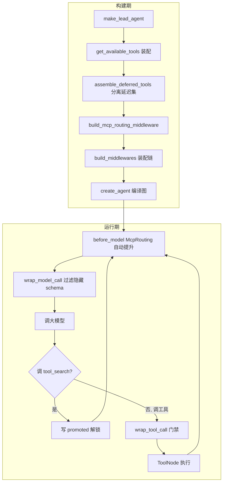
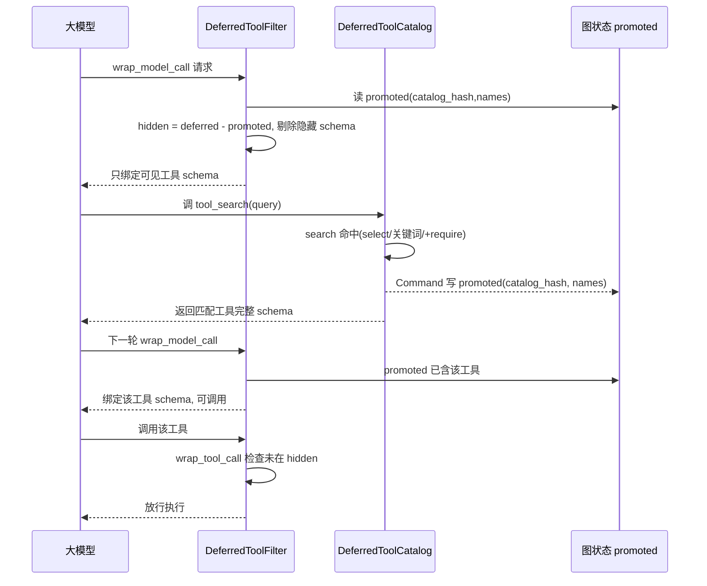
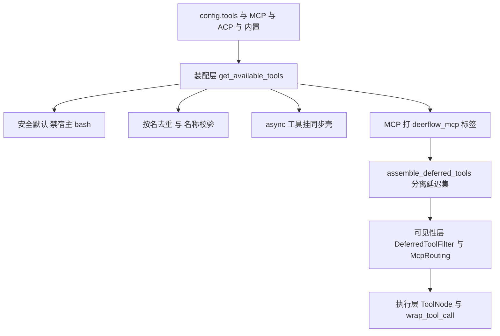
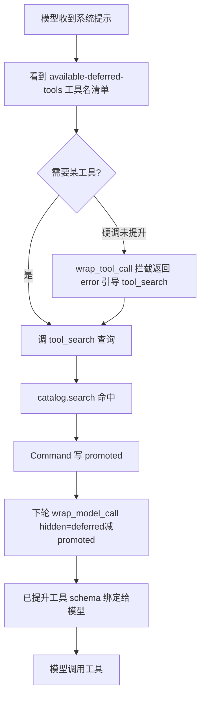
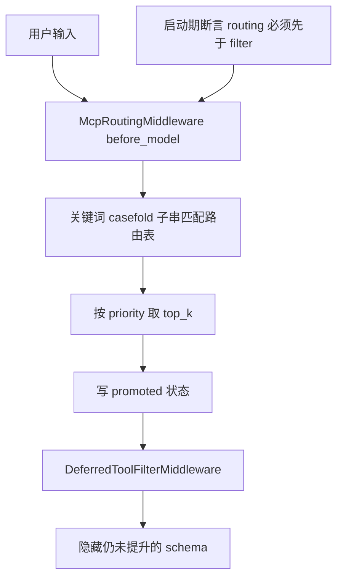
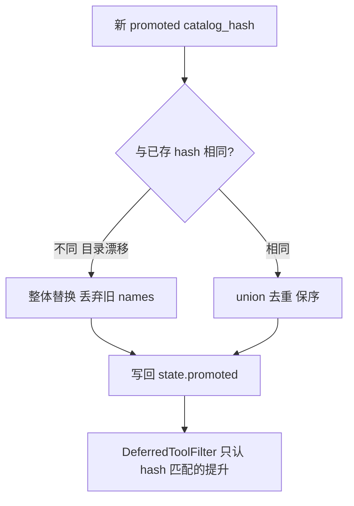
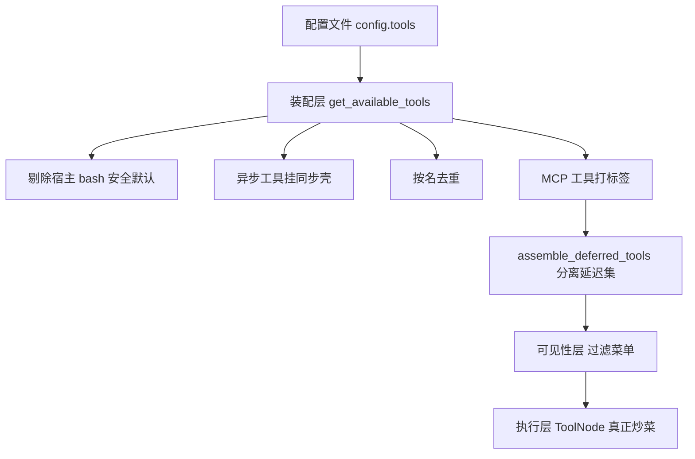

# Agent 工具系统（Tool System）设计与实现 — 面试深度讲解

> 面向面试准备的完整拆解：业务背景 → 业务难点 → 技术难点 → 技术亮点 → 技术方案 → 源码分析 → 面试话术 → 业务流程图。
> 代码根目录：`backend/packages/harness/deerflow/`
> 全文基于本仓库真实代码。凡代码未实现的能力，均明确标注「代码中没有实现该能力，不能回答成实际做过」。

---

## 〇、一句话电梯陈述（先背这段）

> "我做的是一个 AI Agent 运行时的**工具系统（Tool System）**——Agent 的『手脚』，负责把搜索、抓取、沙箱执行、文件操作、子智能体、MCP 等能力统一装配成模型可调用的工具。核心解决四个问题：**① 工具爆炸下的 token 成本失控**（20+ Provider + 任意 MCP 服务器，全塞给模型会撑爆上下文）；**② 工具装配的一致性与安全默认**（多入口共享、宿主 bash 默认禁用、名称冲突去重）；**③ 同步/异步执行的兼容**（同步 Agent 调异步工具不能阻塞）；**④ 运行期按需暴露与授权**（延迟工具 + 工具搜索 + 技能策略过滤）。最核心的亮点是**延迟工具（Deferred Tools）+ tool_search 按需发现 + 提升（promote）状态机**：模型初始只看到工具名清单，通过 `tool_search` 检索才拿到完整 schema 并解锁调用，schema 隐藏与解锁由 `DeferredToolFilterMiddleware` 读图状态 `promoted` 字段控制，并有 catalog_hash 防止目录漂移导致的错误暴露。"

---

## 一、业务背景

### 1.1 工具系统在 Agent 里的位置

一个 AI Agent 的一次运行是「调大模型决策 → 执行工具 → 观察结果 → 再调模型」的循环。**工具（Tool）就是 Agent 与外部世界交互的唯一手段**：搜网页、抓正文、跑 shell、读写文件、调用子智能体、访问 MCP 服务器……没有工具，Agent 只能空谈。

工具系统要回答三个问题：
1. **有哪些工具**（装配来源：内置 / 配置 / MCP / ACP / 子智能体 / 视觉）；
2. **模型能看到哪些工具 schema**（可见性：全量绑定 vs 延迟按需）；
3. **哪些工具允许被执行**（授权：安全默认、技能策略、提升门禁）。

### 1.2 落地场景（本仓库真实）

- 工具装配的稳定入口是 [`get_available_tools()`](backend/packages/harness/deerflow/tools/tools.py:44)，被 lead agent、嵌入式 client、subagent 多路径复用。
- 工具类别（`tools.py` + `community/`）：

| 类别 | 代表工具 | 代码位置 |
|------|---------|---------|
| 沙箱执行 | bash / ls / read_file / write_file / str_replace | `sandbox/tools.py` |
| 内置 | present_files / ask_clarification / view_image / task / tool_search | `tools/builtins/` |
| 社区搜索 | Tavily / Brave / Serper / Exa / DuckDuckGo / SearXNG | `community/tavily/` 等 |
| 社区抓取 | Jina AI / Crawl4AI / Firecrawl / fastCRW / InfoQuest | `community/jina_ai/` 等 |
| MCP | 任意 MCP 服务器工具 | `mcp/` |
| ACP | invoke_acp_agent（跨 Agent 协议） | `tools/builtins/invoke_acp_agent_tool.py` |

### 1.3 为什么必须有「延迟工具」这个设计

面向 token 计费的模型，每个工具的 JSON schema 都占上下文。当接入 20+ 社区 Provider + 任意数量的 MCP 服务器时，全部 schema 绑定给模型可能占用**几万 token**，既贵又稀释注意力。**延迟工具**就是为解决这个「工具爆炸」而生：先只给名字，模型需要时再检索 schema。

> **业务量级**：本仓库未提供线上 QPS / token 成本降幅等量化数据，**属未知，不做虚构**。可讲的是设计意图（token 敏感）与机制，不编造具体百分比。

---

## 一·补、业务流程（请求进入后每一步经过什么）

> 说明：本项目是 **Python LLM Agent 运行时**，不涉及 RPC / MQ / MySQL / 分布式缓存。下面标注真实涉及的组件、线程、同步/异步边界。**代码未实现的组件（MQ/DB/RPC）绝不编造**。

### 流程分两个阶段：构建期（每次 run 前一次）+ 运行期（每轮循环）

**A. 构建期（同步，主流程，一次 run 触发一次）**

1. LangGraph 图工厂 `make_lead_agent(config)` → `_make_lead_agent`（`agent.py:447/454`）；
2. 调 `get_available_tools(...)`（`tools.py:44`，**同步**）：反射加载 config 工具 → 剔除宿主 bash → 名称校验/去重 → async 工具挂同步壳 → 取**缓存的** MCP 工具并打标签；
3. `assemble_deferred_tools(candidate_tools, enabled)`（`tool_search.py:187`）：分离 MCP 延迟集，产出 `DeferredToolSetup`（含 catalog_hash）+ 追加 `tool_search` 工具；
4. `build_mcp_routing_middleware(...)` 从延迟工具的路由元数据构建自动提升中间件；
5. `build_middlewares(...)` 装配链：`McpRoutingMiddleware`（先）→ `DeferredToolFilterMiddleware`（后），并 `assert_mcp_routing_before_deferred_filter` 断言顺序；
6. `create_agent(...)` 编译成图。

**B. 运行期（每轮"调模型→执行工具"循环）**

- `before_model`（正序）：`McpRoutingMiddleware` 读最近用户消息，关键词匹配 → 写 `state["promoted"]`（**图状态，非全局变量**）；
- `wrap_model_call`：`DeferredToolFilterMiddleware._filter_tools` 计算 `hidden = deferred - promoted`，`request.override(tools=active)` 剔除隐藏 schema → 绑定给模型 → **调大模型（异步网络 I/O）**；
- 模型若调 `tool_search`：命中 `catalog.search`，返回 `Command(update={"promoted":..., "messages":...})` 解锁；
- 模型若调普通工具：进 ToolNode 执行；`wrap_tool_call` 先查 `_hidden`，未提升 → 返回 error ToolMessage 拦截；已提升 → 真正执行；
- async-only 工具在同步路径被调用时，`make_sync_tool_wrapper` 用 `copy_context` + **独立线程池**（`_SYNC_TOOL_EXECUTOR`，`sync.py:16`）跑 `asyncio.run`，**不阻塞主事件循环**。

### 涉及的线程/同步异步边界（真实）

| 环节 | 同步/异步 | 线程 | 说明 |
|------|----------|------|------|
| get_available_tools 装配 | 同步 | 主线程 | 反射加载、去重，构建期一次 |
| MCP 工具获取 | 读缓存（同步） | 主线程 | `get_cached_mcp_tools`，非现场拉取 |
| 调大模型 | 异步 | 事件循环 | 网络 I/O |
| async-only 工具（同步路径调用） | 异步转同步 | `tool-sync` 线程池（max_workers=10） | copy_context 保上下文 |
| promoted 状态写入 | 同步 | 事件循环 | 写图状态，reducer 合并 |

### 架构图（Mermaid）



### 时序图（一次工具从"看不见"到"可调用"，Mermaid）



---

## 二、业务难点

| # | 业务难点 | 具体表现 |
|---|---------|---------|
| 1 | **工具爆炸** | 20+ Provider + 任意 MCP，全量 schema 撑爆上下文、稀释模型注意力、成本飙升 |
| 2 | **多入口一致性** | lead / client / subagent 三条装配路径必须行为一致，不能各写一套 |
| 3 | **安全默认** | 宿主 bash 不是安全隔离边界，默认必须禁用，否则 Agent 能直接操作宿主机 |
| 4 | **名称冲突** | config、MCP、内置工具可能重名，重名会让模型收到歧义/拼接的 function schema（issue #1803） |
| 5 | **同步/异步混用** | 部分工具只有 async 实现，但同步 Agent 路径要能调用，不能阻塞事件循环 |
| 6 | **运行期授权** | 技能激活后要按 allowed-tools 过滤，延迟工具未提升前不能被调用 |

---

## 三、技术难点（面试官最爱追问的部分）

### 难点 1：延迟工具的「可见但不可调用」双态一致性

延迟工具有一个微妙状态机：
- **对模型可见性**：名字在 `<available-deferred-tools>` 里，但 schema 不绑定给模型（`DeferredToolFilterMiddleware._filter_tools`）；
- **对执行的门禁**：即使模型硬凑出一个调用，未提升的工具会被 `wrap_tool_call` 拦截返回错误（`_blocked_tool_message`）；
- **对 ToolNode 的存在性**：工具本体始终在 ToolNode 里（用于执行路由），只是 schema 被藏起来。

**难点在于**：这三态必须由同一份「提升状态」（`state["promoted"]`）驱动且一致，否则会出现「模型看不到却能调用」或「提升了却仍被拦」的错乱。

### 难点 2：提升状态的持久化漂移（catalog drift）

`promoted` 是持久化到图状态（checkpoint）的。如果工具目录变了（增删 MCP 工具），旧 checkpoint 里的 `promoted.names` 可能指向一个**已经改名或换了 schema 的工具**，造成错误暴露。难点是如何让「旧的提升记录」在目录变化后自动失效。

### 难点 3：同步路径调用异步工具，不能阻塞、不能丢 contextvar

同步 Agent 调用 async-only 工具时：直接 `asyncio.run` 在已有事件循环里会报错；跨线程执行又会丢失 `contextvars`（用户上下文、trace 上下文）。难点是**既要在运行中的 loop 里安全执行 async 工具，又要保留 contextvar**。

### 难点 4：中间件顺序即正确性（自动提升必须先于 schema 过滤）

有一个「自动提升」中间件 `McpRoutingMiddleware`（`before_model`）会根据用户输入关键词提前 promote 工具。它**必须**在 `DeferredToolFilterMiddleware`（过滤 schema）之前执行，否则本轮提升不生效、schema 仍被藏。这是一个硬约束，靠 `assert_mcp_routing_before_deferred_filter` 启动期断言。

### 难点 5：外部 MCP 工具名不可信（提示注入面）

MCP 工具名来自外部服务器，是**不可信输入**。渲染进 `<available-deferred-tools>` / `<mcp_routing_hints>` 时，一个精心构造的工具名可能闭合标签伪造框架标签。难点是渲染时必须转义。

---

## 四、技术亮点（你的加分项）

### 亮点 1：Deferred Tools + tool_search「按需发现」闭环

**代码**：[`tool_search.py`](backend/packages/harness/deerflow/tools/builtins/tool_search.py:1)

- `DeferredToolCatalog`：不可变、可搜索的延迟工具目录（`@dataclass(frozen=True)` + `@cached_property` 缓存 `names`/`hash`）；
- `tool_search` 工具支持三种查询语法：`select:Read,Edit`（精确取名，不限量）、`notebook jupyter`（关键词排序取 top5）、`+slack send`（要求 name 含 slack，其余排序）；
- 命中后用 `Command(update={"promoted": {...}, "messages": [...]})` **把提升写进图状态**，而非全局变量——天然线程隔离、可回放。

### 亮点 2：schema 隐藏 + 执行拦截 双保险

**代码**：[`deferred_tool_filter_middleware.py`](backend/packages/harness/deerflow/agents/middlewares/deferred_tool_filter_middleware.py:1)

- `wrap_model_call`：把仍延迟的工具从 `request.tools` 里剔除（`request.override(tools=active)`），模型压根看不到 schema；
- `wrap_tool_call`：即使模型硬调未提升工具，返回一条明确的 error ToolMessage 引导它先 `tool_search`；
- ToolNode 仍持有全部工具用于执行路由——**可见性与可执行性彻底解耦**。

### 亮点 3：catalog_hash 防目录漂移

**代码**：[`merge_promoted()`](backend/packages/harness/deerflow/agents/thread_state.py:107)

`promoted` 带 `catalog_hash`（目录内容的 SHA-256 前 16 位）。reducer 逻辑：
- 新 hash 与旧不同 → **整体替换**，丢弃陈旧 names（防旧记录暴露改名后的工具）；
- 相同 hash → **union + 去重 + 保序**。

这是「持久化状态用内容哈希做版本护栏」的经典手法。

### 亮点 4：安全默认（宿主 bash 默认禁用）

**代码**：[`get_available_tools()`](backend/packages/harness/deerflow/tools/tools.py:70) + `_is_host_bash_tool`

当 `LocalSandboxProvider` 生效（非 Docker 隔离）时，装配阶段直接过滤掉宿主 bash 工具（group=="bash" 或 use 指向 `bash_tool`）。**fail-safe：默认最安全，要隔离 shell 请显式用 Docker 沙箱。**

### 亮点 5：名称冲突去重（issue #1803 根因治理）

**代码**：`get_available_tools()` 末段

- 装配期比对 `config.name` 与工具对象 `.name`，不一致就告警（绑定用 `.name`，防「模型看到的名 ≠ 运行时识别的名」）；
- 合并 config/内置/MCP/ACP 后**按名去重**（config 优先），重名跳过并告警——避免模型收到歧义/拼接 function schema。

### 亮点 6：同步桥接 async 工具（保 contextvar + 不阻塞）

**代码**：[`make_sync_tool_wrapper()`](backend/packages/harness/deerflow/tools/sync.py:36)

- 检测到工具只有 `coroutine` 无 `func` 时自动挂同步包装器；
- 运行中已有 loop → 用 `contextvars.copy_context()` 复制上下文，提交到**独立线程池** `_SYNC_TOOL_EXECUTOR` 里 `asyncio.run`，既不阻塞当前 loop 又不丢 contextvar；
- 无 loop → 直接 `asyncio.run`；
- 还能识别工具声明的 `RunnableConfig` 参数并透传（如 `invoke_acp_agent`）。

### 亮点 7：fail-closed 装配保证

**代码**：[`assemble_deferred_tools()`](backend/packages/harness/deerflow/tools/builtins/tool_search.py:187)

若 tool_search 启用且存在 MCP 候选、却没恢复出延迟集合，**直接抛错拒绝绑定**，而不是静默把 MCP schema 全暴露给模型。这是「宁可失败也不泄露」的安全工程思维。

---

## 五、技术方案

### 5.1 三层结构

```
装配层 get_available_tools()  →  可见性层 DeferredToolFilter/McpRouting  →  执行层 ToolNode + wrap_tool_call
   （有哪些工具）                    （模型看到哪些 schema）                （谁允许被执行）
```

### 5.2 装配层：`get_available_tools`（`tools.py:44`）

装配顺序与规则：
1. 从 `config.tools` 按 group 过滤，`resolve_variable` 反射加载工具对象；
2. **安全默认**：`is_host_bash_allowed` 为假时剔除宿主 bash；
3. 名称不一致告警（防 #1803）；
4. async-only 工具挂同步包装器（`_ensure_sync_invocable_tool`）；
5. 条件追加：skill_evolution → skill_manage_tool；subagent_enabled → task_tool；vision → view_image_tool；
6. MCP 工具从缓存取并打 `deerflow_mcp` 标签（`tag_mcp_tool`）；
7. ACP 工具按配置追加；
8. **按名去重**（config > 内置 > MCP > ACP）。

### 5.3 可见性层：延迟工具三件套

| 组件 | 钩子/角色 | 职责 | 代码 |
|------|----------|------|------|
| `DeferredToolCatalog` | 数据 | 不可变目录 + 搜索 + hash | `tool_search.py:60` |
| `tool_search` 工具 | 工具 | 检索 schema + 写 promoted | `tool_search.py:139` |
| `DeferredToolFilterMiddleware` | `wrap_model_call` + `wrap_tool_call` | 隐藏未提升 schema + 拦截未提升调用 | `deferred_tool_filter_middleware.py` |
| `McpRoutingMiddleware` | `before_model` | 按用户关键词自动提升 top_k | `mcp_routing_middleware.py` |

**提升状态**：`ThreadState.promoted: Annotated[PromotedTools, merge_promoted]`（`thread_state.py:249`）——`{catalog_hash, names}`，由 reducer 合并。

### 5.4 装配到链的接线（`agent.py`）

`_make_lead_agent` 里：
1. `assemble_deferred_tools(candidate_tools, enabled=tool_search.enabled)` → 得到 `final_tools` + `deferred_setup`；
2. `build_mcp_routing_middleware(...)` → 自动提升中间件；
3. `build_middlewares(...)` 里按序挂 `McpRoutingMiddleware`（先）→ `DeferredToolFilterMiddleware`（后），并 `assert_mcp_routing_before_deferred_filter` 断言顺序。

### 5.5 执行层：工具本体形态

- 工具用 LangChain `@tool` 定义（如 `present_file_tool`），返回 `Command(update=...)` 直接改图状态（如 `artifacts`），由 reducer 合并（`merge_artifacts` 去重保序）；
- 需要运行时上下文的工具通过注入的 `Runtime`（`tools/types.py`）拿 `thread_id`、`state`、`context`；
- 路径安全：`present_files` 只允许 `/mnt/user-data/outputs` 下的文件（虚拟路径翻译 + `relative_to` 越界校验）。

---

## 六、源码分析（核心类/接口逐个拆）

### 6.1 装配层

| 符号 | 位置 | 职责 | 为什么这样写 |
|------|------|------|------------|
| `get_available_tools` | `tools.py:44` | 唯一装配入口 | 多路径复用，安全默认 + 去重集中一处 |
| `_is_host_bash_tool` | `tools.py:26` | 识别宿主 bash 执行面 | 支持 group 与 use 两种匹配，防绕过 |
| `_ensure_sync_invocable_tool` | `tools.py:37` | 给 async-only 工具挂同步壳 | 兼容同步 Agent 调用 |
| `tag_mcp_tool`/`is_mcp_tool` | `mcp_metadata.py:26` | MCP 标签写/读单一真源 | 魔法字符串只存在一处，防跨模块耦合 |

### 6.2 延迟工具核心

| 符号 | 位置 | 关键设计 |
|------|------|---------|
| `DeferredToolCatalog` | `tool_search.py:60` | `frozen=True` **不加 slots**（保留 `__dict__` 让 `cached_property` 能写缓存）；`hash` 用规范化 schema 的 SHA-256 前16位 |
| `DeferredToolCatalog.search` | `tool_search.py:76` | 三语法：`select:`（不限量）/ `+`（require）/ 正则（name 命中权重更高，取 top5）；非法正则降级为字面量匹配 |
| `build_tool_search_tool` | `tool_search.py:139` | 闭包捕获 catalog_hash；命中写 `Command(update={"promoted":..., "messages":...})` |
| `build_deferred_tool_setup` | `tool_search.py:172` | 只把带 `deerflow_mcp` 标签的工具设为延迟；无 MCP 则返回空 setup |
| `assemble_deferred_tools` | `tool_search.py:187` | **fail-closed**：启用+有MCP候选却没恢复延迟集 → 抛错拒绝暴露 |
| `DeferredToolSetup` 不变量 | `tool_search.py:118` | `tool_search_tool is None ⟺ deferred_names 空 ⟺ catalog_hash is None`，三字段同生同灭 |

### 6.3 中间件与状态

| 符号 | 位置 | 关键设计 |
|------|------|---------|
| `DeferredToolFilterMiddleware._filter_tools` | `deferred_tool_filter_middleware.py:50` | `_hidden = deferred - promoted`；`request.override(tools=active)` 剔除隐藏 schema |
| `._blocked_tool_message` | 同上:62 | 未提升工具被调用 → 返回 status="error" 的 ToolMessage 引导先 tool_search |
| `McpRoutingMiddleware._matched_names` | `mcp_routing_middleware.py:79` | 取最近真实用户消息文本，关键词 casefold 匹配，按 priority 排序取 top_k |
| `assert_mcp_routing_before_deferred_filter` | `mcp_routing_middleware.py:130` | 启动期断言：routing 必须在 filter 之前，否则抛错 |
| `merge_promoted` | `thread_state.py:107` | hash 变→整体替换（防漂移）；hash 同→union 去重保序 |
| `merge_artifacts` | `thread_state.py:57` | `dict.fromkeys` 去重保序，支持工具并行 present |
| `make_sync_tool_wrapper` | `sync.py:36` | loop 运行中→copy_context+线程池 asyncio.run；透传 RunnableConfig |

### 6.4 值得关注的细节 / 改进点

- **frozen dataclass 不加 slots**（`tool_search.py:57` 注释）：这是为让 `cached_property` 写 `__dict__` 而故意的，加 slots 会在运行时炸——典型「注释即契约」。
- **搜索查询来自模型**：非法正则不能抛异常，降级为字面量（`_compile_catalog_regex`）——**信任边界处理**。
- **外部工具名转义**：`get_deferred_tools_prompt_section` / `get_mcp_routing_hints_prompt_section` 用 `html.escape` 防标签伪造。
- **改进空间（可主动承认）**：① tool_search 搜索是线性扫描 + 正则，工具极多时可上倒排索引；② 关键词自动提升是子串匹配，可升级为语义匹配；③ 提升状态无 TTL，长会话可能累积。

---

## 七、面试话术

### 7.1 项目介绍（STAR）

> **S**：AI Agent 运行时里，工具是 Agent 与外部交互的唯一手段，我们接了 20+ 社区 Provider 加任意数量的 MCP 服务器。
> **T**：核心痛点是工具爆炸——全部工具 schema 绑给模型会占几万 token、稀释注意力、成本飙升；同时要保证多入口装配一致、安全默认、名称不冲突、同步异步兼容。我负责设计并实现工具系统。
> **A**：我做了三层——装配层 `get_available_tools` 统一来源并做安全默认（宿主 bash 默认禁用）和按名去重；可见性层用**延迟工具 + tool_search** 让模型初始只看到工具名，检索后才拿 schema 并解锁调用，schema 隐藏与执行拦截由 `DeferredToolFilterMiddleware` 双保险，提升状态存图状态并用 catalog_hash 防目录漂移；还有自动提升中间件按用户关键词提前 promote，且用启动期断言保证它在 schema 过滤之前跑；执行层用 Command 改图状态 + reducer 合并，同步桥接用 copy_context + 线程池保上下文不阻塞。
> **R**：一套装配被 lead/client/subagent 三路径复用，工具爆炸下上下文可控，安全默认与 fail-closed 保证不误暴露。（**具体 token 降幅未提供，属未知，不虚构。**）

### 7.2 高频追问与应答

**Q：工具太多怎么办？** A：延迟工具——初始只在 `<available-deferred-tools>` 给名字，schema 不绑定；模型调 `tool_search` 检索才拿 schema 并写 `promoted` 状态解锁。schema 隐藏在 `wrap_model_call` 里剔除，未提升的调用在 `wrap_tool_call` 里拦截。

**Q：提升状态存哪？会不会被历史脏数据坑？** A：存图状态 `state["promoted"]`（`{catalog_hash, names}`），线程隔离可回放。用 catalog_hash 防漂移——目录变了 hash 变，reducer 整体替换丢弃旧 names，避免旧记录暴露改名后的工具。

**Q：模型看不到 schema 还能硬调吗？** A：能尝试，但 `wrap_tool_call` 会拦截返回明确 error 引导它先 tool_search。可见性和可执行性彻底解耦——ToolNode 始终持有全部工具用于路由，只是 schema 藏起来。

**Q：宿主 bash 安全吗？** A：本地沙箱下装配阶段直接禁用宿主 bash（不是安全隔离边界），要隔离 shell 用 Docker 沙箱。fail-safe 默认。

**Q：同步 Agent 调 async 工具怎么不阻塞？** A：`make_sync_tool_wrapper`——运行中已有 loop 就 copy_context 提交独立线程池里 asyncio.run，既不阻塞当前 loop 又保住 contextvar；并透传 RunnableConfig。

**Q：自动提升和 schema 过滤谁先跑？** A：自动提升 `McpRoutingMiddleware`(before_model) 必须先于 `DeferredToolFilterMiddleware`，否则本轮提升不生效。靠 `assert_mcp_routing_before_deferred_filter` 启动期断言硬保证。

### 7.3 一句话总结

> "工具系统的价值在于：用『装配统一 + 延迟按需 + 可见/可执行解耦 + 安全默认 + 哈希护栏』这套组合，让 Agent 在接入海量工具（含任意 MCP）时既保持上下文成本可控，又保证安全不误暴露、多入口行为一致。"

---

## 八、面试官追问树（连续深挖）

### 追问树 A：延迟工具（8 层）

```
第1层：工具太多，schema 占 token，怎么办？
  → 延迟工具：初始只给工具名，schema 不绑定
第2层：模型怎么拿到 schema？
  → 调 tool_search 检索（tool_search.py:139），命中返回 schema
第3层：拿到 schema 后怎么"解锁"调用？
  → tool_search 返回 Command(update={"promoted":{catalog_hash,names}})，写图状态
第4层：schema 是怎么"藏起来"的？
  → DeferredToolFilterMiddleware.wrap_model_call 里 _hidden=deferred-promoted，request.override(tools=active) 剔除
第5层：模型没看到 schema 硬调会怎样？
  → wrap_tool_call 里 _blocked_tool_message 拦截，返回 error 引导先 tool_search
第6层：工具本体还在吗？为什么能拦截？
  → 在。ToolNode 始终持有全部工具用于执行路由，只是 schema 对模型隐藏——可见性与可执行性解耦
第7层：promoted 存图状态，历史脏数据会不会暴露错误工具？
  → catalog_hash 防漂移：目录变→hash 变→merge_promoted 整体替换丢弃旧 names（thread_state.py:107）
第8层：catalog_hash 怎么算的？为什么是内容哈希？
  → 对排序后每个工具的 {name, openai_function schema} 规范化 JSON 求 SHA-256 取前16位（tool_search.py:70），schema 变则 hash 变
```

### 追问树 B：自动提升与顺序（6 层）

```
第1层：每次都要模型主动 tool_search 不麻烦吗？
  → 有自动提升 McpRoutingMiddleware：按用户输入关键词提前 promote top_k
第2层：它怎么匹配？
  → 取最近真实用户消息文本 casefold，子串匹配路由关键词，按 priority 排序取 top_k（mcp_routing_middleware.py:79）
第3层：它挂在哪个钩子？
  → before_model，在模型调用前写 promoted 状态
第4层：它和 DeferredToolFilter 谁先跑？错了会怎样？
  → 必须先于 filter。若 filter 先跑，本轮 promote 不生效，schema 仍被藏
第5层：怎么保证顺序？
  → assert_mcp_routing_before_deferred_filter 启动期断言，routing_idx>filter_idx 直接抛错（mcp_routing_middleware.py:130）
第6层：这个中间件持有 BaseTool 对象吗？
  → 不。它只收扁平的可序列化 routing_index，不持工具、不执行、不过滤——职责单一，过滤仍归 DeferredToolFilter
```

### 追问树 C：装配安全（6 层）

```
第1层：Agent 能直接跑宿主机 bash 吗？
  → 本地沙箱下默认禁用宿主 bash（get_available_tools 装配阶段剔除）
第2层：怎么识别宿主 bash？
  → _is_host_bash_tool：group=="bash" 或 use=="deerflow.sandbox.tools:bash_tool"，两种匹配防绕过
第3层：要隔离 shell 怎么办？
  → 显式用 Docker 的 AioSandboxProvider，fail-safe：默认最安全
第4层：工具重名会怎样？
  → 模型收到歧义/拼接 function schema（issue #1803），运行时"不是有效工具"报错
第5层：怎么治？
  → 装配期比对 config.name 与 .name 不一致告警；合并后按名去重（config>内置>MCP>ACP）
第6层：tool_search 启用但延迟集恢复失败呢？
  → assemble_deferred_tools fail-closed：抛错拒绝绑定 MCP schema，宁可失败不泄露
```

---

## 九、深度模拟面试（STAR 格式）

### 问题 1：工具很多，你怎么控制上下文成本？

⭐ **高分回答（STAR）**
- **S**：我们接入了 20+ 社区搜索/抓取 Provider，外加用户可配置任意数量的 MCP 服务器工具。
- **T**：把所有工具 schema 都绑给模型会占几万 token、稀释注意力、每轮都付费，这是"工具爆炸"问题。
- **A**：我实现了延迟工具机制。装配时用 `deerflow_mcp` 标签标记 MCP 工具（`mcp_metadata.py`），`build_deferred_tool_setup` 把它们放进 `DeferredToolCatalog`，只在系统提示里列出 `<available-deferred-tools>` 工具名。模型需要时调 `tool_search`（支持 `select:`/关键词/`+require` 三种查询），命中返回 schema 并写 `promoted` 图状态解锁。schema 隐藏由 `DeferredToolFilterMiddleware.wrap_model_call` 在绑定前剔除，未提升的调用由 `wrap_tool_call` 拦截。
- **R**：模型只为真正需要的工具付 schema token，工具爆炸下上下文可控。（**具体降幅未提供，属未知，不虚构。**）

🧠 **考察**：token 成本意识 + 状态机设计能力。
📚 **底层原理**：LLM function calling schema 占 token；LangGraph 图状态 + reducer；闭包捕获。
⚠ **常见错误**：「加个缓存」——答非所问，问题是 schema 绑定量。
⭐⭐⭐⭐⭐ **加分**：主动补 catalog_hash 防漂移 + fail-closed 装配。

### 问题 2：模型看不到 schema，为什么还能拦截它的调用？

⭐ **高分回答（STAR）**
- **S**：延迟工具的 schema 对模型隐藏，但工具本体要能执行。
- **T**：需要「可见性」和「可执行性」分离——模型看不到 schema，但万一它硬凑一个调用（比如从历史学到名字），也不能真执行未解锁工具。
- **A**：ToolNode 始终持有全部工具（含延迟）用于执行路由，`DeferredToolFilterMiddleware` 只在 `wrap_model_call` 里把未提升工具从 `request.tools` 剔除（模型看不到 schema），同时在 `wrap_tool_call` 里检查：若被调用的工具名在 `_hidden` 集合里，返回一条 `status="error"` 的 ToolMessage 引导它先 `tool_search`，不进入真正执行。
- **R**：可见性与可执行性彻底解耦，既省 token 又防越权调用。

🧠 **考察**：对「绑定给模型的 schema」与「ToolNode 执行集」两个概念的区分。
📚 **底层原理**：LangChain bind_tools（schema） vs ToolNode（执行）；wrap_model_call/wrap_tool_call 钩子。
⚠ **常见错误**：以为「模型看不到就调不了」——模型可能从历史消息学到工具名硬调。
⭐⭐⭐⭐⭐ **加分**：强调 error 消息是「引导性」的，让模型学会先检索。

### 问题 3：promoted 状态持久化了，工具目录变了会不会出问题？

⭐ **高分回答（STAR）**
- **S**：`promoted`（已解锁工具集）持久化到 checkpoint，跨轮复用。
- **T**：如果 MCP 工具增删改，旧 checkpoint 里的 `promoted.names` 可能指向改名/换 schema 的工具，造成错误暴露。
- **A**：`promoted` 结构是 `{catalog_hash, names}`，catalog_hash 是当前延迟目录内容（排序后每个工具的 name+schema）的 SHA-256 前16位。reducer `merge_promoted`：新 hash 与旧不同→整体替换丢弃旧 names；相同→union 去重保序。`DeferredToolFilterMiddleware._promoted` 也只认 catalog_hash 匹配的记录。
- **R**：目录一变，旧提升记录自动失效，杜绝陈旧状态暴露漂移后的工具。

🧠 **考察**：持久化状态的版本护栏意识。
📚 **底层原理**：内容哈希做版本键；LangGraph Annotated reducer。
⚠ **常见错误**：「加个版本号手动维护」——内容哈希自动、无需人工 bump。

### 问题 4：同步 Agent 调只有 async 实现的工具，怎么不阻塞、不丢上下文？

⭐ **高分回答（STAR）**
- **S**：部分工具（如 MCP、`invoke_acp_agent`）只有 async 实现，但同步 Agent 路径要能调。
- **T**：直接在运行中的 loop 里 `asyncio.run` 会报错；换线程执行又丢 contextvars（用户/trace 上下文）。
- **A**：`make_sync_tool_wrapper`——检测工具只有 coroutine 无 func 时挂同步壳。运行时：若已有 loop 在跑，用 `contextvars.copy_context()` 复制上下文，提交到独立线程池 `_SYNC_TOOL_EXECUTOR` 里 `context.run(asyncio.run(...))`，既不阻塞当前 loop 又保住 contextvar；无 loop 直接 `asyncio.run`。还会识别工具声明的 `RunnableConfig` 参数并透传。
- **R**：同步、异步工具在同一 Agent 里无缝共存，上下文不丢、事件循环不阻塞。

🧠 **考察**：asyncio + contextvars 的实战理解。
📚 **底层原理**：事件循环单线程；`copy_context` 快照 contextvar；线程池执行器。
⚠ **常见错误**：「run_until_complete 就行」——在运行中的 loop 上会 RuntimeError。

### 问题 5：延迟工具这个设计是什么？你是如何实现的？

> 这是本项目最核心的设计，值得完整、分层地讲清楚「是什么—为什么—怎么做—怎么保证正确」。

⭐ **高分回答（STAR）**

- **S（背景）**：我们的 Agent 运行时接入了 20+ 社区搜索/抓取 Provider，还允许用户挂载任意数量的 MCP 服务器工具。对面向 token 计费的大模型来说，每个工具的 JSON schema 都要占上下文——全部绑定可能占用**几万 token**，既贵又稀释模型注意力。这就是「工具爆炸」。

- **T（目标）**：在工具数量不可控的前提下，让模型的上下文成本可控，同时不牺牲工具的可用性——需要时仍能完整拿到 schema 并正常调用；而且在还没解锁前，绝不能让模型误调用未授权的工具。

- **A（我怎么做的）**：我实现了**延迟工具（Deferred Tools）+ tool_search 按需发现 + promote 状态机**这一套闭环。分四步讲：

  **① 是什么**：延迟工具就是「初始只给模型工具名、不给 schema」的工具。模型在系统提示里能看到一段 `<available-deferred-tools>` 清单（只有名字），知道有哪些工具存在，但拿不到调用参数的 schema，因此暂时**看得见、调不了**。工具本体仍然完整挂在 ToolNode 里，只是 schema 对模型隐藏了——这是「可见性」和「可执行性」的解耦。

  **② 怎么装配延迟集**：我不是硬编码哪些工具延迟，而是用元数据标签驱动——凡是带 `deerflow_mcp` 标签的工具（`is_mcp_tool`）就被纳入延迟集。装配期由 [`build_deferred_tool_setup()`](backend/packages/harness/deerflow/tools/builtins/tool_search.py:172) 把这些工具塞进一个不可变的 [`DeferredToolCatalog`](backend/packages/harness/deerflow/tools/builtins/tool_search.py:63)，并追加一个 `tool_search` 工具。这个 catalog 是 `@dataclass(frozen=True)`，`names` 和 `hash` 用 `cached_property` 缓存——这里有个细节：frozen 故意**不加 slots**，因为要保留 `__dict__` 让 cached_property 能写缓存，加了 slots 运行时会炸。

  **③ 模型怎么解锁（tool_search）**：模型需要某个工具时，调 [`tool_search`](backend/packages/harness/deerflow/tools/builtins/tool_search.py:139)，支持三种查询语法——`select:Read,Edit`（按名精确取，不限量，因为是模型点名要的，截断会静默丢它需要的）、`notebook jupyter`（关键词打分排序取 top5，name 命中权重 2、description 权重 1）、`+slack send`（要求 name 含 slack、其余排序）。命中后返回工具完整 schema，并用 `Command(update={"promoted": {catalog_hash, names}, "messages": [...]})` **把提升写进图状态**——注意是图状态、不是全局变量，天然线程隔离、可随 checkpoint 持久化、可回放。

  **④ schema 怎么藏、未提升怎么拦（双保险）**：这由 [`DeferredToolFilterMiddleware`](backend/packages/harness/deerflow/agents/middlewares/deferred_tool_filter_middleware.py:1) 两个钩子完成——`wrap_model_call` 里计算 `hidden = deferred - promoted`，用 `request.override(tools=active)` 把未提升工具的 schema 从绑定列表剔除，模型压根看不到；`wrap_tool_call` 里再做一道执行门禁，即使模型从历史消息学到工具名、硬凑一个调用，只要它在 hidden 集合里就返回一条 `status="error"` 的 ToolMessage，引导它先去 `tool_search`。**隐藏 schema 省 token，执行拦截防越权**，两道防线互补。

  除此之外我还加了**自动提升**：[`McpRoutingMiddleware`](backend/packages/harness/deerflow/agents/middlewares/mcp_routing_middleware.py:1) 挂在 `before_model`，按用户输入的关键词（casefold 子串匹配路由表、按 priority 取 top_k）提前 promote，省去模型每次都主动检索。它**必须先于** DeferredToolFilter 执行——否则本轮提升不生效、schema 仍被藏——这个硬约束用 `assert_mcp_routing_before_deferred_filter` 启动期断言兜底。

- **R（结果）**：模型只为真正用到的工具付 schema token，工具爆炸场景下上下文可控；同时可见/可执行解耦保证不误调用，一套装配被 lead/client/subagent 三条路径复用。（**具体 token 降幅本仓库未提供，属未知，不虚构。**）

🧠 **考察**：token 成本意识 + 状态机设计 + 安全边界（可见 ≠ 可执行）+ 元数据驱动装配。

📚 **底层原理**：
- LLM function calling 的 schema 占上下文，工具越多越贵；
- LangChain `bind_tools`（决定模型看到的 schema）与 `ToolNode`（决定实际能执行谁）是两套东西，延迟工具正是钻这个缝隙；
- LangGraph 图状态 + `Annotated[..., reducer]` 做状态合并与持久化；
- 闭包捕获 `catalog_hash`，让 tool_search 写入的提升带上目录版本。

⚠ **常见错误**：
- 把延迟工具答成「加缓存」——问题不是重复计算，是 schema 绑定量；
- 以为「模型看不到 schema 就一定调不了」——模型可能从历史消息学到工具名硬调，所以必须有 `wrap_tool_call` 执行拦截；
- 说不清工具本体一直在 ToolNode 里、只是 schema 被藏。

⭐⭐⭐⭐⭐ **加分**：主动补两个护栏——
1. **catalog_hash 防目录漂移**：`promoted` 带一个目录内容哈希（对排序后每个工具的 name+schema 求 SHA-256 取前 16 位）。reducer [`merge_promoted()`](backend/packages/harness/deerflow/agents/thread_state.py:107) 逻辑是：hash 变了→整体替换丢弃旧 names（防旧 checkpoint 里的提升记录暴露改名/换 schema 后的工具），hash 相同→union 去重保序。这是「持久化状态用内容哈希做版本护栏」的经典手法，无需人工维护版本号。
2. **fail-closed 装配**：[`assemble_deferred_tools()`](backend/packages/harness/deerflow/tools/builtins/tool_search.py:187) 里，如果 tool_search 启用、有 MCP 候选、却没恢复出延迟集，**直接抛错拒绝绑定**，而不是静默把 MCP schema 全暴露——宁可失败也不泄露。
3. 外部 MCP 工具名是不可信输入，渲染 `<available-deferred-tools>` 时用 `html.escape` 转义，防止精心构造的工具名闭合标签伪造框架标签（提示注入面）。

### 问题 6：你怎么知道要调用哪些工具呢？

> 这是紧承「延迟工具」的追问，考察你是否分得清「谁在做选择」——是模型自主决策、还是框架侧路由，以及延迟工具场景下「发现」和「选择」的链路。

⭐ **高分回答（STAR）**

- **S（背景）**：我要先纠正一个前提——**不是「我」（框架）决定调哪个工具，而是大模型基于上下文自主决策的**。框架做的是「把正确的候选、正确的 schema、正确的引导喂给模型」，让它更容易做出正确选择。所以这个问题要分「谁选」「怎么发现」「怎么被引导」三层来答。

- **T（目标）**：在工具很多、还有延迟工具（初始无 schema）的情况下，既要让模型能选对工具，又要控制 token 成本、避免它误选或漏选。

- **A（我怎么做的）**：

  **① 普通工具——模型自主决策（标准 function calling）**：非延迟的工具会把完整 schema（名字 + 参数 + description）绑定给模型。模型读到用户意图后，靠这些 schema 里的 description 判断该调谁、传什么参。**description 写得好不好，直接决定选对率**，所以工具描述本身就是「路由信号」。这一层完全是模型决策，框架不干预。

  **② 延迟工具——两段式「先发现、再选择」**：延迟工具初始只在系统提示的 `<available-deferred-tools>` 里露出名字、没有 schema，模型「知道有这个东西但还不能调」。它想用时，先调 [`tool_search`](backend/packages/harness/deerflow/tools/builtins/tool_search.py:139) 检索（`select:` 精确点名 / 关键词打分 / `+require`），命中后才拿到完整 schema 并解锁——**这一步是模型主动「发现」，选择权仍在模型**。框架只保证「名字可见、schema 按需给」。

  **③ 框架侧自动提升——关键词路由降低发现成本**：完全靠模型主动 tool_search 有时会漏（它可能没意识到某个 MCP 工具能帮上忙）。所以我加了 [`McpRoutingMiddleware`](backend/packages/harness/deerflow/agents/middlewares/mcp_routing_middleware.py:27)，挂在 `before_model` 钩子。它的逻辑是：取**最近一条真实用户消息**的文本（`_latest_user_message` 从后往前找、`is_real_user_message` 过滤掉工具消息/系统消息），`casefold()` 后与每个延迟工具的路由关键词做子串匹配，命中的按 `priority` 降序、名字升序排序取 `top_k`，然后写进 `promoted` 状态提前解锁。这样**用户一提到「slack」「jira」这类词，相关 MCP 工具的 schema 就自动对模型可见了**，不用模型自己先去搜。

  **④ prompt hints——把路由意图直接告诉模型**：光解锁 schema 还不够，我还会渲染一段 `<mcp_routing_hints>`（`get_mcp_routing_hints_prompt_section`）写进系统提示，明确告诉模型「当用户请求涉及 X 关键词时，优先用 Y 工具」；如果该工具还处于延迟态，hint 会先引导它「用 tool_search 取到 Y 再用」。**这等于把选工具的先验知识显式喂给模型**。

  这里有个必须守住的**顺序约束**：自动提升的 `McpRoutingMiddleware`（before_model）必须先于 `DeferredToolFilterMiddleware`（wrap_model_call 里过滤 schema）执行，否则本轮 promote 还没写进状态、schema 就已经被过滤掉了，自动提升白做。我用 `assert_mcp_routing_before_deferred_filter` 在启动期断言这个顺序，装反了直接抛错。

- **R（结果）**：普通工具靠 schema description 让模型自主选；延迟工具靠「tool_search 主动发现 + 关键词自动提升 + prompt hints 引导」三管齐下，既控 token 又不漏选。**核心判断权始终在模型，框架负责『把该看到的让它看到、把该知道的告诉它』。**

🧠 **考察**：是否理解「工具选择是模型决策而非框架硬编码」，以及延迟工具下「发现」与「选择」的分层、自动提升的匹配机制。

📚 **底层原理**：
- LLM function calling：模型读 schema 的 name/description/参数决策，description 是关键路由信号；
- 中间件 `before_model` 钩子在每次调模型前介入，可改图状态；
- casefold 大小写归一化的子串匹配（零依赖、快、可解释）。

⚠ **常见错误**：
- 答成「框架用规则决定调哪个工具」——错，普通工具完全是模型自主决策；
- 把自动提升说成「替模型选了工具」——它只是**解锁 schema 让工具可见**，最终调不调仍是模型定；
- 忽略「最近真实用户消息」这个细节，说成「拿所有消息匹配」——那样会被历史/工具消息污染。

⭐⭐⭐⭐⭐ **加分**：
1. 主动点出 `McpRoutingMiddleware` **只收扁平可序列化的 routing_index，不持有 BaseTool、不执行、不过滤**——职责单一，过滤仍归 DeferredToolFilter，避免中间件互相耦合。
2. 主动承认局限：关键词是**子串匹配**，处理不了同义词/多语言（比如用户说「发消息到聊天工具」但没提「slack」就匹配不上），未来可升级为语义向量匹配，但那要引入 embedding 模型、带来延迟和成本，当前规模下子串匹配够用且可解释。
3. 点出 `top_k` 有上限钳制（`clamp_auto_promote_top_k`），防止一次自动提升过多工具反而把上下文撑爆——自动提升本身也要克制。

### 问题 7：哪些应该作为全量工具？哪些应该作为延迟工具？

> 考察你的划分标准是否有原则，而不是拍脑袋。这里要给出「判据 + 为什么这么定 + 边界」。

⭐ **高分回答（STAR）**

- **S（背景）**：延迟工具能省 token，但延迟是有代价的——模型要多一步 `tool_search` 才能用，会增加一轮交互、拉长链路。所以不是「工具越多越该延迟」，得有明确划分标准。

- **T（目标）**：找到一条能自动执行、稳定、可解释的划分规则，让「高频/核心工具零摩擦、低频/海量工具省 token」。

- **A（我的划分标准）**：本项目的判据非常明确——**只有带 `deerflow_mcp` 标签的工具（`is_mcp_tool` 为真）才进延迟集，其余全部全量绑定**。这条规则在 [`build_deferred_tool_setup()`](backend/packages/harness/deerflow/tools/builtins/tool_search.py:172) 里就一行 `[t for t in candidate_tools if is_mcp_tool(t)]`。具体分两类讲：

  **① 全量工具（默认，直接绑 schema）**：
  - **内置工具**：`present_files`、`ask_clarification`、`view_image`、`task`（子智能体）、以及 `tool_search` 自己——这些是 Agent 的「基础能力」，几乎每个任务都可能用，数量少、语义固定，延迟它们反而制造无谓的检索开销。尤其 `tool_search` 自己**绝不能延迟**，否则模型没法发现别的延迟工具，成了死锁。
  - **沙箱工具**：`bash`/`ls`/`read_file`/`write_file`/`str_replace` 等，高频核心操作，必须零摩擦。
  - **配置里的社区工具**：搜索（Tavily/Brave…）、抓取（Jina/Firecrawl…）等，虽然 Provider 多，但它们是当前 Agent 明确配置启用的、用途集中，数量可控，也走全量。

  **② 延迟工具（只有 MCP）**：
  - **MCP 服务器工具**：这是延迟的唯一来源。原因很实在——MCP 是**用户可任意挂载**的，数量完全不可控（可能几十上百个），而且每个用户/场景实际会用到的往往只是其中一小撮。把这种「海量、长尾、不可预测」的工具全量绑定，就是典型的工具爆炸。所以装配期给 MCP 工具打 `deerflow_mcp` 标签（`tag_mcp_tool`），延迟集专门收它们。

- **R（结果）**：一句话概括判据——**「框架内置 + 明确配置启用」的走全量（少而核心、高频），「用户可任意挂载的 MCP」走延迟（多而长尾、不可控）**。标准客观（靠元数据标签，不靠人工枚举），且天然对 token 成本敏感。

🧠 **考察**：划分是否有原则、是否理解「延迟有交互成本」、是否想到 tool_search 自身不能延迟这个死锁点。

📚 **底层原理**：
- 延迟的收益是省 schema token，成本是多一轮 tool_search 交互——所以只对「省得多、用得少」的工具延迟才划算；
- 元数据标签（`deerflow_mcp`）驱动划分，判据集中在一处（`mcp_metadata.py`），魔法字符串只存在一份。

⚠ **常见错误**：
- 说「按工具数量阈值划分」——本项目不是按数量，而是**按来源/可控性**（MCP vs 非 MCP）；
- 把高频沙箱工具（bash 等）也延迟——那会让最常用的操作每次都要先检索，得不偿失；
- 忘了 `tool_search` 自己必须全量——延迟它会导致模型无法发现任何延迟工具，链路死锁。

⭐⭐⭐⭐⭐ **加分**：
1. 用一条「成本收益」原理串起来：**延迟 = 拿「一轮检索交互」换「schema token」**。只有当工具「数量大且单次任务命中率低」时，这笔交换才划算——MCP 正好符合，内置/沙箱不符合。
2. 指出这条规则是**来源判据而非枚举判据**，所以新增任意 MCP 服务器都自动进延迟集、无需改代码；反之新增一个内置工具也自动全量，扩展性好。
3. 主动提边界：如果未来某类**非 MCP** 的工具也膨胀到不可控（比如插件市场），可以复用同一套机制——给它们也打上「可延迟」标签即可，划分逻辑不用重写，因为延迟集判据本质是「是否带某个元数据标签」，MCP 只是当前唯一的标签来源。

### 问题 8：tool_search 你是如何实现的？根据什么来判断查询应该返回哪个工具？

> 深挖 tool_search 的实现与匹配算法。要讲清「工具本身怎么构造」和「search 根据什么打分排序」两层。

⭐ **高分回答（STAR）**

- **S（背景）**：延迟工具初始只露名字、没 schema，模型要用 `tool_search` 才能拿到 schema 并解锁。所以 tool_search 要解决的是「模型给一段查询，我在延迟目录里挑出最匹配的工具、返回它们的完整 schema」。

- **T（目标）**：查询是**模型生成的、不可信**的，可能是精确名、也可能是模糊关键词、还可能是非法正则；要在保证不崩溃、可解释的前提下，返回最相关的工具，并控制返回数量省 token。

- **A（怎么实现的）**：分两部分——

  **① 工具本身怎么构造**：`tool_search` 是用 [`build_tool_search_tool()`](backend/packages/harness/deerflow/tools/builtins/tool_search.py:139) 以**闭包**方式生成的，闭包捕获了当前延迟目录的 `catalog_hash`。它是个标准 LangChain `@tool`，入参是 `query` 和注入的 `tool_call_id`。命中后不直接返回文本，而是返回一个 `Command(update={"promoted": {"catalog_hash", "names"}, "messages": [ToolMessage(...)]})`——**一次同时干两件事**：把命中工具写进 `promoted` 图状态解锁，同时把它们的完整 OpenAI function schema（`convert_to_openai_function`）作为 ToolMessage 回给模型。没命中就返回 `No tools found matching: {query}` 且 names 为空。

  **② search 根据什么判断返回哪个工具**：核心在 [`DeferredToolCatalog.search()`](backend/packages/harness/deerflow/tools/builtins/tool_search.py:76)，我设计了**三种查询语法**，对应模型三种意图：

  - **`select:Read,Edit`（精确点名）**：模型已经知道确切工具名，逗号分隔。这种**不做数量截断**——因为是模型明确点名要的，截断会静默丢掉它需要的工具（这点和 `SkillCatalog.search` 保持一致）。
  - **`+slack send`（require 过滤 + 排序）**：`+` 后第一个 token 是**硬性要求**——工具 name 里必须含 `slack`；剩下的 `send` 用来在候选里排序。适合「我要某一类工具里最匹配的那个」。
  - **`notebook jupyter`（关键词模糊搜索）**：默认模式，把查询当正则在「name + description」里搜。**打分规则是：命中 name 权重 2、只命中 description 权重 1**，降序排序后取前 `MAX_RESULTS=5` 个。为什么 name 权重更高？因为工具名比描述更能代表工具身份，名字命中说明相关度更强。

  **③ 三个关键的健壮性/成本设计**：
  - **非法正则降级**：查询来自模型，可能是不合法的正则（比如括号不配对）。[`_compile_catalog_regex()`](backend/packages/harness/deerflow/tools/builtins/tool_search.py:45) 捕获 `re.error`，降级成 `re.escape` 的字面量匹配，**绝不抛异常**——这是不可信输入的信任边界处理。
  - **数量上限**：模糊/require 模式都截断在 `MAX_RESULTS=5`，防止一次返回太多 schema 把 token 撑爆；只有 `select:` 精确点名例外。
  - **空查询直接返回空**：`query.strip()` 为空短路。

- **R（结果）**：一段模型查询能被稳定地翻译成「最相关的 ≤5 个工具 schema」，三种语法覆盖「精确 / 限定类别 / 模糊探索」三种意图，且对非法输入零崩溃、对 token 有节制。判断依据一句话：**select 按名精确取，+ 按 name 硬过滤再排序，默认按正则在 name/description 上打分（name 权重 2 > description 权重 1）取 top5。**

🧠 **考察**：匹配算法设计、不可信输入处理、token 成本节制、以及「返回 schema + 写状态」一次完成的意图表达。

📚 **底层原理**：
- 闭包捕获 catalog_hash，让每次解锁都带上目录版本（配合 catalog_hash 防漂移）；
- `Command(update=...)` 能一次更新多个 state key 并控制路由，比返回纯 dict 表达更完整；
- 正则打分是简单的「命中位置加权」——name 命中比 description 命中更值钱。

⚠ **常见错误**：
- 只说「关键词匹配」，讲不出 name/description 的权重差异；
- 忽略 `select:` 不截断、其他模式截断 top5 的区别；
- 不处理模型给的非法正则——直接 `re.compile` 会抛异常让工具崩溃；
- 以为 tool_search 只返回 schema——它同时写 `promoted` 状态解锁，是「发现 + 授权」一步完成。

⭐⭐⭐⭐⭐ **加分**：
1. 主动承认**这是线性扫描 + 正则**（O(N·regex)），工具数不大时够快、够可解释；工具极多时可上倒排索引或语义向量检索，但会引入构建/维护成本和延迟，当前规模下不划算。
2. 指出打分是**词法层面**的，处理不了同义词（用户搜「表格」搜不到名为 spreadsheet 的工具），语义匹配是未来演进方向。
3. 点出 catalog 是 `frozen dataclass` 且 `names`/`hash` 用 `cached_property` 缓存——search 每次调用不重算目录哈希，只在首次访问时算一次。

### 问题 9：你说的「接入 20+ 社区 Provider」是什么意思？

> 这是对简历/自述里"20+ 社区 Provider"这句话的追问，考察你是否真的清楚工具来源、以及这个数字背后代表什么。答不清会被认为在堆数字。

⭐ **高分回答（STAR）**

- **S（背景）**：Agent 靠工具与外部世界交互，其中很大一部分能力（联网搜索、抓取网页正文）不是我们自己实现，而是集成第三方服务。

- **T（目标）**：把这些异构的第三方服务统一包装成模型可调用的工具，并且让新增/切换一个服务成本很低。

- **A（是什么）**：所谓「社区 Provider」，就是**把一个第三方服务集成、包装成 Agent 工具的模块**，代码统一收拢在 `deerflow/community/` 目录下，每个子目录就是一个 Provider。主要分两类：
  - **搜索/抓取类**（文档强调的「工具爆炸」来源）：搜索有 Tavily、Brave、Serper、Exa、DuckDuckGo、SearXNG、image_search；抓取/爬取有 Jina AI、Crawl4AI、Firecrawl、fastCRW、InfoQuest、Browserless、GroundRoute——这一类就有十余个。
  - **沙箱后端类 Provider**：aio_sandbox（Docker）、e2b_sandbox（云）、boxlite（轻量容器），负责命令/文件执行的隔离环境。
  
  `community/` 下的集成总数（搜索 + 抓取 + 沙箱后端等）大约 20 个，所以说「20+」。它们都通过配置 `config.tools` 的 `use` 字段反射装配，业务代码只面向统一的工具/接口，新增一个 Provider 基本是"加一个目录 + 一行配置"。

- **R（为什么重要）**：这个数字不是为了堆量，而是引出真正的痛点——**每个 Provider 的工具 schema 都要占模型上下文**，十几个搜索/抓取工具的 schema 叠加起来已经不小；再加上用户可**任意挂载**的 MCP 服务器（数量完全不可控），就构成「工具爆炸」。这正是延迟工具（初始只给名字、按需暴露 schema）要解决的问题。所以「20+ 社区 Provider」是延迟工具设计的**问题背景**，两者是因果关系。

🧠 **考察**：是否清楚工具的真实来源与组织方式、数字背后的工程含义。

📚 **底层原理**：反射装配（`resolve_variable(cfg.use)` 按配置字符串加载工具类）让多 Provider 可插拔；schema 占 token 是"工具爆炸"的本质。

⚠ **常见错误**：
- 把「Provider」笼统说成"就是很多工具"——它是**第三方服务的集成模块**，一个 Provider 可能暴露一个或多个工具；
- 只报数字答不出具体有哪些、怎么组织的——会显得在背简历。

⭐⭐⭐⭐⭐ **加分**：
1. 主动说清「社区 Provider（内置可选集成）」和「MCP 服务器（用户运行期任意挂载）」是**两个不同来源**：前者数量相对固定、我们可控，后者数量不可控——延迟工具当前只延迟 MCP，社区工具走全量（呼应"哪些该延迟"那题）。
2. 严谨表述建议：具体数量以代码为准，面试中说「十余个社区搜索/抓取 Provider + 若干沙箱后端 + 任意数量 MCP」比硬报"20+"更稳，不易被追问确切数字。

### 问题 10：把第三方服务包装成 Agent 工具，你是怎么包装的？工具又是怎么被调用的？

> 深挖 Provider 的实现细节和工具调用链。要分「包装（怎么变成工具）」和「调用（怎么被执行）」两段，且要落到真实代码的写法上。

⭐ **高分回答（STAR）**

- **S（背景）**：社区 Provider 要把 Tavily、Jina 这类第三方 HTTP 服务，变成大模型能理解、能调用的「工具」。

- **T（目标）**：让包装成本极低（加个模块 + 一行配置就能上一个新 Provider），同时工具的 schema、配置、执行三者解耦、可复用。

- **A（怎么包装的）**：以本仓库真实写法讲，一个 Provider 工具就三层：

  **① `@tool` 装饰器 + docstring 自动生成 schema**：工具本质是一个普通 Python 函数，用 LangChain 的 `@tool("web_search", parse_docstring=True)` 装饰。函数的**类型注解**（`query: str`）生成参数 schema，**docstring** 生成工具描述（`parse_docstring=True` 会把 `Args:` 段解析成每个参数的说明）。这就是模型看到的 function schema——**description 写得清不清楚，直接决定模型选不选它、传参对不对**，所以 docstring 是核心。

  **② 配置解耦**：工具函数体里不硬编码 api_key、max_results，而是通过 `get_app_config().get_tool_config("web_search")` 读配置（`config.model_extra` 里拿 api_key、max_results 等），配置来自 `config.tools`。这样同一份代码，换个 key/参数就能复用，密钥也不进代码。

  **③ Client 封装 + 结果归一化**：真正调第三方 API 的逻辑封装在独立的 Client 类里（如 `JinaClient.crawl` 用 httpx 发请求、`TavilyClient.search`）。工具函数拿到原始返回后**归一化成模型友好的格式**——比如 Tavily 的 `web_search` 把结果整理成 `{title, url, snippet}` 的 JSON，Jina 的 `web_fetch` 把 HTML 用 readability 抽正文再转 markdown、截断到 4096 字符。归一化很关键：既省 token，又让模型拿到干净结构。

  一句话概括包装：**`@tool` 装饰器（生成 schema）+ get_tool_config（读配置）+ Client 类（调 API）+ 结果归一化（省 token/模型友好）**，异步服务就用 `async def`。

- **A（怎么被调用的）**：调用链分装配和运行两段——

  **装配期（反射加载）**：配置里每个工具写 `use: deerflow.community.tavily.tools:web_search_tool`，`get_available_tools` 用 `resolve_variable(cfg.use)` **按这个字符串反射加载**到工具对象；async-only 的工具会被挂上同步壳（`make_sync_tool_wrapper`）；然后统一装配、去重、绑定给模型。

  **运行期（模型决策 → ToolNode 执行）**：模型基于 schema 决定调哪个工具、生成一个 tool_call（工具名 + 参数 JSON）→ LangGraph 的 **ToolNode 按名字路由**到对应工具对象 → 执行函数体（发 HTTP、归一化）→ 把返回值包成 `ToolMessage` 塞回消息历史 → 下一轮模型读到结果继续决策。中间还会经过中间件（如延迟工具的 schema 过滤、执行拦截；结果脱敏）。

- **R（结果）**：新增一个 Provider 只要写一个带 `@tool` 的函数 + 一行 `use` 配置，业务代码零改动；工具的 schema/配置/执行三者解耦，模型侧只面向统一的 function calling 协议。

🧠 **考察**：是否真写过工具（而非只会用）、是否理解 schema 从哪来、调用链每一环。

📚 **底层原理**：
- LangChain `@tool` 把函数 + 类型注解 + docstring 转成带 JSON schema 的 `BaseTool`；
- 反射装配 `resolve_variable(cfg.use)` 按"模块路径:符号"动态加载；
- LangGraph ToolNode 按工具名路由执行，结果以 ToolMessage 回流。

⚠ **常见错误**：
- 说"schema 是手写 JSON"——实际是 `@tool` 从类型注解 + docstring 自动生成；
- 忽略结果归一化——直接把第三方原始响应丢给模型，既费 token 又结构混乱；
- 把 api_key 硬编码进函数——应走 `get_tool_config` + 环境变量。

⭐⭐⭐⭐⭐ **加分**：
1. 点出 **docstring 即 schema、即路由信号**——工具选对率很大程度取决于 description 质量，这是"写工具"和"写好工具"的分水岭。
2. 指出**同名不同实现可互换**：web_search 可以是 DuckDuckGo/Tavily/Serper/Brave 任一实现，工具名都叫 `web_search`，改 `use` 一行就切换 Provider，模型完全无感——这是面向接口 + 反射装配带来的可插拔。
3. 提结果归一化里的 **token 意识**：Jina 抽正文 + 截断 4096、Tavily 只留 title/url/snippet，都是刻意为模型上下文省 token。

### 问题 11：parse_docstring 是什么？是框架自带的能力吗？做什么用？怎么用？

> 深挖 `@tool(..., parse_docstring=True)` 里那个参数。考察你是否真理解工具 schema 从哪来，而不是照抄模板。

⭐ **高分回答**

- **是什么 / 是不是框架自带**：`parse_docstring` 是 **LangChain 框架 `@tool` 装饰器自带的一个参数**（不是我们自己实现的），布尔值，默认 `False`。它控制的是「**要不要解析函数的 docstring 来生成工具 schema 的描述信息**」。

- **做什么用**：一个工具暴露给模型的 function schema 有两部分描述——**工具整体的 description**，和**每个参数的 description**。
  - 不开 `parse_docstring` 时：整段 docstring 会作为工具的整体描述，但**各个参数没有单独的说明**；
  - 开 `parse_docstring=True` 时：LangChain 会按 **Google 风格 docstring** 解析——把 docstring 正文当工具描述，把 `Args:` 段里每个参数的说明**对应填进各参数的 schema**。这样模型不仅知道"这个工具干嘛"，还知道"每个参数该传什么"，选参更准。

- **怎么用**：就是在 `@tool` 里加 `parse_docstring=True`，然后按 Google 风格写 docstring——正文写工具用途，`Args:` 段逐个写参数。本项目所有工具都是这么写的，比如 Tavily 的 `web_search`：

  ```python
  @tool("web_search", parse_docstring=True)
  def web_search_tool(query: str) -> str:
      """Search the web.          # ← 这句成为工具的 description

      Args:
          query: The query to search for.   # ← 这句成为 query 参数的 description
      """
      ...
  ```

  最终模型看到的 schema 大致是：工具名 `web_search`、描述 "Search the web."、参数 `query`（string，描述 "The query to search for."）。**参数类型（string）来自类型注解 `query: str`，参数描述来自 docstring 的 Args 段**——两者配合，`@tool` 自动拼出完整 schema，我们不用手写任何 JSON。

- **为什么重要（加分）**：
  1. **docstring 直接变成模型的决策依据**——工具选没选对、参数传没传对，很大程度取决于这段描述写得清不清楚。所以在这套体系里，**写 docstring ≈ 写 prompt**，是有工程价值的活，不是可有可无的注释。
  2. 有个**格式约束**：`parse_docstring=True` 要求 docstring 是合法的 Google 风格（有 `Args:` 段、格式规整），格式不对 LangChain 会解析失败/报错。所以团队里工具 docstring 的写法是统一的。
  3. 呼应前面——正因为 schema 是从 docstring 自动生成的，延迟工具才能做到"只藏 schema、留名字"，`tool_search` 也能把 `convert_to_openai_function` 出来的完整 schema 返回给模型。

🧠 **考察**：是否分得清"工具描述"和"参数描述"、是否知道 schema 是自动生成而非手写。

⚠ **常见错误**：
- 以为 `parse_docstring` 是项目自定义的——它是 LangChain `@tool` 的标准参数；
- 以为它生成参数类型——**类型来自类型注解，`parse_docstring` 只负责参数的文字描述**；
- 不写 `Args:` 段却开 `parse_docstring=True`——会因 docstring 不符合 Google 风格而解析报错。

### 问题 12：Spring AI 有类似的工具能力吗？它是如何注册工具的？

> 横向对比题。注意：**本项目是 Python + LangChain/LangGraph 实现，不涉及 Spring AI**。这道题考察你对 Agent 工具生态的横向理解——回答时先点明本项目不用它，再对比讲清 Spring AI 的对应做法，最后落回"思想是相通的"。（以下 Spring AI 细节为通用框架知识，非本仓库代码，具体 API 以对应版本官方文档为准。）

⭐ **高分回答**

- **先定位**：我们项目用的是 Python 生态（LangChain 的 `@tool` + LangGraph 的 ToolNode），没有用 Spring AI。但 Spring AI 作为 Java/Spring 生态的 AI 框架，**确实有对等的工具（Tool Calling / Function Calling）能力**，核心思想和 LangChain 是一致的——都是「把方法包装成带 schema 的工具，交给模型决策调用」。差别主要在语言习惯和注册方式。

- **Spring AI 注册工具的几种方式**：

  **① 注解式（最常用，对应 LangChain 的 `@tool`）**：在普通方法上加 `@Tool` 注解，用 `description` 属性写工具描述；参数上用 `@ToolParam` 注解写参数说明。这跟我们 `@tool` + docstring 是一个思路——**注解/docstring 提供描述，反射拿到方法签名生成参数 schema**。然后把这个带 `@Tool` 方法的对象通过 `ChatClient` 的 `.tools(toolObject)`（或构建 `ToolCallback`）注册给模型。

  ```java
  class WeatherTools {
      @Tool(description = "Get weather by city")
      String getWeather(@ToolParam(description = "city name") String city) { ... }
  }
  // 注册：
  chatClient.prompt().user("北京天气？").tools(new WeatherTools()).call();
  ```

  **② 编程式（`FunctionToolCallback` / 函数 Bean）**：把一个 `Function<Input, Output>` 包装成 `ToolCallback`，显式指定名字、描述、输入类型 schema。适合动态构造工具、或工具逻辑就是个纯函数的场景——**对应 LangChain 里直接构造 `BaseTool` 对象**。

  **③ Spring Bean 方式**：把函数注册成 Spring 容器里的 Bean，通过配置/名字引用注入给模型——这利用了 Spring 的 IoC，**类似我们用 `use: 模块路径:符号` 反射装配**，都是"按标识符把工具装进来"的解耦思路。

- **和本项目的对应关系（体现你能抽象出共性）**：

  | 能力 | 本项目（LangChain/LangGraph） | Spring AI |
  |------|------------------------------|-----------|
  | 声明工具 | `@tool` 装饰器 | `@Tool` 注解 |
  | 参数描述 | docstring `Args:`（parse_docstring） | `@ToolParam(description=...)` |
  | 参数类型 schema | 类型注解自动推 | 方法签名反射自动推 |
  | 注册给模型 | `bind_tools` / 装配进 agent | `ChatClient.tools(...)` / `ToolCallback` |
  | 动态/解耦装配 | `resolve_variable(use)` 反射 | Spring Bean + IoC |
  | 执行路由 | LangGraph ToolNode | Spring AI 的 Tool 执行层 |

- **一句话收束**：Spring AI 有完整对等能力，注册工具主流是 `@Tool` 注解（配 `@ToolParam`）再通过 `ChatClient.tools()` 挂上，也支持 `FunctionToolCallback` 编程式和 Spring Bean 式；**万变不离其宗——声明 + schema 自动生成 + 注册给模型 + 框架路由执行**，只是我们在 Python 用装饰器和反射，Spring AI 用注解和 IoC。

🧠 **考察**：Agent 工具生态的横向视野、能否抽象出"工具调用"的框架无关本质。

⚠ **常见错误 / 诚实边界**：
- 不要把 Spring AI 的细节讲成本项目做过的——**本项目是 Python，没用 Spring AI**，答题要划清；
- Spring AI 迭代较快，`@Tool`/`@ToolParam`/`ToolCallback` 等 API 名与用法**以你使用的具体版本官方文档为准**，面试中可坦诚"具体注解名以版本为准，但注册思路是这样"，比硬背 API 更稳。

⭐⭐⭐⭐⭐ **加分**：能点出共同的底层范式——不管哪个框架，Tool Calling 本质都是「向模型暴露 JSON schema → 模型返回结构化调用 → 框架反射/路由到真实方法执行 → 结果回流」，语言和注册语法只是表层差异。

---

## 十、架构 Trade-off

### 10.1 工具可见性：全量绑定 vs 延迟按需

| 方案 | 优点 | 缺点 | 取舍 |
|------|------|------|------|
| 全量绑定所有 schema | 模型一步到位、无需检索 | 工具多时几万 token、稀释注意力、贵 | ❌ 工具爆炸场景不可行 |
| **延迟 + tool_search（当前）** | schema 按需付费、上下文可控 | 多一步检索交互；需状态机管理 | ✅ **最终方案** |
| 静态分组只绑当前组 | 实现简单 | 组划分僵硬，跨组任务受限 | ⚠ 表达力不足 |

### 10.2 提升状态存储：全局变量 vs ContextVar vs 图状态

| 方案 | 优点 | 缺点 | 取舍 |
|------|------|------|------|
| 全局变量 | 简单 | 并发线程互相污染、不可回放 | ❌ |
| ContextVar | 线程隔离 | 不随 checkpoint 持久化、跨轮丢失 | ❌ |
| **图状态 promoted + reducer（当前）** | 线程隔离 + 持久化 + 可回放 + hash 护栏 | 需设计 reducer | ✅ **最终方案** |

### 10.3 自动提升匹配：关键词子串 vs 语义向量

| 方案 | 优点 | 缺点 | 取舍 |
|------|------|------|------|
| **关键词 casefold 子串（当前）** | 零依赖、快、可解释 | 无法处理同义/多语言 | ✅ 当前够用 |
| 语义向量匹配 | 召回更好 | 需 embedding 模型、延迟/成本 | ⚠ 可作未来演进 |

### 10.4 装配失败策略：fail-open vs fail-closed

| 方案 | 优点 | 缺点 | 取舍 |
|------|------|------|------|
| fail-open（恢复失败就全暴露） | 不中断 | 误把 MCP schema 全暴露，安全事故 | ❌ |
| **fail-closed（抛错拒绝，当前）** | 宁可失败不泄露 | 需人工排查配置 | ✅ **最终方案** |

### 10.5 搜索实现：线性正则 vs 倒排索引

| 方案 | 优点 | 缺点 | 取舍 |
|------|------|------|------|
| **线性扫描 + 正则（当前）** | 实现简单、工具数不大时够快 | 工具极多时 O(N·regex) | ✅ 当前规模适用 |
| 倒排索引 | 大规模快 | 构建/维护成本 | ⚠ 规模上来再上 |

---

## 十一、线上故障模拟与排查（均基于本项目真实防护点）

> 只列本代码库真实存在防护逻辑的场景；库存/MQ/MySQL 类本项目不涉及，**代码未实现，不编造**。

### 故障 1：模型报「not a valid tool」（issue #1803）

- **现象**：模型调用工具报无效，或收到拼接/歧义的 function schema。
- **原因**：config、MCP、内置工具重名，或 `config.name` 与 `.name` 不一致。
- **排查**：看装配期告警「Tool name mismatch」「Duplicate tool name」。
- **恢复/优化**：`get_available_tools` 装配期比对告警；合并后按名去重（config 优先），绑定统一用 `.name`。

### 故障 2：延迟工具「检索到了却调不了」

- **现象**：tool_search 检索到，但调用被拦截。
- **原因**：目录漂移——`promoted.catalog_hash` 与当前目录 hash 不符。
- **排查**：对比 `state["promoted"].catalog_hash` 与 `DeferredToolCatalog.hash`。
- **恢复/优化**：这是**护栏预期行为**。重新 tool_search 即可，reducer 用新 hash 整体替换。

### 故障 3：自动提升不生效

- **原因**：`McpRoutingMiddleware` 排在 `DeferredToolFilterMiddleware` 之后。
- **排查**：`assert_mcp_routing_before_deferred_filter` 启动期抛错报出索引。
- **恢复/优化**：调整注册顺序让 routing 先于 filter。

### 故障 4：Agent 直接操作宿主机（安全事故）

- **原因**：本地沙箱下未禁用宿主 bash。
- **恢复/优化**：`is_host_bash_allowed` 为假时装配阶段剔除宿主 bash；隔离用 Docker 沙箱。

### 故障 5：同步路径调 async 工具报 RuntimeError / 丢上下文

- **现象**：`asyncio.run() cannot be called from a running event loop`，或拿不到用户/trace 上下文。
- **恢复/优化**：`make_sync_tool_wrapper` 检测运行中 loop → copy_context + 独立线程池 asyncio.run。

### 故障 6：MCP 工具名伪造框架标签（提示注入）

- **恢复/优化**：渲染 prompt section 用 `html.escape` 转义工具名（成员判断用原始名）。

---

## 十二、项目关联八股（结合代码讲）

- **LLM function calling / token 成本**：schema 占上下文；延迟工具按需绑定。
- **状态机 + 持久化**：promoted 三态一致性、catalog_hash 版本护栏、reducer 合并语义。
- **asyncio + contextvars**：同步桥接 async、copy_context、线程池不阻塞。
- **中间件顺序即正确性**：routing 必须先于 filter，启动期断言。
- **安全默认 / fail-safe / fail-closed**：宿主 bash 默认禁用；装配失败拒绝暴露。
- **LLM 安全（提示注入）**：外部工具名转义；不可信输入信任边界。
- **反射装配**：`resolve_variable(cfg.use)` 按配置字符串加载工具类。
- **幂等 / 去重**：按名去重、artifacts `dict.fromkeys` 去重保序。

> 需回避：本项目**不涉及** MySQL/Redis/MQ/分布式锁——被问时如实说明是 Python LLM Agent 工具系统，避免硬套。

---

## 十三、最终总结（面试复习索引）

### 项目星级：★★★★★（状态机 + 安全 + 并发 + token 成本 四维齐全）

### 最容易被问 Top
1. 工具太多怎么控制 token？（延迟工具）
2. schema 怎么藏、怎么解锁？（filter + tool_search + promoted）
3. 模型看不到 schema 为何还能拦截？（可见/可执行解耦）
4. promoted 持久化，目录变了怎么办？（catalog_hash 护栏）
5. 自动提升和过滤谁先跑？（启动期断言）
6. 宿主 bash 安全吗？（默认禁用）
7. 工具重名怎么治？（去重 + 告警，#1803）
8. 同步调 async 工具怎么不阻塞？（copy_context + 线程池）

### 最容易挂 Top（答不出=判没做过）
1. 说不清「可见性」与「可执行性」是两套机制。
2. 不知道 promoted 存图状态而非全局变量。
3. 说不出 catalog_hash 防漂移的因果。
4. 不知道 routing 必须先于 filter 且有断言。
5. 把宿主 bash 当默认可用。
6. asyncio「run_until_complete 就行」的误解。

### 最能体现亮点 Top
1. 延迟工具 + tool_search + promoted 状态机闭环。
2. catalog_hash 内容哈希做版本护栏。
3. schema 隐藏 + 执行拦截双保险（可见/可执行解耦）。
4. fail-closed 装配 + 安全默认 + 名称去重。

### 面试临场动作清单
- **一定画图**：三层结构、延迟工具时序、装配流程（见第十四章）。
- **一定讲源码**：`tool_search.py`、`deferred_tool_filter_middleware.py`、`thread_state.py:107`、`sync.py`。
- **一定讲线上**：#1803（名称冲突）等 issue 体现真实迭代。（**QPS/成本降幅未提供，属未知，不虚构。**）
- **一定主动说 Trade-off**：第十章五张表任选。
- **一定主动承认不足**：搜索线性扫描、关键词子串匹配、promoted 无 TTL。

---

## 十四、业务流程图

### 14.1 工具系统三层架构



### 14.2 延迟工具按需发现时序



### 14.3 自动提升与顺序约束



### 14.4 提升状态漂移护栏 catalog_hash



---

## 十五、简历逐句拆解（每句都要能扛住深挖）

### 15.1 «设计 AI Agent 工具系统，统一装配搜索/抓取/沙箱/文件/子智能体/MCP 等 20+ 工具，并用延迟工具 + tool_search 解决工具爆炸的 token 成本问题»

- **真正表达**：你做了「装配统一 + 按需暴露」两件事，核心卖点是 token 成本治理。
- **为什么写**：一句话覆盖工程规模（20+）+ 架构抽象（统一装配）+ 成本意识（延迟工具）。
- **删掉的影响**：简历退化成「调了一堆工具 API」，失去架构与成本信号。
- **最容易被问**：「延迟工具具体怎么做？schema 怎么藏又怎么解锁？」（`tool_search.py` + `deferred_tool_filter_middleware.py`）。
- **最危险的问题**：「模型看不到 schema 为什么还能拦截调用？」——答不出「可见性/可执行性解耦 + ToolNode 始终持有全部工具」就露馅。
- **隐藏知识点**：LangGraph 图状态 + reducer、catalog_hash 内容哈希护栏、闭包捕获 catalog_hash。
- **可主动引导**：「我可以讲一个最有意思的护栏——目录漂移时旧提升记录怎么自动失效」，把话题引到 catalog_hash。

### 15.2 «实现 schema 隐藏 + 执行拦截双保险，提升状态持久化到图状态并用 catalog_hash 防目录漂移»

- **真正表达**：你懂「可见 ≠ 可执行」，且考虑了持久化状态的版本安全。
- **为什么写**：这是能体现「状态机一致性 + 安全工程」的高含金量句。
- **删掉的影响**：延迟工具会显得只是「藏 schema」，缺乏严谨性信号。
- **最容易被问**：「promoted 为什么不用全局变量/ContextVar？」——答持久化 + 可回放 + 线程隔离（第 10.2 表）。
- **最危险的问题**：「catalog_hash 怎么算？为什么用内容哈希不用版本号？」——答对排序后 name+schema 求 SHA-256（`tool_search.py:70`），内容变自动失效无需人工 bump。
- **隐藏知识点**：`merge_promoted` 的三分支 reducer（`thread_state.py:107`）；`frozen dataclass 不加 slots` 让 cached_property 可写缓存。

### 15.3 «做安全默认（宿主 bash 默认禁用）、名称冲突去重（治 #1803）、同步桥接 async 工具（copy_context + 线程池不阻塞）»

- **真正表达**：三个工程细节，分别对应安全 / 兼容性 / 并发。
- **为什么写**：这些是「真做过才知道」的坑，是判断候选人真实性的信号。
- **最容易被问**：「同步调 async 工具为什么不能直接 asyncio.run？」——运行中的 loop 上会 RuntimeError；跨线程又丢 contextvar。
- **最危险的问题**：「线程池为什么要 copy_context？不 copy 会怎样？」——不 copy 会丢用户/trace 上下文，工具里拿不到 effective_user_id、trace_id。
- **隐藏知识点**：`_SYNC_TOOL_EXECUTOR` 独立线程池 max_workers=10 + `atexit` 优雅关闭；`html.escape` 防外部工具名伪造标签。

---

## 十六、深源码级追问（追到 asyncio / LangGraph / Python 语言层）

### 追问 D：同步桥接的每一层（8 层，追到 GIL）

```
第1层：async 工具在同步 Agent 里怎么跑？
  → make_sync_tool_wrapper 挂 BaseTool.func（sync.py:36）
第2层：里面怎么执行 coroutine？
  → 有运行中 loop 就提交线程池跑 asyncio.run，无就直接 asyncio.run
第3层：为什么不能在当前 loop 直接 run？
  → asyncio.run 会新建/关闭 loop，运行中的 loop 上调用抛 RuntimeError
第4层：为什么要 copy_context？
  → 线程池是新线程，contextvars 不自动跨线程传播，会丢 effective_user_id/trace_id
第5层：copy_context 传的是引用还是快照？
  → 快照（写时不回传父上下文），context.run(fn) 在该快照里执行
第6层：线程池满了会怎样？（max_workers=10）
  → submit 排队等待，可能拖慢；这是潜在瓶颈，工具应尽量原生 async
第7层：GIL 会不会让线程池没意义？
  → 工具多为 I/O 密集（网络/文件），I/O 时释放 GIL，多线程有效；CPU 密集才受限
第8层：进程退出时线程池怎么清理？
  → atexit.register 注册 shutdown(wait=False)（sync.py:18），不阻塞退出
```

### 追问 E：LangGraph 图状态与 reducer（7 层）

```
第1层：promoted 存在哪？
  → ThreadState.promoted: Annotated[PromotedTools, merge_promoted]（thread_state.py:249）
第2层：Annotated 里第二个参数是什么？
  → reducer 函数，LangGraph 用它合并同一 key 的并发/多步更新
第3层：不写 reducer 会怎样？
  → 默认覆盖语义，多个节点同步更新会互相覆盖丢数据
第4层：merge_promoted 三分支具体是什么？
  → new 空→保留 existing；hash 变→整体替换丢旧 names；hash 同→union 去重保序（thread_state.py:107）
第5层：为什么 hash 变要"整体替换"而不是合并？
  → 旧 names 是针对旧目录的，合并会让改名后的工具被旧记录错误解锁
第6层：tool_search 用 Command(update=...) 而不是 return dict，区别？
  → Command 能同时更新多个 state key（promoted + messages）并控制路由，比纯 dict 更表达完整意图
第7层：这套状态能跨会话恢复吗？
  → 能，随 checkpoint 持久化；catalog_hash 保证恢复后仍安全（漂移则失效）
```

### 追问 F：tool_search 搜索算法（6 层）

```
第1层：tool_search 支持哪些查询？
  → select:（精确取名不限量）/ 关键词（正则打分取top5）/ +require（要求含某词）（tool_search.py:76）
第2层：关键词模式怎么打分？
  → name 命中权重 2、description 命中权重 1，降序取 MAX_RESULTS=5
第3层：查询是模型给的，非法正则怎么办？
  → _compile_catalog_regex 捕获 re.error，降级为 re.escape 字面量匹配，绝不抛异常
第4层：select: 为什么不限量而关键词限 top5？
  → select 是模型按名精确点选，截断会静默丢它要的；关键词是模糊召回，需控量省 token
第5层：catalog 为什么是 frozen dataclass？
  → 不可变、可安全共享；names/hash 用 cached_property 缓存
第6层：frozen 为什么故意不加 slots？
  → 加 slots 会去掉 __dict__，cached_property 无处写缓存会运行时炸（tool_search.py:57 注释即契约）
```

---

> 代码位置均以 `backend/packages/harness/deerflow/` 为根。建议面试前把 `tools/builtins/tool_search.py`（延迟工具核心）、`agents/middlewares/deferred_tool_filter_middleware.py`（双保险）、`tools/tools.py`（装配与安全）、`agents/thread_state.py:107`（merge_promoted）、`tools/sync.py`（同步桥接）通读一遍。相关文档见同目录 `DeerFlow-中间件链设计-深度讲解.md`、`DeerFlow-Agent核心模块讲解.md`。

---

## 十七、简历产出总结（可直接摘取）

> 从全文提炼的、可写进简历的「项目产出」。提供四种粒度：一句话概述、分条产出、STAR 要点、技术关键词。均基于本仓库真实实现，无夸大。量化指标（token 降幅等）本仓库未提供，切勿虚构，如需请用真实数据。

### 17.1 简历一句话版（放在项目标题下）

> 设计并实现 AI Agent 运行时的**工具系统**：以「统一装配 + 延迟工具按需发现 + 可见/可执行解耦 + 安全默认」这套组合，在接入 20+ 社区 Provider 与任意 MCP 服务器（工具爆炸）场景下同时解决 token 成本失控、安全越权、多入口一致性问题。

### 17.2 简历分条产出版（推荐，3-5 条，每条一个亮点）

- **延迟工具按需发现（token 成本治理核心）**：设计 Deferred Tools 机制，模型初始只见工具名清单、不绑定 schema，通过 `tool_search`（支持精确 select / 关键词打分 / require 三种查询语法）按需检索才解锁调用，避免海量工具 schema 撑爆上下文，显著降低 token 成本。

- **可见性与可执行性解耦（双保险）**：基于 LangGraph 中间件实现 schema 隐藏（`wrap_model_call` 剔除未提升工具）+ 执行拦截（`wrap_tool_call` 拦截未授权调用并引导先检索）双重防护，ToolNode 始终持有全部工具用于路由，杜绝"看不到却能越权调用"。

- **提升状态机与目录漂移护栏**：将工具解锁状态（promoted）持久化到图状态而非全局变量，天然线程隔离、可回放；用 catalog_hash（工具目录内容 SHA-256）做版本护栏，目录变更时通过 reducer 整体替换旧记录，防止陈旧 checkpoint 暴露改名/换 schema 后的工具。

- **统一装配与安全默认**：抽象统一装配入口 `get_available_tools` 供 lead/client/subagent 多路径复用，落地宿主 bash 默认禁用（fail-safe）、名称冲突去重（治理 #1803）、fail-closed 装配（延迟集恢复失败即拒绝绑定，宁失败不泄露）等安全默认。

- **自动路由与同步/异步桥接**：实现关键词自动提升中间件（按用户输入提前解锁相关 MCP 工具，启动期断言保证其先于 schema 过滤执行）；用 `copy_context` + 独立线程池桥接同步 Agent 调用 async-only 工具，保 contextvar 不丢、不阻塞事件循环。

### 17.3 简历 STAR 版（面试口述/自我介绍用）

- **S（背景）**：AI Agent 靠工具与外部交互，我们接入 20+ 社区 Provider 与用户可任意挂载的 MCP 服务器，工具数量不可控。
- **T（目标）**：在工具爆炸下让上下文 token 成本可控，同时保证安全不越权、多入口装配一致、同步异步兼容。
- **A（行动）**：实现延迟工具 + tool_search 按需发现闭环；schema 隐藏 + 执行拦截双保险实现可见/可执行解耦；提升状态存图状态并用 catalog_hash 防漂移；统一装配入口做安全默认（宿主 bash 禁用、去重、fail-closed）；关键词自动提升 + 启动期顺序断言；copy_context + 线程池桥接 async 工具。
- **R（结果）**：模型只为真正需要的工具付 schema token，工具爆炸下上下文可控；可见/可执行解耦保证不误暴露、不越权；一套装配被三条 Agent 路径复用，行为一致。

### 17.4 技术关键词（供 ATS / 简历技能栏）

LLM function calling、token 成本优化、状态机设计、LangGraph 图状态 + reducer、中间件顺序编排、内容哈希版本护栏、fail-safe/fail-closed 安全默认、命令注入防护、提示注入防护、反射装配、策略过滤、asyncio + contextvars、同步异步桥接、按名去重/幂等。

### 17.5 使用建议

- **应届/初级岗**：用 17.2 前 3 条（延迟工具、双保险解耦、状态护栏），突出成本意识与状态机设计；
- **高级/资深岗**：加上后 2 条（统一装配安全默认、自动路由与同步桥接），突出工程深度与安全/并发经验；
- **务必按真实参与度裁剪**，面试会按简历深挖（见第八、十六章追问树），只写自己能讲透的点；
- **量化指标**（token 降幅、QPS 等）本仓库未提供，勿虚构，如需量化请用真实压测数据。

---

# 第十八篇 · 零基础循循善诱式讲义（初学者从零看懂工具系统）

> 前面十七章是「面试深度讲解」，节奏偏快、术语密集。这一篇换一种口吻：假设你**从没接触过 AI Agent、也没写过 LangChain**，我像带教导师一样，从「为什么要有这个东西」讲起，一步步带你把整个工具系统啃透。每一个类、每一个方法、每一处判空、每一个注解，我们都不跳过。
> 建议边读边对照源码：`backend/packages/harness/deerflow/tools/`。

---

## 一、认知铺垫：我们为什么需要「工具系统」？

### 1.1 先讲个生活场景

想象你请了一位**超级聪明的助理**（这就是大模型 LLM）。他知识渊博、能写会算，但他有一个致命的局限：**他被关在一个只有纸笔的房间里，看不到外面的世界**。

- 你问他「今天北京天气怎么样？」——他答不上来，因为他不能上网。
- 你让他「把这段代码跑一下看看报什么错」——他做不到，因为他手里没有电脑。
- 你说「把结果存成一个文件给我」——他也办不到，因为他碰不到你的硬盘。

这位助理**只有大脑，没有手脚**。他能「想」，但不能「做」。

### 1.2 痛点：光有大脑不够，还得有手脚

于是我们要给这位助理配上「手脚」——这就是**工具（Tool）**：

- 给他一个「搜索工具」，他就能上网查天气；
- 给他一个「bash 工具」，他就能跑代码；
- 给他一个「写文件工具」，他就能存结果。

**工具就是 Agent（智能体）与外部世界交互的唯一手段。** 一个 Agent 干活的过程，本质上就是这么一个循环：

```
调大模型（想：我该干嘛）
   ↓
执行工具（做：真的去搜/去跑/去写）
   ↓
观察结果（看：拿到了什么）
   ↓
再调大模型（继续想：下一步干嘛）
   ↓
   ……（循环直到任务完成）
```

> 📌 **记住这个循环**，后面所有设计都是围绕它转的。

### 1.3 新痛点：工具太多了，怎么办？

好，现在我们给助理配了工具。但问题来了——工具**越来越多**：

- 光「上网搜索」这一件事，就有 Tavily、Brave、Serper、Exa、DuckDuckGo、SearXNG 六七家服务商；
- 「抓网页正文」又有 Jina、Crawl4AI、Firecrawl 等一大堆；
- 更要命的是，用户还能**自己接入任意数量的 MCP 服务器**（MCP 你可以先理解为「第三方工具插件市场」），可能一下子冒出几十上百个工具。

这里有个关键的技术事实你必须先建立：

> **大模型每「认识」一个工具，都要先读一份该工具的『说明书』（叫 schema），而这份说明书是要占「上下文空间」的，占空间就要花钱（token 计费）。**

打个比方：你给助理发一本《工具使用手册》，手册越厚，他读得越慢、你付的印刷费越贵，而且**手册太厚他反而找不到重点**（注意力被稀释）。

当工具膨胀到几十上百个，把所有说明书一股脑塞给模型，可能占用**几万 token**——又贵、又慢、又让模型犯迷糊。**这就是「工具爆炸（Tool Explosion）」问题。**

### 1.4 我们今天要做的事

所以「工具系统」要解决的，其实是**四件事**（记住这四件事，就抓住了全局）：

| # | 要解决的问题 | 大白话 |
|---|------------|--------|
| ① | **工具爆炸下的成本失控** | 工具太多，说明书太厚，又贵又让模型迷糊 |
| ② | **装配的一致性与安全默认** | 多个地方都要用工具，不能各写一套；危险工具（如直接操作宿主机）默认要关掉 |
| ③ | **同步/异步兼容** | 有些工具只会「异步」跑，但调用它的地方是「同步」的，不能卡死 |
| ④ | **运行期按需暴露与授权** | 需要时才把工具说明书给模型；没解锁的工具不许乱调 |

其中最核心、最亮眼的解法，叫 **延迟工具（Deferred Tools）**——先只告诉模型「有哪些工具（只给名字）」，等它真需要了再给「说明书」。这个我们后面重点讲。

---

## 二、宏观全景：先看森林，再看树木

在钻进代码细节之前，我们先站高一点，看看整个系统长什么样。别急着背代码，先建立「地图感」。

### 2.1 整个系统就三层

你可以把工具系统想象成一家餐厅的运作：

```
第一层：装配层（后厨备菜）
   get_available_tools()
   → 决定「今天有哪些菜（工具）能做」
   → 顺便：把不安全的菜撤掉、重名的菜去重、异步的菜配好同步的锅

第二层：可见性层（服务员递菜单）
   DeferredToolFilter + McpRouting
   → 决定「给客人（模型）看菜单上的哪些菜」
   → 招牌菜直接印在菜单上；小众菜先只写个名字，客人问了才给详细介绍

第三层：执行层（真正炒菜）
   ToolNode + wrap_tool_call
   → 决定「客人点的菜，到底给不给做」
   → 没「解锁」的菜，就算客人硬点，也先拦下来
```

一句话串起来：

```
装配层（有哪些工具） → 可见性层（模型看到哪些说明书） → 执行层（谁允许被真正执行）
```

### 2.2 核心角色介绍（剧组名单）

| 角色（代码符号） | 扮演什么 | 通俗理解 |
|-----------------|---------|---------|
| [`get_available_tools()`](backend/packages/harness/deerflow/tools/tools.py:44) | 装配总管 | 后厨主厨，负责把今天能做的菜全部备齐 |
| [`DeferredToolCatalog`](backend/packages/harness/deerflow/tools/builtins/tool_search.py:63) | 延迟工具目录 | 一本「小众菜清单」，只记菜名，可被检索 |
| [`tool_search`](backend/packages/harness/deerflow/tools/builtins/tool_search.py:139) 工具 | 检索员 | 客人说「我想找会做辣的菜」，它帮忙翻清单找出来 |
| [`DeferredToolFilterMiddleware`](backend/packages/harness/deerflow/agents/middlewares/deferred_tool_filter_middleware.py:28) | 菜单过滤器 | 决定菜单上印哪些菜、拦住没解锁的点单 |
| [`McpRoutingMiddleware`](backend/packages/harness/deerflow/agents/middlewares/mcp_routing_middleware.py:27) | 自动推荐员 | 客人一提「想吃辣」，主动把辣菜先摆上菜单 |
| [`merge_promoted()`](backend/packages/harness/deerflow/agents/thread_state.py:110) | 状态管家 | 记录「哪些菜已经解锁了」，还防止用错旧记录 |
| [`make_sync_tool_wrapper()`](backend/packages/harness/deerflow/tools/sync.py:36) | 同步/异步翻译官 | 让「只会异步做的菜」也能在同步厨房里做出来 |

### 2.3 整体流程图（先混个眼熟）



> 现在看不懂没关系，我们下一章逐个模块把它拆开。这张图你先记住「三层」就够了。

---

## 三、逐模块深入剖析（核心重点，逐行带你读）

### 3.1 装配层：`get_available_tools()` —— 后厨主厨备菜

**它在哪？** [`tools.py:44`](backend/packages/harness/deerflow/tools/tools.py:44)

**它的职责是什么？** 一句话：**把「今天这个 Agent 能用的所有工具」备齐、清洗、去重，交出一份干净的清单。** 它是整个系统唯一的「工具装配入口」，lead agent（主智能体）、embedded client（嵌入式客户端）、subagent（子智能体）三条路径都调它——**统一一个入口，行为才一致**。

我们跟着代码从头走一遍，一步都不跳。

#### 第 1 步：从配置里挑出要用的工具

```python
config = app_config or get_app_config()
tool_configs = [tool for tool in config.tools if groups is None or tool.group in groups]
```

- `config.tools` 是配置文件（`config.yaml`）里声明的所有工具；
- `groups` 是个可选的「分组过滤器」——如果传了分组，就只留属于这些组的工具；没传（`None`）就全要。

> 💡 **为什么这么写？** 不同 Agent 可能只需要一部分工具（比如某个 Agent 只做搜索、不碰 bash），用 `groups` 一过滤就能定制。这是「按需装配」的第一道闸。

#### 第 2 步（安全默认）：把「宿主 bash」踢出去

```python
if not is_host_bash_allowed(config):
    tool_configs = [tool for tool in tool_configs if not _is_host_bash_tool(tool)]
```

这一步**极其重要**，是安全红线。我们先理解「宿主 bash」是什么：

- 「bash」就是能执行系统命令的工具（`ls`、`rm`、`cat` 都能跑）；
- 「**宿主** bash」= 直接在**你自己这台真机器**上跑命令，没有任何隔离。

想象你把「能在你电脑上执行任意命令」的权力，交给了一个 AI——它一旦被诱导，可能 `rm -rf` 删你的文件。**这太危险了。**

所以设计原则是 **fail-safe（默认最安全）**：只要当前不是用 Docker 沙箱隔离（`is_host_bash_allowed` 返回假），就在装配阶段**直接把宿主 bash 工具剔除**。想用 shell？请显式配置 Docker 沙箱，让命令在隔离容器里跑。

再看它怎么识别「宿主 bash」——[`_is_host_bash_tool()`](backend/packages/harness/deerflow/tools/tools.py:26)：

```python
def _is_host_bash_tool(tool: object) -> bool:
    group = getattr(tool, "group", None)
    use = getattr(tool, "use", None)
    if group == "bash":
        return True
    if use == "deerflow.sandbox.tools:bash_tool":
        return True
    return False
```

> 💡 **为什么要两种匹配（group 和 use 各判一次）？** 因为一个工具可能通过「分组名叫 bash」被识别，也可能通过「实现指向 `bash_tool`」被识别。**两条路都堵上，防止有人换个分组名就绕过安全检查。** 这叫「防绕过」。
>
> 💡 **为什么用 `getattr(tool, "group", None)` 而不是直接 `tool.group`？** 因为不确定每个 tool 对象都有 `group` 属性，直接点可能抛 `AttributeError`。用 `getattr` 加默认值 `None`，**取不到就当没有，绝不报错**——这是防御式编程。

#### 第 3 步：把配置「反射」成真正的工具对象

```python
loaded_tools_raw = [(cfg, resolve_variable(cfg.use, BaseTool)) for cfg in tool_configs]
```

配置里每个工具写的是一个字符串，比如 `use: deerflow.community.tavily.tools:web_search_tool`。`resolve_variable` 就是「**按这个字符串，动态地把对应的工具对象加载进来**」——这叫**反射装配**。

> 💡 **为什么用反射？** 这样新增一个工具，只要「写一个工具函数 + 在配置里加一行 `use`」就行，**装配代码一个字都不用改**。可插拔、易扩展。

#### 第 4 步（治 bug）：名字对不上就告警

```python
for cfg, loaded in loaded_tools_raw:
    if cfg.name != loaded.name:
        logger.warning("Tool name mismatch: ...")
```

- `cfg.name` 是配置里写的名字；
- `loaded.name` 是工具对象**自己**的名字。

这俩要是不一致会出大事：**模型在说明书里看到的是 A 名字，运行时却按 B 名字识别**，结果模型调 A，系统说「没有 A 这个工具」——这正是真实 bug **issue #1803** 的根因。

这里的处理是：不一致就打警告日志，并且**统一用工具对象自己的 `.name`** 去绑定（以工具自己为准）。

#### 第 5 步：给「只会异步」的工具配一口「同步锅」

```python
loaded_tools = [_ensure_sync_invocable_tool(t) for _, t in loaded_tools_raw]
```

这个先记住「有这一步」，具体原理我们放到 **3.4 同步桥接** 详讲。简单说：有些工具只有异步实现，但调用方是同步的，这里给它挂个「同步外壳」。

#### 第 6 步：按条件追加「内置工具」

```python
builtin_tools = BUILTIN_TOOLS.copy()
```

先看 [`BUILTIN_TOOLS`](backend/packages/harness/deerflow/tools/tools.py:15)（永远都有的基础工具）：

```python
BUILTIN_TOOLS = [
    present_file_tool,      # 把文件"呈现"给用户
    ask_clarification_tool, # 向用户追问澄清
    review_skill_package,   # 审查技能包
]
```

> 💡 **为什么先 `.copy()`？** 因为 `BUILTIN_TOOLS` 是个模块级的**共享列表**。如果直接往它身上 `append`，会**污染全局**——下次别人调用 `get_available_tools` 时，列表里就多了上次追加的东西。`.copy()` 复制一份出来改，**互不干扰**。这是新手极易踩的坑！

然后按条件往这份副本里加东西：

```python
# ① 技能进化开启 → 加 skill_manage_tool
if getattr(skill_evolution_config, "enabled", False):
    from deerflow.tools.skill_manage_tool import skill_manage_tool
    builtin_tools.append(skill_manage_tool)

# ② 子智能体开启 → 加 task 工具
if subagent_enabled:
    builtin_tools.extend(SUBAGENT_TOOLS)

# ③ 模型支持看图 → 加 view_image_tool
if model_config is not None and model_config.supports_vision:
    builtin_tools.append(view_image_tool)
```

> 💡 **为什么用「懒加载」（在 if 里面才 `import`）？** 只有真正需要 `skill_manage_tool` 时才导入它，**避免不必要的模块加载开销和可能的循环依赖**。
>
> 💡 **为什么看图工具要判 `supports_vision`？** 给一个不支持图像的模型塞「看图工具」毫无意义，只会白占说明书空间。**按模型能力裁剪工具**，很讲究。

#### 第 7 步：取 MCP 工具（从缓存，不现拉）

```python
if include_mcp:
    try:
        extensions_config = ExtensionsConfig.from_file()
        if extensions_config.get_enabled_mcp_servers():
            mcp_tools = get_cached_mcp_tools()
            for t in mcp_tools:
                tag_mcp_tool(t)   # ← 关键：打标签
    except ImportError:
        logger.warning("MCP module not available...")
    except Exception as e:
        logger.error(f"Failed to get cached MCP tools: {e}")
```

这里有几个关键点，逐个说：

1. **为什么读 `ExtensionsConfig.from_file()` 而不是 `config.extensions`？** 注释说得很清楚：MCP 配置可能被另一个进程（Gateway API）在运行时改动，**从磁盘重新读一次，才能拿到最新配置**。
2. **为什么是 `get_cached_mcp_tools()`（读缓存）而不是现场去拉？** MCP 工具在应用启动时就初始化好并缓存了。**装配期读缓存，快且不阻塞**——你总不能每次备菜都重新联系一遍所有供应商吧？
3. **`tag_mcp_tool(t)` 打的什么标签？为什么重要？** 这是**整个延迟工具机制的引信**！后面「哪些工具要延迟」就靠这个标签判断。我们看它的实现——[`mcp_metadata.py:26`](backend/packages/harness/deerflow/tools/mcp_metadata.py:26)：

```python
MCP_TOOL_METADATA_KEY = "deerflow_mcp"

def tag_mcp_tool(tool: BaseTool) -> BaseTool:
    tool.metadata = {**(tool.metadata or {}), MCP_TOOL_METADATA_KEY: True}
    return tool

def is_mcp_tool(tool: BaseTool) -> bool:
    return (getattr(tool, "metadata", None) or {}).get(MCP_TOOL_METADATA_KEY) is True
```

> 💡 **为什么把「打标签/读标签」和那个魔法字符串 `"deerflow_mcp"` 单独放一个文件？** 这叫「**单一真源（Single Source of Truth）**」。这个魔法字符串只存在**一处**，写标签的人和读标签的人都 import 同一个函数。假如以后要改标签名，只改这一个文件，不会漏。
>
> 💡 **注意 `{**(tool.metadata or {}), KEY: True}` 这个写法**：`tool.metadata or {}` 是防止 metadata 是 `None`（判空！），`{**旧的, 新的}` 是「保留原有 metadata、再加一个键」，**不覆盖原有信息**。

4. **为什么用 try/except 包起来，还分 ImportError 和 Exception？** 因为 MCP 是可选功能——没装依赖包（ImportError）或者拉取失败（其他 Exception），**不能让整个装配崩掉**，打个日志、`mcp_tools` 保持空列表，继续往下走。这叫「优雅降级」。

#### 第 8 步：追加 ACP 工具（跨 Agent 协议）

```python
acp_tools: list[BaseTool] = []
try:
    ...
    if acp_agents:
        acp_tools.append(build_invoke_acp_agent_tool(acp_agents))
except Exception as e:
    logger.warning(f"Failed to load ACP tool: {e}")
```

ACP 你先理解为「让这个 Agent 能去调用**别的** Agent」的工具。同样用 try/except 保护，失败也不影响主流程。

#### 第 9 步（重头戏）：合并 + 按名去重

```python
all_tools = [_ensure_sync_invocable_tool(t) for t in loaded_tools + builtin_tools + mcp_tools + acp_tools]
seen_names: set[str] = set()
unique_tools: list[BaseTool] = []
for t in all_tools:
    if t.name not in seen_names:
        unique_tools.append(t)
        seen_names.add(t.name)
    else:
        logger.warning("Duplicate tool name %r detected and skipped ...")
return unique_tools
```

逐句看：

- **合并顺序 `loaded_tools + builtin_tools + mcp_tools + acp_tools`** 就是**优先级**：配置工具 > 内置 > MCP > ACP。因为去重时「先出现的赢」，所以排在前面的优先保留。
- **`seen_names` 用 `set`（集合）** 记录「已经见过的名字」。为什么用 set？因为 `in` 判断在集合里是 O(1)，**查得飞快**；如果用 list，每次判断都要遍历，慢。
- **遇到重名就跳过并告警**：如果不去重，模型会收到「两份同名但内容不同的说明书」，直接懵掉（又是 issue #1803 的表现）。

> 🎯 **这一段的核心思想**：**同名工具只能有一个**，否则模型会歧义。去重 + 告警，既保证正确，又留下排查线索。

---

### 3.2 可见性层：延迟工具「三件套」—— 系统最精华的部分

装配层备好了所有菜。但如果菜太多（MCP 工具可能几十上百个），全印在菜单上给客人看，客人就晕了、菜单印刷费也爆了。**延迟工具**就是来解决这个的。

先把「延迟工具」这四个字讲透：

> **延迟工具 = 一开始只给模型「工具名字」，不给「说明书（schema）」。模型知道「有这么个工具存在」，但拿不到调用参数，所以暂时「看得见、调不了」。等它真需要，通过 `tool_search` 检索，才拿到完整说明书并「解锁」。**

这套机制由**三个组件**协作完成，我们一个个拆。

#### 组件一：`DeferredToolCatalog` —— 一本可搜索的「小众菜清单」

**它在哪？** [`tool_search.py:63`](backend/packages/harness/deerflow/tools/builtins/tool_search.py:63)

```python
@dataclass(frozen=True)
class DeferredToolCatalog:
    """Immutable catalog of deferred tools. Pure search, no mutation."""
    tools: tuple[BaseTool, ...]

    @cached_property
    def names(self) -> frozenset[str]:
        return frozenset(t.name for t in self.tools)

    @cached_property
    def hash(self) -> str:
        canon = [{"name": t.name, "schema": convert_to_openai_function(t)} for t in sorted(self.tools, key=lambda t: t.name)]
        blob = json.dumps(canon, sort_keys=True, ensure_ascii=False, default=str)
        return hashlib.sha256(blob.encode("utf-8")).hexdigest()[:16]
```

我们逐个细节抠：

**① `@dataclass(frozen=True)` 是什么？** `dataclass` 是 Python 帮你自动生成构造函数等的语法糖；`frozen=True` 表示「**冻结、不可变**」——创建后不能再改它的字段。

> 💡 **为什么要不可变？** 这本「清单」在整个 run 期间被反复读取（模型每轮都可能来搜）。不可变对象**天然线程安全、可以放心共享、不怕被谁悄悄改了**。这是函数式编程的经典思路。

**② `tools: tuple[...]` 为什么用 tuple 不用 list？** 因为 tuple 是不可变的，list 是可变的。既然整个类都要 frozen，装工具的容器也得是不可变的 tuple，**首尾呼应**。

**③ `@cached_property` 是什么？** 「带缓存的属性」——第一次访问 `catalog.names` 时计算一次并存起来，之后再访问直接返回缓存，**不重复计算**。

> 💡 **为什么 `names` 和 `hash` 要缓存？** 因为算 hash 要遍历所有工具、序列化、跑 SHA-256，**不便宜**。模型每轮都可能用到，缓存一次省很多。

**④ 全场最坑的一个注释——为什么 frozen 却「故意不加 slots」？** 看源码上方注释：

```python
# NOTE: frozen=True without slots=True keeps __dict__, which is what lets the
# @cached_property fields below cache ... Do NOT add slots=True or hash/names break at runtime.
```

大白话：`cached_property` 需要往对象的 `__dict__`（属性字典）里写缓存值。而 `frozen=True` 本来禁止改属性——`cached_property` 是靠**直接写 `__dict__` 绕过**这个限制的。如果再加 `slots=True`，对象就**没有 `__dict__` 了**，缓存无处可写，**运行时直接炸**。

> 🎯 **这就是「注释即契约」**：这行注释是在告诉未来的维护者「别手贱加 slots，会出事」。新手看到 frozen dataclass 常想「加个 slots 优化内存」，这里偏偏不能加。

**⑤ `hash` 为什么这么算？** 它把每个工具的「名字 + 说明书」按名字排序后，序列化成 JSON，再求 SHA-256 取前 16 位。

- `sort_keys=True` + `sorted(...)`：**排序保证同样的内容永远算出同样的 hash**（顺序不影响结果）；
- 这个 hash 代表「**当前这批延迟工具的内容指纹**」——只要工具集变了（增删、改名、改说明书），hash 就变。

> 💡 **这个 hash 有什么用？** 记住它叫 `catalog_hash`，后面「防止用错旧记录」全靠它。先埋个伏笔。

**⑥ 核心方法 `search()` —— 怎么根据查询找工具？** [`tool_search.py:76`](backend/packages/harness/deerflow/tools/builtins/tool_search.py:76)

```python
def search(self, query: str) -> list[BaseTool]:
    query = query.strip()
    if not query:
        return []

    if query.startswith("select:"):
        wanted = {n.strip() for n in query[7:].split(",")}
        return [t for t in self.tools if t.name in wanted]

    if query.startswith("+"):
        parts = query[1:].split(None, 1)
        if not parts:
            return []
        required = parts[0].lower()
        candidates = [t for t in self.tools if required in t.name.lower()]
        if len(parts) > 1:
            candidates.sort(key=lambda t: _catalog_regex_score(parts[1], t), reverse=True)
        return candidates[:MAX_RESULTS]

    regex = _compile_catalog_regex(query)
    scored: list[tuple[int, BaseTool]] = []
    for t in self.tools:
        searchable = f"{t.name} {t.description or ''}"
        if regex.search(searchable):
            scored.append((2 if regex.search(t.name) else 1, t))
    scored.sort(key=lambda x: x[0], reverse=True)
    return [t for _, t in scored][:MAX_RESULTS]
```

它支持**三种查询语法**，对应模型三种意图，我们一种种看：

- **`query.strip()` 先去空格，空查询直接返回空**——防御式，模型给个空字符串不至于崩。

- **语法一：`select:Read,Edit`（精确点名）**
  - 模型已经知道确切名字，逗号分隔。
  - `query[7:]` 是砍掉前面 `"select:"` 这 7 个字符，取后面的内容。
  - **注意：这种模式不做数量截断！** 为什么？注释说了：模型是**明确点名**要这几个，你截断了就等于**悄悄丢掉它要的工具**，会出错。

- **语法二：`+slack send`（require 硬性要求 + 排序）**
  - `+` 后第一个词（`slack`）是**硬性要求**：工具名必须包含它；
  - 剩下的（`send`）用来在候选里排序。
  - `parts = query[1:].split(None, 1)`：`split(None, 1)` 表示「按空白分割，最多分 1 次」，所以 `parts` 最多两段。
  - `if not parts: return []`：处理「光一个 `+` 没跟内容」的边界——没要求就啥也返回不了。
  - 结果截断在 `MAX_RESULTS`（=5）。

- **语法三：`notebook jupyter`（默认关键词模糊搜索）**
  - 把查询当**正则**在「名字 + 描述」里搜。
  - **打分规则**：命中**名字**权重 **2**，只命中**描述**权重 **1**。为什么名字权重高？因为名字比描述更能代表工具身份，名字命中说明更相关。
  - 降序排序后取前 5（`MAX_RESULTS`）。

**⑦ 一个关键的健壮性设计：非法正则怎么办？** 看 [`_compile_catalog_regex()`](backend/packages/harness/deerflow/tools/builtins/tool_search.py:45)：

```python
def _compile_catalog_regex(pattern: str) -> re.Pattern[str]:
    try:
        return re.compile(pattern, re.IGNORECASE)
    except re.error:
        return re.compile(re.escape(pattern), re.IGNORECASE)
```

> 💡 **为什么要 try/except？** 查询是**模型生成的**，模型可能给出一个非法正则（比如括号不配对 `(abc`）。如果直接 `re.compile` 会抛异常让工具崩溃。这里捕获 `re.error`，**降级成把它当普通字符串（`re.escape`）来匹配**——绝不崩溃。
>
> 🎯 **这是「信任边界」思维**：凡是来自模型/外部的输入，都是**不可信**的，必须做好「它给我垃圾我也不崩」的准备。

#### 组件二：`tool_search` 工具 —— 那个「检索员」

**它在哪？** 由 [`build_tool_search_tool()`](backend/packages/harness/deerflow/tools/builtins/tool_search.py:139) 用**闭包**方式生成：

```python
def build_tool_search_tool(catalog: DeferredToolCatalog) -> BaseTool:
    catalog_hash = catalog.hash   # ← 闭包捕获

    @tool
    def tool_search(query: str, tool_call_id: Annotated[str, InjectedToolCallId]) -> Command:
        """Fetches full schema definitions for deferred tools ..."""
        matched = catalog.search(query)
        if not matched:
            content, names = f"No tools found matching: {query}", []
        else:
            content = json.dumps([convert_to_openai_function(t) for t in matched], indent=2, ensure_ascii=False)
            names = [t.name for t in matched]
        return Command(
            update={
                "promoted": {"catalog_hash": catalog_hash, "names": names},
                "messages": [ToolMessage(content=content, tool_call_id=tool_call_id, name="tool_search")],
            }
        )
    return tool_search
```

逐点拆：

**① 什么叫「闭包」？为什么用它？** 闭包就是「一个函数记住了它被创建时的外部变量」。这里 `tool_search` 这个内部函数**记住了外层的 `catalog_hash`**。

> 💡 **为什么要记住 catalog_hash？** 这样每次 `tool_search` 解锁工具时，都能带上「当前工具目录的指纹」。将来目录变了，旧指纹就对不上——伏笔又埋深了一层。

**② `@tool` 装饰器是什么？** 这是 LangChain 提供的，把一个普通 Python 函数**变成大模型能调用的工具**。函数的类型注解（`query: str`）生成参数说明，docstring（那段三引号注释）生成工具描述。

> 🎯 **重点：docstring 就是给模型看的「工具说明书」！** 你看那段 docstring 里写清了三种查询语法（`select:` / 关键词 / `+`）——模型正是读这段才知道怎么用 `tool_search`。**写 docstring ≈ 写 prompt**，不是可有可无的注释。

**③ `tool_call_id: Annotated[str, InjectedToolCallId]` 是什么鬼？** 这是 LangChain 的「**注入参数**」——`InjectedToolCallId` 告诉框架「这个参数不用模型填，框架自动注入本次调用的 ID」。模型只需要填 `query`，`tool_call_id` 是系统塞进来的。

> 💡 **为什么需要这个 ID？** 因为返回结果时要生成一条 `ToolMessage`，这条消息必须标注「我是回应哪次调用的」，靠的就是这个 ID 配对。

**④ 返回的 `Command(...)` 是什么？为什么不直接 return 文本？** 这是全场又一个精妙点。`Command` 能**一次同时干两件事**：

```python
return Command(update={
    "promoted": {...},              # 事情A：把命中工具写进"已解锁"状态
    "messages": [ToolMessage(...)], # 事情B：把工具说明书作为消息回给模型
})
```

- `promoted` 更新的是**图状态**（后面 3.3 详讲），等于「登记：这几个工具解锁了」；
- `messages` 里塞的是命中工具的完整说明书（`convert_to_openai_function` 把工具转成 OpenAI function schema）。

> 🎯 **一步完成「发现 + 授权」**：模型调一次 `tool_search`，既拿到了说明书（能看懂怎么调），又完成了解锁登记（被允许调）。用普通 return 只能返回文本，做不到「同时改状态」，所以必须用 `Command`。

**⑤ 没命中的处理**：`content = "No tools found matching: {query}"`，`names = []`。空列表意味着「没解锁任何工具」，如实告诉模型「没找到」。

#### 组件三：`DeferredToolFilterMiddleware` —— 菜单过滤器 + 点单门禁

**它在哪？** [`deferred_tool_filter_middleware.py:28`](backend/packages/harness/deerflow/agents/middlewares/deferred_tool_filter_middleware.py:28)

这是「延迟工具能落地」的关键。它做**两件事，两道防线**：

**防线一：`wrap_model_call` —— 藏说明书（省 token）**

先看它怎么算「哪些该藏」：

```python
def _promoted(self, state) -> set[str]:
    promoted = (state or {}).get("promoted")
    if promoted and promoted.get("catalog_hash") == self._catalog_hash:
        return set(promoted.get("names") or [])
    return set()

def _hidden(self, state) -> set[str]:
    return set(self._deferred) - self._promoted(state)
```

- `_deferred`：**所有**延迟工具的名字（构造时传入）；
- `_promoted`：**已解锁**的工具名字（从图状态读）；
- `_hidden = 全部延迟 - 已解锁` —— **剩下的就是「还该藏着」的**。

> 💡 **`_promoted` 里那个 `catalog_hash` 判断在干嘛？** `promoted.get("catalog_hash") == self._catalog_hash`——**只认「指纹对得上」的解锁记录**。如果图状态里存的是旧目录的解锁记录（指纹不匹配），一律当作「没解锁」。这就是前面埋的伏笔兑现——**防止旧记录解锁了错误的工具**。
>
> 💡 **`(state or {}).get("promoted")` 和 `promoted.get("names") or []`**：全是判空。state 可能是 None，promoted 可能没有 names 键——层层兜底，绝不因为「少了个字段」就崩。

然后过滤：

```python
def _filter_tools(self, request: ModelRequest) -> ModelRequest:
    if not self._deferred:
        return request
    hide = self._hidden(request.state)
    if not hide:
        return request
    active = [t for t in request.tools if getattr(t, "name", None) not in hide]
    return request.override(tools=active)
```

- 没有延迟工具（`not self._deferred`）→ 啥都不干，原样返回（**性能短路**，不做无用功）；
- 没有要藏的（`not hide`）→ 也原样返回；
- 否则：从 `request.tools` 里**剔除掉要藏的**，`request.override(tools=active)` 生成一个「只含可见工具」的新请求给模型。

> 🎯 **这一步的效果**：模型收到的说明书里，**根本没有未解锁工具的 schema**——它压根看不到，自然省 token。

**防线二：`wrap_tool_call` —— 拦点单（防越权）**

```python
def _blocked_tool_message(self, request: ToolCallRequest) -> ToolMessage | None:
    if not self._deferred:
        return None
    name = str(request.tool_call.get("name") or "")
    if not name or name not in self._hidden(request.state):
        return None
    tool_call_id = str(request.tool_call.get("id") or "missing_tool_call_id")
    return ToolMessage(
        content=(f"Error: Tool '{name}' is deferred and has not been promoted yet. Call tool_search first ..."),
        tool_call_id=tool_call_id, name=name, status="error",
    )
```

> 💡 **等等，模型都看不到说明书了，为什么还要拦？** 好问题！因为**模型可能从历史对话里「学」到某个工具名**，然后硬凑一个调用。所以光藏说明书不够，执行前还要再查一道：**被调的工具如果还在 `_hidden` 里（没解锁），就拦下来**，返回一条 `status="error"` 的消息，**引导它「先去 tool_search」**。

> 🎯 **这就是「可见性」和「可执行性」的解耦**：
> - 藏说明书（可见性）省 token；
> - 拦执行（可执行性）防越权。
> - 而**工具本体始终在 ToolNode 里**（用于执行路由），只是说明书对模型隐藏。三者由同一份 `promoted` 状态驱动，保持一致。

**为什么每个钩子都有同步 + 异步两个版本？**（`wrap_model_call` / `awrap_model_call` 等）因为 Agent 可能跑在同步路径，也可能跑在异步路径，两套都要支持，逻辑一样只是一个带 `async`。

#### 组件四（辅助）：`McpRoutingMiddleware` —— 自动推荐员

**它在哪？** [`mcp_routing_middleware.py:27`](backend/packages/harness/deerflow/agents/middlewares/mcp_routing_middleware.py:27)

前面的流程是「模型自己主动 `tool_search`」。但有时候模型**没意识到**某个工具能帮上忙。于是加了这个「自动推荐」——**用户一提到某些关键词，就提前把相关工具解锁**。

核心方法 `_matched_names`：

```python
def _matched_names(self, state) -> list[str]:
    if not self._catalog_hash or not self._routing_index:
        return []
    messages = list((state or {}).get("messages") or [])
    target = self._latest_user_message(messages)
    if target is None:
        return []
    text = get_original_user_content_text(target.content, target.additional_kwargs)
    if not text:
        return []
    haystack = text.casefold()
    matched: list[tuple[int, str]] = []
    for name, (priority, keywords) in self._routing_index.items():
        if any(keyword.casefold() in haystack for keyword in keywords):
            matched.append((priority, name))
    matched.sort(key=lambda item: (-item[0], item[1]))
    return [name for _, name in matched[: self._top_k]]
```

逐点：

- **`_latest_user_message`：只取「最近一条真实用户消息」**。看 [`mcp_routing_middleware.py:71`](backend/packages/harness/deerflow/agents/middlewares/mcp_routing_middleware.py:71) 它从后往前找、用 `is_real_user_message` 过滤掉工具消息/系统消息。
  > 💡 **为什么只看最近真实用户消息？** 如果拿所有消息匹配，会被历史消息、工具返回结果**污染**——用户十轮前提过「slack」，不代表现在还要用。只看最新用户意图，最准。
- **`casefold()`：大小写归一化**。比 `lower()` 更彻底（能处理某些特殊字符），保证「Slack」「SLACK」「slack」都能匹配。
- **`any(keyword in haystack)`：子串匹配**。用户消息里只要包含关键词，就算命中。
- **排序 `(-item[0], item[1])`：先按 priority 降序，再按名字升序**，取前 `top_k` 个。

**这个中间件挂在 `before_model` 钩子**（模型调用**之前**执行）：

```python
def before_model(self, state, runtime) -> dict[str, Any] | None:
    return self._state_update(state)
```

匹配到就返回 `{"promoted": {...}}` 写状态，等于**替模型提前解锁了工具**。

> 🎯 **一个极重要的设计约束——它必须先于过滤器跑！**
> 想想看：`McpRoutingMiddleware` 负责「提前解锁」，`DeferredToolFilterMiddleware` 负责「藏未解锁的」。如果**过滤器先跑**，这轮的解锁还没写进状态，说明书就已经被藏掉了，自动推荐白做！
>
> 所以有个启动期断言 [`assert_mcp_routing_before_deferred_filter()`](backend/packages/harness/deerflow/agents/middlewares/mcp_routing_middleware.py:130)：装配中间件时检查顺序，**装反了直接抛错**，让问题在启动期就暴露，而不是等到线上出诡异 bug。

> 💡 **注意这个中间件的「职责单一」**：它只收一份「扁平的、可序列化的路由表（routing_index）」，**不持有工具对象、不执行工具、不过滤**。过滤仍归 `DeferredToolFilterMiddleware`。**各管一摊，互不耦合。**

#### 把三件套 + 装配串起来：`assemble_deferred_tools`

**它在哪？** [`tool_search.py:187`](backend/packages/harness/deerflow/tools/builtins/tool_search.py:187)

```python
def assemble_deferred_tools(candidate_tools, *, enabled):
    deferred_setup = build_deferred_tool_setup(candidate_tools, enabled=enabled)
    if enabled and not deferred_setup.deferred_names and any(is_mcp_tool(t) for t in candidate_tools):
        raise RuntimeError("tool_search enabled and MCP candidates exist, but no deferred set was recovered - refusing to bind MCP schemas (fail-closed).")
    final_tools = list(candidate_tools)
    if deferred_setup.tool_search_tool:
        final_tools.append(deferred_setup.tool_search_tool)
    return final_tools, deferred_setup
```

> 🎯 **这里有个「宁可失败也不泄露」的安全设计（fail-closed）**：如果「延迟功能开着」+「确实有 MCP 工具」，却「没能恢复出延迟集」——**直接抛错拒绝继续**，而不是稀里糊涂把所有 MCP 说明书全暴露给模型。
>
> **为什么这么刚？** 因为「静默暴露」是安全事故（几十上百个 MCP 工具说明书全塞给模型，token 爆炸 + 可能暴露不该暴露的工具）。**出错了就停下来让人排查，好过默默出事。**

而「哪些工具进延迟集」的判断在 [`build_deferred_tool_setup()`](backend/packages/harness/deerflow/tools/builtins/tool_search.py:172)，核心就一行：

```python
deferred = [t for t in candidate_tools if is_mcp_tool(t)]
```

> 🎯 **划分标准极其清晰：只有带 `deerflow_mcp` 标签的（即 MCP 工具）才延迟，其余全部全量绑定。**
> 为什么是 MCP？因为 MCP 是**用户可任意挂载的、数量不可控的、长尾的**——正是「工具爆炸」的来源。而内置工具、沙箱工具、配置的社区搜索工具，都是「少而核心、高频」的，延迟它们反而每次都要多一步检索，得不偿失。
>
> ⚠️ **特别注意：`tool_search` 自己绝不能延迟！** 否则模型没法发现任何延迟工具，直接死锁。它是全量绑定的。

`DeferredToolSetup` 这个数据类还有个「同生共死」的不变量（[`tool_search.py:118`](backend/packages/harness/deerflow/tools/builtins/tool_search.py:118)）：

```
tool_search_tool 为 None  ⟺  deferred_names 为空  ⟺  catalog_hash 为 None
```

三个字段要么都有值（有延迟工具），要么都为空（没有延迟工具），**不会出现「有名字却没检索工具」这种半吊子状态**。

---

### 3.3 状态管家：`merge_promoted` —— 解锁记录存哪、怎么防出错

前面反复提到「把解锁写进**图状态** `promoted`」。这一节讲清楚它到底是什么、为什么这么设计。

**先回答：解锁记录为什么不用「全局变量」？**

新手第一反应可能是「搞个全局字典记录解锁了哪些工具不就行了」。**不行**，原因：
- **全局变量会被并发污染**：多个用户/多个线程同时跑 Agent，A 的解锁记录会串到 B 那里；
- **不能回放**：Agent 支持「从某个检查点（checkpoint）恢复继续跑」，全局变量存不进检查点。

**正确做法：存进「图状态（graph state）」。** 图状态是每个「线程（会话）」独立的、能随检查点持久化的。天然线程隔离、可回放。

**它的结构** —— [`thread_state.py:105`](backend/packages/harness/deerflow/agents/thread_state.py:105)：

```python
class PromotedTools(TypedDict):
    catalog_hash: str
    names: list[str]
```

就俩字段：`catalog_hash`（工具目录指纹）+ `names`（已解锁的工具名列表）。

**关键：reducer（合并器）`merge_promoted`** —— [`thread_state.py:110`](backend/packages/harness/deerflow/agents/thread_state.py:110)：

```python
def merge_promoted(existing, new):
    if not new:
        return existing
    if existing is None or existing.get("catalog_hash") != new["catalog_hash"]:
        return {
            "catalog_hash": new["catalog_hash"],
            "names": list(dict.fromkeys(new["names"])),
        }
    return {
        "catalog_hash": existing["catalog_hash"],
        "names": list(dict.fromkeys(existing["names"] + new["names"])),
    }
```

**先解释什么是 reducer。** LangGraph 里，多个地方可能同时更新同一个状态字段（比如 `tool_search` 解锁一批、`McpRouting` 又自动解锁一批）。reducer 就是「**当同一个字段有新旧两份值时，怎么合并**」的规则。它挂在状态字段上：

```python
promoted: Annotated[PromotedTools, merge_promoted]  # thread_state.py:249 附近
```

`Annotated[类型, merge_promoted]` 的意思是「promoted 这个字段，合并时用 `merge_promoted` 函数」。

**逐个分支拆 `merge_promoted`：**

- **分支一 `if not new: return existing`**——新值是空的（这一步没动解锁），保留旧的。**防御式：没更新就别乱改。**

- **分支二：`catalog_hash` 变了 → 整体替换，丢弃旧 names**
  ```python
  if existing is None or existing.get("catalog_hash") != new["catalog_hash"]:
      return {"catalog_hash": new["catalog_hash"], "names": list(dict.fromkeys(new["names"]))}
  ```
  > 🎯 **这是最精华的一分支，兑现了前面所有伏笔！**
  > 场景：用户上次跑的时候解锁了工具 X（旧目录），后来 MCP 工具改动了（比如 X 改了名或换了说明书），目录指纹变了。这时旧检查点里存的 `names=["X"]` **已经不可信**了——它可能指向一个改名后完全不同的工具！
  > 所以：**只要 hash 不一样，就把旧记录整个扔掉，只用新的**。杜绝「旧记录误解锁了漂移后的工具」。这叫 **catalog drift（目录漂移）防护**。

- **分支三：`catalog_hash` 相同 → 合并去重保序**
  ```python
  return {"catalog_hash": existing["catalog_hash"], "names": list(dict.fromkeys(existing["names"] + new["names"]))}
  ```
  目录没变，就把新旧解锁的名字**并起来**。`dict.fromkeys(...)` 是个 Python 惯用法：**去重的同时保持顺序**（set 去重会打乱顺序，dict 从 3.7 起保插入序）。

> 💡 **为什么用「内容哈希」做版本，不用「手动版本号」？** 如果用版本号，改工具时得记得手动 `+1`，**人会忘**。内容哈希是「内容一变，指纹自动变」，**零维护、不会忘**。这是「用内容哈希做版本护栏」的经典手法。

顺便看一眼旁边的 [`merge_artifacts`](backend/packages/harness/deerflow/agents/thread_state.py:58)（工具产物合并），同样用 `dict.fromkeys` 去重保序，思路一致——支持多个工具并行产出文件而不重复。

---

### 3.4 同步桥接：`make_sync_tool_wrapper` —— 让异步工具在同步厨房也能做

**它在哪？** [`sync.py:36`](backend/packages/harness/deerflow/tools/sync.py:36)

先讲清楚痛点。有些工具（比如 MCP 工具、`invoke_acp_agent`）**只有异步实现**（`async def`）。但调用它们的 Agent 可能跑在**同步**路径上。这就有矛盾了：

**新手常见的错误想法：「那我直接 `asyncio.run(工具())` 不就行了？」**

**不行，两个坑：**
1. **坑一**：如果当前**已经有一个事件循环在运行**，你再调 `asyncio.run` 会直接报错：`RuntimeError: asyncio.run() cannot be called from a running event loop`（`asyncio.run` 会新建并关闭 loop，不能套在运行中的 loop 里）。
2. **坑二**：如果换个线程去跑，又会**丢失 contextvars**（比如「当前用户是谁」「本次调用的 trace_id」这些上下文），因为 contextvars **不会自动跨线程传播**。

看它怎么优雅解决这俩坑：

```python
def run_coroutine(*args, **kwargs):
    try:
        loop = asyncio.get_running_loop()
    except RuntimeError:
        loop = None

    if loop is not None and loop.is_running():
        context = contextvars.copy_context()
        future = _SYNC_TOOL_EXECUTOR.submit(context.run, lambda: asyncio.run(coro(*args, **kwargs)))
        return future.result()
    return asyncio.run(coro(*args, **kwargs))
```

逐句拆：

- **`asyncio.get_running_loop()` + try/except**：先探测「现在有没有正在跑的事件循环」。有就拿到 loop，没有就抛 `RuntimeError`，我们接住设为 `None`。
- **情况 A：有正在跑的 loop（`loop.is_running()`）**——这是最棘手的情况：
  - `contextvars.copy_context()`：**把当前上下文拍个快照**（用户、trace 等信息都在里面）；
  - `_SYNC_TOOL_EXECUTOR.submit(context.run, ...)`：**提交到一个独立线程池**去执行，并用 `context.run(...)` **在那个�照上下文里跑**——这样即使换了线程，上下文也没丢；
  - 线程里再 `asyncio.run(coro(...))`：因为是**新线程**，没有正在跑的 loop，`asyncio.run` 就能安全地新建 loop 跑异步工具了；
  - `future.result()`：等它跑完拿结果。
  - **效果**：既不阻塞当前主 loop（活儿甩给了别的线程），又保住了 contextvar。
- **情况 B：没有正在跑的 loop**——简单，直接 `asyncio.run(coro(...))`。

**那个线程池是什么？** 看文件顶部 [`sync.py:16`](backend/packages/harness/deerflow/tools/sync.py:16)：

```python
_SYNC_TOOL_EXECUTOR = concurrent.futures.ThreadPoolExecutor(max_workers=10, thread_name_prefix="tool-sync")
atexit.register(lambda: _SYNC_TOOL_EXECUTOR.shutdown(wait=False))
```

- `max_workers=10`：最多 10 个线程并行跑异步工具（`thread_name_prefix` 给线程起名字，方便调试时看日志）。
- **`atexit.register(...)`：程序退出时自动关闭线程池**，`wait=False` 表示「不等它们跑完，直接关」，避免卡住退出。**善后要做干净。**

**还有一个细节：透传 `RunnableConfig`** —— [`_get_runnable_config_param()`](backend/packages/harness/deerflow/tools/sync.py:21)：

```python
def _get_runnable_config_param(func):
    if isinstance(func, functools.partial):
        func = func.func
    try:
        type_hints = get_type_hints(func)
    except Exception:
        return None
    for name, type_ in type_hints.items():
        if type_ is RunnableConfig:
            return name
    return None
```

这段是「**探测这个异步工具有没有声明一个 `RunnableConfig` 类型的参数**」（有些工具如 `invoke_acp_agent` 需要 LangChain 注入运行配置）。如果有，同步壳就暴露一个 `config` 参数，让 LangChain 能注入，再转发给工具。

> 💡 **`isinstance(func, functools.partial)` 那步在干嘛？** 有些函数是被 `functools.partial` 包过的，要先剥开拿到真正的原函数才能读它的类型注解。又是一处防御性处理。
>
> 💡 **`get_type_hints` 也用 try/except 包着**——万一读类型注解失败，返回 None（当作没有 config 参数），不崩。

**回头看装配层的第 5 步就懂了** —— [`_ensure_sync_invocable_tool()`](backend/packages/harness/deerflow/tools/tools.py:37)：

```python
def _ensure_sync_invocable_tool(tool: BaseTool) -> BaseTool:
    if getattr(tool, "func", None) is None and getattr(tool, "coroutine", None) is not None:
        tool.func = make_sync_tool_wrapper(tool.coroutine, tool.name)
    return tool
```

意思是：**如果这个工具没有同步实现（`func` 是 None）、但有异步实现（`coroutine` 不是 None）**，就给它的 `func` 挂上一个「同步壳」。这样同步路径调 `tool.func` 时，壳会帮它安全地跑异步逻辑。

> 🎯 **GIL 会不会让线程池没意义？**（进阶思考）Python 有全局解释器锁（GIL），同一时刻只有一个线程执行 Python 字节码。但这些异步工具大多是 **I/O 密集**（发网络请求、读写文件），I/O 等待时会**释放 GIL**，其他线程能干活——所以多线程对 I/O 密集有效。只有 CPU 密集才会被 GIL 卡住。

---


