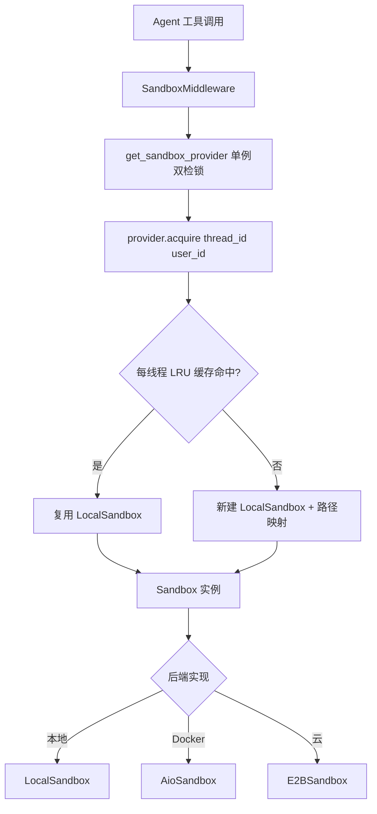
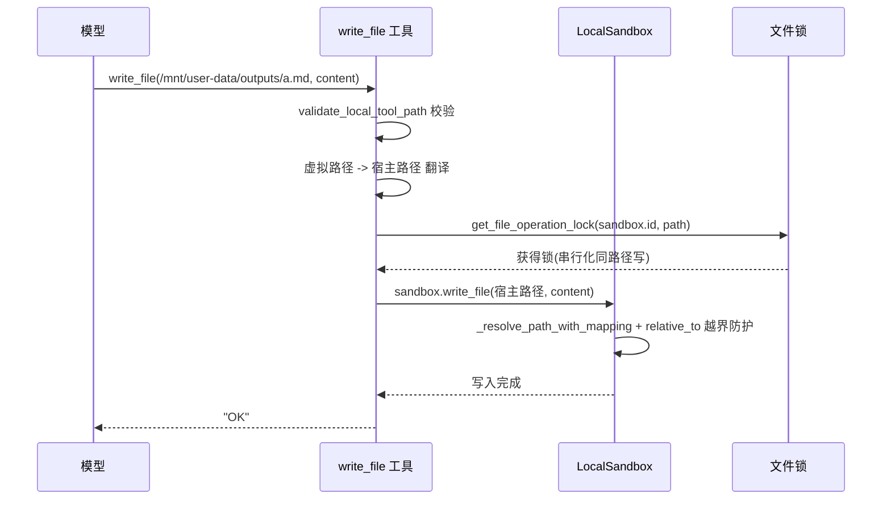

# Agent 沙箱系统（Sandbox）设计与实现 — 面试深度讲解

> 面向面试准备的完整拆解：业务背景 → 业务流程 → 技术难点 → 技术亮点 → 技术方案 → 代码实现讲解 → 源码分析 → 面试话术 → Trade-off → 线上故障。
> 代码根目录：`backend/packages/harness/deerflow/sandbox/`
> 全文基于本仓库真实代码。凡代码未实现的能力，均明确标注「代码中没有实现该能力，不能回答成实际做过」。

---

## 〇、一句话电梯陈述（先背这段）

> "我做的是 AI Agent 运行时里的**沙箱系统（Sandbox）**——它是 Agent 的『电脑』，为每个会话线程提供隔离的文件读写与命令执行环境，并对模型屏蔽真实宿主路径。核心解决四件事：**① 环境隔离**（每线程独立工作目录，避免会话间串扰）；**② 虚拟路径契约**（模型只看到 `/mnt/user-data/...` 这类稳定虚拟路径，真实宿主路径被翻译与遮蔽，兼顾安全与前缀缓存）；**③ 安全边界**（宿主 bash 默认禁用、路径遍历防护、子进程环境变量密钥擦除、只读挂载）；**④ 可插拔多后端**（本地 / Docker AIO / e2b / boxlite 统一抽象为一个 `Sandbox` 接口）。最有意思的设计是 `Sandbox` / `SandboxProvider` 两层抽象 + 单例双检锁 + 每线程 LRU 缓存 + 虚拟路径正反向翻译，把『安全隔离』和『模型友好』这两个看似矛盾的目标同时满足。"

---

## 一、业务背景

### 1.1 为什么 Agent 需要「沙箱」

一个 AI Agent 要真正干活（写代码、跑脚本、处理文件、生成交付物），就必须能**执行命令和读写文件**。但直接让模型操作宿主机是灾难：

- 会话之间会互相覆盖文件（无隔离）；
- 模型能看到真实宿主路径（`/app/backend/.deer-flow/users/xxx/...`），泄露用户名、目录结构；
- 模型生成的 bash 可能删库、读密钥、越权访问其它用户数据。

沙箱就是为此而生：**给 Agent 一台"虚拟电脑"，隔离、受限、可控**。

### 1.2 虚拟路径契约（本项目最核心的业务约定）

模型永远只看到这套**虚拟路径**（`config/paths.py` 的 `VIRTUAL_PATH_PREFIX`）：

```
/mnt/user-data/uploads     ← 用户上传的文件
/mnt/user-data/workspace   ← Agent 的工作目录
/mnt/user-data/outputs     ← 交付物（present_files 只允许这里）
/mnt/skills                ← 技能包
/mnt/acp-workspace         ← 跨 Agent 协议工作区
```

真实宿主目录是**每线程独立**的：`{base_dir}/users/{user_id}/threads/{thread_id}/user-data/`。沙箱负责把虚拟路径 ↔ 宿主路径**双向翻译**，模型全程无感知。

### 1.3 落地场景（本仓库真实）

- 抽象接口：[`Sandbox`](backend/packages/harness/deerflow/sandbox/sandbox.py:43)（ABC，定义 execute_command / read_file / write_file / glob / grep 等）
- 提供者抽象：[`SandboxProvider`](backend/packages/harness/deerflow/sandbox/sandbox_provider.py:10)（acquire / get / release 生命周期）
- 本地实现：`sandbox/local/local_sandbox.py`、`local_sandbox_provider.py`
- Docker/其它：`community/aio_sandbox/`、`community/e2b_sandbox/`、`community/boxlite/`
- 装配入口：`SandboxMiddleware`（`sandbox/middleware.py`）在中间件链里获取/释放沙箱

> **业务量级**：本仓库未提供线上 QPS / 并发沙箱数等量化数据，**属未知，不做虚构**。可讲的是设计意图与机制。

---

## 二、业务流程（请求进入后每一步经过什么）

> 本项目是 Python LLM Agent 运行时，**不涉及 RPC / MQ / MySQL / 分布式缓存**，绝不编造这些组件。

### 2.1 生命周期分三段

**A. 获取（acquire）—— 中间件在 Agent 生命周期触发**

- `SandboxMiddleware`（`middleware.py`）默认 `lazy_init=True`：**首个工具调用时**才获取沙箱（省资源）；`lazy_init=False` 则在 `before_agent` 提前获取；
- 获取路径：`get_sandbox_provider()`（单例双检锁）→ `provider.acquire(thread_id, user_id)` → 返回 `sandbox_id`；
- 异步路径用 `acquire_async` = `asyncio.to_thread(acquire)`，把阻塞的 Docker/文件操作**卸载到线程**不阻塞事件循环。

**B. 使用（工具调用期间）**

- 工具（write_file / str_replace / bash / read_file / glob / grep）通过注入的 `Runtime` 拿 `sandbox`；
- 本地沙箱：虚拟路径 → 宿主路径翻译（`_resolve_path_with_mapping`），并做**路径遍历防护**（`relative_to` 越界抛 `PermissionError`）；
- 写操作按 `(sandbox.id, path)` 取文件锁**串行化**（`get_file_operation_lock`）；
- bash 执行：宿主 bash 默认禁用（`is_host_bash_allowed`），允许时带 wall-clock 超时（默认 600s）+ 输出上限（10MB）+ 环境变量密钥擦除（`build_sandbox_env`）；
- 输出返回前，把宿主路径**反向翻译**回虚拟路径（`_reverse_resolve_paths_in_output`）遮蔽真实路径。

**C. 释放（release）—— 但不是每轮都释放**

- 沙箱**跨轮复用**（同一 thread 内多轮不重建）；`after_agent` 才 release；
- 应用关闭时 `shutdown_sandbox_provider()` 统一清理。

### 2.2 架构图（Mermaid）



### 2.3 一次 write_file 的时序图（含路径翻译与文件锁）



### 2.4 涉及的线程/同步异步边界（真实）

| 环节 | 同步/异步 | 线程 | 说明 |
|------|----------|------|------|
| provider 单例获取 | 同步（加锁） | 任意线程 | 双检锁，构造在锁外防重入死锁 |
| acquire（Docker/文件） | 阻塞 → `to_thread` | worker 线程 | 不阻塞事件循环 |
| 文件写 str_replace | 同步（文件锁） | 事件循环/工具线程 | 按 (sandbox_id, path) 串行 |
| bash 执行 | 同步 subprocess | 工具线程 | 超时 600s + 输出 10MB 上限 |
| 管道读取 | 后台线程 | drain 线程 | 有界捕获防 OOM |

---

## 三、技术难点（面试官最爱追问的部分）

### 难点 1：单例的并发安全 + 插件回调不能死锁

`get_sandbox_provider()` 是全局单例，会被多个 OS 线程访问（主事件循环、Feishu 渠道线程各自的 loop）。裸的 check-then-create 会双重初始化；reset/shutdown 与 get 竞争会返回 None 或半初始化实例。**难点**：既要用锁保证引用切换原子，又不能在锁内跑插件代码（`config.sandbox.use` 解析到任意类，其 `__init__`/`reset`/`shutdown` 可能慢或**重入**这些生命周期函数，持非重入锁会自死锁）。

### 难点 2：虚拟路径的正反向翻译 + 路径遍历防护

- 正向（虚拟→宿主）：`_resolve_path_with_mapping`，且必须防 `../` 遍历越界（`relative_to` 校验）；
- 反向（宿主→虚拟）：命令输出/文件列表里出现的宿主路径要遮蔽回虚拟路径（`_reverse_resolve_paths_in_output`）；
- **难点**：嵌套挂载（`/mnt/skills` vs `/mnt/skills-extra`）要按最长前缀匹配；Windows 分隔符与 POSIX 混用；`# Agent 沙箱系统（Sandbox）设计与实现 — 面试深度讲解

> 面向面试准备的完整拆解：业务背景 → 业务流程 → 技术难点 → 技术亮点 → 技术方案 → 代码实现讲解 → 源码分析 → 面试话术 → Trade-off → 线上故障。
> 代码根目录：`backend/packages/harness/deerflow/sandbox/`
> 全文基于本仓库真实代码。凡代码未实现的能力，均明确标注「代码中没有实现该能力，不能回答成实际做过」。

---

## 〇、一句话电梯陈述（先背这段）

> "我做的是 AI Agent 运行时里的**沙箱系统（Sandbox）**——它是 Agent 的『电脑』，为每个会话线程提供隔离的文件读写与命令执行环境，并对模型屏蔽真实宿主路径。核心解决四件事：**① 环境隔离**（每线程独立工作目录，避免会话间串扰）；**② 虚拟路径契约**（模型只看到 `/mnt/user-data/...` 这类稳定虚拟路径，真实宿主路径被翻译与遮蔽，兼顾安全与前缀缓存）；**③ 安全边界**（宿主 bash 默认禁用、路径遍历防护、子进程环境变量密钥擦除、只读挂载）；**④ 可插拔多后端**（本地 / Docker AIO / e2b / boxlite 统一抽象为一个 `Sandbox` 接口）。最有意思的设计是 `Sandbox` / `SandboxProvider` 两层抽象 + 单例双检锁 + 每线程 LRU 缓存 + 虚拟路径正反向翻译，把『安全隔离』和『模型友好』这两个看似矛盾的目标同时满足。"

---

## 一、业务背景

### 1.1 为什么 Agent 需要「沙箱」

一个 AI Agent 要真正干活（写代码、跑脚本、处理文件、生成交付物），就必须能**执行命令和读写文件**。但直接让模型操作宿主机是灾难：

- 会话之间会互相覆盖文件（无隔离）；
- 模型能看到真实宿主路径（`/app/backend/.deer-flow/users/xxx/...`），泄露用户名、目录结构；
- 模型生成的 bash 可能删库、读密钥、越权访问其它用户数据。

沙箱就是为此而生：**给 Agent 一台"虚拟电脑"，隔离、受限、可控**。

### 1.2 虚拟路径契约（本项目最核心的业务约定）

模型永远只看到这套**虚拟路径**（`config/paths.py` 的 `VIRTUAL_PATH_PREFIX`）：

```
/mnt/user-data/uploads     ← 用户上传的文件
/mnt/user-data/workspace   ← Agent 的工作目录
/mnt/user-data/outputs     ← 交付物（present_files 只允许这里）
/mnt/skills                ← 技能包
/mnt/acp-workspace         ← 跨 Agent 协议工作区
```

真实宿主目录是**每线程独立**的：`{base_dir}/users/{user_id}/threads/{thread_id}/user-data/`。沙箱负责把虚拟路径 ↔ 宿主路径**双向翻译**，模型全程无感知。

### 1.3 落地场景（本仓库真实）

- 抽象接口：[`Sandbox`](backend/packages/harness/deerflow/sandbox/sandbox.py:43)（ABC，定义 execute_command / read_file / write_file / glob / grep 等）
- 提供者抽象：[`SandboxProvider`](backend/packages/harness/deerflow/sandbox/sandbox_provider.py:10)（acquire / get / release 生命周期）
- 本地实现：`sandbox/local/local_sandbox.py`、`local_sandbox_provider.py`
- Docker/其它：`community/aio_sandbox/`、`community/e2b_sandbox/`、`community/boxlite/`
- 装配入口：`SandboxMiddleware`（`sandbox/middleware.py`）在中间件链里获取/释放沙箱

> **业务量级**：本仓库未提供线上 QPS / 并发沙箱数等量化数据，**属未知，不做虚构**。可讲的是设计意图与机制。

---

## 二、业务流程（请求进入后每一步经过什么）

> 本项目是 Python LLM Agent 运行时，**不涉及 RPC / MQ / MySQL / 分布式缓存**，绝不编造这些组件。

### 2.1 生命周期分三段

**A. 获取（acquire）—— 中间件在 Agent 生命周期触发**

- `SandboxMiddleware`（`middleware.py`）默认 `lazy_init=True`：**首个工具调用时**才获取沙箱（省资源）；`lazy_init=False` 则在 `before_agent` 提前获取；
- 获取路径：`get_sandbox_provider()`（单例双检锁）→ `provider.acquire(thread_id, user_id)` → 返回 `sandbox_id`；
- 异步路径用 `acquire_async` = `asyncio.to_thread(acquire)`，把阻塞的 Docker/文件操作**卸载到线程**不阻塞事件循环。

**B. 使用（工具调用期间）**

- 工具（write_file / str_replace / bash / read_file / glob / grep）通过注入的 `Runtime` 拿 `sandbox`；
- 本地沙箱：虚拟路径 → 宿主路径翻译（`_resolve_path_with_mapping`），并做**路径遍历防护**（`relative_to` 越界抛 `PermissionError`）；
- 写操作按 `(sandbox.id, path)` 取文件锁**串行化**（`get_file_operation_lock`）；
- bash 执行：宿主 bash 默认禁用（`is_host_bash_allowed`），允许时带 wall-clock 超时（默认 600s）+ 输出上限（10MB）+ 环境变量密钥擦除（`build_sandbox_env`）；
- 输出返回前，把宿主路径**反向翻译**回虚拟路径（`_reverse_resolve_paths_in_output`）遮蔽真实路径。

**C. 释放（release）—— 但不是每轮都释放**

- 沙箱**跨轮复用**（同一 thread 内多轮不重建）；`after_agent` 才 release；
- 应用关闭时 `shutdown_sandbox_provider()` 统一清理。

### 2.2 架构图（Mermaid）


### 2.3 一次 write_file 的时序图（含路径翻译与文件锁）


### 2.4 涉及的线程/同步异步边界（真实）

| 环节 | 同步/异步 | 线程 | 说明 |
|------|----------|------|------|
| provider 单例获取 | 同步（加锁） | 任意线程 | 双检锁，构造在锁外防重入死锁 |
| acquire（Docker/文件） | 阻塞 → `to_thread` | worker 线程 | 不阻塞事件循环 |
| 文件写 str_replace | 同步（文件锁） | 事件循环/工具线程 | 按 (sandbox_id, path) 串行 |
| bash 执行 | 同步 subprocess | 工具线程 | 超时 600s + 输出 10MB 上限 |
 边界（输出正好停在挂载根）；一处漏改就泄露真实宿主路径（#4035/#4053 就是两份规则各改一半导致漂移）。

### 难点 3：宿主 bash 不是安全边界

`LocalSandboxProvider` 直接在宿主机跑 subprocess，**不是隔离边界**。默认放开 bash，模型能读宿主任意文件、删库、读平台密钥。**难点**：既要默认安全（禁用），又要给完全可信本地环境显式开关，还要在工具装配层就剔除 bash 工具。

### 难点 4：子进程会继承整个 os.environ（密钥泄露）

技能脚本作为 sandbox subprocess 运行，默认继承 Gateway 进程**全部环境变量**——含 `OPENAI_API_KEY`、tracing key、Provider key、DB 连接串。**难点**：任何"请求级密钥注入"都失去意义（脚本能直接读继承的平台密钥）。必须注入前**擦除**所有像密钥的变量，且不误伤 PATH/HOME。

### 难点 5：bash 命令可能永不返回 / 输出爆内存

模型可能跑前台常驻进程（未后台化的 server）或产生海量输出。**难点**：要 wall-clock 超时终止（否则一轮挂死）、输出上限（否则 OOM）、读管道不阻塞。

### 难点 6：同一文件并发读改写（str_replace 竞争）

`str_replace` 是"读→改→写"三步，并发调同一文件会互相覆盖。**难点**：虚拟路径相同也要保证同路径写串行化，且锁不能内存泄漏（长运行进程里线程/路径无限增长）。

---

## 四、技术亮点（你的加分项）

### 亮点 1：Sandbox / SandboxProvider 两层抽象 + 可插拔多后端

**代码**：[`Sandbox`](backend/packages/harness/deerflow/sandbox/sandbox.py:43) / [`SandboxProvider`](backend/packages/harness/deerflow/sandbox/sandbox_provider.py:10)

- `Sandbox` 定义能力接口（execute_command / read_file / write_file / glob / grep / download_file / update_file）；
- `SandboxProvider` 定义生命周期（acquire / get / release）；
- 本地、Docker（AIO）、e2b、boxlite 各自实现，通过 `config.sandbox.use` 反射装配（`resolve_class`）——**策略模式 + 依赖倒置**。

### 亮点 2：单例双检锁 + 锁外构造 + 输掉竞争自清理

**代码**：`get_sandbox_provider()`（`sandbox_provider.py:75`）

- 快路径：一次加锁读，防 reset/shutdown 在 check 与 return 之间把全局置空；
- 冷启动：**在锁外**解析类 + 构造实例（插件代码不能在非重入锁内跑，否则自死锁/阻塞并发 get）；
- 竞争协调：锁内比对，输掉安装竞争的一方在锁外 `shutdown()` 自己刚建的孤儿实例（防 AioSandboxProvider 的 idle-checker 线程泄漏，issue #3721）。

### 亮点 3：虚拟路径正反向翻译 + 遍历防护 + 单一规则源

**代码**：`local_sandbox.py` 的 `_resolve_path_with_mapping`/`_reverse_resolve_path`；`path_patterns.py` 的 `build_output_mask_pattern`

- 正向翻译后 `resolved_path.relative_to(local_root)` 越界即抛 `PermissionError`（`local_sandbox.py:318-321`）——防 `../` 逃逸；
- 挂载按 container/local 特异性排序（最长前缀优先），处理嵌套挂载；
- 遮蔽正则边界规则集中在 `build_output_mask_pattern` **一处**（`path_patterns.py`），私有 `_SEGMENT_BOUNDARY`/`_PATH_TAIL` 不外泄，防第三处 hand-roll 变体漂移（#4035/#4053 教训）。

### 亮点 4：安全默认（fail-safe）—— 宿主 bash 默认禁用

**代码**：[`is_host_bash_allowed`](backend/packages/harness/deerflow/sandbox/security.py:34)

- 本地 provider 下 `allow_host_bash` 默认 false → 禁用宿主 bash；
- 工具装配层（`get_available_tools`）据此**剔除 bash 工具**；
- 清晰引导：要隔离 shell 用 `AioSandboxProvider`（Docker），或仅在完全可信环境显式开 `allow_host_bash: true`。

### 亮点 5：子进程环境变量密钥擦除（security-first）

**代码**：[`build_sandbox_env`](backend/packages/harness/deerflow/sandbox/env_policy.py:96) + `is_blocked_env_name`

- 通配 `*KEY* / *SECRET* / *TOKEN* / *PASS* / *CREDENTIAL* / *DSN*` + 精确名单（DATABASE_URL / REDIS_URL / MYSQL_PWD / GITHUB_PAT ...）；
- 从继承环境**擦掉所有像密钥的变量**，再把授权的请求级密钥叠加在上（注入优先，因它是上游授权的）；
- 良性变量（PATH/HOME/SHELL/PWD）不含这些 token 被保留——**fail-safe 方向：宁可多擦**。

### 亮点 6：抽象层 env-key 校验（defense-in-depth）

**代码**：`_validate_extra_env`（`sandbox.py:16`）

env 变量名必须匹配 POSIX 规则 `^[A-Za-z_][A-Za-z0-9_]*# Agent 沙箱系统（Sandbox）设计与实现 — 面试深度讲解

> 面向面试准备的完整拆解：业务背景 → 业务流程 → 技术难点 → 技术亮点 → 技术方案 → 代码实现讲解 → 源码分析 → 面试话术 → Trade-off → 线上故障。
> 代码根目录：`backend/packages/harness/deerflow/sandbox/`
> 全文基于本仓库真实代码。凡代码未实现的能力，均明确标注「代码中没有实现该能力，不能回答成实际做过」。

---

## 〇、一句话电梯陈述（先背这段）

> "我做的是 AI Agent 运行时里的**沙箱系统（Sandbox）**——它是 Agent 的『电脑』，为每个会话线程提供隔离的文件读写与命令执行环境，并对模型屏蔽真实宿主路径。核心解决四件事：**① 环境隔离**（每线程独立工作目录，避免会话间串扰）；**② 虚拟路径契约**（模型只看到 `/mnt/user-data/...` 这类稳定虚拟路径，真实宿主路径被翻译与遮蔽，兼顾安全与前缀缓存）；**③ 安全边界**（宿主 bash 默认禁用、路径遍历防护、子进程环境变量密钥擦除、只读挂载）；**④ 可插拔多后端**（本地 / Docker AIO / e2b / boxlite 统一抽象为一个 `Sandbox` 接口）。最有意思的设计是 `Sandbox` / `SandboxProvider` 两层抽象 + 单例双检锁 + 每线程 LRU 缓存 + 虚拟路径正反向翻译，把『安全隔离』和『模型友好』这两个看似矛盾的目标同时满足。"

---

## 一、业务背景

### 1.1 为什么 Agent 需要「沙箱」

一个 AI Agent 要真正干活（写代码、跑脚本、处理文件、生成交付物），就必须能**执行命令和读写文件**。但直接让模型操作宿主机是灾难：

- 会话之间会互相覆盖文件（无隔离）；
- 模型能看到真实宿主路径（`/app/backend/.deer-flow/users/xxx/...`），泄露用户名、目录结构；
- 模型生成的 bash 可能删库、读密钥、越权访问其它用户数据。

沙箱就是为此而生：**给 Agent 一台"虚拟电脑"，隔离、受限、可控**。

### 1.2 虚拟路径契约（本项目最核心的业务约定）

模型永远只看到这套**虚拟路径**（`config/paths.py` 的 `VIRTUAL_PATH_PREFIX`）：

```
/mnt/user-data/uploads     ← 用户上传的文件
/mnt/user-data/workspace   ← Agent 的工作目录
/mnt/user-data/outputs     ← 交付物（present_files 只允许这里）
/mnt/skills                ← 技能包
/mnt/acp-workspace         ← 跨 Agent 协议工作区
```

真实宿主目录是**每线程独立**的：`{base_dir}/users/{user_id}/threads/{thread_id}/user-data/`。沙箱负责把虚拟路径 ↔ 宿主路径**双向翻译**，模型全程无感知。

### 1.3 落地场景（本仓库真实）

- 抽象接口：[`Sandbox`](backend/packages/harness/deerflow/sandbox/sandbox.py:43)（ABC，定义 execute_command / read_file / write_file / glob / grep 等）
- 提供者抽象：[`SandboxProvider`](backend/packages/harness/deerflow/sandbox/sandbox_provider.py:10)（acquire / get / release 生命周期）
- 本地实现：`sandbox/local/local_sandbox.py`、`local_sandbox_provider.py`
- Docker/其它：`community/aio_sandbox/`、`community/e2b_sandbox/`、`community/boxlite/`
- 装配入口：`SandboxMiddleware`（`sandbox/middleware.py`）在中间件链里获取/释放沙箱

> **业务量级**：本仓库未提供线上 QPS / 并发沙箱数等量化数据，**属未知，不做虚构**。可讲的是设计意图与机制。

---

## 二、业务流程（请求进入后每一步经过什么）

> 本项目是 Python LLM Agent 运行时，**不涉及 RPC / MQ / MySQL / 分布式缓存**，绝不编造这些组件。

### 2.1 生命周期分三段

**A. 获取（acquire）—— 中间件在 Agent 生命周期触发**

- `SandboxMiddleware`（`middleware.py`）默认 `lazy_init=True`：**首个工具调用时**才获取沙箱（省资源）；`lazy_init=False` 则在 `before_agent` 提前获取；
- 获取路径：`get_sandbox_provider()`（单例双检锁）→ `provider.acquire(thread_id, user_id)` → 返回 `sandbox_id`；
- 异步路径用 `acquire_async` = `asyncio.to_thread(acquire)`，把阻塞的 Docker/文件操作**卸载到线程**不阻塞事件循环。

**B. 使用（工具调用期间）**

- 工具（write_file / str_replace / bash / read_file / glob / grep）通过注入的 `Runtime` 拿 `sandbox`；
- 本地沙箱：虚拟路径 → 宿主路径翻译（`_resolve_path_with_mapping`），并做**路径遍历防护**（`relative_to` 越界抛 `PermissionError`）；
- 写操作按 `(sandbox.id, path)` 取文件锁**串行化**（`get_file_operation_lock`）；
- bash 执行：宿主 bash 默认禁用（`is_host_bash_allowed`），允许时带 wall-clock 超时（默认 600s）+ 输出上限（10MB）+ 环境变量密钥擦除（`build_sandbox_env`）；
- 输出返回前，把宿主路径**反向翻译**回虚拟路径（`_reverse_resolve_paths_in_output`）遮蔽真实路径。

**C. 释放（release）—— 但不是每轮都释放**

- 沙箱**跨轮复用**（同一 thread 内多轮不重建）；`after_agent` 才 release；
- 应用关闭时 `shutdown_sandbox_provider()` 统一清理。

### 2.2 架构图（Mermaid）


### 2.3 一次 write_file 的时序图（含路径翻译与文件锁）


### 2.4 涉及的线程/同步异步边界（真实）

| 环节 | 同步/异步 | 线程 | 说明 |
|------|----------|------|------|
| provider 单例获取 | 同步（加锁） | 任意线程 | 双检锁，构造在锁外防重入死锁 |
| acquire（Docker/文件） | 阻塞 → `to_thread` | worker 线程 | 不阻塞事件循环 |
| 文件写 str_replace | 同步（文件锁） | 事件循环/工具线程 | 按 (sandbox_id, path) 串行 |
| bash 执行 | 同步 subprocess | 工具线程 | 超时 600s + 输出 10MB 上限 |
。当前实现都不把 key 拼进 shell，但在**抽象层**强制校验是纵深防御：未来若有实现把 key 走 shell，不必重推规则，非法 key 立即 `ValueError` fail-fast，防命令注入。

### 亮点 7：bash 有界执行（超时 + 输出上限 + 有界管道）

**代码**：`local_sandbox.py` 的 `DEFAULT_COMMAND_TIMEOUT_SECONDS=600`、`_COMMAND_CAPTURE_LIMIT_BYTES=10MB`、`_BoundedPipeCapture`

- wall-clock 超时终止前台常驻进程；
- `_BoundedPipeCapture` 只在内存保留上限内输出，超出丢弃并加截断提示（防 OOM），带锁线程安全。

### 亮点 8：文件操作串行化 + WeakValueDictionary 防泄漏

**代码**：[`get_file_operation_lock`](backend/packages/harness/deerflow/sandbox/file_operation_lock.py:20)

- 按 `(sandbox.id, path)` 取锁，str_replace/write_file 串行化同路径写；
- 锁存 `weakref.WeakValueDictionary`：无人引用时自动回收，**防长运行进程锁表无限增长**。

### 亮点 9：每线程 LRU 缓存 + 优雅降级

**代码**：`LocalSandboxProvider`（`local_sandbox_provider.py`）

- 每 `thread_id` 一个 `LocalSandbox`，`OrderedDict` 做 LRU（默认上限 256）；
- 超限淘汰 LRU；被淘汰线程下次 acquire 重建，只丢失 `_agent_written_paths`（反向解析提示），**优雅降级**为全新运行行为，不报错。

---

## 五、技术方案与代码实现讲解

### 5.1 抽象层：Sandbox 接口（`sandbox.py`）

```python
class Sandbox(ABC):
    def __init__(self, id: str): self._id = id
    @property
    def id(self) -> str: return self._id

    @abstractmethod
    def execute_command(self, command, env=None, timeout=None) -> str: ...
    @abstractmethod
    def read_file(self, path) -> str: ...
    @abstractmethod
    def write_file(self, path, content, append=False) -> None: ...
    @abstractmethod
    def glob(self, path, pattern, *, include_dirs=False, max_results=200): ...
    @abstractmethod
    def grep(self, path, pattern, *, glob=None, literal=False, case_sensitive=False, max_results=100): ...
```

**讲解**：接口即契约。`execute_command` 的 `env` 用来传请求级密钥（短期 token），`timeout` 用来限制单条命令墙钟时间。`_validate_extra_env` 在契约层校验 env key 是 POSIX 名——纵深防御。

### 5.2 单例双检锁（`sandbox_provider.py`，重点讲）

```python
def get_sandbox_provider(**kwargs) -> SandboxProvider:
    global _default_sandbox_provider
    with _provider_lock:                     # ① 快路径：加锁读
        if _default_sandbox_provider is not None:
            return _default_sandbox_provider
    config = get_app_config()                # ② 锁外解析+构造（插件代码）
    cls = resolve_class(config.sandbox.use, SandboxProvider)
    provider = cls(**kwargs)
    with _provider_lock:                     # ③ 锁内协调竞争
        if _default_sandbox_provider is None:
            _default_sandbox_provider = provider
            return provider
        winner = _default_sandbox_provider
    if hasattr(provider, "shutdown"):        # ④ 输掉竞争，锁外清理孤儿
        provider.shutdown()
    return winner
```

**讲解**：
- 为什么①要加锁读？防 reset/shutdown 在 check 与 return 之间把全局置空返回 None；
- 为什么②在锁外？插件 `__init__` 可能慢或重入生命周期函数，持非重入 `threading.Lock` 会自死锁、且阻塞所有并发 get；
- 为什么④要 shutdown 孤儿？AioSandboxProvider 构造时会起 idle-checker 线程，输掉竞争不清理就线程泄漏（#3721）。

### 5.3 虚拟路径正向翻译 + 遍历防护（`local_sandbox.py`）

```python
def _resolve_path_with_mapping(self, path: str) -> ResolvedPath:
    mapping_match = self._find_path_mapping(path_str)  # 最长前缀匹配挂载
    if mapping_match is None:
        return ResolvedPath(path_str, None)
    mapping, relative = mapping_match
    local_root = Path(self._resolved_local_paths[mapping])
    resolved_path = (local_root / relative).resolve() if relative else local_root
    try:
        resolved_path.relative_to(local_root)          # 越界检查
    except ValueError as exc:
        raise PermissionError(errno.EACCES, "Access denied: path escapes mounted directory", path_str) from exc
    return ResolvedPath(str(resolved_path), mapping)
```

**讲解**：先按挂载最长前缀把虚拟路径映射到宿主根，`resolve()` 展开 `..`，再用 `relative_to` 确认没逃出挂载根——这是**路径遍历防护的核心一行**。`_find_path_mapping` 按 container 特异性排序（`_mappings_by_container_specificity`），保证嵌套挂载取最具体的。

### 5.4 反向翻译遮蔽宿主路径（`local_sandbox.py` + `path_patterns.py`）

```python
def _reverse_resolve_paths_in_output(self, output: str) -> str:
    result = output
    for pattern in self._reverse_output_patterns:      # 最长 local 路径优先
        result = pattern.sub(lambda m: self._reverse_resolve_path(m.group(0)), result)
    return result
```

```python
# path_patterns.py：唯一规则源
_SEGMENT_BOUNDARY = r"(?=/|$|[^\w./-])"   # $ 是 load-bearing：输出正好停在挂载根
_PATH_TAIL = r"(?:[/\\][^\s\"';&|<>()]*)?"
def build_output_mask_pattern(base, *, separator_agnostic=False) -> re.Pattern:
    escaped = re.escape(base)
    if separator_agnostic:
        escaped = escaped.replace(r"\\", r"[/\\]")
    return re.compile(escaped + _SEGMENT_BOUNDARY + _PATH_TAIL)
```

**讲解**：命令输出/文件列表里可能出现真实宿主路径，返回模型前必须遮蔽回虚拟路径。`_SEGMENT_BOUNDARY` 保证挂载根不匹配到同前缀兄弟目录（`/skills` 不误匹配 `/skills-extra`）。规则集中一处，避免两份规则各改一半漂移（真实教训 #4035/#4053）。

### 5.5 安全门禁（`security.py`）

```python
def is_host_bash_allowed(config=None) -> bool:
    sandbox_cfg = getattr(config, "sandbox", None)
    if sandbox_cfg is None: return False
    if not uses_local_sandbox_provider(config): return True   # Docker 等隔离后端放行
    return bool(getattr(sandbox_cfg, "allow_host_bash", False)) # 本地默认 false
```

**讲解**：只有"本地 provider 且未显式开 allow_host_bash"才禁用。Docker/e2b 这类真正隔离的后端直接放行。工具装配层读这个函数剔除 bash 工具。

### 5.6 环境变量密钥擦除（`env_policy.py`）

```python
def build_sandbox_env(injected=None) -> dict[str, str]:
    env = {k: v for k, v in os.environ.items() if not is_blocked_env_name(k)}  # 先擦
    if injected: env.update(injected)                                          # 再叠加授权密钥
    return env

def is_blocked_env_name(name: str) -> bool:
    upper = name.upper()
    if upper in _BLOCKED_EXACT_NAMES: return True          # DATABASE_URL/MYSQL_PWD/...
    return any(fnmatch.fnmatchcase(upper, p) for p in _SECRET_NAME_PATTERNS)  # *KEY*/*SECRET*/...
```

**讲解**：先从继承环境擦掉所有像密钥的变量，再把上游授权的请求级密钥叠上（注入优先）。`*PASS*` 故意覆盖 `GIT_ASKPASS`/`SUDO_ASKPASS` 这类"指向密钥程序"的变量——同类泄露。良性 `PWD`/`OLDPWD` 不含 `PASS` 子串不受影响。

### 5.7 文件操作锁（`file_operation_lock.py`）

```python
_FILE_OPERATION_LOCKS: WeakValueDictionary[tuple[str, str], threading.Lock] = WeakValueDictionary()

def get_file_operation_lock(sandbox, path) -> threading.Lock:
    lock_key = (sandbox.id or f"instance:{id(sandbox)}", path)
    with _FILE_OPERATION_LOCKS_GUARD:
        lock = _FILE_OPERATION_LOCKS.get(lock_key) or threading.Lock()
        _FILE_OPERATION_LOCKS[lock_key] = lock
        return lock
```

**讲解**：按 `(sandbox_id, path)` 粒度加锁，str_replace 的读-改-写全程持锁，防并发覆盖。用 `WeakValueDictionary`：锁无人引用即回收，防长运行进程锁表爆内存。

### 5.8 中间件装配（`middleware.py`）

```python
class SandboxMiddleware(AgentMiddleware):
    def __init__(self, lazy_init: bool = True): ...       # 默认懒加载
    async def abefore_agent(self, state, runtime):
        if self._lazy_init: return await super().abefore_agent(...)  # 懒加载不提前获取
        sandbox_id = await self._acquire_sandbox_async(thread_id, user_id=...)
        return {"sandbox": {"sandbox_id": sandbox_id}}
    async def aafter_agent(self, state, runtime):
        await self._release_sandbox_async(state["sandbox"]["sandbox_id"])  # 结束才释放
```

**讲解**：`lazy_init=True` 时首个工具调用才获取沙箱（省资源）；获取写进图状态 `sandbox.sandbox_id`（跨轮复用）；`aafter_agent` 才释放；异步路径用 `to_thread` 卸载阻塞操作。`wrap_tool_call` 还会 diff 工具调用前后的 state，把懒加载出来的 sandbox_id 通过 `Command(update=...)` 持久化进图状态（否则下游中间件/子智能体看不到）。

---

## 六、面试官追问树（连续深挖）

### 追问树 A：单例并发（8 层）

```
第1层：沙箱 provider 是怎么管理的？
  → 全局单例 get_sandbox_provider，双检锁
第2层：为什么要双检锁不是简单单例？
  → 会被多 OS 线程访问（主 loop + Feishu 渠道线程各自的 loop）
第3层：裸 check-then-create 有什么问题？
  → 双重初始化；reset/shutdown 与 get 竞争返回 None 或半初始化实例
第4层：为什么构造在锁外？
  → config.sandbox.use 解析到任意插件类，其 __init__/reset/shutdown 可能慢或重入这些函数
第5层：重入会怎样？
  → 持非重入 threading.Lock 跨插件回调会自死锁，还阻塞所有并发 get
第6层：锁外构造会不会重复建实例？
  → 会竞争，锁内比对：输掉的一方拿 winner 返回
第7层：输掉竞争的孤儿实例怎么办？
  → 锁外 shutdown() 它，否则 AioSandboxProvider 的 idle-checker 线程泄漏(#3721)
第8层：为什么 winner 一定不是 None？
  → winner 在锁内读，而锁内 _default 已被某线程装上，是活实例
```

### 追问树 B：路径安全（8 层）

```
第1层：模型看到的是真实路径吗？
  → 不是。只看 /mnt/user-data/... 虚拟路径，宿主是每线程真实目录
第2层：虚拟路径怎么变成真实路径？
  → _resolve_path_with_mapping 按挂载最长前缀映射
第3层：模型传 ../../etc/passwd 会怎样？
  → resolve() 展开后 relative_to(local_root) 越界抛 PermissionError(local_sandbox.py:318)
第4层：嵌套挂载 /mnt/skills 和 /mnt/skills-extra 怎么区分？
  → 按 container 特异性排序取最长前缀；反向按 local 路径长度排序
第5层：命令输出里出现真实路径会泄露吗？
  → 不会。_reverse_resolve_paths_in_output 遮蔽回虚拟路径
第6层：遮蔽正则怎么保证 /skills 不误匹配 /skills-extra？
  → _SEGMENT_BOUNDARY 段边界前瞻，且 $ 处理输出正好停在挂载根
第7层：为什么规则要集中一处？
  → 两份规则各改一半会漂移，#4035 改了反向漏了遮蔽、#4053 补另一份
第8层：Windows 分隔符怎么办？
  → separator_agnostic 让 \ 也能匹配 /，reverse_resolve 用 os.sep 比较
```

### 追问树 C：密钥与 bash 安全（7 层）

```
第1层：技能脚本能读到平台密钥吗？
  → 默认不能。build_sandbox_env 擦除继承环境里像密钥的变量
第2层：怎么判断"像密钥"？
  → is_blocked_env_name：通配 *KEY*/*SECRET*/*TOKEN*/*PASS*/*DSN* + 精��名单
第3层：请求级密钥怎么进去？
  → injected 在擦除后 update 叠加，注入优先（上游已授权）
第4层：PATH/HOME 会被误擦吗？
  → 不会，不含这些 token；PWD/OLDPWD 不含 PASS 子串
第5层：宿主 bash 能跑吗？
  → 本地 provider 默认禁用(is_host_bash_allowed)，工具装配层剔除 bash
第6层：为什么本地 bash 不算隔离？
  → 直接在宿主机跑 subprocess，能读宿主任意文件/删库
第7层：要隔离 shell 怎么办？
  → 用 AioSandboxProvider(Docker)，或完全可信环境显式开 allow_host_bash
```

---

## 七、深度模拟面试（STAR 格式）

### 问题 1：你的沙箱怎么保证 Agent 不越权访问宿主文件？

⭐ **高分回答（STAR）**
- **S**：Agent 要读写文件、跑命令，但直接操作宿主机会泄露真实路径、越权访问其它用户数据。
- **T**：既要让模型能操作文件，又要严格限制在受控范围，且模型不能看到真实宿主路径。
- **A**：三道防线。① 虚拟路径契约：模型只看 `/mnt/user-data/...`，宿主是每线程独立目录 `{base}/users/{uid}/threads/{tid}/`；② 路径遍历防护：`_resolve_path_with_mapping` 把虚拟路径映射到挂载根后 `resolve()` 展开 `..`，再 `relative_to(local_root)` 越界即抛 `PermissionError`（`local_sandbox.py:318`）；③ 反向遮蔽：命令输出里的宿主路径经 `_reverse_resolve_paths_in_output` 翻译回虚拟路径，模型永远看不到真实路径。
- **R**：模型全程只见虚拟路径，`../` 逃逸被拦，跨线程隔离。

🧠 **考察**：路径安全的纵深防御意识。
📚 **底层原理**：`Path.resolve()` 符号链接/`..` 展开；`relative_to` 前缀包含判定。
⚠ **常见错误**：「检查路径里有没有 `..`」——字符串检查会被符号链接/编码绕过，正确做法是 resolve 后比对真实前缀。
⭐⭐⭐⭐⭐ **加分**：补遮蔽规则集中一处防漂移（#4035/#4053）。

### 问题 2：沙箱 provider 单例，多线程访问你怎么保证安全又不死锁？

⭐ **高分回答（STAR）**
- **S**：`get_sandbox_provider` 是全局单例，被主事件循环和 Feishu 渠道线程（各自 loop）并发访问。
- **T**：既要引用切换原子，又不能在锁内跑插件构造代码（可能慢/重入）。
- **A**：双检锁 + 锁外构造。快路径加锁读防 reset/shutdown 竞争返回 None；冷启动**在锁外**解析类+构造（插件 `__init__`/`reset`/`shutdown` 可能重入生命周期函数，持非重入锁会自死锁）；锁内协调竞争，输掉的一方拿 winner 返回并在锁外 `shutdown()` 自己建的孤儿实例，防 idle-checker 线程泄漏（#3721）。
- **R**：并发安全、不死锁、无孤儿线程泄漏。

🧠 **考察**：并发 + 锁粒度 + 死锁规避。
📚 **底层原理**：DCL（双检锁）；`threading.Lock` 非重入；插件回调不可控。
⚠ **常见错误**：「加个锁包住整个函数」——会在插件构造上自死锁并阻塞所有 get。

### 问题 3：技能脚本作为子进程跑，怎么防它读走平台密钥？

⭐ **高分回答（STAR）**
- **S**：子进程默认继承 Gateway 进程整个 `os.environ`，含 OPENAI_API_KEY、DB 连接串等。
- **T**：任何请求级密钥注入都失去意义——脚本能直接读继承的平台密钥。
- **A**：`build_sandbox_env` 先擦后叠。`is_blocked_env_name` 用通配 `*KEY*/*SECRET*/*TOKEN*/*PASS*/*CREDENTIAL*/*DSN*` + 精确名单（DATABASE_URL/MYSQL_PWD/GITHUB_PAT...）擦掉所有像密钥的变量，再把上游授权的请求级密钥 `update` 叠上（注入优先）。fail-safe 方向宁可多擦，良性 PATH/HOME/PWD 不受影响。
- **R**：脚本拿不到继承的平台密钥，只拿到显式授权的请求级密钥。

🧠 **考察**：最小权限 + security-first 默认。
📚 **底层原理**：子进程环境继承；fnmatch 通配。
⚠ **常见错误**：「白名单只传需要的」——理想但难维护；本项目用黑名单擦除 + 注入优先，兼顾兼容与安全。

### 问题 4：bash 跑了个不返回的进程/海量输出怎么办？

⭐ **高分回答（STAR）**
- **S**：模型可能跑未后台化的 server（前台常驻）或产生海量输出。
- **T**：不能让一轮永久挂死，也不能 OOM。
- **A**：`execute_command` 带 wall-clock 超时（默认 `DEFAULT_COMMAND_TIMEOUT_SECONDS=600`，可配 `sandbox.bash_command_timeout`），超时终止进程；输出用 `_BoundedPipeCapture` 只保留上限 `_COMMAND_CAPTURE_LIMIT_BYTES=10MB`，超出丢弃并加截断提示，且带锁线程安全，后台线程 drain 管道不阻塞。
- **R**：命令有界执行，一轮不会挂死，内存不爆。

🧠 **考察**：超时/资源上限/管道背压意识。
📚 **底层原理**：subprocess 管道；wall-clock vs CPU 时间；有界缓冲。
⚠ **常见错误**：「communicate() 读完就行」——无上限会 OOM，无超时会挂死。

---

## 八、架构 Trade-off

### 8.1 沙箱后端：本地 vs Docker vs 云（e2b）

| 方案 | 优点 | 缺点 | 适用/取舍 |
|------|------|------|----------|
| **LocalSandbox（本地文件）** | 零依赖、快、易调试 | **不是安全隔离边界**，bash 默认禁用 | ✅ 开发/可信环境默认 |
| **AioSandbox（Docker）** | 真正进程/文件隔离，可跑 bash | 需 Docker、启动慢、资源开销 | ✅ 生产隔离首选 |
| e2b / boxlite（云沙箱） | 强隔离、弹性 | 外部依赖、网络延迟、成本 | ⚠ 特定场景 |

> 通过 `config.sandbox.use` 反射切换，同一 `Sandbox` 接口，业务无感知。

### 8.2 沙箱获取：eager vs lazy

| 方案 | 优点 | 缺点 | 取舍 |
|------|------|------|------|
| eager（before_agent 获取） | 首个工具无冷启动延迟 | 纯问答不需文件也建沙箱，浪费 | ⚠ 特定场景 |
| **lazy（首个工具调用才建，默认）** | 不用文件的会话零沙箱开销 | 首个文件操作有冷启动 | ✅ **默认方案** |

### 8.3 密钥策略：白名单 vs 黑名单擦除

| 方案 | 优点 | 缺点 | 取舍 |
|------|------|------|------|
| 白名单（只传需要的） | 最小权限最彻底 | 难维护，漏配就缺变量 | ⚠ 理想难落地 |
| **黑名单擦除 + 注入优先（当前）** | 兼容良性变量 + 密钥安全 | 需持续维护模式集 | ✅ **最终方案** |

### 8.4 文件锁粒度：全局锁 vs (sandbox,path) 锁

| 方案 | 优点 | 缺点 | 取舍 |
|------|------|------|------|
| 全局单锁 | 简单 | 不同文件也串行，吞吐差 | ❌ |
| **(sandbox_id, path) 细粒度 + WeakValueDict（当前）** | 只串行同文件 + 锁自动回收 | 实现稍复杂 | ✅ **最终方案** |

### 8.5 每线程缓存：不缓存 vs LRU

| 方案 | 优点 | 缺点 | 取舍 |
|------|------|------|------|
| 每次重建 | 无状态 | 丢反向解析提示、重复开销 | ⚠ |
| **LRU 缓存（默认 256）+ 优雅降级** | 复用 + 内存有界 | 淘汰丢 _agent_written_paths | ✅ **最终方案** |

> 注：本项目是 Python LLM Agent 运行时，**不涉及** Redis/Kafka/RocketMQ/MySQL/ZooKeeper/分布式锁等。**代码未实现，不能回答成实际做过。** 本项目的 Trade-off 集中在后端选型/获取时机/密钥策略/锁粒度/缓存五个维度。

---

## 九、线上故障模拟与排查（均基于本项目真实防护点）

### 故障 1：模型报「Access denied: path escapes mounted directory」

- **现象**：文件操作报权限拒绝。
- **原因**：路径含 `..` 逃逸挂载根，被 `relative_to` 越界检查拦截（`local_sandbox.py:318`）。
- **排查**：看 `PermissionError(EACCES)` 与请求路径。
- **恢复/优化**：这是**预期防护行为**。引导模型用挂载内的合法虚拟路径。

### 故障 2：命令输出泄露真实宿主路径

- **现象**：模型看到 `/app/backend/.deer-flow/users/xxx/...`。
- **原因**：某处宿主路径没被反向遮蔽（规则漂移，历史 #4035/#4053）。
- **排查**：检查 `_reverse_output_patterns` 与 `build_output_mask_pattern` 是否覆盖该挂载。
- **恢复/优化**：规则集中 `path_patterns.py` 一处，补该挂载的遮蔽规则。

### 故障 3：技能脚本读到平台密钥

- **原因**：某密钥变量名没被 `is_blocked_env_name` 覆盖。
- **恢复/优化**：补 `_SECRET_NAME_PATTERNS` 通配或 `_BLOCKED_EXACT_NAMES` 精确名；请求级密钥走注入。

### 故障 4：一轮 bash 挂死不返回

- **原因**：前台常驻进程未后台化。
- **恢复/优化**：wall-clock 超时（默认 600s）终止；引导模型后台化（`&`/nohup）或缩短命令。

### 故障 5：sandbox provider 线程泄漏

- **现象**：进程线程数持续增长。
- **原因**：竞争中输掉的孤儿 provider 未 shutdown（历史 #3721）。
- **恢复/优化**：`get_sandbox_provider` 输掉竞争在锁外 `shutdown()` 孤儿。

### 故障 6：并发 str_replace 覆盖

- **原因**：同文件并发读-改-写无串行化。
- **恢复/优化**：`get_file_operation_lock` 按 (sandbox_id, path) 加锁全程持有。

### 故障 7：长运行内存增长（沙箱/锁表）

- **原因**：thread_id 无界、锁表无界。
- **恢复/优化**：沙箱 LRU 上限 256 淘汰；锁用 `WeakValueDictionary` 自动回收。

---

## 十、项目关联八股（结合代码讲）

- **设计模式**：策略模式（多后端）+ 依赖倒置（反射装配）+ 模板方法（Provider.acquire_async 复用 acquire）。
- **并发**：双检锁（DCL）、锁粒度、锁外跑不可控回调防死锁、WeakValueDictionary。
- **asyncio**：`to_thread` 把阻塞的 Docker/文件操作卸载出事件循环。
- **安全**：路径遍历防护（resolve+relative_to）、最小权限/密钥擦除、fail-safe 默认、纵深防御（抽象层 env 校验）。
- **资源治理**：wall-clock 超时、输出上限、有界管道、LRU、内存有界。
- **Linux/进程**：subprocess、环境变量继承、信号终止、管道。

> 需回避：本项目**不涉及** MySQL 事务/Redis 持久化/MQ 幂等/分布式锁——被问时如实说明是 Python LLM Agent 沙箱，避免硬套。

---

## 十一、面试话术

### 11.1 项目介绍（STAR）

> **S**：AI Agent 要真正干活就得能读写文件、跑命令，但直接操作宿主机会泄露路径、越权、泄密钥。
> **T**：我负责设计并实现沙箱系统——给 Agent 一台隔离的"虚拟电脑"，兼顾安全隔离与模型友好。
> **A**：我做了 `Sandbox`/`SandboxProvider` 两层抽象支持本地/Docker/云多后端反射装配；虚拟路径契约让模型只看 `/mnt/user-data/...`，正向翻译带 `relative_to` 遍历防护、反向翻译遮蔽宿主路径且规则集中一处；安全上宿主 bash 默认禁用、子进程环境变量密钥擦除、抽象层 env-key 纵深校验；工程上单例双检锁+锁外构造防死锁、文件锁 (sandbox,path) 粒度+WeakValueDict、bash 超时+输出上限+有界管道、每线程 LRU 缓存优雅降级。
> **R**：一套接口支撑多后端，模型全程只见虚拟路径，越权/泄密钥被拦，长运行内存有界。（**QPS/并发数未提供，属未知，不虚构。**）

### 11.2 一句话总结

> "沙箱的价值在于：用两层抽象 + 虚拟路径契约 + 多重安全默认，把『让 Agent 自由干活』和『不越权、不泄密、不挂死』这对矛盾同时解决，还能一套接口在本地/Docker/云之间无缝切换。"

---

## 十二、最终总结（面试复习索引）

### 项目星级：★★★★★（抽象设计 + 安全 + 并发 + 资源治理 四维齐全）

### 最容易被问 Top
1. 怎么防 Agent 越权访问宿主文件？（虚拟路径 + relative_to + 反向遮蔽）
2. 单例多线程怎么安全不死锁？（双检锁 + 锁外构造）
3. 子进程怎么防读平台密钥？（build_sandbox_env 擦除 + 注入优先）
4. bash 挂死/爆内存怎么办？（超时 + 输出上限 + 有界管道）
5. 宿主 bash 为什么默认禁用？（不是隔离边界）
6. 多后端怎么统一？（Sandbox/Provider 抽象 + 反射）
7. 并发 str_replace 怎么防覆盖？（(sandbox,path) 文件锁）
8. 沙箱什么时候获取/释放？（lazy 首个工具获取，after_agent 释放，跨轮复用）

### 最容易挂 Top（答不出=判没做过）
1. 用字符串查 `..` 防遍历（应 resolve+relative_to）。
2. 锁包住整个 provider 构造（会自死锁）。
3. 不知道子进程继承整个 os.environ 的泄密风险。
4. 把本地 bash 当隔离边界。
5. 说不清反向路径遮蔽与规则漂移。
6. bash 无超时/无输出上限。

### 最能体现亮点 Top
1. 单例双检锁 + 锁外构造 + 输掉竞争自清理孤儿。
2. 虚拟路径正反向翻译 + relative_to 遍历防护 + 单一规则源。
3. 环境变量密钥擦除（security-first）+ 抽象层 env 校验纵深防御。
4. 文件锁 (sandbox,path) 粒度 + WeakValueDictionary 防泄漏。

### 面试临场动作清单
- **一定画图**：架构图、write_file 时序图（第二章已备）。
- **一定讲源码**：`sandbox_provider.py:75`（双检锁）、`local_sandbox.py:318`（遍历防护）、`env_policy.py:96`（密钥擦除）、`file_operation_lock.py`（锁）、`path_patterns.py`（遮蔽规则）。
- **一定讲线上**：#3721（孤儿线程泄漏）、#4035/#4053（路径规则漂移）、#3861（密钥擦除）体现真实迭代。（**QPS 未提供，属未知，不虚构。**）
- **一定主动说 Trade-off**：第八章五张表任选。
- **一定主动承认不足**：本地非隔离边界、密钥黑名单需维护、Windows 分隔符边界复杂。

---

## 十三、简历逐句拆解（每句都要能扛住深挖）

### 13.1 «设计并实现 AI Agent 沙箱系统，通过 Sandbox/SandboxProvider 两层抽象支持本地/Docker/云多后端，为每个会话线程提供隔离的文件与命令执行环境»

- **真正表达**：你做了「能力抽象 + 生命周期抽象」两层，且支持多后端可插拔——考架构抽象能力。
- **为什么写**：一句话覆盖设计模式（策略+依赖倒置）、工程规模（多后端）、隔离意识（每线程）。
- **删掉的影响**：简历退化成「调了个文件工具」，失去架构深度信号。
- **最容易被问**：「两层抽象各管什么？多后端怎么切换？」（`sandbox.py` 能力接口 / `sandbox_provider.py` 生命周期 / `config.sandbox.use` 反射）。
- **最危险的问题**：「本地沙箱算安全隔离吗？」——答不出「本地直接跑宿主 subprocess 不是隔离边界、bash 默认禁用」就露馅。
- **隐藏知识点**：反射装配 `resolve_class`、单例双检锁、每线程 LRU 缓存。
- **可主动引导**：「我可以讲多后端里最有意思的安全 Trade-off——本地为什么默认禁 bash」把话题引到安全默认。

### 13.2 «设计虚拟路径契约，模型只见 /mnt/user-data/... 稳定虚拟路径，宿主真实路径经正反向翻译与遍历防护，兼顾安全与前缀缓存»

- **真正表达**：你懂「模型友好」和「安全隔离」这对矛盾，用虚拟路径同时解决。
- **为什么写**：高含金量——同时能引到路径安全、前缀缓存、纵深防御三类追问。
- **删掉的影响**：沙箱会显得只是「读写文件」，缺乏安全与成本意识。
- **最容易被问**：「虚拟路径怎么翻译？`../` 逃逸怎么防？」（`_resolve_path_with_mapping` + `relative_to`，`local_sandbox.py:318`）。
- **最危险的问题**：「命令输出里的真实路径会泄露吗？」——答反向遮蔽 `_reverse_resolve_paths_in_output` + 规则集中一处防漂移（#4035/#4053）。
- **隐藏知识点**：`_SEGMENT_BOUNDARY` 段边界防同前缀兄弟目录误匹配；`# Agent 沙箱系统（Sandbox）设计与实现 — 面试深度讲解

> 面向面试准备的完整拆解：业务背景 → 业务流程 → 技术难点 → 技术亮点 → 技术方案 → 代码实现讲解 → 源码分析 → 面试话术 → Trade-off → 线上故障。
> 代码根目录：`backend/packages/harness/deerflow/sandbox/`
> 全文基于本仓库真实代码。凡代码未实现的能力，均明确标注「代码中没有实现该能力，不能回答成实际做过」。

---

## 〇、一句话电梯陈述（先背这段）

> "我做的是 AI Agent 运行时里的**沙箱系统（Sandbox）**——它是 Agent 的『电脑』，为每个会话线程提供隔离的文件读写与命令执行环境，并对模型屏蔽真实宿主路径。核心解决四件事：**① 环境隔离**（每线程独立工作目录，避免会话间串扰）；**② 虚拟路径契约**（模型只看到 `/mnt/user-data/...` 这类稳定虚拟路径，真实宿主路径被翻译与遮蔽，兼顾安全与前缀缓存）；**③ 安全边界**（宿主 bash 默认禁用、路径遍历防护、子进程环境变量密钥擦除、只读挂载）；**④ 可插拔多后端**（本地 / Docker AIO / e2b / boxlite 统一抽象为一个 `Sandbox` 接口）。最有意思的设计是 `Sandbox` / `SandboxProvider` 两层抽象 + 单例双检锁 + 每线程 LRU 缓存 + 虚拟路径正反向翻译，把『安全隔离』和『模型友好』这两个看似矛盾的目标同时满足。"

---

## 一、业务背景

### 1.1 为什么 Agent 需要「沙箱」

一个 AI Agent 要真正干活（写代码、跑脚本、处理文件、生成交付物），就必须能**执行命令和读写文件**。但直接让模型操作宿主机是灾难：

- 会话之间会互相覆盖文件（无隔离）；
- 模型能看到真实宿主路径（`/app/backend/.deer-flow/users/xxx/...`），泄露用户名、目录结构；
- 模型生成的 bash 可能删库、读密钥、越权访问其它用户数据。

沙箱就是为此而生：**给 Agent 一台"虚拟电脑"，隔离、受限、可控**。

### 1.2 虚拟路径契约（本项目最核心的业务约定）

模型永远只看到这套**虚拟路径**（`config/paths.py` 的 `VIRTUAL_PATH_PREFIX`）：

```
/mnt/user-data/uploads     ← 用户上传的文件
/mnt/user-data/workspace   ← Agent 的工作目录
/mnt/user-data/outputs     ← 交付物（present_files 只允许这里）
/mnt/skills                ← 技能包
/mnt/acp-workspace         ← 跨 Agent 协议工作区
```

真实宿主目录是**每线程独立**的：`{base_dir}/users/{user_id}/threads/{thread_id}/user-data/`。沙箱负责把虚拟路径 ↔ 宿主路径**双向翻译**，模型全程无感知。

### 1.3 落地场景（本仓库真实）

- 抽象接口：[`Sandbox`](backend/packages/harness/deerflow/sandbox/sandbox.py:43)（ABC，定义 execute_command / read_file / write_file / glob / grep 等）
- 提供者抽象：[`SandboxProvider`](backend/packages/harness/deerflow/sandbox/sandbox_provider.py:10)（acquire / get / release 生命周期）
- 本地实现：`sandbox/local/local_sandbox.py`、`local_sandbox_provider.py`
- Docker/其它：`community/aio_sandbox/`、`community/e2b_sandbox/`、`community/boxlite/`
- 装配入口：`SandboxMiddleware`（`sandbox/middleware.py`）在中间件链里获取/释放沙箱

> **业务量级**：本仓库未提供线上 QPS / 并发沙箱数等量化数据，**属未知，不做虚构**。可讲的是设计意图与机制。

---

## 二、业务流程（请求进入后每一步经过什么）

> 本项目是 Python LLM Agent 运行时，**不涉及 RPC / MQ / MySQL / 分布式缓存**，绝不编造这些组件。

### 2.1 生命周期分三段

**A. 获取（acquire）—— 中间件在 Agent 生命周期触发**

- `SandboxMiddleware`（`middleware.py`）默认 `lazy_init=True`：**首个工具调用时**才获取沙箱（省资源）；`lazy_init=False` 则在 `before_agent` 提前获取；
- 获取路径：`get_sandbox_provider()`（单例双检锁）→ `provider.acquire(thread_id, user_id)` → 返回 `sandbox_id`；
- 异步路径用 `acquire_async` = `asyncio.to_thread(acquire)`，把阻塞的 Docker/文件操作**卸载到线程**不阻塞事件循环。

**B. 使用（工具调用期间）**

- 工具（write_file / str_replace / bash / read_file / glob / grep）通过注入的 `Runtime` 拿 `sandbox`；
- 本地沙箱：虚拟路径 → 宿主路径翻译（`_resolve_path_with_mapping`），并做**路径遍历防护**（`relative_to` 越界抛 `PermissionError`）；
- 写操作按 `(sandbox.id, path)` 取文件锁**串行化**（`get_file_operation_lock`）；
- bash 执行：宿主 bash 默认禁用（`is_host_bash_allowed`），允许时带 wall-clock 超时（默认 600s）+ 输出上限（10MB）+ 环境变量密钥擦除（`build_sandbox_env`）；
- 输出返回前，把宿主路径**反向翻译**回虚拟路径（`_reverse_resolve_paths_in_output`）遮蔽真实路径。

**C. 释放（release）—— 但不是每轮都释放**

- 沙箱**跨轮复用**（同一 thread 内多轮不重建）；`after_agent` 才 release；
- 应用关闭时 `shutdown_sandbox_provider()` 统一清理。

### 2.2 架构图（Mermaid）


### 2.3 一次 write_file 的时序图（含路径翻译与文件锁）


### 2.4 涉及的线程/同步异步边界（真实）

| 环节 | 同步/异步 | 线程 | 说明 |
|------|----------|------|------|
| provider 单例获取 | 同步（加锁） | 任意线程 | 双检锁，构造在锁外防重入死锁 |
| acquire（Docker/文件） | 阻塞 → `to_thread` | worker 线程 | 不阻塞事件循环 |
| 文件写 str_replace | 同步（文件锁） | 事件循环/工具线程 | 按 (sandbox_id, path) 串行 |
| bash 执行 | 同步 subprocess | 工具线程 | 超时 600s + 输出 10MB 上限 |
| 管道读取 | 后台线程 | drain 线程 | 有界捕获防 OOM |

---

## 三、技术难点（面试官最爱追问的部分）

### 难点 1：单例的并发安全 + 插件回调不能死锁

`get_sandbox_provider()` 是全局单例，会被多个 OS 线程访问（主事件循环、Feishu 渠道线程各自的 loop）。裸的 check-then-create 会双重初始化；reset/shutdown 与 get 竞争会返回 None 或半初始化实例。**难点**：既要用锁保证引用切换原子，又不能在锁内跑插件代码（`config.sandbox.use` 解析到任意类，其 `__init__`/`reset`/`shutdown` 可能慢或**重入**这些生命周期函数，持非重入锁会自死锁）。

### 难点 2：虚拟路径的正反向翻译 + 路径遍历防护

- 正向（虚拟→宿主）：`_resolve_path_with_mapping`，且必须防 `../` 遍历越界（`relative_to` 校验）；
- 反向（宿主→虚拟）：命令输出/文件列表里出现的宿主路径要遮蔽回虚拟路径（`_reverse_resolve_paths_in_output`）；
- **难点**：嵌套挂载（`/mnt/skills` vs `/mnt/skills-extra`）要按最长前缀匹配；Windows 分隔符与 POSIX 混用；`# Agent 沙箱系统（Sandbox）设计与实现 — 面试深度讲解

> 面向面试准备的完整拆解：业务背景 → 业务流程 → 技术难点 → 技术亮点 → 技术方案 → 代码实现讲解 → 源码分析 → 面试话术 → Trade-off → 线上故障。
> 代码根目录：`backend/packages/harness/deerflow/sandbox/`
> 全文基于本仓库真实代码。凡代码未实现的能力，均明确标注「代码中没有实现该能力，不能回答成实际做过」。

---

## 〇、一句话电梯陈述（先背这段）

> "我做的是 AI Agent 运行时里的**沙箱系统（Sandbox）**——它是 Agent 的『电脑』，为每个会话线程提供隔离的文件读写与命令执行环境，并对模型屏蔽真实宿主路径。核心解决四件事：**① 环境隔离**（每线程独立工作目录，避免会话间串扰）；**② 虚拟路径契约**（模型只看到 `/mnt/user-data/...` 这类稳定虚拟路径，真实宿主路径被翻译与遮蔽，兼顾安全与前缀缓存）；**③ 安全边界**（宿主 bash 默认禁用、路径遍历防护、子进程环境变量密钥擦除、只读挂载）；**④ 可插拔多后端**（本地 / Docker AIO / e2b / boxlite 统一抽象为一个 `Sandbox` 接口）。最有意思的设计是 `Sandbox` / `SandboxProvider` 两层抽象 + 单例双检锁 + 每线程 LRU 缓存 + 虚拟路径正反向翻译，把『安全隔离』和『模型友好』这两个看似矛盾的目标同时满足。"

---

## 一、业务背景

### 1.1 为什么 Agent 需要「沙箱」

一个 AI Agent 要真正干活（写代码、跑脚本、处理文件、生成交付物），就必须能**执行命令和读写文件**。但直接让模型操作宿主机是灾难：

- 会话之间会互相覆盖文件（无隔离）；
- 模型能看到真实宿主路径（`/app/backend/.deer-flow/users/xxx/...`），泄露用户名、目录结构；
- 模型生成的 bash 可能删库、读密钥、越权访问其它用户数据。

沙箱就是为此而生：**给 Agent 一台"虚拟电脑"，隔离、受限、可控**。

### 1.2 虚拟路径契约（本项目最核心的业务约定）

模型永远只看到这套**虚拟路径**（`config/paths.py` 的 `VIRTUAL_PATH_PREFIX`）：

```
/mnt/user-data/uploads     ← 用户上传的文件
/mnt/user-data/workspace   ← Agent 的工作目录
/mnt/user-data/outputs     ← 交付物（present_files 只允许这里）
/mnt/skills                ← 技能包
/mnt/acp-workspace         ← 跨 Agent 协议工作区
```

真实宿主目录是**每线程独立**的：`{base_dir}/users/{user_id}/threads/{thread_id}/user-data/`。沙箱负责把虚拟路径 ↔ 宿主路径**双向翻译**，模型全程无感知。

### 1.3 落地场景（本仓库真实）

- 抽象接口：[`Sandbox`](backend/packages/harness/deerflow/sandbox/sandbox.py:43)（ABC，定义 execute_command / read_file / write_file / glob / grep 等）
- 提供者抽象：[`SandboxProvider`](backend/packages/harness/deerflow/sandbox/sandbox_provider.py:10)（acquire / get / release 生命周期）
- 本地实现：`sandbox/local/local_sandbox.py`、`local_sandbox_provider.py`
- Docker/其它：`community/aio_sandbox/`、`community/e2b_sandbox/`、`community/boxlite/`
- 装配入口：`SandboxMiddleware`（`sandbox/middleware.py`）在中间件链里获取/释放沙箱

> **业务量级**：本仓库未提供线上 QPS / 并发沙箱数等量化数据，**属未知，不做虚构**。可讲的是设计意图与机制。

---

## 二、业务流程（请求进入后每一步经过什么）

> 本项目是 Python LLM Agent 运行时，**不涉及 RPC / MQ / MySQL / 分布式缓存**，绝不编造这些组件。

### 2.1 生命周期分三段

**A. 获取（acquire）—— 中间件在 Agent 生命周期触发**

- `SandboxMiddleware`（`middleware.py`）默认 `lazy_init=True`：**首个工具调用时**才获取沙箱（省资源）；`lazy_init=False` 则在 `before_agent` 提前获取；
- 获取路径：`get_sandbox_provider()`（单例双检锁）→ `provider.acquire(thread_id, user_id)` → 返回 `sandbox_id`；
- 异步路径用 `acquire_async` = `asyncio.to_thread(acquire)`，把阻塞的 Docker/文件操作**卸载到线程**不阻塞事件循环。

**B. 使用（工具调用期间）**

- 工具（write_file / str_replace / bash / read_file / glob / grep）通过注入的 `Runtime` 拿 `sandbox`；
- 本地沙箱：虚拟路径 → 宿主路径翻译（`_resolve_path_with_mapping`），并做**路径遍历防护**（`relative_to` 越界抛 `PermissionError`）；
- 写操作按 `(sandbox.id, path)` 取文件锁**串行化**（`get_file_operation_lock`）；
- bash 执行：宿主 bash 默认禁用（`is_host_bash_allowed`），允许时带 wall-clock 超时（默认 600s）+ 输出上限（10MB）+ 环境变量密钥擦除（`build_sandbox_env`）；
- 输出返回前，把宿主路径**反向翻译**回虚拟路径（`_reverse_resolve_paths_in_output`）遮蔽真实路径。

**C. 释放（release）—— 但不是每轮都释放**

- 沙箱**跨轮复用**（同一 thread 内多轮不重建）；`after_agent` 才 release；
- 应用关闭时 `shutdown_sandbox_provider()` 统一清理。

### 2.2 架构图（Mermaid）


### 2.3 一次 write_file 的时序图（含路径翻译与文件锁）


### 2.4 涉及的线程/同步异步边界（真实）

| 环节 | 同步/异步 | 线程 | 说明 |
|------|----------|------|------|
| provider 单例获取 | 同步（加锁） | 任意线程 | 双检锁，构造在锁外防重入死锁 |
| acquire（Docker/文件） | 阻塞 → `to_thread` | worker 线程 | 不阻塞事件循环 |
| 文件写 str_replace | 同步（文件锁） | 事件循环/工具线程 | 按 (sandbox_id, path) 串行 |
| bash 执行 | 同步 subprocess | 工具线程 | 超时 600s + 输出 10MB 上限 |
 边界（输出正好停在挂载根）；一处漏改就泄露真实宿主路径（#4035/#4053 就是两份规则各改一半导致漂移）。

### 难点 3：宿主 bash 不是安全边界

`LocalSandboxProvider` 直接在宿主机跑 subprocess，**不是隔离边界**。默认放开 bash，模型能读宿主任意文件、删库、读平台密钥。**难点**：既要默认安全（禁用），又要给完全可信本地环境显式开关，还要在工具装配层就剔除 bash 工具。

### 难点 4：子进程会继承整个 os.environ（密钥泄露）

技能脚本作为 sandbox subprocess 运行，默认继承 Gateway 进程**全部环境变量**——含 `OPENAI_API_KEY`、tracing key、Provider key、DB 连接串。**难点**：任何"请求级密钥注入"都失去意义（脚本能直接读继承的平台密钥）。必须注入前**擦除**所有像密钥的变量，且不误伤 PATH/HOME。

### 难点 5：bash 命令可能永不返回 / 输出爆内存

模型可能跑前台常驻进程（未后台化的 server）或产生海量输出。**难点**：要 wall-clock 超时终止（否则一轮挂死）、输出上限（否则 OOM）、读管道不阻塞。

### 难点 6：同一文件并发读改写（str_replace 竞争）

`str_replace` 是"读→改→写"三步，并发调同一文件会互相覆盖。**难点**：虚拟路径相同也要保证同路径写串行化，且锁不能内存泄漏（长运行进程里线程/路径无限增长）。

---

## 四、技术亮点（你的加分项）

### 亮点 1：Sandbox / SandboxProvider 两层抽象 + 可插拔多后端

**代码**：[`Sandbox`](backend/packages/harness/deerflow/sandbox/sandbox.py:43) / [`SandboxProvider`](backend/packages/harness/deerflow/sandbox/sandbox_provider.py:10)

- `Sandbox` 定义能力接口（execute_command / read_file / write_file / glob / grep / download_file / update_file）；
- `SandboxProvider` 定义生命周期（acquire / get / release）；
- 本地、Docker（AIO）、e2b、boxlite 各自实现，通过 `config.sandbox.use` 反射装配（`resolve_class`）——**策略模式 + 依赖倒置**。

### 亮点 2：单例双检锁 + 锁外构造 + 输掉竞争自清理

**代码**：`get_sandbox_provider()`（`sandbox_provider.py:75`）

- 快路径：一次加锁读，防 reset/shutdown 在 check 与 return 之间把全局置空；
- 冷启动：**在锁外**解析类 + 构造实例（插件代码不能在非重入锁内跑，否则自死锁/阻塞并发 get）；
- 竞争协调：锁内比对，输掉安装竞争的一方在锁外 `shutdown()` 自己刚建的孤儿实例（防 AioSandboxProvider 的 idle-checker 线程泄漏，issue #3721）。

### 亮点 3：虚拟路径正反向翻译 + 遍历防护 + 单一规则源

**代码**：`local_sandbox.py` 的 `_resolve_path_with_mapping`/`_reverse_resolve_path`；`path_patterns.py` 的 `build_output_mask_pattern`

- 正向翻译后 `resolved_path.relative_to(local_root)` 越界即抛 `PermissionError`（`local_sandbox.py:318-321`）——防 `../` 逃逸；
- 挂载按 container/local 特异性排序（最长前缀优先），处理嵌套挂载；
- 遮蔽正则边界规则集中在 `build_output_mask_pattern` **一处**（`path_patterns.py`），私有 `_SEGMENT_BOUNDARY`/`_PATH_TAIL` 不外泄，防第三处 hand-roll 变体漂移（#4035/#4053 教训）。

### 亮点 4：安全默认（fail-safe）—— 宿主 bash 默认禁用

**代码**：[`is_host_bash_allowed`](backend/packages/harness/deerflow/sandbox/security.py:34)

- 本地 provider 下 `allow_host_bash` 默认 false → 禁用宿主 bash；
- 工具装配层（`get_available_tools`）据此**剔除 bash 工具**；
- 清晰引导：要隔离 shell 用 `AioSandboxProvider`（Docker），或仅在完全可信环境显式开 `allow_host_bash: true`。

### 亮点 5：子进程环境变量密钥擦除（security-first）

**代码**：[`build_sandbox_env`](backend/packages/harness/deerflow/sandbox/env_policy.py:96) + `is_blocked_env_name`

- 通配 `*KEY* / *SECRET* / *TOKEN* / *PASS* / *CREDENTIAL* / *DSN*` + 精确名单（DATABASE_URL / REDIS_URL / MYSQL_PWD / GITHUB_PAT ...）；
- 从继承环境**擦掉所有像密钥的变量**，再把授权的请求级密钥叠加在上（注入优先，因它是上游授权的）；
- 良性变量（PATH/HOME/SHELL/PWD）不含这些 token 被保留——**fail-safe 方向：宁可多擦**。

### 亮点 6：抽象层 env-key 校验（defense-in-depth）

**代码**：`_validate_extra_env`（`sandbox.py:16`）

env 变量名必须匹配 POSIX 规则 `^[A-Za-z_][A-Za-z0-9_]*# Agent 沙箱系统（Sandbox）设计与实现 — 面试深度讲解

> 面向面试准备的完整拆解：业务背景 → 业务流程 → 技术难点 → 技术亮点 → 技术方案 → 代码实现讲解 → 源码分析 → 面试话术 → Trade-off → 线上故障。
> 代码根目录：`backend/packages/harness/deerflow/sandbox/`
> 全文基于本仓库真实代码。凡代码未实现的能力，均明确标注「代码中没有实现该能力，不能回答成实际做过」。

---

## 〇、一句话电梯陈述（先背这段）

> "我做的是 AI Agent 运行时里的**沙箱系统（Sandbox）**——它是 Agent 的『电脑』，为每个会话线程提供隔离的文件读写与命令执行环境，并对模型屏蔽真实宿主路径。核心解决四件事：**① 环境隔离**（每线程独立工作目录，避免会话间串扰）；**② 虚拟路径契约**（模型只看到 `/mnt/user-data/...` 这类稳定虚拟路径，真实宿主路径被翻译与遮蔽，兼顾安全与前缀缓存）；**③ 安全边界**（宿主 bash 默认禁用、路径遍历防护、子进程环境变量密钥擦除、只读挂载）；**④ 可插拔多后端**（本地 / Docker AIO / e2b / boxlite 统一抽象为一个 `Sandbox` 接口）。最有意思的设计是 `Sandbox` / `SandboxProvider` 两层抽象 + 单例双检锁 + 每线程 LRU 缓存 + 虚拟路径正反向翻译，把『安全隔离』和『模型友好』这两个看似矛盾的目标同时满足。"

---

## 一、业务背景

### 1.1 为什么 Agent 需要「沙箱」

一个 AI Agent 要真正干活（写代码、跑脚本、处理文件、生成交付物），就必须能**执行命令和读写文件**。但直接让模型操作宿主机是灾难：

- 会话之间会互相覆盖文件（无隔离）；
- 模型能看到真实宿主路径（`/app/backend/.deer-flow/users/xxx/...`），泄露用户名、目录结构；
- 模型生成的 bash 可能删库、读密钥、越权访问其它用户数据。

沙箱就是为此而生：**给 Agent 一台"虚拟电脑"，隔离、受限、可控**。

### 1.2 虚拟路径契约（本项目最核心的业务约定）

模型永远只看到这套**虚拟路径**（`config/paths.py` 的 `VIRTUAL_PATH_PREFIX`）：

```
/mnt/user-data/uploads     ← 用户上传的文件
/mnt/user-data/workspace   ← Agent 的工作目录
/mnt/user-data/outputs     ← 交付物（present_files 只允许这里）
/mnt/skills                ← 技能包
/mnt/acp-workspace         ← 跨 Agent 协议工作区
```

真实宿主目录是**每线程独立**的：`{base_dir}/users/{user_id}/threads/{thread_id}/user-data/`。沙箱负责把虚拟路径 ↔ 宿主路径**双向翻译**，模型全程无感知。

### 1.3 落地场景（本仓库真实）

- 抽象接口：[`Sandbox`](backend/packages/harness/deerflow/sandbox/sandbox.py:43)（ABC，定义 execute_command / read_file / write_file / glob / grep 等）
- 提供者抽象：[`SandboxProvider`](backend/packages/harness/deerflow/sandbox/sandbox_provider.py:10)（acquire / get / release 生命周期）
- 本地实现：`sandbox/local/local_sandbox.py`、`local_sandbox_provider.py`
- Docker/其它：`community/aio_sandbox/`、`community/e2b_sandbox/`、`community/boxlite/`
- 装配入口：`SandboxMiddleware`（`sandbox/middleware.py`）在中间件链里获取/释放沙箱

> **业务量级**：本仓库未提供线上 QPS / 并发沙箱数等量化数据，**属未知，不做虚构**。可讲的是设计意图与机制。

---

## 二、业务流程（请求进入后每一步经过什么）

> 本项目是 Python LLM Agent 运行时，**不涉及 RPC / MQ / MySQL / 分布式缓存**，绝不编造这些组件。

### 2.1 生命周期分三段

**A. 获取（acquire）—— 中间件在 Agent 生命周期触发**

- `SandboxMiddleware`（`middleware.py`）默认 `lazy_init=True`：**首个工具调用时**才获取沙箱（省资源）；`lazy_init=False` 则在 `before_agent` 提前获取；
- 获取路径：`get_sandbox_provider()`（单例双检锁）→ `provider.acquire(thread_id, user_id)` → 返回 `sandbox_id`；
- 异步路径用 `acquire_async` = `asyncio.to_thread(acquire)`，把阻塞的 Docker/文件操作**卸载到线程**不阻塞事件循环。

**B. 使用（工具调用期间）**

- 工具（write_file / str_replace / bash / read_file / glob / grep）通过注入的 `Runtime` 拿 `sandbox`；
- 本地沙箱：虚拟路径 → 宿主路径翻译（`_resolve_path_with_mapping`），并做**路径遍历防护**（`relative_to` 越界抛 `PermissionError`）；
- 写操作按 `(sandbox.id, path)` 取文件锁**串行化**（`get_file_operation_lock`）；
- bash 执行：宿主 bash 默认禁用（`is_host_bash_allowed`），允许时带 wall-clock 超时（默认 600s）+ 输出上限（10MB）+ 环境变量密钥擦除（`build_sandbox_env`）；
- 输出返回前，把宿主路径**反向翻译**回虚拟路径（`_reverse_resolve_paths_in_output`）遮蔽真实路径。

**C. 释放（release）—— 但不是每轮都释放**

- 沙箱**跨轮复用**（同一 thread 内多轮不重建）；`after_agent` 才 release；
- 应用关闭时 `shutdown_sandbox_provider()` 统一清理。

### 2.2 架构图（Mermaid）


### 2.3 一次 write_file 的时序图（含路径翻译与文件锁）


### 2.4 涉及的线程/同步异步边界（真实）

| 环节 | 同步/异步 | 线程 | 说明 |
|------|----------|------|------|
| provider 单例获取 | 同步（加锁） | 任意线程 | 双检锁，构造在锁外防重入死锁 |
| acquire（Docker/文件） | 阻塞 → `to_thread` | worker 线程 | 不阻塞事件循环 |
| 文件写 str_replace | 同步（文件锁） | 事件循环/工具线程 | 按 (sandbox_id, path) 串行 |
| bash 执行 | 同步 subprocess | 工具线程 | 超时 600s + 输出 10MB 上限 |
。当前实现都不把 key 拼进 shell，但在**抽象层**强制校验是纵深防御：未来若有实现把 key 走 shell，不必重推规则，非法 key 立即 `ValueError` fail-fast，防命令注入。

### 亮点 7：bash 有界执行（超时 + 输出上限 + 有界管道）

**代码**：`local_sandbox.py` 的 `DEFAULT_COMMAND_TIMEOUT_SECONDS=600`、`_COMMAND_CAPTURE_LIMIT_BYTES=10MB`、`_BoundedPipeCapture`

- wall-clock 超时终止前台常驻进程；
- `_BoundedPipeCapture` 只在内存保留上限内输出，超出丢弃并加截断提示（防 OOM），带锁线程安全。

### 亮点 8：文件操作串行化 + WeakValueDictionary 防泄漏

**代码**：[`get_file_operation_lock`](backend/packages/harness/deerflow/sandbox/file_operation_lock.py:20)

- 按 `(sandbox.id, path)` 取锁，str_replace/write_file 串行化同路径写；
- 锁存 `weakref.WeakValueDictionary`：无人引用时自动回收，**防长运行进程锁表无限增长**。

### 亮点 9：每线程 LRU 缓存 + 优雅降级

**代码**：`LocalSandboxProvider`（`local_sandbox_provider.py`）

- 每 `thread_id` 一个 `LocalSandbox`，`OrderedDict` 做 LRU（默认上限 256）；
- 超限淘汰 LRU；被淘汰线程下次 acquire 重建，只丢失 `_agent_written_paths`（反向解析提示），**优雅降级**为全新运行行为，不报错。

---

## 五、技术方案与代码实现讲解

### 5.1 抽象层：Sandbox 接口（`sandbox.py`）

```python
class Sandbox(ABC):
    def __init__(self, id: str): self._id = id
    @property
    def id(self) -> str: return self._id

    @abstractmethod
    def execute_command(self, command, env=None, timeout=None) -> str: ...
    @abstractmethod
    def read_file(self, path) -> str: ...
    @abstractmethod
    def write_file(self, path, content, append=False) -> None: ...
    @abstractmethod
    def glob(self, path, pattern, *, include_dirs=False, max_results=200): ...
    @abstractmethod
    def grep(self, path, pattern, *, glob=None, literal=False, case_sensitive=False, max_results=100): ...
```

**讲解**：接口即契约。`execute_command` 的 `env` 用来传请求级密钥（短期 token），`timeout` 用来限制单条命令墙钟时间。`_validate_extra_env` 在契约层校验 env key 是 POSIX 名——纵深防御。

### 5.2 单例双检锁（`sandbox_provider.py`，重点讲）

```python
def get_sandbox_provider(**kwargs) -> SandboxProvider:
    global _default_sandbox_provider
    with _provider_lock:                     # ① 快路径：加锁读
        if _default_sandbox_provider is not None:
            return _default_sandbox_provider
    config = get_app_config()                # ② 锁外解析+构造（插件代码）
    cls = resolve_class(config.sandbox.use, SandboxProvider)
    provider = cls(**kwargs)
    with _provider_lock:                     # ③ 锁内协调竞争
        if _default_sandbox_provider is None:
            _default_sandbox_provider = provider
            return provider
        winner = _default_sandbox_provider
    if hasattr(provider, "shutdown"):        # ④ 输掉竞争，锁外清理孤儿
        provider.shutdown()
    return winner
```

**讲解**：
- 为什么①要加锁读？防 reset/shutdown 在 check 与 return 之间把全局置空返回 None；
- 为什么②在锁外？插件 `__init__` 可能慢或重入生命周期函数，持非重入 `threading.Lock` 会自死锁、且阻塞所有并发 get；
- 为什么④要 shutdown 孤儿？AioSandboxProvider 构造时会起 idle-checker 线程，输掉竞争不清理就线程泄漏（#3721）。

### 5.3 虚拟路径正向翻译 + 遍历防护（`local_sandbox.py`）

```python
def _resolve_path_with_mapping(self, path: str) -> ResolvedPath:
    mapping_match = self._find_path_mapping(path_str)  # 最长前缀匹配挂载
    if mapping_match is None:
        return ResolvedPath(path_str, None)
    mapping, relative = mapping_match
    local_root = Path(self._resolved_local_paths[mapping])
    resolved_path = (local_root / relative).resolve() if relative else local_root
    try:
        resolved_path.relative_to(local_root)          # 越界检查
    except ValueError as exc:
        raise PermissionError(errno.EACCES, "Access denied: path escapes mounted directory", path_str) from exc
    return ResolvedPath(str(resolved_path), mapping)
```

**讲解**：先按挂载最长前缀把虚拟路径映射到宿主根，`resolve()` 展开 `..`，再用 `relative_to` 确认没逃出挂载根——这是**路径遍历防护的核心一行**。`_find_path_mapping` 按 container 特异性排序（`_mappings_by_container_specificity`），保证嵌套挂载取最具体的。

### 5.4 反向翻译遮蔽宿主路径（`local_sandbox.py` + `path_patterns.py`）

```python
def _reverse_resolve_paths_in_output(self, output: str) -> str:
    result = output
    for pattern in self._reverse_output_patterns:      # 最长 local 路径优先
        result = pattern.sub(lambda m: self._reverse_resolve_path(m.group(0)), result)
    return result
```

```python
# path_patterns.py：唯一规则源
_SEGMENT_BOUNDARY = r"(?=/|$|[^\w./-])"   # $ 是 load-bearing：输出正好停在挂载根
_PATH_TAIL = r"(?:[/\\][^\s\"';&|<>()]*)?"
def build_output_mask_pattern(base, *, separator_agnostic=False) -> re.Pattern:
    escaped = re.escape(base)
    if separator_agnostic:
        escaped = escaped.replace(r"\\", r"[/\\]")
    return re.compile(escaped + _SEGMENT_BOUNDARY + _PATH_TAIL)
```

**讲解**：命令输出/文件列表里可能出现真实宿主路径，返回模型前必须遮蔽回虚拟路径。`_SEGMENT_BOUNDARY` 保证挂载根不匹配到同前缀兄弟目录（`/skills` 不误匹配 `/skills-extra`）。规则集中一处，避免两份规则各改一半漂移（真实教训 #4035/#4053）。

### 5.5 安全门禁（`security.py`）

```python
def is_host_bash_allowed(config=None) -> bool:
    sandbox_cfg = getattr(config, "sandbox", None)
    if sandbox_cfg is None: return False
    if not uses_local_sandbox_provider(config): return True   # Docker 等隔离后端放行
    return bool(getattr(sandbox_cfg, "allow_host_bash", False)) # 本地默认 false
```

**讲解**：只有"本地 provider 且未显式开 allow_host_bash"才禁用。Docker/e2b 这类真正隔离的后端直接放行。工具装配层读这个函数剔除 bash 工具。

### 5.6 环境变量密钥擦除（`env_policy.py`）

```python
def build_sandbox_env(injected=None) -> dict[str, str]:
    env = {k: v for k, v in os.environ.items() if not is_blocked_env_name(k)}  # 先擦
    if injected: env.update(injected)                                          # 再叠加授权密钥
    return env

def is_blocked_env_name(name: str) -> bool:
    upper = name.upper()
    if upper in _BLOCKED_EXACT_NAMES: return True          # DATABASE_URL/MYSQL_PWD/...
    return any(fnmatch.fnmatchcase(upper, p) for p in _SECRET_NAME_PATTERNS)  # *KEY*/*SECRET*/...
```

**讲解**：先从继承环境擦掉所有像密钥的变量，再把上游授权的请求级密钥叠上（注入优先）。`*PASS*` 故意覆盖 `GIT_ASKPASS`/`SUDO_ASKPASS` 这类"指向密钥程序"的变量——同类泄露。良性 `PWD`/`OLDPWD` 不含 `PASS` 子串不受影响。

### 5.7 文件操作锁（`file_operation_lock.py`）

```python
_FILE_OPERATION_LOCKS: WeakValueDictionary[tuple[str, str], threading.Lock] = WeakValueDictionary()

def get_file_operation_lock(sandbox, path) -> threading.Lock:
    lock_key = (sandbox.id or f"instance:{id(sandbox)}", path)
    with _FILE_OPERATION_LOCKS_GUARD:
        lock = _FILE_OPERATION_LOCKS.get(lock_key) or threading.Lock()
        _FILE_OPERATION_LOCKS[lock_key] = lock
        return lock
```

**讲解**：按 `(sandbox_id, path)` 粒度加锁，str_replace 的读-改-写全程持锁，防并发覆盖。用 `WeakValueDictionary`：锁无人引用即回收，防长运行进程锁表爆内存。

### 5.8 中间件装配（`middleware.py`）

```python
class SandboxMiddleware(AgentMiddleware):
    def __init__(self, lazy_init: bool = True): ...       # 默认懒加载
    async def abefore_agent(self, state, runtime):
        if self._lazy_init: return await super().abefore_agent(...)  # 懒加载不提前获取
        sandbox_id = await self._acquire_sandbox_async(thread_id, user_id=...)
        return {"sandbox": {"sandbox_id": sandbox_id}}
    async def aafter_agent(self, state, runtime):
        await self._release_sandbox_async(state["sandbox"]["sandbox_id"])  # 结束才释放
```

**讲解**：`lazy_init=True` 时首个工具调用才获取沙箱（省资源）；获取写进图状态 `sandbox.sandbox_id`（跨轮复用）；`aafter_agent` 才释放；异步路径用 `to_thread` 卸载阻塞操作。`wrap_tool_call` 还会 diff 工具调用前后的 state，把懒加载出来的 sandbox_id 通过 `Command(update=...)` 持久化进图状态（否则下游中间件/子智能体看不到）。

---

## 六、面试官追问树（连续深挖）

### 追问树 A：单例并发（8 层）

```
第1层：沙箱 provider 是怎么管理的？
  → 全局单例 get_sandbox_provider，双检锁
第2层：为什么要双检锁不是简单单例？
  → 会被多 OS 线程访问（主 loop + Feishu 渠道线程各自的 loop）
第3层：裸 check-then-create 有什么问题？
  → 双重初始化；reset/shutdown 与 get 竞争返回 None 或半初始化实例
第4层：为什么构造在锁外？
  → config.sandbox.use 解析到任意插件类，其 __init__/reset/shutdown 可能慢或重入这些函数
第5层：重入会怎样？
  → 持非重入 threading.Lock 跨插件回调会自死锁，还阻塞所有并发 get
第6层：锁外构造会不会重复建实例？
  → 会竞争，锁内比对：输掉的一方拿 winner 返回
第7层：输掉竞争的孤儿实例怎么办？
  → 锁外 shutdown() 它，否则 AioSandboxProvider 的 idle-checker 线程泄漏(#3721)
第8层：为什么 winner 一定不是 None？
  → winner 在锁内读，而锁内 _default 已被某线程装上，是活实例
```

### 追问树 B：路径安全（8 层）

```
第1层：模型看到的是真实路径吗？
  → 不是。只看 /mnt/user-data/... 虚拟路径，宿主是每线程真实目录
第2层：虚拟路径怎么变成真实路径？
  → _resolve_path_with_mapping 按挂载最长前缀映射
第3层：模型传 ../../etc/passwd 会怎样？
  → resolve() 展开后 relative_to(local_root) 越界抛 PermissionError(local_sandbox.py:318)
第4层：嵌套挂载 /mnt/skills 和 /mnt/skills-extra 怎么区分？
  → 按 container 特异性排序取最长前缀；反向按 local 路径长度排序
第5层：命令输出里出现真实路径会泄露吗？
  → 不会。_reverse_resolve_paths_in_output 遮蔽回虚拟路径
第6层：遮蔽正则怎么保证 /skills 不误匹配 /skills-extra？
  → _SEGMENT_BOUNDARY 段边界前瞻，且 $ 处理输出正好停在挂载根
第7层：为什么规则要集中一处？
  → 两份规则各改一半会漂移，#4035 改了反向漏了遮蔽、#4053 补另一份
第8层：Windows 分隔符怎么办？
  → separator_agnostic 让 \ 也能匹配 /，reverse_resolve 用 os.sep 比较
```

### 追问树 C：密钥与 bash 安全（7 层）

```
第1层：技能脚本能读到平台密钥吗？
  → 默认不能。build_sandbox_env 擦除继承环境里像密钥的变量
第2层：怎么判断"像密钥"？
  → is_blocked_env_name：通配 *KEY*/*SECRET*/*TOKEN*/*PASS*/*DSN* + 精��名单
第3层：请求级密钥怎么进去？
  → injected 在擦除后 update 叠加，注入优先（上游已授权）
第4层：PATH/HOME 会被误擦吗？
  → 不会，不含这些 token；PWD/OLDPWD 不含 PASS 子串
第5层：宿主 bash 能跑吗？
  → 本地 provider 默认禁用(is_host_bash_allowed)，工具装配层剔除 bash
第6层：为什么本地 bash 不算隔离？
  → 直接在宿主机跑 subprocess，能读宿主任意文件/删库
第7层：要隔离 shell 怎么办？
  → 用 AioSandboxProvider(Docker)，或完全可信环境显式开 allow_host_bash
```

---

## 七、深度模拟面试（STAR 格式）

### 问题 1：你的沙箱怎么保证 Agent 不越权访问宿主文件？

⭐ **高分回答（STAR）**
- **S**：Agent 要读写文件、跑命令，但直接操作宿主机会泄露真实路径、越权访问其它用户数据。
- **T**：既要让模型能操作文件，又要严格限制在受控范围，且模型不能看到真实宿主路径。
- **A**：三道防线。① 虚拟路径契约：模型只看 `/mnt/user-data/...`，宿主是每线程独立目录 `{base}/users/{uid}/threads/{tid}/`；② 路径遍历防护：`_resolve_path_with_mapping` 把虚拟路径映射到挂载根后 `resolve()` 展开 `..`，再 `relative_to(local_root)` 越界即抛 `PermissionError`（`local_sandbox.py:318`）；③ 反向遮蔽：命令输出里的宿主路径经 `_reverse_resolve_paths_in_output` 翻译回虚拟路径，模型永远看不到真实路径。
- **R**：模型全程只见虚拟路径，`../` 逃逸被拦，跨线程隔离。

🧠 **考察**：路径安全的纵深防御意识。
📚 **底层原理**：`Path.resolve()` 符号链接/`..` 展开；`relative_to` 前缀包含判定。
⚠ **常见错误**：「检查路径里有没有 `..`」——字符串检查会被符号链接/编码绕过，正确做法是 resolve 后比对真实前缀。
⭐⭐⭐⭐⭐ **加分**：补遮蔽规则集中一处防漂移（#4035/#4053）。

### 问题 2：沙箱 provider 单例，多线程访问你怎么保证安全又不死锁？

⭐ **高分回答（STAR）**
- **S**：`get_sandbox_provider` 是全局单例，被主事件循环和 Feishu 渠道线程（各自 loop）并发访问。
- **T**：既要引用切换原子，又不能在锁内跑插件构造代码（可能慢/重入）。
- **A**：双检锁 + 锁外构造。快路径加锁读防 reset/shutdown 竞争返回 None；冷启动**在锁外**解析类+构造（插件 `__init__`/`reset`/`shutdown` 可能重入生命周期函数，持非重入锁会自死锁）；锁内协调竞争，输掉的一方拿 winner 返回并在锁外 `shutdown()` 自己建的孤儿实例，防 idle-checker 线程泄漏（#3721）。
- **R**：并发安全、不死锁、无孤儿线程泄漏。

🧠 **考察**：并发 + 锁粒度 + 死锁规避。
📚 **底层原理**：DCL（双检锁）；`threading.Lock` 非重入；插件回调不可控。
⚠ **常见错误**：「加个锁包住整个函数」——会在插件构造上自死锁并阻塞所有 get。

### 问题 3：技能脚本作为子进程跑，怎么防它读走平台密钥？

⭐ **高分回答（STAR）**
- **S**：子进程默认继承 Gateway 进程整个 `os.environ`，含 OPENAI_API_KEY、DB 连接串等。
- **T**：任何请求级密钥注入都失去意义——脚本能直接读继承的平台密钥。
- **A**：`build_sandbox_env` 先擦后叠。`is_blocked_env_name` 用通配 `*KEY*/*SECRET*/*TOKEN*/*PASS*/*CREDENTIAL*/*DSN*` + 精确名单（DATABASE_URL/MYSQL_PWD/GITHUB_PAT...）擦掉所有像密钥的变量，再把上游授权的请求级密钥 `update` 叠上（注入优先）。fail-safe 方向宁可多擦，良性 PATH/HOME/PWD 不受影响。
- **R**：脚本拿不到继承的平台密钥，只拿到显式授权的请求级密钥。

🧠 **考察**：最小权限 + security-first 默认。
📚 **底层原理**：子进程环境继承；fnmatch 通配。
⚠ **常见错误**：「白名单只传需要的」——理想但难维护；本项目用黑名单擦除 + 注入优先，兼顾兼容与安全。

### 问题 4：bash 跑了个不返回的进程/海量输出怎么办？

⭐ **高分回答（STAR）**
- **S**：模型可能跑未后台化的 server（前台常驻）或产生海量输出。
- **T**：不能让一轮永久挂死，也不能 OOM。
- **A**：`execute_command` 带 wall-clock 超时（默认 `DEFAULT_COMMAND_TIMEOUT_SECONDS=600`，可配 `sandbox.bash_command_timeout`），超时终止进程；输出用 `_BoundedPipeCapture` 只保留上限 `_COMMAND_CAPTURE_LIMIT_BYTES=10MB`，超出丢弃并加截断提示，且带锁线程安全，后台线程 drain 管道不阻塞。
- **R**：命令有界执行，一轮不会挂死，内存不爆。

🧠 **考察**：超时/资源上限/管道背压意识。
📚 **底层原理**：subprocess 管道；wall-clock vs CPU 时间；有界缓冲。
⚠ **常见错误**：「communicate() 读完就行」——无上限会 OOM，无超时会挂死。

---

## 八、架构 Trade-off

### 8.1 沙箱后端：本地 vs Docker vs 云（e2b）

| 方案 | 优点 | 缺点 | 适用/取舍 |
|------|------|------|----------|
| **LocalSandbox（本地文件）** | 零依赖、快、易调试 | **不是安全隔离边界**，bash 默认禁用 | ✅ 开发/可信环境默认 |
| **AioSandbox（Docker）** | 真正进程/文件隔离，可跑 bash | 需 Docker、启动慢、资源开销 | ✅ 生产隔离首选 |
| e2b / boxlite（云沙箱） | 强隔离、弹性 | 外部依赖、网络延迟、成本 | ⚠ 特定场景 |

> 通过 `config.sandbox.use` 反射切换，同一 `Sandbox` 接口，业务无感知。

### 8.2 沙箱获取：eager vs lazy

| 方案 | 优点 | 缺点 | 取舍 |
|------|------|------|------|
| eager（before_agent 获取） | 首个工具无冷启动延迟 | 纯问答不需文件也建沙箱，浪费 | ⚠ 特定场景 |
| **lazy（首个工具调用才建，默认）** | 不用文件的会话零沙箱开销 | 首个文件操作有冷启动 | ✅ **默认方案** |

### 8.3 密钥策略：白名单 vs 黑名单擦除

| 方案 | 优点 | 缺点 | 取舍 |
|------|------|------|------|
| 白名单（只传需要的） | 最小权限最彻底 | 难维护，漏配就缺变量 | ⚠ 理想难落地 |
| **黑名单擦除 + 注入优先（当前）** | 兼容良性变量 + 密钥安全 | 需持续维护模式集 | ✅ **最终方案** |

### 8.4 文件锁粒度：全局锁 vs (sandbox,path) 锁

| 方案 | 优点 | 缺点 | 取舍 |
|------|------|------|------|
| 全局单锁 | 简单 | 不同文件也串行，吞吐差 | ❌ |
| **(sandbox_id, path) 细粒度 + WeakValueDict（当前）** | 只串行同文件 + 锁自动回收 | 实现稍复杂 | ✅ **最终方案** |

### 8.5 每线程缓存：不缓存 vs LRU

| 方案 | 优点 | 缺点 | 取舍 |
|------|------|------|------|
| 每次重建 | 无状态 | 丢反向解析提示、重复开销 | ⚠ |
| **LRU 缓存（默认 256）+ 优雅降级** | 复用 + 内存有界 | 淘汰丢 _agent_written_paths | ✅ **最终方案** |

> 注：本项目是 Python LLM Agent 运行时，**不涉及** Redis/Kafka/RocketMQ/MySQL/ZooKeeper/分布式锁等。**代码未实现，不能回答成实际做过。** 本项目的 Trade-off 集中在后端选型/获取时机/密钥策略/锁粒度/缓存五个维度。

---

## 九、线上故障模拟与排查（均基于本项目真实防护点）

### 故障 1：模型报「Access denied: path escapes mounted directory」

- **现象**：文件操作报权限拒绝。
- **原因**：路径含 `..` 逃逸挂载根，被 `relative_to` 越界检查拦截（`local_sandbox.py:318`）。
- **排查**：看 `PermissionError(EACCES)` 与请求路径。
- **恢复/优化**：这是**预期防护行为**。引导模型用挂载内的合法虚拟路径。

### 故障 2：命令输出泄露真实宿主路径

- **现象**：模型看到 `/app/backend/.deer-flow/users/xxx/...`。
- **原因**：某处宿主路径没被反向遮蔽（规则漂移，历史 #4035/#4053）。
- **排查**：检查 `_reverse_output_patterns` 与 `build_output_mask_pattern` 是否覆盖该挂载。
- **恢复/优化**：规则集中 `path_patterns.py` 一处，补该挂载的遮蔽规则。

### 故障 3：技能脚本读到平台密钥

- **原因**：某密钥变量名没被 `is_blocked_env_name` 覆盖。
- **恢复/优化**：补 `_SECRET_NAME_PATTERNS` 通配或 `_BLOCKED_EXACT_NAMES` 精确名；请求级密钥走注入。

### 故障 4：一轮 bash 挂死不返回

- **原因**：前台常驻进程未后台化。
- **恢复/优化**：wall-clock 超时（默认 600s）终止；引导模型后台化（`&`/nohup）或缩短命令。

### 故障 5：sandbox provider 线程泄漏

- **现象**：进程线程数持续增长。
- **原因**：竞争中输掉的孤儿 provider 未 shutdown（历史 #3721）。
- **恢复/优化**：`get_sandbox_provider` 输掉竞争在锁外 `shutdown()` 孤儿。

### 故障 6：并发 str_replace 覆盖

- **原因**：同文件并发读-改-写无串行化。
- **恢复/优化**：`get_file_operation_lock` 按 (sandbox_id, path) 加锁全程持有。

### 故障 7：长运行内存增长（沙箱/锁表）

- **原因**：thread_id 无界、锁表无界。
- **恢复/优化**：沙箱 LRU 上限 256 淘汰；锁用 `WeakValueDictionary` 自动回收。

---

## 十、项目关联八股（结合代码讲）

- **设计模式**：策略模式（多后端）+ 依赖倒置（反射装配）+ 模板方法（Provider.acquire_async 复用 acquire）。
- **并发**：双检锁（DCL）、锁粒度、锁外跑不可控回调防死锁、WeakValueDictionary。
- **asyncio**：`to_thread` 把阻塞的 Docker/文件操作卸载出事件循环。
- **安全**：路径遍历防护（resolve+relative_to）、最小权限/密钥擦除、fail-safe 默认、纵深防御（抽象层 env 校验）。
- **资源治理**：wall-clock 超时、输出上限、有界管道、LRU、内存有界。
- **Linux/进程**：subprocess、环境变量继承、信号终止、管道。

> 需回避：本项目**不涉及** MySQL 事务/Redis 持久化/MQ 幂等/分布式锁——被问时如实说明是 Python LLM Agent 沙箱，避免硬套。

---

## 十一、面试话术

### 11.1 项目介绍（STAR）

> **S**：AI Agent 要真正干活就得能读写文件、跑命令，但直接操作宿主机会泄露路径、越权、泄密钥。
> **T**：我负责设计并实现沙箱系统——给 Agent 一台隔离的"虚拟电脑"，兼顾安全隔离与模型友好。
> **A**：我做了 `Sandbox`/`SandboxProvider` 两层抽象支持本地/Docker/云多后端反射装配；虚拟路径契约让模型只看 `/mnt/user-data/...`，正向翻译带 `relative_to` 遍历防护、反向翻译遮蔽宿主路径且规则集中一处；安全上宿主 bash 默认禁用、子进程环境变量密钥擦除、抽象层 env-key 纵深校验；工程上单例双检锁+锁外构造防死锁、文件锁 (sandbox,path) 粒度+WeakValueDict、bash 超时+输出上限+有界管道、每线程 LRU 缓存优雅降级。
> **R**：一套接口支撑多后端，模型全程只见虚拟路径，越权/泄密钥被拦，长运行内存有界。（**QPS/并发数未提供，属未知，不虚构。**）

### 11.2 一句话总结

> "沙箱的价值在于：用两层抽象 + 虚拟路径契约 + 多重安全默认，把『让 Agent 自由干活』和『不越权、不泄密、不挂死』这对矛盾同时解决，还能一套接口在本地/Docker/云之间无缝切换。"

---

## 十二、最终总结（面试复习索引）

### 项目星级：★★★★★（抽象设计 + 安全 + 并发 + 资源治理 四维齐全）

### 最容易被问 Top
1. 怎么防 Agent 越权访问宿主文件？（虚拟路径 + relative_to + 反向遮蔽）
2. 单例多线程怎么安全不死锁？（双检锁 + 锁外构造）
3. 子进程怎么防读平台密钥？（build_sandbox_env 擦除 + 注入优先）
4. bash 挂死/爆内存怎么办？（超时 + 输出上限 + 有界管道）
5. 宿主 bash 为什么默认禁用？（不是隔离边界）
6. 多后端怎么统一？（Sandbox/Provider 抽象 + 反射）
7. 并发 str_replace 怎么防覆盖？（(sandbox,path) 文件锁）
8. 沙箱什么时候获取/释放？（lazy 首个工具获取，after_agent 释放，跨轮复用）

### 最容易挂 Top（答不出=判没做过）
1. 用字符串查 `..` 防遍历（应 resolve+relative_to）。
2. 锁包住整个 provider 构造（会自死锁）。
3. 不知道子进程继承整个 os.environ 的泄密风险。
4. 把本地 bash 当隔离边界。
5. 说不清反向路径遮蔽与规则漂移。
6. bash 无超时/无输出上限。

### 最能体现亮点 Top
1. 单例双检锁 + 锁外构造 + 输掉竞争自清理孤儿。
2. 虚拟路径正反向翻译 + relative_to 遍历防护 + 单一规则源。
3. 环境变量密钥擦除（security-first）+ 抽象层 env 校验纵深防御。
4. 文件锁 (sandbox,path) 粒度 + WeakValueDictionary 防泄漏。

### 面试临场动作清单
- **一定画图**：架构图、write_file 时序图（第二章已备）。
- **一定讲源码**：`sandbox_provider.py:75`（双检锁）、`local_sandbox.py:318`（遍历防护）、`env_policy.py:96`（密钥擦除）、`file_operation_lock.py`（锁）、`path_patterns.py`（遮蔽规则）。
- **一定讲线上**：#3721（孤儿线程泄漏）、#4035/#4053（路径规则漂移）、#3861（密钥擦除）体现真实迭代。（**QPS 未提供，属未知，不虚构。**）
- **一定主动说 Trade-off**：第八章五张表任选。
 load-bearing；Windows 分隔符 `separator_agnostic`。
- **可主动引导**：「稳定虚拟路径还有个额外收益——系统提示前缀不变，命中前缀缓存省 token」把话题引到成本。

### 13.3 «实现多重安全默认：宿主 bash 默认禁用、子进程环境变量密钥擦除、抽象层 env-key 校验；工程上单例双检锁、文件锁细粒度、bash 有界执行、每线程 LRU 缓存»

- **真正表达**：一句话塞了安全（3 项）+ 并发（锁）+ 资源治理（有界执行/LRU）。
- **为什么写**：这些都是「真做过才知道」的坑，是判断真实性的信号。
- **最容易被问**：「子进程为什么会泄露密钥？怎么擦？」（`build_sandbox_env` 先擦后叠、注入优先）。
- **最危险的问题**：「双检锁为什么构造要放锁外？」——答插件 `__init__` 可能重入生命周期函数，持非重入锁会自死锁。
- **隐藏知识点**：`WeakValueDictionary` 防锁表泄漏；`_BoundedPipeCapture` 防 OOM；输掉竞争 shutdown 孤儿防线程泄漏（#3721）。

---

## 十四、深源码级追问（追到 Python / OS 层）

### 追问 D：文件锁与内存治理（7 层）

```
第1层：str_replace 并发覆盖怎么防？
  → get_file_operation_lock 按 (sandbox_id, path) 加锁全程持有
第2层：为什么不是全局一把锁？
  → 全局锁不同文件也串行，吞吐差；细粒度只串行同文件
第3层：锁存在哪？
  → 模块级 weakref.WeakValueDictionary（file_operation_lock.py:8）
第4层：为什么用 WeakValueDictionary 不是普通 dict？
  → 长运行进程里 (sandbox,path) 无界，普通 dict 锁表无限增长；弱引用无人用即回收
第5层：弱引用回收后并发拿锁会不会各拿各的？
  → get 里在 _GUARD 下 get-or-create，同时有活引用时返回同一把；无引用说明无人在用，重建无害
第6层：sandbox.id 为空怎么办？
  → 退化为 f"instance:{id(sandbox)}" 做 key，仍能区分实例
第7层：这把锁是进程内的，多进程 Gateway 呢？
  → 代码未实现跨进程锁，本项目沙箱是进程内资源，不能回答成做过分布式锁
```

### 追问 E：bash 有界执行与管道（7 层）

```
第1层：bash 输出很大会 OOM 吗？
  → 不会。_BoundedPipeCapture 只保留 _COMMAND_CAPTURE_LIMIT_BYTES=10MB
第2层：超出部分怎么处理？
  → 丢弃并在末尾加 output truncated after X of Y bytes 提示
第3层：读管道会阻塞吗？
  → 后台线程 drain，append 带 threading.Lock 线程安全
第4层：命令永不返回怎么办？
  → wall-clock 超时 DEFAULT_COMMAND_TIMEOUT_SECONDS=600 终止
第5层：为什么是墙钟不是 CPU 时间？
  → 前台常驻进程可能几乎不耗 CPU 阻塞在 accept，CPU 时间限不住
第6层：subprocess 怎么起的？会拼 shell 吗？
  → 本地用 subprocess.run(env=...) 无 shell 拼接；env key 经 _validate_extra_env POSIX 校验
第7层：终止进程用什么信号？
  → 代码顶部 import signal 用于终止（local_sandbox.py）；进程组细节以实际实现为准，不确定处不虚构
```

### 追问 F：单例竞争的极端时序（6 层）

```
第1层：两个线程同时冷启动会建两个 provider 吗？
  → 会各自锁外构造，锁内只有一个装上全局
第2层：另一个实例怎么处理？
  → 输掉的一方拿 winner 返回，并锁外 shutdown 自己建的孤儿
第3层：为什么 shutdown 要在锁外？
  → shutdown 可能慢(释放沙箱、停线程)，锁内会阻塞所有并发 get
第4层：reset 和 get 并发会拿到 None 吗？
  → 不会。get 快路径也在锁内读，reset 在锁内置 None 后锁外跑 reset()
第5层：为什么 reset() 回调也在锁外？
  → 同构造：插件 reset 可能慢或重入，锁内跑会死锁/阻塞
第6层：set_sandbox_provider 替换旧的会 shutdown 吗？
  → 不会，注释明确 caller owns lifecycle——替换不负责关旧的，由调用方管
```

---

> 代码位置均以 `backend/packages/harness/deerflow/sandbox/` 为根。建议面试前把 `sandbox.py`（接口）、`sandbox_provider.py:75`（单例双检锁）、`local/local_sandbox.py:298-388`（路径正反向翻译）、`security.py` / `env_policy.py`（安全）、`file_operation_lock.py`（锁）、`middleware.py`（装配）通读一遍。相关文档见同目录 `DeerFlow-工具系统设计-深度讲解.md`、`DeerFlow-Agent核心模块讲解.md`。

---

---