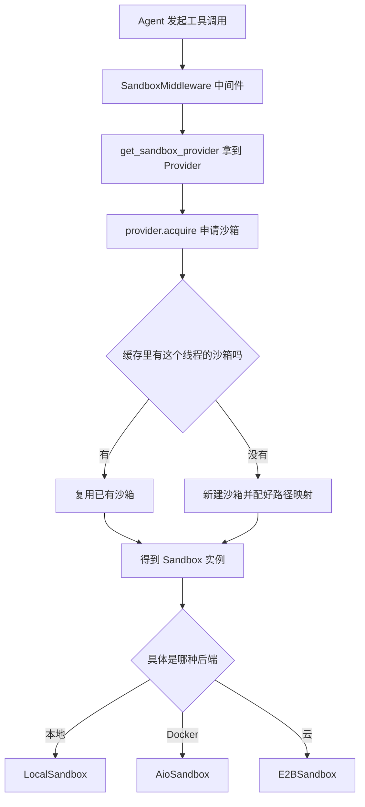
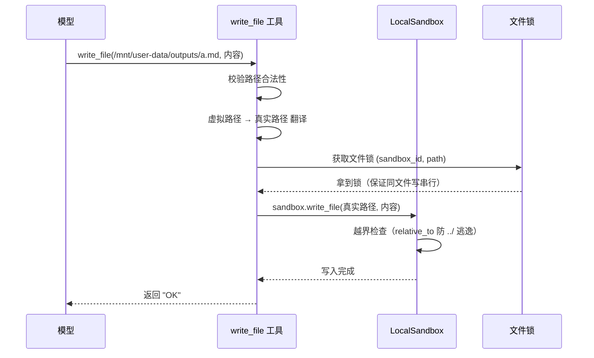

# DeerFlow 沙箱系统（Sandbox）设计与实现 — 从零到精通

> 本文面向「完全没接触过沙箱」的读者。我们从"沙箱到底是什么、为什么需要它"讲起，一步步深入到 DeerFlow 项目里的具体设计与源码实现。
>
> 代码根目录：`backend/packages/harness/deerflow/sandbox/`
> 全文基于本仓库真实代码，不虚构任何未实现的能力。

---

## 目录

- [第 1 章 先搞懂：沙箱到底是什么](#第-1-章)
- [第 2 章 DeerFlow 为什么需要沙箱](#第-2-章)
- [第 3 章 核心概念：虚拟路径契约](#第-3-章)
- [第 4 章 整体架构：两层抽象](#第-4-章)
- [第 5 章 沙箱的一生：获取 → 使用 → 释放](#第-5-章)
- [第 6 章 逐个模块讲源码](#第-6-章)
- [第 7 章 安全设计：三道防线](#第-7-章)
- [第 8 章 工程细节：并发、资源、内存](#第-8-章)
- [第 9 章 多后端选型与取舍](#第-9-章)
- [第 10 章 常见问题与排查](#第-10-章)
- [第 11 章 一页速查表](#第-11-章)
- [第 12 章 模拟面试：你的沙箱是如何实现的](#第-12-章)
- [第 13 章 大厂面试宝典：高频深度追问（SSP/SP）](#第-13-章)
- [第 14 章 简历产出总结（可直接摘取）](#第-14-章)

> **深入小节导航**（面向想深挖实现的读者）：
> - 5.2.1 一条 bash 命令怎么被安全跑起来（shell 选择 / 管道 drain / 进程组终止）
> - 6.3.1 热路径的性能优化（cached_property + 双套边界正则）
> - 6.3.2 三个容易被忽略的实现细节（download_file 边界 / read_file 反向解析 / list_dir overlay）
> - 6.8.1 懒加载的坑与 wrap_tool_call 状态持久化
> - 8.3.1 LocalSandboxProvider 为什么这么设计（每线程沙箱 + LRU + 线程安全）
> - 8.3.2 路径映射是怎么拼出来的（静态映射 + 每线程动态映射）

---

<a id="第-1-章"></a>
## 第 1 章 先搞懂：沙箱到底是什么

### 1.1 用生活例子理解

想象你请了一个很能干、但你完全不认识的临时工到家里干活。他能做饭、修东西、整理房间，效率极高。但你敢让他在**整个家里随便翻**吗？

- 他可能翻到你的**保险柜密码**（对应：系统里的 API 密钥）；
- 他可能不小心**砸坏承重墙**（对应：删掉系统关键文件）；
- 他可能跑到**邻居家**（对应：访问其他用户的数据）。

聪明的做法是：给他划一间**独立的工作间**，里面放好他需要的工具和材料，门口贴上"只能在这间屋子里干活"。这间工作间，就是**沙箱（Sandbox）**。

> **一句话定义**：沙箱是一个**受限、隔离、可控**的运行环境。程序在里面能干活，但干不了坏事，也影响不到外面的世界。

### 1.2 沙箱要保证的三件事

| 保证 | 含义 | 家里请临时工的类比 |
|------|------|-------------------|
| **隔离（Isolation）** | 沙箱里的操作不影响外部，不同沙箱之间也互不干扰 | 每个临时工一间独立工作间，互不串门 |
| **受限（Restriction）** | 只能访问被明确允许的资源 | 只能进指定的房间，拿指定的工具 |
| **可控（Control）** | 外部可以监控、限制、随时终止里面的活动 | 你能随时喊停，也能限制他干多久 |

### 1.3 "沙箱"这个词的由来

"Sandbox"字面意思是给小孩玩的**沙坑**。小孩在沙坑里怎么折腾都行——堆城堡、挖坑、洒得到处都是沙子，但**沙子出不了坑，坑外的世界不受影响**。计算机领域借用了这个比喻。

---

<a id="第-2-章"></a>
## 第 2 章 DeerFlow 为什么需要沙箱

### 2.1 AI Agent 要"真正干活"就得能碰文件和命令

DeerFlow 是一个 **AI Agent 运行时**。所谓 Agent，就是让大模型（LLM）不只是聊天，而是能**动手做事**：写代码、跑脚本、处理上传的文件、生成报告交付物。

要做这些事，Agent 必须能：

1. **写文件**（比如生成一个 `report.md`）；
2. **读文件**（比如读用户上传的 `data.csv`）；
3. **执行命令**（比如跑一段 Python 脚本）。

### 2.2 如果直接让模型操作真实机器，会发生什么灾难

大模型生成的操作是**不可完全信任**的——它可能被诱导（提示词注入），也可能自己"发挥"出危险操作。如果让它直接操作运行 DeerFlow 的那台服务器（我们叫它**宿主机 / Host**）：

- **会话之间互相覆盖**：用户 A 和用户 B 都写 `output.txt`，会互相盖掉（**没有隔离**）；
- **泄露真实路径**：模型看到 `/app/backend/.deer-flow/users/张三/threads/abc/...`，暴露了用户名、目录结构、服务器内部布局；
- **删库跑路**：模型生成 `rm -rf /` 之类的命令，直接把服务器搞挂；
- **偷密钥**：模型读服务器上的环境变量，拿走 `OPENAI_API_KEY`、数据库密码。

所以，**必须给 Agent 一台"虚拟电脑"**——这就是 DeerFlow 沙箱系统的使命。

### 2.3 DeerFlow 沙箱要同时满足两个"看似矛盾"的目标

这是理解整个设计的关键。沙箱要同时做到：

- **目标 A（安全）**：把模型死死关在受控范围里，不越权、不泄密、不搞崩系统；
- **目标 B（模型友好）**：让模型用起来简单、稳定，感觉就像在操作一台正常的电脑。

这两个目标看起来冲突：越安全通常越难用。DeerFlow 用**虚拟路径契约**这个巧妙设计同时满足了两者——这是下一章的核心。

---

<a id="第-3-章"></a>
## 第 3 章 核心概念：虚拟路径契约

> 如果全文只记住一个概念，就记这个。它是 DeerFlow 沙箱设计的灵魂。

### 3.1 什么是"虚拟路径"

**问题**：模型需要一个"文件放在哪"的地址（路径）。如果直接给它真实地址，就泄露了服务器内部结构；而且真实地址每个用户、每次会话都不一样，模型会被搞晕。

**解法**：给模型一套**假的、但永远固定**的地址，叫**虚拟路径（Virtual Path）**。模型永远只看到这套地址：

```
/mnt/user-data/uploads     ← 用户上传的文件放这里
/mnt/user-data/workspace   ← Agent 干活的工作区
/mnt/user-data/outputs     ← 交付物放这里（最终给用户的成果）
/mnt/skills                ← 技能包（预置的工具脚本）
/mnt/acp-workspace         ← 跨 Agent 协作的工作区
```

（定义在 `deerflow/config/paths.py` 的 `VIRTUAL_PATH_PREFIX`）

### 3.2 虚拟路径背后的"真实地址"

虚拟路径只是给模型看的"门牌号"。它背后对应一个**每个会话线程独立**的真实目录：

```
真实宿主目录 = {base_dir}/users/{user_id}/threads/{thread_id}/user-data/
```

- `user_id`：哪个用户；
- `thread_id`：哪次会话（一次对话就是一个 thread）。

因为路径里带了 `user_id` 和 `thread_id`，**不同用户、不同会话的文件天然就分开了**——这就实现了"隔离"。

### 3.3 双向翻译：门牌号 ↔ 真实地址

沙箱在中间做一个"翻译官"的角色，全程对模型透明：

```
                    ┌─────────────────┐
   模型写文件         │                 │       真正落盘
/mnt/user-data/  ──▶ │   沙箱翻译官     │ ──▶  {base}/users/张三/
outputs/a.md         │  (正向翻译)      │       threads/abc/user-data/outputs/a.md
                    │                 │
   模型看到          │                 │       命令实际输出了
/mnt/user-data/  ◀── │   (反向翻译)     │ ◀──  {base}/users/张三/threads/...
outputs/a.md         │                 │
                    └─────────────────┘
```

- **正向翻译（虚拟 → 真实）**：模型说"写到 `/mnt/user-data/outputs/a.md`"，沙箱翻译成真实地址再落盘；
- **反向翻译（真实 → 虚拟）**：命令执行后如果输出里带了真实地址（比如 `ls` 打印出完整路径），沙箱在返回给模型前把它**改回虚拟路径**，模型永远看不到真身。

### 3.4 虚拟路径的两个额外好处

1. **安全**：真实结构、用户名全被藏起来；
2. **省钱（前缀缓存）**：大模型有"前缀缓存"机制——如果每次请求开头的内容（系统提示词）都一样，就能命中缓存，省 token、省钱。虚拟路径**永远不变**，所以提示词里关于文件路径的部分保持稳定，能持续命中缓存。如果用真实路径（每次都变），缓存就废了。

---

<a id="第-4-章"></a>
## 第 4 章 整体架构：两层抽象

DeerFlow 沙箱用**两层抽象接口**把"能力"和"生命周期管理"分开。这是典型的面向接口编程。

### 4.1 第一层：`Sandbox` —— 定义"沙箱能干什么"

[`Sandbox`](backend/packages/harness/deerflow/sandbox/sandbox.py:43) 是一个抽象基类（ABC），规定了任何沙箱都必须提供这些能力：

| 方法 | 作用 |
|------|------|
| `execute_command` | 执行一条命令 |
| `read_file` / `write_file` | 读 / 写文本文件 |
| `download_file` / `update_file` | 读 / 写二进制文件 |
| `list_dir` | 列目录 |
| `glob` | 按通配符找文件（如 `*.py`） |
| `grep` | 在文件里搜文本 |

> **打个比方**：`Sandbox` 就像一份"电脑功能说明书"，规定了"一台合格的电脑必须能开机、能读盘、能跑程序"。至于是台式机还是笔记本，说明书不管。

### 4.2 第二层：`SandboxProvider` —— 定义"沙箱怎么管理"

[`SandboxProvider`](backend/packages/harness/deerflow/sandbox/sandbox_provider.py:9) 管的是沙箱的**生命周期**：

| 方法 | 作用 |
|------|------|
| `acquire(thread_id, user_id)` | 申请一个沙箱，返回它的 ID |
| `get(sandbox_id)` | 按 ID 拿到沙箱实例 |
| `release(sandbox_id)` | 释放（销毁）一个沙箱 |
| `acquire_async(...)` | 异步版申请（内部用线程跑，不卡事件循环） |

> **打个比方**：`SandboxProvider` 就像"电脑租赁公司"——负责给你分配一台电脑、按 ID 找到你租的那台、用完帮你回收。

### 4.3 为什么要分两层？—— 可插拔多后端

分开之后，"沙箱是什么样的"和"怎么管理沙箱"就解耦了。DeerFlow 因此支持**多种后端实现**，配置一改就能切换：

| 后端实现 | 沙箱是什么 | 隔离强度 |
|----------|-----------|---------|
| **LocalSandbox（本地）** | 就是宿主机上的一个目录 | 弱（不是真隔离，详见第 7 章） |
| **AioSandbox（Docker）** | 一个 Docker 容器 | 强（进程 / 文件级隔离） |
| **E2BSandbox（云）** | 云端的一个沙箱实例 | 强 |
| **boxlite** | 轻量容器 | 中 |

切换方式：改配置 `config.sandbox.use`，代码通过反射（`resolve_class`）加载对应的类。业务代码只面向 `Sandbox` / `SandboxProvider` 接口编程，**完全不用改**。

> 这就是设计模式里的**策略模式 + 依赖倒置**：上层依赖抽象接口，具体实现可插拔。

### 4.4 架构总览图



---

<a id="第-5-章"></a>
## 第 5 章 沙箱的一生：获取 → 使用 → 释放

一个沙箱从被创建到被回收，经历三个阶段。谁在管这三个阶段？—— [`SandboxMiddleware`](backend/packages/harness/deerflow/sandbox/middleware.py)（沙箱中间件）。它挂在 Agent 的执行流程上，在合适的时机触发获取和释放。

### 5.1 阶段 A：获取（acquire）

**关键设计：懒加载（lazy_init，默认开启）**

- 如果一次会话是**纯问答**（比如"你好，帮我解释一下什么是递归"），根本不需要文件操作，那就**不创建沙箱**，省资源；
- 只有当模型**第一次真正调用文件 / 命令工具**时，才现场创建沙箱。这叫"懒加载"。

获取的调用链：

```
get_sandbox_provider()          拿到全局唯一的 Provider（单例）
    ↓
provider.acquire(thread_id, user_id)   申请沙箱，返回 sandbox_id
    ↓
（异步场景用 acquire_async，内部 asyncio.to_thread 把阻塞操作丢到线程里跑，不卡事件循环）
```

> **为什么要 `to_thread`？** 创建 Docker 容器、初始化目录这些操作是**阻塞**的（会等好几秒）。如果直接在 asyncio 事件循环里跑，整个服务就卡住了。丢到工作线程去跑，事件循环继续处理别的请求。

### 5.2 阶段 B：使用（工具调用期间）

模型调用工具（`write_file` / `read_file` / `str_replace` / `bash` / `glob` / `grep`）时，每一步沙箱都在背后做保护：

1. **路径校验 + 正向翻译**：把虚拟路径翻译成真实路径，同时检查有没有 `../` 越界（详见第 7 章）；
2. **写操作加文件锁**：同一个文件的并发写会被串行化，避免互相覆盖（详见第 8 章）；
3. **命令有界执行**：bash 命令带超时（默认 600 秒）和输出上限（10MB），防止挂死或撑爆内存；
4. **环境变量密钥擦除**：跑子进程前，把像密钥的环境变量全擦掉（详见第 7 章）；
5. **反向翻译遮蔽**：返回结果前，把输出里的真实路径改回虚拟路径。

#### 5.2.1 深入：一条 bash 命令到底怎么被"安全地跑起来"

很多人以为"执行命令"就是一句 `subprocess.run(cmd)`。实际上要安全、跨平台、不挂死地跑，本地沙箱做了很多事。我们把一条命令的执行拆成四个环节：

**环节一：选对 shell（跨平台）**

不同操作系统的默认 shell 不一样：Linux/macOS 是 `bash`/`sh`，Windows 可能是 `cmd.exe`、`powershell`，也可能装了 Git Bash（MSYS）。本地沙箱有一组辅助函数专门识别 shell 类型：

```python
@staticmethod
def _is_powershell(shell: str) -> bool:
    return LocalSandbox._shell_name(shell) in {"powershell", "powershell.exe", "pwsh", "pwsh.exe"}

@staticmethod
def _find_first_available_shell(candidates) -> str | None:
    for shell in candidates:
        if os.path.isabs(shell):                      # 绝对路径：检查文件存在且可执行
            if os.path.isfile(shell) and os.access(shell, os.X_OK):
                return shell
        else:
            found = shutil.which(shell)               # 命令名：在 PATH 里找
            if found is not None:
                return found
    return None
```

**为什么要这么麻烦？** 因为模型生成的命令语法是按 bash 写的。如果落到 Windows 的 `cmd.exe` 上跑，语法完全不兼容。识别 shell 类型后，沙箱才能决定怎么正确地把命令交给它执行。

> **实现细节（务必对照源码）**：`_get_shell()` 在 POSIX 上的探测顺序是 `("/bin/zsh", "/bin/bash", "/bin/sh", "sh")`——**首选是 `/bin/zsh`**（因为 macOS 默认 shell 已是 zsh），依次回退到 bash、sh，最后在 PATH 里找 `sh`。全都找不到时：Windows 上继续回退到 `pwsh`/`powershell`/`cmd.exe`，其余平台直接抛 `RuntimeError`。本文后面为讲解方便，示例里写的是 `/bin/bash`，真实首选请以源码的 zsh 为准。

**环节二：把命令喂给 shell 并启动子进程**

命令通过 `subprocess`（Python 标准库的子进程模块）启动。关键点：本地沙箱**不做 shell 字符串拼接**，而是把环境变量以 `env=...` 参数传给子进程（见 6.1 的 `_validate_extra_env` 讲解），从根本上避免命令注入。

**环节三：读取输出——为什么要用后台线程"排空管道"**

子进程的输出通过**管道（pipe）**传回来。这里有个经典陷阱：

> 管道有固定容量（比如 64KB）。如果子进程拼命往管道里写、而父进程不及时读走，管道会被**写满**，子进程就**卡住不动**（阻塞在 write）。父进程如果又在等子进程结束，就形成**互相干等的死锁**。

解法是开一个**后台线程专门"排空"管道**：

```python
@staticmethod
def _drain_pipe(fd: int, capture: _BoundedPipeCapture) -> None:
    try:
        while chunk := os.read(fd, 8192):    # 不停地读，8KB 一块
            capture.append(chunk)            # 交给有界缓冲（超上限就丢弃）
    except OSError:
        ...
    finally:
        os.close(fd)                         # 尽力关闭
```

- `_drain_pipe` 在独立线程里跑，持续把管道里的数据读出来，子进程就永远不会被写满卡住；
- 读出的数据交给 `_BoundedPipeCapture`——它只在内存里保留上限（10MB）内的部分，超出的直接丢弃并加"已截断"提示，**防止海量输出撑爆内存（OOM）**。

**环节四：超时了怎么"干净地"终止进程**

超时终止不是简单 kill 主进程就行。因为模型的命令可能派生一堆子进程（比如 `a | b | c` 或后台任务），只杀主进程会留下**僵尸子进程**。所以沙箱用**进程组（process group）**统一管理：

```python
@staticmethod
def _process_group_exists(pgid: int | None) -> bool:
    try:
        os.killpg(pgid, 0)     # 信号 0：只探测进程组是否还在，不真的杀
        return True
    except ProcessLookupError:
        return False
    ...
```

启动子进程时把它设为一个新进程组的组长，超时后用 `os.killpg` 向**整个进程组**发终止信号，把它和所有派生的子进程一起干掉。

**超时后给模型的友好提示**：

```
Command timed out after 600 seconds and was terminated. To run a long-lived
process such as a web server, start it in the background and redirect its
output, e.g. `your-command > /mnt/user-data/workspace/server.log 2>&1 &`.
```

这段提示不只是报错，还**教模型怎么改**——把常驻进程用 `&` 后台化。这体现了"模型友好"的设计理念：错误信息要能引导模型自我修正。

### 5.3 阶段 C：释放（release）—— 注意不是每轮都释放

**关键设计：跨轮复用**

- 同一个会话（thread）里，用户可能来回聊很多轮。沙箱**不是每轮结束就销毁**，而是**整个会话内复用**——避免反复创建销毁的开销；
- 只有 Agent 整体结束（`after_agent`）时才 `release`；
- 应用关闭时，`shutdown_sandbox_provider()` 统一清理所有沙箱。

### 5.4 一次 write_file 的完整时序图



---

<a id="第-6-章"></a>
## 第 6 章 逐个模块讲源码

这一章带你看每个核心文件的真实代码。目录结构：

```
sandbox/
├── sandbox.py              抽象接口：Sandbox（能力）
├── sandbox_provider.py     抽象接口：SandboxProvider（生命周期）+ 单例管理
├── security.py             安全门禁：宿主 bash 是否允许
├── env_policy.py           环境变量密钥擦除策略
├── file_operation_lock.py  文件操作锁（防并发覆盖）
├── path_patterns.py        路径遮蔽正则（反向翻译用）
├── middleware.py           中间件：获取/释放沙箱
├── tools.py                暴露给模型的工具（write_file 等）
└── local/
    ├── local_sandbox.py          本地沙箱实现（路径翻译核心）
    └── local_sandbox_provider.py 本地 Provider（LRU 缓存）
```

### 6.1 `sandbox.py`：接口即契约

```python
class Sandbox(ABC):
    def __init__(self, id: str):
        self._id = id

    @property
    def id(self) -> str:
        return self._id

    @abstractmethod
    def execute_command(self, command, env=None, timeout=None) -> str: ...
    @abstractmethod
    def read_file(self, path) -> str: ...
    @abstractmethod
    def write_file(self, path, content, append=False) -> None: ...
    @abstractmethod
    def glob(self, path, pattern, *, include_dirs=False, max_results=200): ...
    @abstractmethod
    def grep(self, path, pattern, *, glob=None, literal=False,
             case_sensitive=False, max_results=100): ...
```

**要点**：
- `execute_command` 的 `env` 参数用来传**请求级密钥**（比如用户的短期 token）——不放进提示词、不放进命令字符串，直接以环境变量注入子进程，更安全；
- `timeout` 用来限制单条命令的墙钟时间。

**纵深防御的细节**：接口里有个 `_validate_extra_env` 函数，强制校验所有 `env` 的键必须是合法的 POSIX 环境变量名。它用的正则规则是：

```python
_ENV_NAME_PATTERN = re.compile(r"^[A-Za-z_][A-Za-z0-9_]*$")

def _validate_extra_env(extra_env):
    if not extra_env:
        return
    for key in extra_env:
        if not isinstance(key, str) or not _ENV_NAME_PATTERN.fullmatch(key):
            raise ValueError(...)  # 非法键立即报错
```

这条规则的意思是：环境变量名只能以字母或下划线开头，后面只能跟字母、数字、下划线。

**为什么这么做？** 现在所有实现都不会把键拼进 shell 命令字符串（本地沙箱用 `subprocess.run(env=...)`，不经过 shell）。但万一将来有个实现改成拼 shell，一个恶意键（比如带分号和 `rm -rf /` 的键）就可能造成命令注入。在**抽象层**提前强制校验，就是"防患于未然"——将来的实现不用自己重新想这个规则，非法键当场 fail-fast。

### 6.2 `sandbox_provider.py`：单例双检锁（重点难点）

这是全项目并发最微妙的地方。`get_sandbox_provider()` 是全局单例，会被**多个操作系统线程**同时访问（主事件循环、飞书渠道线程各跑各的 loop）。

```python
_default_sandbox_provider = None
_provider_lock = threading.Lock()

def get_sandbox_provider(**kwargs):
    global _default_sandbox_provider
    # ① 快路径：加锁读一次
    with _provider_lock:
        if _default_sandbox_provider is not None:
            return _default_sandbox_provider

    # ② 冷启动：在锁外解析类 + 构造实例
    config = get_app_config()
    cls = resolve_class(config.sandbox.use, SandboxProvider)
    provider = cls(**kwargs)

    # ③ 锁内协调竞争
    with _provider_lock:
        if _default_sandbox_provider is None:
            _default_sandbox_provider = provider
            return provider
        winner = _default_sandbox_provider  # 我输了，用别人建好的

    # ④ 输掉竞争：在锁外清理自己刚建的"孤儿"实例
    if hasattr(provider, "shutdown"):
        provider.shutdown()
    return winner
```

逐点讲清楚（这几个"为什么"是精髓）：

- **① 为什么读也要加锁？** 防止另一个线程正在执行 `reset/shutdown`，恰好在"检查"和"返回"之间把全局变量置空，让你返回 `None`。
- **② 为什么构造实例放在锁外？** `config.sandbox.use` 会解析到**任意插件类**，它的 `__init__` 可能很慢，甚至可能**回头再调用**这些生命周期函数。`threading.Lock` 是**不可重入**的——如果在持锁时又想拿同一把锁，就**自己把自己锁死（自死锁）**。而且构造慢的话，会阻塞所有其它线程的 `get()`。所以插件代码绝不能在锁内跑。
- **③ 为什么锁外构造要"协调竞争"？** 两个线程可能同时走到锁外构造，各建了一个实例。锁内只让一个"装上"全局，另一个是"孤儿"。
- **④ 为什么要 `shutdown` 孤儿？** 有的 Provider（如 `AioSandboxProvider`）构造时会**启动后台线程**（idle-checker）。如果输掉竞争的孤儿不清理，那个后台线程就永远泄漏了。这是真实踩过的坑（历史 issue #3721）。

### 6.3 `local_sandbox.py`：正向翻译 + 遍历防护（安全核心）

模型给的是虚拟路径，要翻译成真实路径。关键是**必须防止 `../` 逃逸**：

```python
def _resolve_path_with_mapping(self, path: str) -> ResolvedPath:
    mapping_match = self._find_path_mapping(path_str)   # 按最长前缀找到对应挂载
    if mapping_match is None:
        return ResolvedPath(path_str, None)
    mapping, relative = mapping_match
    local_root = Path(self._resolved_local_paths[mapping])
    # 拼出真实路径，resolve() 会把 .. 展开成真实位置
    resolved_path = (local_root / relative).resolve() if relative else local_root
    try:
        resolved_path.relative_to(local_root)   # ★ 越界检查
    except ValueError as exc:
        raise PermissionError(errno.EACCES,
            "Access denied: path escapes mounted directory", path_str) from exc
    return ResolvedPath(str(resolved_path), mapping)
```

**核心思想（新手务必理解这一点）**：

假设挂载根是 `/base/threads/abc/`，模型传了 `/mnt/user-data/../../../../etc/passwd`。
- 天真做法：检查字符串里有没有 `..` —— **这是错的**！`..` 可以被符号链接、编码等方式绕过；
- 正确做法：先 `resolve()` 把路径**真正算出来**（`..` 全部展开），得到比如 `/etc/passwd`，再用 `relative_to(local_root)` 判断"它是不是还在挂载根里面"。`/etc/passwd` 显然不在 `/base/threads/abc/` 里面，`relative_to` 抛异常，于是拒绝访问。

这就是**路径遍历防护**（Path Traversal Protection）。`relative_to` 那一行是整个安全的命门。

#### 6.3.1 深入：热路径的性能优化（cached_property）

路径翻译是**最高频**的操作——模型每次读写文件、每条命令输出都要翻译一遍。如果每次都重新排序挂载列表、重新编译正则，会很慢。本地沙箱用 `@cached_property`（缓存属性）把这些一次性算好、之后复用：

```python
@cached_property
def _command_pattern(self):
    """匹配 shell 命令里的容器路径（shell 感知边界）。"""
    mappings = sorted(self.path_mappings, key=lambda m: len(m.container_path), reverse=True)
    ...
    return re.compile("|".join(...))

@cached_property
def _content_pattern(self):
    """匹配纯文本文件内容里的容器路径（文本边界）。"""
    ...
```

**要点一：`path_mappings` 只在 `__init__` 里设一次、之后从不改**。既然挂载列表不变，那么"排序后的视图"和"编译好的正则"在沙箱整个生命周期内都是稳定的。`@cached_property` 保证第一次访问时计算、之后直接返回缓存结果——避免在 Agent 热路径上反复排序 + 编译正则。

**要点二：为什么有两套正则（`_command_pattern` vs `_content_pattern`）？** 因为"命令里的路径"和"文件内容里的路径"边界规则不同：

- **命令场景**：路径后面可能跟 shell 特殊字符（空格、引号、分号、竖线、`&`），需要用 shell 感知的边界；
- **纯文本场景**：路径后面可能跟逗号、冒号等普通标点，边界更宽松。

用错边界会导致路径被"多吃"或"少吃"，翻译出错。这是一个"细节里藏魔鬼"的地方——两种上下文必须用各自贴合的正则。

**要点三：按容器路径长度降序排序**（`key=lambda m: len(...), reverse=True`）。这保证**最长前缀优先匹配**：处理嵌套挂载时（如 `/mnt/skills` 和 `/mnt/skills-extra`），先匹配更长更具体的那个，不会错配。

#### 6.3.2 深入：三个容易被忽略的实现细节（零遗漏补全）

除了正向翻译和缓存，`local_sandbox.py` 里还有三处新手容易漏看、但很关键的实现，务必补齐认知。

**细节一：`download_file` 的双重边界——白名单前缀 + 100MB 上限**

下载二进制文件（比如把生成的 PDF 交付给用户）比读文本更敏感，所以 `download_file` 比 `read_file` 多了两道门：

```python
def download_file(self, path: str) -> bytes:
    normalised = path.replace("\\", "/")
    stripped_path = normalised.lstrip("/")
    allowed_prefix = VIRTUAL_PATH_PREFIX.lstrip("/")
    # ① 白名单校验：只允许下载 /mnt/user-data 前缀下的文件
    if stripped_path != allowed_prefix and not stripped_path.startswith(f"{allowed_prefix}/"):
        raise PermissionError(errno.EACCES, f"Access denied: path must be under '{VIRTUAL_PATH_PREFIX}'", path)
    resolved_path = self._resolve_path(path)
    max_download_size = 100 * 1024 * 1024   # ② 100MB 上限
    file_size = os.path.getsize(resolved_path)
    if file_size > max_download_size:
        raise OSError(errno.EFBIG, ...)
    ...
```

- **① 白名单前缀**：即便通过了路径翻译，下载还额外要求路径必须落在 `VIRTUAL_PATH_PREFIX`（即 `/mnt/user-data`）下——技能目录、acp-workspace 都不允许下载，进一步收窄了对外交付的出口；
- **② 100MB 上限**：防止一次下载把内存撑爆（注意这与命令输出的 10MB 上限是两个不同的常量，别混淆）；
- 源码里还专门标注了 **TOCTOU** 注记：`getsize()` 和 `read()` 之间文件可能变大，这是"受控沙箱环境下可接受的权衡"。

**细节二：`read_file` 只对"Agent 自己写过的文件"做反向解析**

反向翻译（真实路径 → 虚拟路径）并不是对所有读到的文件内容无脑执行的。`LocalSandbox` 用一个 `self._agent_written_paths` 集合记录"哪些文件是通过 `write_file` 写进去的"：

```python
def read_file(self, path):
    ...
    if resolved_path in self._agent_written_paths:      # 只有 Agent 自己写的才反向解析
        content = self._reverse_resolve_paths_in_output(content)
    return content
```

**为什么要区分？** 用户上传的文件、外部工具产生的文件，其内容里可能本来就含有类似真实路径的字符串（但那是数据的一部分，不是路径泄露）。如果对这些内容也无脑做反向替换，会**篡改用户数据**。所以只有 Agent 亲手 `write_file` 写进去的内容（可能含被正向翻译过的真实路径）才需要在读回时还原成虚拟路径。这也解释了第 8 章 LRU 淘汰时"丢失 `_agent_written_paths` 只是优雅降级"的含义——丢了它，`read_file` 退化成"不做反向解析"，等同于一次全新运行。

**细节三：`list_dir` 的"虚拟子目录 overlay"补丁**

`/mnt/skills` 下的 `public`/`custom`/`legacy` 这些子挂载，它们的真实目录往往在宿主机的**别处**（不在 `/mnt/skills` 对应的那一个物理目录里），底层的 `list_dir` 工具出于安全会跳过这些"目录外"的软链接式目标。结果就是：模型 `ls /mnt/skills` 时可能**看不到本该存在的技能子目录**。

`LocalSandbox.list_dir` 因此加了一段"overlay"补丁：遍历所有 `path_mappings`，凡是"容器路径正好是当前请求目录的直接子级、且没被列出、且宿主目录真实存在"的挂载，手动把它补回结果列表：

```python
for mapping in self.path_mappings:
    if mapping.container_path.startswith(container_path + "/"):
        child_rel = mapping.container_path[len(container_path) + 1:]
        if "/" not in child_rel and mapping.container_path.rstrip("/") not in existing_dirs:
            if Path(mapping.local_path).resolve().is_dir():   # 确认宿主目录真实存在，不加幽灵项
                result.append(f"{mapping.container_path}/")
```

这体现了一个思路：**当"安全遍历规则"和"契约要求模型能看到的视图"冲突时，用一层受控的 overlay 把契约要求的视图补回来**，而不是放松底层的安全规则。

### 6.4 `path_patterns.py`：反向翻译遮蔽（单一规则源）

命令的输出里可能出现真实路径。返回给模型前要"遮蔽"回虚拟路径。这里把匹配规则**集中在一个函数**里构造：

```python
# 段边界：确保挂载根不会误匹配到"同前缀的兄弟目录"
_SEGMENT_BOUNDARY = r"(?=/|$|[^\w./-])"
_PATH_TAIL = r"(?:[/\\][^\s\"';&|<>()]*)?"

def build_output_mask_pattern(base, *, separator_agnostic=False):
    escaped = re.escape(base)
    if separator_agnostic:
        escaped = escaped.replace(r"\\", r"[/\\]")   # 兼容 Windows 分隔符
    return re.compile(escaped + _SEGMENT_BOUNDARY + _PATH_TAIL)
```

**为什么需要"段边界"？** 假设有两个挂载 `/base/skills` 和 `/base/skills-extra`。如果不加边界，匹配 `/base/skills` 时会把 `/base/skills-extra` 的前半段也匹配掉，翻译就错了。`_SEGMENT_BOUNDARY` 保证只在**完整路径段的边界**才匹配。（其中的行尾锚点是特意加的，用来处理"输出正好停在挂载根、后面什么都没有"的情况。）

**为什么规则要集中在一个文件里？** 有两处代码都要做这个遮蔽（bash 输出、glob/grep 结果）。历史上这两处规则是各写各的，结果 #4035 改了一处漏了另一处，#4053 才补上——两份规则"各改一半"导致漂移。现在把规则**唯一地**放在 `path_patterns.py`，谁也别想再私自"手搓"一份变体。这是"单一事实来源（Single Source of Truth）"原则的实践。

### 6.5 `security.py`：宿主 bash 门禁

```python
def is_host_bash_allowed(config=None) -> bool:
    sandbox_cfg = getattr(config, "sandbox", None)
    if sandbox_cfg is None:
        return False
    if not uses_local_sandbox_provider(config):
        return True   # Docker/e2b 等真隔离后端，放行 bash
    return bool(getattr(sandbox_cfg, "allow_host_bash", False))  # 本地默认 False
```

逻辑：**只有"本地 Provider 且没显式开开关"才禁用 bash**。Docker、e2b 这类真正隔离的后端，跑 bash 是安全的，直接放行。（为什么本地要禁，见第 7 章。）

### 6.6 `env_policy.py`：环境变量密钥擦除

```python
def build_sandbox_env(injected=None) -> dict[str, str]:
    # ① 先从继承环境里擦掉所有"像密钥"的变量
    env = {k: v for k, v in os.environ.items() if not is_blocked_env_name(k)}
    # ② 再把上游授权的请求级密钥叠加上去
    if injected:
        env.update(injected)
    return env

def is_blocked_env_name(name: str) -> bool:
    upper = name.upper()
    if upper in _BLOCKED_EXACT_NAMES:   # 精确名单：DATABASE_URL / MYSQL_PWD / GITHUB_PAT ...
        return True
    # 通配名单：含 KEY / SECRET / TOKEN / PASS / CREDENTIAL / DSN 的都算
    return any(fnmatch.fnmatchcase(upper, p) for p in _SECRET_NAME_PATTERNS)
```

**先擦后叠**的顺序很重要：先把继承来的平台密钥全擦光，再叠上"这次请求专门授权的"密钥。这样脚本只能拿到被明确授权的密钥，拿不到平台的。（详见第 7 章。）

### 6.7 `file_operation_lock.py`：文件锁 + 防内存泄漏

```python
_FILE_OPERATION_LOCKS = weakref.WeakValueDictionary()  # 弱引用字典
_FILE_OPERATION_LOCKS_GUARD = threading.Lock()

def get_file_operation_lock(sandbox, path):
    lock_key = get_file_operation_lock_key(sandbox, path)  # (sandbox_id, path)
    with _FILE_OPERATION_LOCKS_GUARD:
        lock = _FILE_OPERATION_LOCKS.get(lock_key)
        if lock is None:
            lock = threading.Lock()
            _FILE_OPERATION_LOCKS[lock_key] = lock
        return lock
```

**两个设计点**：
- 锁的粒度是 `(sandbox_id, path)`——只有**操作同一个文件**才会互斥，不同文件互不影响，吞吐好；
- 用 `WeakValueDictionary`（弱引用字典）而不是普通 dict：当没人再用某把锁时，它会被自动回收。否则长时间运行的进程里，锁的数量会无限增长，最终撑爆内存。

### 6.8 `middleware.py`：中间件装配

```python
class SandboxMiddleware(AgentMiddleware):
    def __init__(self, lazy_init: bool = True): ...   # 默认懒加载

    async def abefore_agent(self, state, runtime):
        if self._lazy_init:
            return await super().abefore_agent(...)   # 懒加载：先不获取
        sandbox_id = await self._acquire_sandbox_async(thread_id, user_id=...)
        return {"sandbox": {"sandbox_id": sandbox_id}}

    async def aafter_agent(self, state, runtime):
        await self._release_sandbox_async(state["sandbox"]["sandbox_id"])  # 结束才释放
```

沙箱 ID 会写进 Agent 的"图状态（state）"里的 `sandbox.sandbox_id`，这样整个会话都能复用同一个沙箱，下游的中间件、子智能体也都能拿到。

#### 6.8.1 深入：懒加载埋下的一个坑，以及 wrap_tool_call 怎么补

懒加载虽好，但埋了个隐蔽的坑。理解这个坑，就理解了 LangGraph 状态管理的一个本质。

**坑在哪？**

懒加载时，沙箱是在"第一次工具调用"里现场创建的。创建后，代码把 `sandbox_id` 写进了 `runtime.state["sandbox"]`。听起来没问题？但——

> 在 LangGraph 里，**直接改 `runtime.state` 只在当前这次工具调用内有效**。它不会被 LangGraph 的"状态通道（channel reducer）"采纳，所以**下一个图步骤、下游的其它中间件、子智能体的 `task_tool` 都看不到这个 `sandbox_id`**。

结果就是：第一次调用创建了沙箱，但第二次调用、或下游组件却以为"还没有沙箱"，可能重复创建，或者干脆拿不到——状态"丢失"了。

**怎么补？—— 前后快照对比（diff）+ Command 显式更新**

`SandboxMiddleware` 重写了 `wrap_tool_call`（包裹每次工具调用），用"调用前后对比"来捕捉这次懒加载：

```python
def wrap_tool_call(self, request, handler):
    prev_sandbox_id = self._read_sandbox_id_from_request(request)  # ① 调用前：有沙箱吗
    result = handler(request)                                     # ② 执行工具
    if prev_sandbox_id is not None:
        return result            # 调用前就有 → 不是这次新建的，直接返回
    curr_sandbox_id = self._read_sandbox_id_from_request(request)  # ③ 调用后：有沙箱了吗
    if curr_sandbox_id is None:
        return result            # 还是没有 → 这次没触发懒加载
    # ④ 检测到"调用前没有、调用后有" → 说明这次懒加载新建了沙箱
    return self._attach_sandbox_update(result, curr_sandbox_id)   # 显式持久化进图状态
```

逻辑很清晰：**调用前没有、调用后有 → 说明这次触发了懒加载，必须把新沙箱 ID 正式写进图状态**。

**怎么"正式写进"？—— 用 `Command(update=...)`**

LangGraph 里，要让状态变更被通道采纳，必须通过返回值里的 `Command(update=...)`，而不是直接改 `runtime.state`：

```python
@staticmethod
def _attach_sandbox_update(result, sandbox_id):
    sandbox_update = {"sandbox": {"sandbox_id": sandbox_id}}
    if isinstance(result, ToolMessage):
        # 工具返回的是普通消息 → 包成 Command，带上 sandbox 更新
        return Command(update={**sandbox_update, "messages": [result]})
    existing_update = result.update
    if isinstance(existing_update, dict):
        # 工具本身已返回 Command → 合并 sandbox 键，保留它原有的所有字段
        merged_update = {**existing_update, **sandbox_update}
        return dc_replace(result, update=merged_update)
    return result  # 未知形态 → 原样返回，避免静默丢数据
```

注意这里的**防御性处理**：
- 如果工具返回的是普通 `ToolMessage`，就包成 `Command` 并塞进 sandbox 更新；
- 如果工具已经返回了 `Command`（比如它自己要做 `goto` 跳转），就**合并** sandbox 键、**保留它原有的所有字段**（`messages`/`goto`/`graph`/`resume` 等），不能覆盖；
- 如果 `Command.update` 是未知形态（非 dict），**原样返回**——宁可不改，也不能瞎改造成静默数据丢失。

**这段代码教会我们什么？** 在 LangGraph（以及很多状态机 / 数据流框架）里，"本地改变量"和"提交状态变更"是两回事。想让变更持久化、被下游看到，必须走框架规定的提交通道（这里是 `Command(update=...)`）。这是一个很容易踩的坑。

### 6.9 `local_sandbox_provider.py`：每线程沙箱与 LRU 缓存

`LocalSandboxProvider` 负责"给每个会话线程分配一个 `LocalSandbox`"。它的核心职责与设计放在第 8 章（内存治理）统一讲，这里先记住一句话：**它为每个 `thread_id` 缓存一个沙箱，用 LRU 策略控制内存上限**。

---

<a id="第-7-章"></a>
## 第 7 章 安全设计：三道防线

DeerFlow 沙箱的安全不是靠单点，而是**层层设防（纵深防御）**。这里系统梳理三道核心防线。

### 7.1 第一道：路径隔离与遍历防护

| 防护 | 做法 | 挡住什么 |
|------|------|---------|
| 每线程独立目录 | 真实路径带 `user_id/thread_id` | 会话间、用户间串扰 |
| 虚拟路径遮蔽 | 模型只见 `/mnt/user-data/...` | 泄露真实结构、用户名 |
| 正向翻译遍历防护 | `resolve()` + `relative_to()` | `../` 逃逸到挂载根之外 |
| 反向翻译遮蔽 | `build_output_mask_pattern` | 命令输出里泄露真实路径 |

### 7.2 第二道：宿主 bash 默认禁用

**关键认知：本地沙箱不是真正的安全边界。**

`LocalSandboxProvider` 是直接在**宿主机**上跑 `subprocess`。这意味着如果放开 bash，模型能读宿主机任意文件、删库、读平台密钥——**它跟"隔离"没半点关系**，只是个共享同一台机器的目录而已。

所以 DeerFlow 的选择是 **fail-safe（默认安全）**：
- 本地 Provider 下，`allow_host_bash` 默认 `false` → **禁用宿主 bash**；
- 工具装配层（`get_available_tools`）据此**直接把 bash 工具从工具列表里剔除**——模型压根看不到这个工具；
- 想要真正能跑 bash？用 `AioSandboxProvider`（Docker，真隔离），或者**只在完全可信的本地环境**里显式设 `allow_host_bash: true`。

### 7.3 第三道：子进程环境变量密钥擦除

**问题的根源**：子进程默认会**继承父进程的全部环境变量**。DeerFlow 的 Gateway 进程里有一堆平台密钥（`OPENAI_API_KEY`、tracing key、数据库连接串……）。如果技能脚本作为子进程直接继承这些，任何"请求级密钥注入"都白搭了——脚本直接读继承来的平台密钥就行。

**解法**（`build_sandbox_env`，见 6.6）：**先擦后叠**。
- 用黑名单（通配含 KEY/SECRET/TOKEN/PASS/CREDENTIAL/DSN 的名字 + 精确名单）擦掉所有像密钥的变量；
- 再把上游授权的请求级密钥叠上（注入优先，因为它是被明确授权的）。

**几个精妙细节**：
- 通配 `PASS` 故意也覆盖 `GIT_ASKPASS`/`SUDO_ASKPASS` 这类"指向密钥程序"的变量——继承这个指针等于间接泄露密钥，同类风险；
- 良性变量 `PATH`/`HOME`/`SHELL`/`PWD`/`OLDPWD` 不含这些关键词，**不会被误擦**；
- 方向是"宁可多擦"（fail-safe）：真需要某个被擦的变量，让技能通过"必需密钥声明"走注入通道。

### 7.4 为什么用黑名单而不是白名单？

理论上白名单（只放行需要的）最安全，但**极难维护**——漏配一个变量脚本就跑不起来。DeerFlow 用"黑名单擦除 + 注入优先"，在**兼容性**（保留良性变量）和**安全**（擦掉密钥）之间取平衡。代价是黑名单模式集要持续维护。

---

<a id="第-8-章"></a>
## 第 8 章 工程细节：并发、资源、内存

安全之外，沙箱还要在高并发、长时间运行下稳定不崩。

### 8.1 并发安全

| 场景 | 风险 | 解法 |
|------|------|------|
| 单例被多线程访问 | 双重初始化 / 返回 None / 线程泄漏 | 双检锁 + 锁外构造 + 输掉竞争清理孤儿（6.2） |
| 同文件并发读改写 | 互相覆盖 | `(sandbox_id, path)` 粒度文件锁（6.7） |
| 阻塞操作卡事件循环 | 整个服务卡住 | `asyncio.to_thread` 卸载到工作线程 |

**关于 `str_replace` 的并发覆盖**：`str_replace`（字符串替换）本质是"读 → 改 → 写"三步。如果两个调用同时改同一个文件，就会互相覆盖。文件锁保证同一路径的这三步全程串行。

### 8.2 命令的有界执行（防挂死、防 OOM）

模型可能跑一个**永不返回**的前台进程（比如没加 `&` 后台化的 server），或产生**海量输出**。对策：

```python
DEFAULT_COMMAND_TIMEOUT_SECONDS = 600          # 墙钟超时 10 分钟
_COMMAND_CAPTURE_LIMIT_BYTES = 10 * 1024 * 1024  # 输出上限 10MB
```

- **超时**：用墙钟时间（不是 CPU 时间）超时终止。为什么是墙钟？因为前台常驻进程可能几乎不耗 CPU（阻塞在等连接），CPU 时间限不住它；
- **输出上限**：`_BoundedPipeCapture` 只在内存里保留上限内的输出，超出的丢弃并加"已截断"提示，防止 OOM。它带锁，是线程安全的；
- **不阻塞读管道**：后台线程持续 drain（排空）管道，避免子进程因为管道写满而卡住。

### 8.3 内存治理（长时间运行不泄漏）

| 资源 | 无界会怎样 | 有界方案 |
|------|-----------|---------|
| 每线程沙箱 | thread_id 无限增长，沙箱越攒越多 | LRU 缓存（默认上限 256），超限淘汰最久没用的 |
| 文件锁表 | (sandbox, path) 组合无限增长 | `WeakValueDictionary` 自动回收无引用的锁 |

#### 8.3.1 深入：LocalSandboxProvider 为什么这么设计

**背景：为什么是"每线程一个沙箱"，而不是"全局一个"？**

早期版本的 `LocalSandboxProvider` 返回的是一个**全进程共用**的 `LocalSandbox`（ID 固定叫 `"local"`）。但这有个根本矛盾：虚拟路径契约要求 `/mnt/user-data/...` 对应的真实目录是**每线程独立**的（`{base_dir}/users/{user_id}/threads/{thread_id}/user-data/`）。一个全局共用的沙箱根本无法给不同线程映射到不同的真实目录。

所以现在改成**每个 `thread_id` 一个独立的 `LocalSandbox`**，它的 `path_mappings` 里带有该线程专属的路径映射。这才真正兑现了"隔离"承诺。

> 兼容性细节：没有线程上下文的老调用（`acquire()` / `acquire(None)`）仍返回一个 ID 为 `"local"` 的通用单例，兼容旧代码和测试。

**为什么用 `OrderedDict` 做 LRU？**

`OrderedDict` 记住插入 / 访问顺序。做 LRU（最近最少使用淘汰）刚好合适：

- 每次 `acquire(thread_id)` 命中缓存时，把该项移到"最新"位置；
- 缓存超过上限（256）时，从"最旧"那头淘汰。

**为什么要上限？** 一个长时间运行的 Gateway，来访的 `thread_id` 数量是**无上限**的（每个新会话一个）。虽然每个 `LocalSandbox` 实例很轻量（就是个小 Python 对象，带一个路径映射列表和一个"已写路径"集合），但不设上限，攒到几十万个也会吃掉可观内存。256 是"复用收益"和"内存占用"的平衡点。

**线程安全：一把 Provider 级锁**

`acquire` / `get` / `reset` 可能被多个线程同时调用（Gateway 工具分发、子智能体 worker 池、后台记忆更新器……）。所以所有对缓存的读写都用一把 **Provider 级的 `threading.Lock`** 串行化，避免缓存被并发改乱。这和 `AioSandboxProvider` 的做法一致。

**优雅降级到底"降"了什么？**

被 LRU 淘汰的线程，下次 `acquire` 会重建一个全新的 `LocalSandbox`。重建代价极低，唯一"丢失"的是 `_agent_written_paths` 这个集合——它记录了"哪些文件是 Agent 自己写的"，只用于 `read_file` 时决定要不要对内容做反向路径解析。丢了它，`read_file` 就退化成"不做反向解析"，这恰好等同于一次全新运行的默认行为。所以**没有任何功能错误，只是少了一点点优化**。这就是"优雅降级"的精髓：极端情况下能力退一档，但绝不崩溃、不报错。

#### 8.3.2 深入：路径映射是怎么"拼"出来的（静态 + 每线程动态）

`LocalSandboxProvider` 给每个沙箱的 `path_mappings` 分成**两部分拼接**，这个划分本身就是安全与正确性的关键：

**A. 静态映射（`_setup_path_mappings`，全进程共享、只算一次）**

- **public 技能目录**：`/mnt/skills/public`，只读，所有线程共用；
- **config.yaml 里的自定义挂载（`sandbox.mounts`）**：会经过三重校验后才加入——host_path 必须绝对、container_path 必须绝对、且**不能与保留前缀冲突**（`/mnt/skills/{public,custom,legacy}`、`/mnt/acp-workspace`、`/mnt/user-data`），冲突的直接跳过并告警；
- **host_path 不存在时升级为 ERROR 日志（#3244）**：这里有个真实踩过的坑——`make up`（Docker 部署）时这段代码跑在 gateway 容器里，如果配置的 host 路径没同时 bind-mount 进容器，就会"静默地读到空目录"，极难排查。所以代码特意把它从"静默跳过"改成 **ERROR 级日志 + 可操作的修复指引**。

**B. 每线程动态映射（`_build_thread_path_mappings`，依赖 thread_id + user_id）**

为什么这些必须动态、不能塞进静态映射？因为它们的真实目录**因用户 / 会话而异**：

- `/mnt/user-data`（聚合父目录）及其 `workspace`/`uploads`/`outputs` 三个子目录 + `/mnt/acp-workspace`——都解析到 `{base}/users/{user_id}/threads/{thread_id}/...`；
- `/mnt/skills/custom`（**每用户**只读挂载）：早期版本曾在 init 时就绑定 `get_effective_user_id()`，导致"后续所有用户都解析到初始化那一刻那个用户的目录"这个严重 bug，所以必须每线程按真实 user_id 重新构建；
- `/mnt/skills/legacy`（迁移前的全局 custom 技能）：**只对"还没有自己 per-user custom 技能"的用户挂载**，与列表层 `UserScopedSkillStorage` 的可见性规则保持一致——否则"列表层说看不到、但沙箱层能 `read_file` 读到"，两层对可见性产生分歧，而沙箱层是更宽松的那个（安全漏洞）。

> **一个反复出现的设计原则**：只要涉及"用户能看到什么"，**列表/提示层与沙箱文件访问层必须给出一致的答案，且沙箱层不能比列表层更宽松**。custom、legacy 两处挂载的动态化都是为了守住这条线。

### 8.4 内存治理小结

| 资源 | 无界风险 | 有界手段 | 极端情况的表现 |
|------|---------|---------|--------------|
| 每线程沙箱 | thread_id 无限增长 | LRU 上限 256 | 淘汰后重建，优雅降级 |
| 文件锁表 | (sandbox, path) 无限增长 | WeakValueDictionary 弱引用 | 无引用即自动回收 |
| 命令输出 | 海量输出撑爆内存 | `_BoundedPipeCapture` 10MB 上限 | 超出丢弃 + 截断提示 |
| provider 后台线程 | 孤儿实例线程泄漏 | 输掉竞争锁外 shutdown | 孤儿被清理（#3721） |

---

<a id="第-9-章"></a>
## 第 9 章 多后端选型与取舍

### 9.1 三种后端怎么选

| 方案 | 优点 | 缺点 | 适用场景 |
|------|------|------|---------|
| **LocalSandbox（本地）** | 零依赖、快、易调试 | **不是安全隔离边界**，bash 默认禁用 | 开发 / 完全可信环境（默认） |
| **AioSandbox（Docker）** | 真正的进程 / 文件隔离，可安全跑 bash | 需要 Docker、启动慢、有资源开销 | 生产环境隔离首选 |
| **e2b / boxlite（云）** | 强隔离、弹性伸缩 | 外部依赖、网络延迟、成本 | 特定云场景 |

通过 `config.sandbox.use` 一行配置切换，同一套 `Sandbox` 接口，业务代码无感知。

### 9.2 其它关键取舍

| 维度 | 选项 | DeerFlow 的选择 | 理由 |
|------|------|----------------|------|
| 获取时机 | eager（提前建） vs lazy（用时建） | **lazy（默认）** | 纯问答会话零沙箱开销 |
| 密钥策略 | 白名单 vs 黑名单擦除 | **黑名单擦除 + 注入优先** | 兼顾兼容性与安全，白名单难维护 |
| 文件锁粒度 | 全局单锁 vs (sandbox, path) | **(sandbox, path) 细粒度** | 只串行同文件，吞吐好 |
| 缓存策略 | 每次重建 vs LRU | **LRU（256）+ 优雅降级** | 复用 + 内存有界 |

> 说明：DeerFlow 是 Python LLM Agent 运行时，**不涉及** MySQL 事务、Redis 持久化、消息队列、分布式锁等。取舍集中在"后端选型 / 获取时机 / 密钥策略 / 锁粒度 / 缓存"这五个维度。

---

<a id="第-10-章"></a>
## 第 10 章 常见问题与排查

| 现象 | 原因 | 处理 |
|------|------|------|
| 报错 `Access denied: path escapes mounted directory` | 路径含 `..` 想逃出挂载根，被越界检查拦截 | 这是**预期的防护行为**，引导模型用合法虚拟路径 |
| 命令输出里出现真实宿主路径 | 某处路径没被反向遮蔽（规则漂移） | 检查 `build_output_mask_pattern` 是否覆盖该挂载，规则集中在 `path_patterns.py` 补 |
| 技能脚本读到了平台密钥 | 某密钥变量名没被 `is_blocked_env_name` 覆盖 | 补通配名单或精确名单 |
| 一轮 bash 挂死不返回 | 前台常驻进程没后台化 | 墙钟超时（默认 600s）会终止；引导模型用 `&`/nohup 后台化 |
| 进程线程数持续增长 | 竞争中输掉的孤儿 Provider 没 shutdown | 已由 `get_sandbox_provider` 输掉竞争时锁外 `shutdown()` 修复（#3721） |
| 并发 str_replace 互相覆盖 | 同文件读改写没串行化 | `get_file_operation_lock` 按 (sandbox_id, path) 加锁 |
| 长时间运行内存增长 | thread_id / 锁表无界 | 沙箱 LRU 上限 256 淘汰；锁用弱引用字典自动回收 |

---

<a id="第-11-章"></a>
## 第 11 章 一页速查表

### 核心概念

- **沙箱**：受限、隔离、可控的运行环境，让 Agent 能干活但干不了坏事；
- **虚拟路径契约**：模型只见 `/mnt/user-data/...`，背后是每线程独立的真实目录，双向翻译对模型透明；
- **两层抽象**：`Sandbox`（能干什么）+ `SandboxProvider`（怎么管理），支持本地/Docker/云可插拔。

### 关键机制与对应源码

| 机制 | 源码位置 |
|------|---------|
| 单例双检锁 + 锁外构造 | `sandbox_provider.py` `get_sandbox_provider` |
| 路径遍历防护 | `local_sandbox.py` `_resolve_path_with_mapping` |
| 路径遮蔽（单一规则源） | `path_patterns.py` `build_output_mask_pattern` |
| 宿主 bash 门禁 | `security.py` `is_host_bash_allowed` |
| 环境变量密钥擦除 | `env_policy.py` `build_sandbox_env` |
| 文件锁 + 防泄漏 | `file_operation_lock.py` `get_file_operation_lock` |
| bash 有界执行 | `local_sandbox.py` `_BoundedPipeCapture` + 超时 |
| 懒加载状态持久化 | `middleware.py` `wrap_tool_call` |
| 沙箱获取/释放 | `middleware.py` `SandboxMiddleware` |
| 每线程沙箱 + LRU | `local_sandbox_provider.py` `LocalSandboxProvider` |

### 三道安全防线

1. **路径隔离**：每线程目录 + 虚拟路径遮蔽 + 遍历防护（resolve + relative_to）+ 输出反向遮蔽；
2. **bash 门禁**：本地非隔离边界，bash 默认禁用，工具层直接剔除；
3. **密钥擦除**：子进程环境先擦（黑名单）后叠（注入优先）。

### 一句话总结

> DeerFlow 沙箱用「虚拟路径契约 + 两层可插拔抽象 + 多重安全默认」，同时解决了"让 Agent 自由干活"和"不越权、不泄密、不挂死"这对矛盾，还能一套接口在本地/Docker/云之间无缝切换。

---

> 相关文档：同目录下 `DeerFlow-工具系统设计-深度讲解.md`、`DeerFlow-Agent核心模块讲解.md`、`DeerFlow-中间件链设计-深度讲解.md`。
> 建议对照阅读源码：`sandbox.py`（接口）、`sandbox_provider.py`（单例）、`local/local_sandbox.py`（路径翻译）、`security.py` / `env_policy.py`（安全）、`file_operation_lock.py`（锁）、`middleware.py`（装配）。

---

<a id="第-12-章"></a>
## 第 12 章 模拟面试：「你的沙箱是如何实现的？」

> 这是一道开放式项目深挖题。下面给出一份结构清晰、层次分明的优秀回答范式。
>
> **回答节奏**：先给一句话定位 → 讲核心矛盾 → 分层展开实现 → 主动抛亮点。全程控制在 3-4 分钟。

### 12.1 完整参考答案

**① 一句话定位（先让面试官抓住重点）**

> "我做的是 AI Agent 运行时里的沙箱系统，本质是给大模型一台'受限、隔离、可控的虚拟电脑'——让它能读写文件、跑命令干活，但不越权、不泄密、不搞崩宿主机。整个实现围绕一个核心矛盾展开：**既要安全隔离，又要对模型友好**。"

**② 核心设计：虚拟路径契约（这是灵魂，一定要讲）**

> "模型永远只看到 `/mnt/user-data/...` 这套固定虚拟路径，背后对应的是每个会话线程独立的真实目录 `{base}/users/{user_id}/threads/{thread_id}/`。沙箱做双向翻译：正向（虚拟→真实）落盘时带路径遍历防护，用 `resolve()` 展开 `..` 后 `relative_to` 校验是否逃出挂载根；反向（真实→虚拟）在输出返回模型前遮蔽真实路径。这样既天然隔离了用户/会话，又藏住了服务器结构，还因为路径恒定能命中大模型前缀缓存省 token。"

**③ 分层架构：两层抽象 + 可插拔多后端**

> "架构上分两层：`Sandbox` 定义'能干什么'（读写/执行/glob/grep），`SandboxProvider` 定义'怎么管理生命周期'（acquire/get/release）。通过 `config.sandbox.use` 反射装配，本地/Docker/云后端可插拔——这是策略模式 + 依赖倒置。"

**④ 三道安全防线（体现纵深防御意识）**

> "安全不靠单点：一是路径隔离与遍历防护；二是宿主 bash 默认禁用（本地沙箱直接跑 subprocess 不是隔离边界，工具装配层直接剔除 bash）；三是子进程环境变量密钥擦除（子进程默认继承整个 os.environ 含平台密钥，所以先按黑名单擦掉像密钥的变量、再叠加授权的请求级密钥）。"

**⑤ 主动抛工程亮点（不等追问，展示深度）**

> "工程上有几个我觉得有意思的点：单例用双检锁但**构造放锁外**，因为插件构造可能重入生命周期函数、持非重入锁会自死锁，输掉竞争的孤儿实例还要清理防线程泄漏；文件锁用 `(sandbox_id, path)` 细粒度 + 弱引用字典防锁表泄漏；bash 命令带墙钟超时 + 输出上限 + 后台线程排空管道防挂死和 OOM；沙箱按线程 LRU 缓存跨轮复用，淘汰后重建是优雅降级不报错。"

**⑥ 收尾一句（把散点收束成结构）**

> "总结就是——虚拟路径契约解决模型友好，多重安全默认解决隔离，两层抽象解决可扩展，工程细节解决稳定性。"

### 12.2 答题结构速记

| 层次 | 说什么 | 对应章节 |
|------|--------|---------|
| 定位 | 一台受限的虚拟电脑；核心矛盾=安全 vs 模型友好 | 第 1-2 章 |
| 灵魂 | 虚拟路径契约 + 双向翻译 + 遍历防护 | 第 3、6.3 章 |
| 架构 | 两层抽象 + 反射装配多后端 | 第 4 章 |
| 安全 | 路径隔离 / bash 禁用 / 密钥擦除 三道防线 | 第 7 章 |
| 工程 | 双检锁 / 文件锁 / 有界执行 / LRU | 第 6.2、8 章 |
| 收束 | 四句话对应四个目标 | 第 11 章 |

### 12.3 避坑提醒（说错就露馅）

- **别说"检查字符串里有没有 `..`"防遍历**——会被符号链接/编码绕过，正确做法是 `resolve()` 后 `relative_to` 比对真实前缀；
- **别把本地沙箱说成安全隔离边界**——它直接在宿主机跑 subprocess，所以 bash 才默认禁用；
- **别说"锁包住整个单例构造函数"**——插件构造可能重入，持非重入锁会自死锁，构造必须放锁外；
- **别忽略子进程继承 os.environ 的泄密风险**——这是密钥擦除机制存在的前提。

### 12.4 追问：「你的沙箱用的是 Docker 吗？命令执行和文件读写都在本地机器上吗？」

> 这是一道**戳穿真实性**的追问。答得含糊会被认为"没真正搭过"，答得诚实且能讲清权衡才是加分项。核心原则：**先澄清"不一定"，再讲清默认实现的真相，最后主动坦白它的局限**。

**① 先澄清：不是绑死 Docker，是可配置多后端**

> "不是绑死 Docker。我把沙箱抽象成了 `Sandbox` + `SandboxProvider` 两层接口，具体后端通过 `config.sandbox.use` 反射装配、可插拔。目前有三类实现：本地（LocalSandbox）、Docker（AioSandbox）、云沙箱（e2b / boxlite）。"

**② 讲真相：默认的本地后端，确实在宿主机上跑**

> "**默认用的是 LocalSandbox，命令执行和文件读写确实都在本地宿主机上**——文件操作就是读写宿主机上一个按 `{user_id}/{thread_id}` 划分的目录，命令执行就是在宿主机起一个 `subprocess`。所以严格讲，默认这一档**并不是靠操作系统级隔离**，它更像是'带路径约束 + 输出遮蔽的受控本地执行'。"

**③ 主动坦白局限（这一步最能体现认知深度）**

> "正因为本地后端在宿主机直接跑，我很清楚它**不是一个真正的安全隔离边界**——理论上一段 bash 能读到宿主机任意文件。所以我在设计上做了两件事兜底：一是**本地 bash 默认禁用**，`is_host_bash_allowed` 在本地 Provider 下默认返回 false，工具装配层直接把 bash 工具剔除，模型压根调不到；二是**文件操作仍然被虚拟路径的遍历防护和目录映射约束**，`resolve()` + `relative_to` 挡住 `../` 逃逸，读写跳不出该线程的挂载根。"

**④ 给出正解：要真隔离怎么办**

> "如果要真正的进程/文件系统隔离——比如生产环境要跑不可信的 bash——就把 `config.sandbox.use` 切到 `AioSandboxProvider`，命令和文件就都发生在 **Docker 容器**里，宿主机被容器边界保护；或者用 e2b/boxlite 这种云沙箱。因为上层只依赖抽象接口，这个切换对业务代码是**零改动**的。"

**⑤ 一句话收束**

> "所以准确的回答是：**默认在本地宿主机执行、用虚拟路径约束 + bash 门禁做软性防护；需要硬隔离时一行配置切到 Docker/云沙箱**。本地那档定位就是开发和完全可信环境，这也是它默认禁 bash 的原因。"

**这道题的评分点**：

| 表现 | 评价 |
|------|------|
| 只回答"是 Docker" | ❌ 不准确，且暴露没搞清默认实现 |
| 只回答"在本地跑" | ⚠️ 对但不完整，没讲多后端和隔离权衡 |
| 澄清多后端 + 坦白本地非隔离边界 + 讲清 bash 门禁兜底 + 给出切 Docker 的正解 | ✅ 满分，体现真实落地经验和安全认知 |

### 12.5 追问：「命令执行就是在宿主机起一个 subprocess 是什么意思？」

> 这是对**基础进程模型**的追问，考察你是不是真的理解底层，而不是只会背名词。答题思路：先把 subprocess 讲白 → 落到本项目真实代码 → 点出"在宿主机起"的隔离含义。

**① 先把 subprocess 讲白（用大白话）**

> "subprocess 就是**子进程**。正在运行的 DeerFlow 服务本身是一个进程（父进程/主进程）；当要执行一条命令（比如 `python xxx.py`）时，程序不自己去解释它，而是**让操作系统再新起一个独立的进程**去跑，这个新起的进程就是'子进程'。Python 里用标准库的 `subprocess` 模块来做。"

**② 落到本项目的真实代码**

> "具体到本地沙箱，`execute_command` 最终调的是 `subprocess.Popen`。在 Linux/macOS 上起的命令是 `[shell, "-c", command]`——也就是**先起一个 shell 子进程（如 `/bin/bash`），再让这个 shell 去执行模型给的命令字符串**。命令的 stdout/stderr 通过管道传回父进程，读出来作为工具结果返回给模型。"

**举个具体例子**：

```python
# 模型想跑：python analyze.py
# 本地沙箱实际执行（简化）：
process = subprocess.Popen(
    ["/bin/bash", "-c", "python analyze.py"],  # 起一个 bash 子进程去跑
    stdout=..., stderr=...,                      # 输出走管道回传
    start_new_session=True,                      # 放进独立进程组，方便整组终止
    env=sandbox_env,                             # 擦掉密钥后的环境变量
)
```

**③ 点出"在宿主机起"的关键含义（面试官真正想听的）**

> "'在宿主机起一个 subprocess'的重点在于：这个子进程**和 DeerFlow 主进程跑在同一台物理机、同一个操作系统内核上**，中间没有任何容器或虚拟机的边界，它只是操作系统层面的'另一个进程'。"

> "这就是为什么本地后端**不是安全隔离边界**——子进程虽然是独立进程，但它能看到宿主机的整个文件系统、能继承宿主机的环境变量、和主进程共享同一套资源。**进程隔离 ≠ 安全隔离**。真正的隔离要靠 Docker（独立的文件系统/进程命名空间）或虚拟机。"

**④ 顺带体现你的设计细节（加分）**

> "也正因为子进程在宿主机裸跑，我起进程时做了几件事收口：用 `start_new_session=True` 把它放进**独立进程组**，超时时能用 `killpg` 把它连带派生的子进程一起干掉，不留僵尸；`env` 传的是**擦掉密钥后**的环境，防止继承平台密钥；stdout/stderr 用**后台线程排空管道**，避免输出太多把子进程写阻塞。"

**⑤ 一句话收束**

> "所以'在宿主机起 subprocess'就是——**通过 `subprocess.Popen` 在同一台机器上新起一个（shell）进程来执行命令**，它是进程级的独立，但不是安全隔离；要安全隔离得换 Docker 后端。"

**四种执行方式的隔离强度对比**：

| 概念 | 是什么 | 隔离强度 |
|------|--------|---------|
| **同进程内执行** | 主进程自己解释执行（如 `eval`） | 无，最危险 |
| **subprocess（本项目本地后端）** | 同一台机器上新起一个 OS 进程 | 进程级独立，但共享文件系统/内核，**非安全边界** |
| **Docker 容器** | 独立命名空间（文件系统、进程、网络） | 强隔离 |
| **虚拟机** | 独立内核 | 最强隔离 |

---

<a id="第-13-章"></a>
## 第 13 章 大厂面试宝典：高频深度追问（SSP/SP 标准）

> 本章按「结论先行 → 底层原理 → 项目实践 → 方案对比 → 继续追问 → 面试表达模板」的大厂标准结构，覆盖沙箱涉及的并发、操作系统、安全、架构、AI 五大方向。每题均结合本项目真实源码。

### 13.1 并发方向

#### Q1：双检锁（DCL）为什么第一次检查也要加锁？裸的 check-then-create 有什么问题？

**一、结论先行**
因为本项目的单例会被**多个 OS 线程并发访问**，裸的"检查再创建"会导致三个问题：重复初始化、读到半初始化实例、与 reset/shutdown 竞争读到 `None`。第一次检查加锁是为了保证"读引用"这个动作本身的原子性与可见性。

**二、底层原理**
经典 DCL 的两个隐患：
1. **重复初始化**：线程 A、B 同时看到 `provider is None`，都去创建，实例被建两遍；
2. **指令重排 / 半初始化**：`provider = Cls()` 不是原子的——分"分配内存→调用 `__init__`→赋值引用"三步。若把引用赋值重排到 `__init__` 之前，另一个线程可能读到一个"引用非空但字段还没填好"的对象。

本项目在此之上还有第三个隐患——**与生命周期函数竞争**：`reset()`/`shutdown()` 会把全局置 `None`。如果 `get` 的读不加锁，可能恰好在 reset 把它置空的瞬间读到 `None` 返回给调用方。所以 [`get_sandbox_provider`](backend/packages/harness/deerflow/sandbox/sandbox_provider.py) 的快路径也用 `with _provider_lock` 包住那次读。

**三、项目实践**
```python
with _provider_lock:            # 快路径：加锁读，防与 reset 竞争
    if _default_sandbox_provider is not None:
        return _default_sandbox_provider
config = get_app_config()       # 慢路径：锁外构造（插件代码不能持锁跑）
provider = cls(**kwargs)
with _provider_lock:            # 再检查 + 装载
    if _default_sandbox_provider is None:
        _default_sandbox_provider = provider
        return provider
    winner = _default_sandbox_provider
if hasattr(provider, "shutdown"):
    provider.shutdown()         # 输掉竞争，清理孤儿
return winner
```
收益：并发安全、不死锁、无孤儿线程泄漏（曾因未清理孤儿导致 idle-checker 线程泄漏，issue #3721）。

**四、方案对比**

| 方案 | 优点 | 缺点 | 取舍 |
|------|------|------|------|
| 裸 check-then-create | 简单 | 重复初始化 + 竞争读 None | ❌ |
| 全程持锁（锁包住构造） | 绝对无竞争 | 插件构造重入会自死锁、慢构造阻塞所有 get | ❌ |
| 模块级预初始化（import 时建） | 无锁 | 配置未加载完就建、无法 reset 换配置 | ⚠️ |
| **DCL + 锁外构造 + 清理孤儿（本项目）** | 安全 + 不死锁 + 不阻塞 | 实现略复杂 | ✅ |

**五、如果继续追问**
- Java 的 DCL 要加 `volatile`，Python 为什么这里不用？→ CPython 有 GIL，引用赋值是单字节码原子操作，且这里靠锁而非无锁读保证可见性；
- 如果两个线程都锁外构造了实例会怎样？→ 锁内只装一个，输掉的一方拿 `winner` 返回并 shutdown 自己的孤儿；
- 为什么 `winner` 一定不是 None？→ 它是在锁内读的，此时全局已被某线程装上，是活实例。

**六、面试表达模板**
"我们的 sandbox provider 是全局单例，会被主事件循环和飞书渠道线程等多个 OS 线程并发访问，所以用了双检锁。但和教科书 DCL 不同的是两点：第一，快路径的读也加锁，因为 reset/shutdown 会把全局置空，不加锁可能读到 None；第二，实例构造放在锁外——因为 provider 是插件类，构造函数可能很慢甚至重入生命周期函数，`threading.Lock` 非重入，持锁跑会自死锁。锁外构造带来竞争，我们在锁内只装一个,输掉的一方主动 shutdown 自己建的孤儿实例，否则它启动的后台线程会泄漏——这是我们真实修过的一个线程泄漏 bug。"

---

#### Q2：为什么 `threading.Lock` 非重入会导致自死锁？什么场景会触发？

**一、结论先行**
`threading.Lock` 是非重入锁——**同一个线程重复获取会永久阻塞自己**。如果在持锁期间执行的代码又回头来获取同一把锁，就自死锁了。本项目里插件 provider 的 `__init__`/`reset`/`shutdown` 可能间接再调用 `get_sandbox_provider`，所以这些回调绝不能在锁内跑。

**二、底层原理**
非重入锁只记录"锁是否被持有"，不记录"被哪个线程持有、重入了几次"。所以同线程二次 `acquire()` 时，它看到锁已被持有就阻塞，而持有者正是自己、永远不会释放——死锁。可重入锁（`threading.RLock`）会记录持有线程和重入计数，同线程可重复获取。

**三、项目实践**
本项目故意用非重入 `Lock` 而非 `RLock`，并把所有插件回调移到锁外，理由是：即便用 RLock 能避免自死锁，但**持锁跑慢构造（如 Docker 启动几秒）会阻塞所有并发 `get()`**，吞吐崩塌。所以正解不是"换可重入锁"，而是"锁只保护引用交换、绝不跑不可控代码"。

**四、方案对比**

| 方案 | 能否防自死锁 | 能否防阻塞 | 取舍 |
|------|------------|-----------|------|
| RLock（可重入） | ✅ | ❌ 慢构造仍阻塞全部 get | ⚠️ 治标不治本 |
| **Lock + 回调移到锁外（本项目）** | ✅ | ✅ | ✅ |

**五、如果继续追问**
- RLock 内部怎么实现重入计数？→ 记录 owner 线程 id + count，同线程 acquire 时 count++；
- 锁外构造的竞态怎么收敛？→ 见 Q1 的清理孤儿机制；
- 死锁的四个必要条件？→ 互斥、持有并等待、不可抢占、循环等待，自死锁是"持有并等待"退化到单线程。

**六、面试表达模板**
"`threading.Lock` 非重入，同线程重复 acquire 会阻塞自己。我们的 provider 是插件类，它的构造和 reset/shutdown 可能间接再触发 `get_sandbox_provider`，如果这些回调在锁内跑就会自死锁。有人会说换 RLock，但那治标不治本——因为慢构造（Docker 启动要几秒）持锁跑会阻塞所有并发 get，吞吐直接崩。所以我们的做法是：锁只保护那一次引用交换，任何插件回调、慢 IO 全放到锁外。"

---

#### Q3：Python 有 GIL 了，为什么还需要这些锁？GIL 到底锁的是什么？

**一、结论先行**
GIL 保证的是**单条字节码的原子性**，但不保证"多条字节码组成的复合操作"的原子性。本项目的"检查-创建-赋值""读-改-写文件"都是复合操作，GIL 管不了，必须用锁。

**二、底层原理**
GIL（全局解释器锁）保证任意时刻只有一个线程执行 Python 字节码，所以单个 `LOAD`/`STORE` 不会被打断。但 `if x is None: x = create()` 是多条字节码，线程可能在 `if` 判断后、赋值前被切走，另一个线程也进来判断——这就是竞态。GIL 只防"字节码内部撕裂"，不防"字节码之间被抢占"。文件的 `str_replace`（读→改→写）同理，跨了多次 IO 调用，中间会释放 GIL。

**三、项目实践**
- 单例：DCL 锁保护复合的"检查-赋值"；
- 文件：`get_file_operation_lock` 按 `(sandbox_id, path)` 加锁，保护复合的"读-改-写"；
- 而阻塞 IO（Docker、文件）本身会释放 GIL，所以用 `asyncio.to_thread` 卸载到线程池是有效的并行。

**四、方案对比**

| 操作类型 | GIL 是否够用 | 是否需要额外锁 |
|---------|------------|--------------|
| 单条字节码（`x = 1`） | ✅ 够 | 否 |
| 复合读改写（DCL、str_replace） | ❌ 不够 | 是 |
| 纯 CPU 密集并行 | GIL 反而是瓶颈 | 用多进程 |
| 阻塞 IO | GIL 会释放 | to_thread 有效 |

**五、如果继续追问**
- GIL 什么时候释放？→ 阻塞 IO、`time.sleep`、每隔一定字节码数（`sys.setswitchinterval`）；
- 为什么 CPU 密集用多进程不用多线程？→ GIL 让多线程无法真正并行跑 Python 字节码；
- `asyncio.to_thread` 为什么能不阻塞事件循环？→ 阻塞调用在 worker 线程执行时释放 GIL，主线程事件循环继续跑。

**六、面试表达模板**
"GIL 只保证单条字节码原子，不保证复合操作原子。我们的单例检查-创建、文件的读-改-写都是复合操作，线程可能在中间被切走，所以必须加锁。反过来，阻塞 IO（Docker 启动、文件读写）会释放 GIL，所以我们用 `asyncio.to_thread` 把它们卸到线程池，主事件循环不会被卡——这是对 GIL 特性的正确利用。"

### 13.2 操作系统方向

#### Q4：为什么读子进程输出要用后台线程"排空管道"？直接 communicate() 不行吗？

**一、结论先行**
因为管道有固定容量，写满会阻塞子进程；而 `communicate()` 在有"后台常驻进程"时会一直等到超时。本项目用后台 drain 线程持续排空管道，让前台 shell 一退出就能返回，同时对输出做有界丢弃。

**二、底层原理**
管道是内核里一段固定大小的缓冲区（Linux 默认 64KB），存在背压：子进程 write、父进程不读 → 缓冲写满 → 子进程 `write()` 阻塞。`communicate()` 要读到 **EOF**（所有写端关闭）才返回。但若模型跑 `server &`（后台常驻进程），它继承了 stdout 写端并一直开着，EOF 永远不来，`communicate()` 会一直等到超时——即使前台 shell 早退出了。

**三、项目实践**
[`_run_posix_command`](backend/packages/harness/deerflow/sandbox/local/local_sandbox.py) 用 `Popen` + daemon drain 线程：`process.wait(timeout)` 只等前台进程不等后台 EOF；drain 线程持续读避免管道写满卡死；`_BoundedPipeCapture` 只留 10MB 防 OOM；`stdin=DEVNULL` 让读输入的命令立即 EOF。

**四、方案对比**

| 方案 | 后台进程场景 | 海量输出 | 取舍 |
|------|------------|---------|------|
| `communicate()` | ❌ 等到超时 | ❌ 全读进内存 OOM | 简单场景可用 |
| **Popen + 后台 drain + 有界缓冲（本项目）** | ✅ 前台退出即返回 | ✅ 超上限丢弃 | ✅ |

**五、如果继续追问**
- 为什么 `stdin=DEVNULL`？→ 命令读 stdin 时立即 EOF，避免傻等输入挂死；
- drain 线程为什么设 daemon？→ 主流程结束时不阻塞进程退出；
- 输出正好卡在 10MB 边界？→ 加"已截断 X of Y bytes"提示，缓冲带锁线程安全。

**六、面试表达模板**
"管道有 64KB 固定容量，写满会阻塞子进程。communicate 要读到 EOF 才返回——但模型可能跑 `server &` 这种后台进程，它继承了 stdout 写端一直开着，EOF 永远不��，communicate 就等到超时。所以我们用 Popen + daemon 线程持续排空管道，wait 只等前台进程；输出交给 10MB 有界缓冲防 OOM，stdin 接 /dev/null。"

---

#### Q5：命令超时后为什么用 killpg 杀进程组，而不是 process.kill()？

**一、结论先行**
一条命令可能派生一堆子进程（管道 `a|b|c`、后台任务），`process.kill()` 只杀直接子进程，孙子进程会变孤儿继续跑。用 `start_new_session` 把命令放进独立进程组，超时时 `killpg` 一次杀整组。

**二、底层原理**
`start_new_session=True` 调用 `setsid()`，让子进程成为新会话、新进程组组长，它派生的子孙默认同组。`os.killpg(pgid, SIGKILL)` 向整组发信号一网打尽。若只 `process.kill()`，孙子进程会被 init 收养成孤儿。

**三、项目实践**
[`_terminate_process_group`](backend/packages/harness/deerflow/sandbox/local/local_sandbox.py)：先用信号 0 探测进程组是否存在，`killpg(SIGKILL)` 杀整组；捕获 `ProcessLookupError` 降级为 `process.kill()`（处理"命令在超时与杀进程间刚好退出"的竞态）；最后 `process.wait(timeout=10)` 回收防僵尸。

**四、方案对比**

| 方案 | 杀干净子孙 | 竞态处理 | 取舍 |
|------|----------|---------|------|
| `process.kill()` | ❌ 只杀直接子进程 | — | ❌ 留孤儿 |
| **killpg + 降级 + wait 回收（本项目）** | ✅ | ✅ | ✅ |

**五、如果继续追问**
- SIGKILL vs SIGTERM？→ SIGTERM 可捕获优雅退出，SIGKILL 不可捕获立即杀，这里强制终止用 SIGKILL；
- 为什么要 wait？→ 回收僵尸进程（子进程退出后 task_struct 仍在，父进程 wait 才释放）；
- 信号 0？→ 不发实际信号，仅探测进程/组是否存在及权限。

**六、面试表达模板**
"命令可能派生一堆子进程，process.kill 只杀直接子进程，剩下的变孤儿继续跑。所以起进程时用 start_new_session 让它成为进程组组长，超时用 killpg 给整组发 SIGKILL。这里有个竞态：命令可能在超时判断和杀进程之间自己退出了、进程组消失，killpg 会抛异常，所以降级为杀直接子进程，最后 wait 回收防僵尸。"

---

#### Q6：subprocess 起进程底层发生了什么？fork/exec 是什么？

**一、结论先行**
`subprocess.Popen` 在 POSIX 上底层是 `fork() + exec()`：先 fork 出父进程副本，再在副本里 exec 成目标程序（如 bash），替换进程镜像。

**二、底层原理**
fork() 复制当前进程（写时复制 COW，改时才复制页）；exec() 用新程序镜像替换代码/数据段，PID 不变但"换了程序"。子进程 fork 后**继承父进程的 fd 和环境变量**——这正是密钥泄露风险的根源。现代 CPython 用 C 扩展 `_posixsubprocess` 实现，避免 fork 后在 Python 层跑代码（多线程 fork 后锁状态可能损坏）。

**三、项目实践**
`Popen(args, env=sandbox_env)` 的 `env` 参数**替换**子进程继承的环境——这就是 `build_sandbox_env` 生效的原理：不是改父进程环境，而是给子进程指定一套擦过密钥的新环境。fd 层面用 `os.pipe()` 建管道，写端传子进程、父进程留读端。

**四、方案对比**

| 起进程方式 | 机制 | 隔离 |
|-----------|------|------|
| fork + exec（subprocess） | 复制父进程再替换镜像 | 进程级，共享内核/文件系统 |
| Docker 起容器 | 额外套命名空间 + cgroup | 强隔离 |

**五、如果继续追问**
- COW 是什么？→ 父子共享物理页，任一方写才复制该页，省内存；
- 为什么 fork 后不宜在 Python 层跑代码？→ 多线程 fork 后只有当前线程存活，锁状态可能损坏；
- 子进程继承了什么？→ fd、环境变量、工作目录、进程组——密钥擦除正针对"继承环境变量"。

**六、面试表达模板**
"subprocess 在 Linux 上底层是 fork + exec：先 fork 出父进程副本，再 exec 成 bash。关键是子进程会继承父进程的 fd 和环境变量——这正是我们做密钥擦除的原因，因为子进程默认能读到 Gateway 的所有平台密钥。我们通过给 Popen 传一个擦过密钥的 env 来替换子进程环境，而不是改父进程。"

### 13.3 安全方向

#### Q7：路径遍历防护为什么不能用字符串检查 `..`？正确做法是什么？

**一、结论先行**
字符串检查 `..` 会被符号链接、URL 编码、绝对路径绕过。正确做法是先 `resolve()` 把路径物理解析成真实绝对路径（展开所有 `..` 和符号链接），再用 `relative_to(挂载根)` 判断是否还在允许范围。

**二、底层原理**
字符串检查的漏洞：① 符号链接（路径无 `..` 但软链指向 `/etc`）；② 编码绕过（`%2e%2e%2f`）；③ 直接传绝对路径 `/etc/passwd`（无 `..`）；④ 多重斜杠变体。`Path.resolve()` 做物理解析：跟随符号链接、展开 `..`、规范化。之后 `relative_to(local_root)` 抛 `ValueError` 即说明逃逸，拦截。

**三、项目实践**
[`_resolve_path_with_mapping`](backend/packages/harness/deerflow/sandbox/local/local_sandbox.py)：`resolved_path = (local_root / relative).resolve()` 后 `resolved_path.relative_to(local_root)`，越界抛 `PermissionError(EACCES)`。这一行是整个文件安全的命门。

**四、方案对比**

| 方案 | 防 `..` | 防符号链接 | 防绝对路径 | 取舍 |
|------|--------|-----------|-----------|------|
| 字符串查 `..` | 部分 | ❌ | ❌ | ❌ 危险 |
| **resolve + relative_to（本项目）** | ✅ | ✅ | ✅ | ✅ |

**五、如果继续追问**
- resolve 有 TOCTOU 问题吗？→ 解析和使用间路径可能被换软链，受控目录接受该权衡，严格场景用 `openat + O_NOFOLLOW`；
- relative_to 底层？→ 按路径段比较是否以 local_root 为前缀；
- Windows 差异？→ 分隔符、大小写不敏感、盘符需额外规范化。

**六、面试表达模板**
"绝对不能用字符串查 `..`，符号链接、URL 编码、直接传绝对路径都能绕过。正确做法是先 resolve 把路径物理解析成真实绝对路径——它会跟随符号链接、展开 `..`，再用 relative_to 校验这个真实路径是否还在挂载根下面，逃出去就抛 PermissionError。这一行是我们路径安全的命门。"

---

#### Q8：子进程环境变量密钥擦除，为什么用黑名单而不是白名单？先擦后叠的顺序为什么重要？

**一、结论先行**
白名单最彻底但极难维护（漏配一个变量脚本就跑不起来）。本项目用"黑名单擦除 + 请求级密钥注入优先"，兼顾安全与兼容。先擦后叠保证：先清掉继承的平台密钥，再叠上本次授权的密钥，同名时授权的覆盖。

**二、底层原理**
子进程 fork 继承父进程整个 `os.environ`，含 `OPENAI_API_KEY`、DB 连接串。不擦则任何请求级注入都无意义。[`build_sandbox_env`](backend/packages/harness/deerflow/sandbox/env_policy.py)：先 `{k:v for ... if not is_blocked_env_name(k)}` 擦，再 `env.update(injected)` 叠。判定用通配（含 KEY/SECRET/TOKEN/PASS/CREDENTIAL/DSN）+ 精确名单，方向 fail-safe 宁可多擦。

**三、项目实践**
通配 `PASS` 故意覆盖 `GIT_ASKPASS`/`SUDO_ASKPASS`（指向密钥程序的指针，继承等于间接泄露）；良性 `PATH`/`HOME`/`PWD` 不含关键词不受影响。真需要被擦的变量走"必需密钥声明"注入通道。

**四、方案对比**

| 方案 | 安全性 | 可维护性 | 兼��性 | 取舍 |
|------|-------|---------|-------|------|
| 白名单 | ✅ 最彻底 | ❌ 漏配就崩 | ❌ | ⚠️ 理想难落地 |
| **黑名单擦除 + 注入优先（本项目）** | 高 | 需维护模式集 | ✅ | ✅ |
| 不擦 | ❌ | — | — | ❌ 泄密 |

**五、如果继续追问**
- 黑名单漏了某密钥名怎么办？→ 补通配或精确名单，这是黑名单固有成本；
- 为什么不彻底白名单？→ 良性变量太多且随环境变化，白名单频繁漏配；
- 注入密钥从哪来？→ 上游按技能的必需密钥声明从 context.secrets 取，是授权的短期凭证。

**六、面试表达模板**
"子进程 fork 会继承父进程整个环境变量，包含平台密钥。所以起进程前先按黑名单把像密钥的变量擦掉——通配 KEY/SECRET/TOKEN/PASS，再叠上本次授权的密钥。顺序很重要：先擦后叠，授权的即便同名也覆盖。用黑名单不用白名单是因为良性变量太多，白名单漏配一个脚本就崩；黑名单方向是宁可多擦，真需要的走注入通道。"

### 13.4 架构方向

#### Q9：为什么把沙箱拆成 Sandbox + SandboxProvider 两层？体现什么设计原则？

**一、结论先行**
两层是"能力"与"生命周期管理"的职责分离，体现**策略模式 + 依赖倒置 + 单一职责**，让本地/Docker/云多后端可插拔、业务代码零改动。

**二、底层原理**
依赖倒置：上层依赖抽象 `Sandbox` 接口不依赖具体类；策略模式：不同后端是不同策略，运行时 `config.sandbox.use` + 反射 `resolve_class` 选择；单一职责：能力和生命周期变化原因不同（加 grep 改 Sandbox；改缓存改 Provider），拆开各自演进。

**三、项目实践**
切后端只改一行 `config.sandbox.use: AioSandboxProvider`，`get_available_tools`、`SandboxMiddleware`、所有工具零改动——它们只面向接口。

**四、方案对比**

| 方案 | 扩展性 | 耦合 | 取舍 |
|------|-------|------|------|
| 单类硬编码 | ❌ 加后端要改业务 | 高 | ❌ |
| **Sandbox + Provider 两层（本项目）** | ✅ 全可插拔 | 低 | ✅ |

**五、如果继续追问**
- 反射装配的风险？→ 配置错运行时才暴露、类型不安全，靠启动校验兜底；
- 为什么 Provider 单例而 Sandbox 每线程一个？→ Provider 管全局资源池是单例，Sandbox 是每会话隔离资源；
- 加新后端要实现啥？→ Sandbox 读写/执行/glob/grep + Provider acquire/get/release。

**六、面试表达模板**
"沙箱拆两层：Sandbox 管能力，Provider 管生命周期。这是策略模式加依赖倒置，上层只依赖抽象接口，后端本地/Docker/云通过配置反射装配。好处是切后端只改一行配置，所有工具和中间件零改动。拆两层因为能力和生命周期变化原因不同，符合单一职责，各自独立演进。"

---

#### Q10：懒加载的 sandbox_id 为什么直接改 runtime.state 不生效？怎么解决？

**一、结论先行**
LangGraph 里直接改 `runtime.state` 只在当前工具调用内有效，不被状态通道采纳，下游看不到。解法是 `wrap_tool_call` 对比调用前后快照，检测到懒加载后用 `Command(update=...)` 显式提交。

**二、底层原理**
LangGraph 状态基于通道：只有节点返回值里的 update 经 reducer 合并才广播给下游。直接改传入 state 是"本地突变"，出节点即丢——类似 React 直接改 state 不触发渲染、必须 setState。

**三、项目实践**
[`wrap_tool_call`](backend/packages/harness/deerflow/sandbox/middleware.py)：调用前后各读一次 sandbox_id，"前无后有"说明本次懒加载新建了沙箱，用 `Command(update={"sandbox": ...})` 提交。工具已返回 Command 时合并键保留原字段（goto/graph 等），未知形态原样返回防静默丢数据。

**四、方案对比**

| 方案 | 下游可见 | 取舍 |
|------|---------|------|
| 直接改 runtime.state | ❌ 出节点即丢 | ❌ |
| eager 提前建 | ✅ 但纯问答也建浪费 | ⚠️ |
| **wrap_tool_call diff + Command（本项目）** | ✅ 保留懒加载收益 | ✅ |

**五、如果继续追问**
- 为什么不干脆 eager？→ 纯问答不需沙箱，懒加载省资源；
- diff 快照可靠吗？→ 只看 sandbox_id 从无到有，语义明确；
- 为什么保留工具原 Command 字段？→ 工具可能返回 goto/graph，覆盖会破坏控制流。

**六、面试表达模板**
"LangGraph 状态基于通道，只有节点返回值里的 update 经 reducer 合并才被下游看到。懒加载时我们在工具调用里现场建沙箱、改了 runtime.state，但那是本地突变，出节点就丢，下游子智能体拿不到 sandbox_id。所以在 wrap_tool_call 里对比调用前后 sandbox_id，从无到有就用 Command update 提交。这跟 React 必须 setState 一个道理。"

### 13.5 AI 应用方向

#### Q11：虚拟路径为什么能省 token？前缀缓存原理是什么？

**一、结论先行**
大模型有前缀缓存：多次请求提示词前缀完全一致时 KV Cache 可复用，跳过重复计算省时省钱。虚拟路径恒定使系统提示词稳定，持续命中前缀缓存；用每次变的真实路径缓存立即失效。

**二、底层原理**
Transformer 推理每个 token 算出 KV 向量存入 KV Cache，前缀相同则 KV 可直接复用无需重算，显著降 TTFT 和成本。前缀缓存对"前缀逐字节一致"敏感——系统提示里嵌一个变化的真实路径，前缀就变、缓存全失效。

**三、项目实践**
模型全程只见 `/mnt/user-data/...`，每线程变化的真实路径隔离在翻译层之下。收益：安全（藏结构）+ 成本（前缀稳定命中缓存）。安全设计顺带带来成本优化。

**四、方案对比**

| 方案 | 前缀稳定 | 安全 | 取舍 |
|------|---------|------|------|
| 暴露真实路径 | ❌ 缓存失效 | ❌ 泄露结构 | ❌ |
| **虚拟路径契约（本项目）** | ✅ 恒定 | ✅ | ✅ |

**五、如果继续追问**
- KV Cache 占显存吗？→ 占，长上下文是显存大头；
- 前缀缓存 vs 会话内 KV Cache？→ 前者跨请求复用相同前缀，后者单次生成递增复用；
- 怎么稳定前缀？→ 易变内容（时间戳、随机 id）后置，固定内容前置。

**六、面试表达模板**
"大模型有前缀缓存：提示词前缀完全一致时 KV Cache 能复用，省首 token 延迟和成本。我们虚拟路径永远是 `/mnt/user-data/...`，不随用户会话变，系统提示前缀稳定，能持续命中缓存。暴露真实路径的话里面带用户名和线程 id 每次都变、缓存全失效。所以虚拟路径这个安全设计顺带做了成本优化。"

---

#### Q12：Agent 沙箱怎么防提示词注入导致的越权/泄密？

**一、结论先行**
不能靠"提示模型别乱来"，必须靠运行时强制的安全边界：路径遍历防护拦越权、密钥擦除防泄密、bash 门禁降攻击面。即便提示词被注入诱导模型生成恶意操作，这些机制在执行层拦截。

**二、底层原理**
提示词注入本质是"数据被当指令执行"，模型输出不可信，防御必须在模型之外的执行层：生成 `read /etc/passwd` → 遍历防护拦；生成读环境变量脚本 → 密钥被擦读不到；生成 `rm -rf` → 本地 bash 禁用、工具层没这工具。

**三、项目实践**
三道防线（第 7 章）即纵深防御：单点被绕过还有下一道。fail-safe 默认（本地禁 bash、宁可多擦密钥）保证默认安全。这是零信任模型输出的工程落地。

**四、方案对比**

| 防御层 | 手段 | 能否防注入 |
|-------|------|----------|
| 提示层 | 系统提示"别越权" | ❌ 可被注入覆盖 |
| **执行层（本项目）** | 遍历防护/密钥擦除/bash 门禁 | ✅ 强制边界 |

**五、如果继续追问**
- 模型被诱导用合法路径写恶意文件？→ 写在受控目录内不影响宿主，交付物只允许 outputs 目录；
- 要跑不可信 bash？→ 切 Docker，容器边界隔离；
- 防泄露上下文敏感数据？→ 密钥不入提示词走 env 注入，上下文层脱敏。

**六、面试表达模板**
"提示词注入本质是数据被当指令执行，模型输出天然不可信。所以我不靠提示模型别乱来，而在执行层设强制边界：想读 /etc/passwd 遍历防护拦掉，想偷密钥密钥早擦了，想 rm -rf 本地 bash 默认禁用。这是纵深防御加 fail-safe 默认，本质是零信任模型输出。真要跑不可信命令就切 Docker 用容器兜底。"

### 13.6 开放设计题

#### Q13：设计一个 AI Agent 的沙箱系统，你会怎么做？

**一、结论先行**
四个维度：隔离模型（多后端可插拔）、路径契约（虚拟路径 + 双向翻译 + 遍历防护）、安全边界（bash 门禁 + 密钥擦除 + 纵深防御）、资源治理（超时 + 输出上限 + LRU + 内存有界）。核心是同时满足"安全隔离"和"模型友好"。

**二、分层设计**
```
抽象层：Sandbox（能力）+ Provider（生命周期）   ← 策略模式，多后端可插拔
契约层：虚拟路径 ↔ 真实路径双向翻译             ← 安全 + 模型友好 + 省 token
        正向带遍历防护，反向遮蔽真实路径
安全层：bash 门禁 + 密钥擦除 + env 校验         ← 三道防线，纵深防御
执行层：subprocess + 进程组 + 有界管道          ← 超时/OOM/僵尸治理
资源层：每线程 LRU 缓存 + 文件锁 + 单例          ← 并发安全 + 内存有界
```

**三、关键决策点**

| 决策 | 选择 | 理由 |
|------|------|------|
| 隔离强度 | 本地默认 + Docker 可选 | 开发轻量、生产隔离 |
| 路径暴露 | 虚拟路径契约 | 安全 + 前缀缓存 |
| 获取时机 | 懒加载 | 纯问答零开销 |
| 生命周期 | 跨轮复用 + LRU | 复用 + 内存有界 |
| 命令执行 | subprocess + 进程组 + 有界管道 | 防挂死/OOM/僵尸 |
| 密钥 | 黑名单擦除 + 注入优先 | 安全 + 兼容 |

**四、方案对比（隔离后端）**
本地（快、非隔离边界）vs Docker（强隔离、启动慢）vs 云沙箱（弹性、有成本），一套接口按场景切换。

**五、如果继续追问**
- 多用户并发？→ 每 `(user_id, thread_id)` 独立目录 + 每线程沙箱 LRU；
- 资源配额？→ 超时 + 输出上限 + 磁盘配额，Docker 可加 cgroup 限 CPU/内存；
- 审计危险操作？→ 工具调用埋点 + 命令日志 + 越权拦截告警。

**六、面试表达模板**
"我会分五层。抽象层用 Sandbox + Provider 支持多后端可插拔；契约层做虚拟路径双向翻译，正向带遍历防护、反向遮蔽真实路径，既安全又能命中前缀缓存；安全层三道防线做纵深防御；执行层用 subprocess 加进程组、有界管道解决挂死、OOM、僵尸；资源层每线程 LRU 缓存加文件锁加单例双检锁保证并发安全和内存有界。核心是同时满足安全隔离和模型友好，本地轻量、生产用 Docker 硬隔离，一套接口按场景切换。"

---

> **第 13 章小结**：本章覆盖并发（DCL / 非重入锁 / GIL）、操作系统（管道 / 进程组 / fork-exec）、安全（遍历防护 / 密钥擦除 / 防注入）、架构（两层抽象 / LangGraph 状态）、AI（前缀缓存 / 防注入）五大方向共 13 道 SSP/SP 标准题，每题含结论先行、底层原理、项目实践、方案对比、继续追问、面试表达模板，可作为沙箱专项面试冲刺清单。

---

<a id="第-14-章"></a>
## 第 14 章 简历产出总结（可直接摘取）

> 从上述设计中提炼的、可写进简历的「项目产出」。提供三种粒度：一句话概述、STAR 要点、分条产出（含技术关键词）。均基于本仓库真实实现，无夸大。建议按目标岗位裁剪，量化指标缺失处不虚构。

### 14.1 简历一句话版（放在项目标题下）

> 设计并实现 AI Agent 运行时的**沙箱系统**：以「虚拟路径契约 + 两层可插拔抽象 + 三道安全防线」同时解决"让模型自由读写文件/执行命令"与"不越权、不泄密、不挂死、不 OOM"的矛盾，支持本地/Docker/云后端一行配置无缝切换。

### 14.2 简历分条产出版（推荐，3-5 条，每条一个亮点）

- **虚拟路径契约与路径安全**：设计虚拟路径（`/mnt/user-data/...`）到「按 `user_id/thread_id` 隔离的真实目录」的双向翻译机制，正向翻译用 `resolve()` + `relative_to()` 实现路径遍历（`../` 逃逸）防护，反向翻译遮蔽真实路径；路径恒定还可命中大模型前缀缓存降低 token 成本。

- **两层可插拔架构**：抽象出 `Sandbox`（能力）与 `SandboxProvider`（生命周期）两层接口，基于策略模式 + 依赖倒置 + 反射装配，支持 Local/Docker(AioSandbox)/云(e2b、boxlite) 多后端通过一行配置切换，业务代码零改动。

- **纵深防御安全体系**：落地三道防线——路径隔离与遍历防护、宿主 bash 默认禁用（本地非隔离边界，工具装配层直接剔除，fail-safe）、子进程环境变量密钥擦除（黑名单擦除含 KEY/SECRET/TOKEN 等 + 授权密钥注入优先），并在抽象层强制校验 env 键名防命令注入。

- **命令有界执行（防挂死/防 OOM）**：基于 `subprocess` + 独立进程组实现命令执行，用后台线程持续排空管道避免管道写满死锁，`_BoundedPipeCapture` 限制输出 10MB 防 OOM，墙钟超时（默认 600s）+ `os.killpg` 进程组终止清理僵尸子进程，超时提示引导模型改用后台化命令。

- **并发与内存治理**：单例 Provider 用双检锁 + 锁外构造（规避非重入锁自死锁）+ 输掉竞争清理孤儿实例防线程泄漏（修复线程泄漏类问题）；文件操作按 `(sandbox_id, path)` 细粒度加锁 + `WeakValueDictionary` 防锁表内存泄漏；每线程沙箱用 LRU（上限 256）缓存跨轮复用，淘汰后重建实现优雅降级不报错。

### 14.3 简历 STAR 版（面试口述/自我介绍用）

- **S（背景）**：AI Agent 需要读写文件、执行命令才能真正干活，但大模型生成的操作不可信，直接操作宿主机会导致会话串扰、路径泄露、删库、密钥泄漏。
- **T（目标）**：构建一个同时满足「安全隔离」与「模型友好」的沙箱运行环境，并支持多后端可插拔。
- **A（行动）**：设计虚拟路径契约做双向翻译与遍历防护；抽象 Sandbox/Provider 两层接口支持多后端反射装配；落地路径隔离、bash 门禁、密钥擦除三道安全防线；命令执行用进程组 + 有界管道 + 墙钟超时解决挂死与 OOM；单例双检锁、细粒度文件锁、LRU 缓存保证并发安全与内存有界。
- **R（结果）**：一套接口在本地/Docker/云间无缝切换，本地轻量易调试、生产可硬隔离；实现了模型自由干活的同时不越权、不泄密、不挂死，并修复了线程泄漏、路径遮蔽规则漂移等真实线上问题。

### 14.4 技术关键词（供 ATS / 简历技能栏）

面向接口编程、策略模式、依赖倒置、反射装配、路径遍历防护（Path Traversal）、纵深防御、fail-safe 安全默认、命令注入防护、进程组管理、管道 drain、有界缓冲防 OOM、墙钟超时、双检锁（DCL）、非重入锁、弱引用防内存泄漏、LRU 缓存、优雅降级、LangGraph 状态管理、asyncio 事件循环卸载。

### 14.5 使用建议

- **应届/初级岗**：用 14.2 中前 3 条（契约、架构、安全），突出设计思路与安全意识；
- **高级/资深岗**：加上后 2 条（有界执行、并发内存治理），突出工程深度与踩坑经验；
- **务必按真实参与度裁剪**，面试会按简历深挖（参见第 12、13 章的追问树），只写自己能讲透的点；
- **量化指标**（QPS、token 降幅、内存占用等）本仓库未提供，如需量化请用真实压测数据，切勿虚构。

---

> **全文完**。本讲义严格基于本仓库 `backend/packages/harness/deerflow/sandbox/` 目录真实源码撰写，不虚构任何未实现的能力。建议对照源码反复研读第 6、8 章的核心实现。


