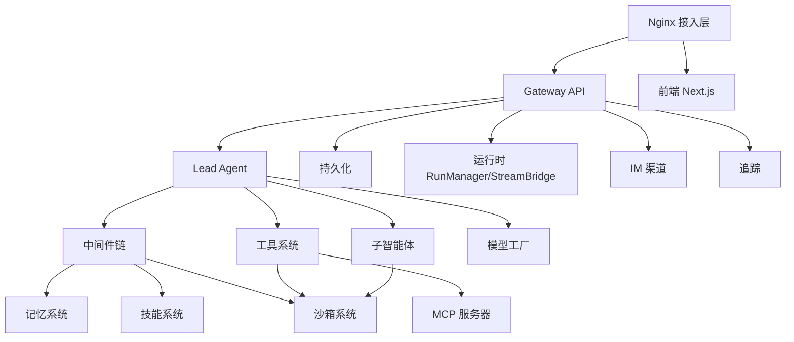

# DeerFlow 2.0 项目完整讲解文档

> 本文档面向工程师，系统讲解 DeerFlow 2.0 的项目定位、整体架构、分层设计、各模块职责及其相互关系。

> 如果你是零基础同学，建议先阅读 `study/README.md` 指定的学习主线（01~05 教程），再回到本篇做全景复盘与查阅。

---

## 一、项目定位与本质

### 1.1 一句话定义

**DeerFlow**（**D**eep **E**xploration and **E**fficient **R**esearch **Flow**）是字节跳动开源的 **超级智能体运行时（Super Agent Harness）**。它把 **子智能体（Sub-Agents）**、**记忆（Memory）**、**沙箱（Sandbox）** 编排在一起，通过 **可扩展的技能（Skills）** 让智能体"几乎可以做任何事"。

### 1.2 它是什么 / 不是什么

| 维度 | 说明 |
|------|------|
| **是什么** | 一个"开箱即用 + 完全可扩展"的智能体运行时（harness），自带文件系统、记忆、技能、沙箱执行环境、规划与子智能体派生能力 |
| **不是什么** | 不是一个需要你自己拼装的框架（framework）。2.0 是彻底重写，与 1.x 无共享代码 |
| **演进路径** | 从 "Deep Research（深度研究框架）" 演进为 "Super Agent Harness"——因为社区把它用于数据管道、幻灯片生成、看板搭建、内容自动化等远超研究的场景 |
| **底座** | 构建在 **LangGraph** 和 **LangChain** 之上 |

### 1.3 核心理念

1. **Harness（运行时）而非 Framework（框架）**：提供智能体真正干活所需的基础设施，而不是让你从零搭建。
2. **技能驱动（Skill-driven）**：能力以 Markdown 定义的技能模块形式存在，按需渐进式加载，保持上下文窗口精简。
3. **有一台"真正的电脑"**：每个任务拥有独立执行环境与完整文件系统视图，能读写文件、执行 shell 命令。
4. **本地可信优先**：默认部署在本地可信环境（仅 127.0.0.1 回环），具备高权限能力，安全边界明确。

---

## 二、整体架构分层

DeerFlow 采用 **前后端分离 + 统一网关反向代理** 的架构。整体分为四层：

```
┌──────────────────────────────────────────────────────────┐
│                   接入层 (Nginx :2026)                     │
│              统一反向代理 / 同源 / 请求路由                  │
└───────────┬───────────────────────────┬──────────────────┘
            │                           │
   /api/langgraph/*  /api/*        /  (非 API)
   → 重写为 /api/*                       │
            ▼                           ▼
┌────────────────────────────┐  ┌──────────────────────────┐
│      Gateway API (:8001)    │  │   Frontend (Next.js)     │
│   FastAPI REST + 智能体运行时 │  │   Web UI 工作台           │
│                             │  └──────────────────────────┘
│  ┌────────────────────────┐ │
│  │      Lead Agent        │ │  ← 智能体核心
│  │  中间件链 / 工具 / 子智能体 │ │
│  └────────────────────────┘ │
└────────────────────────────┘
            │
            ▼
┌──────────────────────────────────────────────────────────┐
│                     基础设施层                              │
│  沙箱 Sandbox │ 记忆 Memory │ 持久化 Persistence │ 技能 Skills │
│  MCP │ 模型工厂 Models │ 追踪 Tracing │ 守卫 Guardrails       │
└──────────────────────────────────────────────────────────┘
```

### 2.1 分层说明

| 层级 | 组件 | 职责 |
|------|------|------|
| **接入层** | Nginx (:2026) | 统一入口、反向代理、路由分发、同源策略、CORS/CSRF 控制 |
| **应用层（前端）** | Next.js (Frontend) | Web 工作台 UI，聊天、工作区、技能/模型/记忆管理、定时任务 |
| **应用层（后端）** | Gateway API (:8001) | FastAPI REST 接口 + 内嵌智能体运行时，管理模型/MCP/技能/记忆/上传/产物/线程/运行/流式 |
| **智能体层** | Lead Agent | LangGraph 单智能体运行入口，串联中间件链、工具系统、子智能体派生 |
| **基础设施层** | Sandbox / Memory / Persistence / Skills / MCP / Models / Tracing / Guardrails | 为智能体提供执行环境、长期记忆、持久化、技能、工具扩展、可观测性和安全守卫 |

### 2.2 请求路由规则（经 Nginx）

- `/api/langgraph/*` → 重写为 Gateway 原生 `/api/*`（智能体交互、线程、流式）
- `/api/*`（其他）→ Gateway API（模型、MCP、技能、记忆、产物、上传等）
- `/`（非 API）→ Frontend Next.js Web 界面

---

## 三、后端模块分层与讲解

后端代码组织为两个 Python 包：

- `packages/harness/` → **deerflow-harness** 包（import 路径 `deerflow.*`）：智能体运行时核心
- `app/` → **FastAPI Gateway + IM 渠道**（import 路径 `app.*`）：HTTP 服务与消息渠道

### 3.1 智能体核心（`deerflow/agents/`）

#### Lead Agent（主智能体）

- **入口**：`make_lead_agent(config)` 创建的单一 LangGraph 智能体，是整个运行时的运行入口。
- **组合能力**：
  - 动态模型选择（支持 thinking 推理、vision 视觉）
  - 中间件链（跨切面关注点处理）
  - 工具系统（沙箱、MCP、社区、内置工具）
  - 子智能体派生（并行任务执行）
  - 系统提示词（注入技能、记忆上下文、工作目录指引）
- **关键文件**：
  - `agents/factory.py`：智能体工厂
  - `agents/lead_agent/agent.py`：主智能体实现
  - `agents/lead_agent/prompt.py`：系统提示词构建
  - `agents/thread_state.py`：线程状态 Schema

#### 中间件链（Middleware Chain）

中间件按严格顺序执行，每个处理一个特定关注点。README 列出的核心 9 个：

| # | 中间件 | 作用 |
|---|--------|------|
| 1 | ThreadDataMiddleware | 创建每线程隔离目录（workspace/uploads/outputs） |
| 2 | UploadsMiddleware | 将新上传文件注入对话上下文 |
| 3 | SandboxMiddleware | 获取代码执行沙箱环境 |
| 4 | SummarizationMiddleware | 接近 token 上限时压缩上下文（可选） |
| 5 | TodoListMiddleware | 规划模式下追踪多步任务（可选） |
| 6 | TitleMiddleware | 首轮对话后自动生成会话标题 |
| 7 | MemoryMiddleware | 将对话排队进行异步记忆抽取 |
| 8 | ViewImageMiddleware | 为视觉模型注入图像数据（条件触发） |
| 9 | ClarificationMiddleware | 拦截澄清请求并中断执行（必须最后） |

> 实际代码目录 `agents/middlewares/` 中还包含更多进阶中间件：循环检测（loop_detection）、悬空工具调用处理（dangling_tool_call）、技能激活（skill_activation）、技能工具策略（skill_tool_policy）、令牌预算（token_budget）、工具输出预算（tool_output_budget）、安全终止（safety_termination）、输入净化（input_sanitization）等，共同保障长任务下的稳定性与安全性。

#### 记忆系统（`agents/memory/`）

- **能力**：LLM 驱动的跨会话持久上下文保留。
- **工作机制**：
  - 自动抽取：分析对话得到用户上下文、事实、偏好
  - 结构化存储：用户上下文（工作/个人/当前关注）+ 历史 + 带置信度评分的事实
  - 去抖更新（debounce）：批量更新以减少 LLM 调用
  - 系统提示注入：Top 事实 + 上下文注入到智能体提示
  - 存储：JSON 文件，基于 mtime 的缓存失效
  - 去重：apply 时跳过重复事实条目，避免无限累积
- **后端可插拔**：`backends/deermem`（默认 LLM 记忆实现）、`backends/noop`（空实现）。

### 3.2 沙箱系统（`deerflow/sandbox/` + `deerflow/community/`）

- **本质**：每线程隔离的执行环境 + 虚拟路径翻译。
- **抽象接口**：`execute_command`、`read_file`、`write_file`、`list_dir`
- **Provider 实现**：
  - `LocalSandboxProvider`（本地文件系统，宿主 bash 默认禁用，非安全隔离边界）
  - `AioSandboxProvider`（Docker 隔离容器，位于 community/，支持异步生命周期、warm-pool 容器复用与健康校验）
  - 另有 `e2b_sandbox`、`boxlite` 等社区 Provider
- **虚拟路径映射**：
  ```
  /mnt/user-data/uploads     ← 用户上传文件
  /mnt/user-data/workspace   ← 智能体工作目录
  /mnt/user-data/outputs     ← 最终交付物
  /mnt/skills                ← 技能目录
  ```
- **工具**：`bash`、`ls`、`read_file`、`write_file`、`str_replace`
- **安全**：`str_replace` 按 `(sandbox.id, path)` 串行化读改写；SkillScan 在安装/技能写入时先行做离线确定性扫描。

### 3.3 子智能体系统（`deerflow/subagents/`）

- **本质**：异步任务委派 + 并发执行。
- **内置智能体**：
  - `general-purpose`（全工具集）
  - `bash`（命令专家，仅在有 shell 访问时暴露）
- **并发约束**：每轮最多 3 个子智能体，15 分钟超时。
- **执行流程**：主智能体调用 `task()` 工具 → executor 在后台线程池运行子智能体 → 轮询完成 → 返回结构化结果。
- **上下文隔离**：子智能体运行在各自隔离上下文中，看不到主智能体或其他子智能体的上下文，专注当前任务。
- **关键文件**：`subagents/executor.py`（后台执行引擎）、`subagents/registry.py`（智能体注册表）、`subagents/builtins/`。

### 3.4 技能系统（`deerflow/skills/`）

- **本质**：结构化能力模块——一个 `SKILL.md`（Markdown）定义工作流、最佳实践和资源引用。
- **内置技能**：research（研究）、report-generation（报告生成）、slide-creation（幻灯片）、web-page（网页）、image/video-generation（图像/视频生成）等。
- **渐进式加载**：仅在任务需要时加载对应技能，保持上下文精简，对 token 敏感模型友好。
- **激活方式**：以 `/skill-name` 前缀显式激活（如 `/data-analysis analyze uploads/foo.csv`）。
- **工具策略**：技能的 `allowed-tools` 策略仅在被显式 slash 激活或进入线程活动技能上下文后生效，过滤模型可见工具 schema 与执行。
- **SkillScan 安全**：安装/编辑技能前经过原生确定性安全扫描器 + LLM 扫描器双重校验，`CRITICAL` 级发现直接拦截。
- **技能评审**：内置 `skill-reviewer` 公共技能与 `review_skill_package` 工具，做只读技能质量评审。

### 3.5 工具生态（`deerflow/tools/` + `deerflow/community/`）

| 类别 | 工具 |
|------|------|
| 沙箱 | `bash`、`ls`、`read_file`、`write_file`、`str_replace` |
| 内置 | `present_files`、`ask_clarification`、`view_image`、`task`（子智能体） |
| 社区 | Tavily（网搜）、Jina AI/Crawl4AI（网页抓取）、Firecrawl/fastCRW（抓取）、DuckDuckGo（图搜）、InfoQuest、Brave、Serper、Exa、SearXNG 等 |
| MCP | 任意 Model Context Protocol 服务器（stdio / SSE / HTTP 传输） |
| 技能 | 通过系统提示注入的领域工作流 |

### 3.6 Gateway API（`app/gateway/`）

FastAPI 应用，为前端提供 REST 端点：

| 路由 | 用途 |
|------|------|
| `GET /api/models` | 列出可用 LLM 模型 |
| `GET/PUT /api/mcp/config` | 管理 MCP 服务器配置 |
| `GET/PUT /api/skills` | 列出与管理技能 |
| `POST /api/skills/install` | 从 `.skill` 归档安装技能 |
| `GET /api/memory` | 获取记忆数据 |
| `POST /api/threads/{id}/uploads` | 上传文件（PDF/PPT/Excel/Word 自动转 Markdown） |
| `GET /api/threads/{id}/artifacts/{path}` | 服务生成的产物 |
| `DELETE /api/threads/{id}` | 删除 DeerFlow 管理的本地线程数据 |

- **应用设置**：`app/gateway/app.py`
- **路由模块**：`app/gateway/routers/`

### 3.7 IM 渠道（`app/channels/`）

- 支持 Telegram、Slack、Feishu/Lark、WeChat、WeCom、DingTalk。
- 均采用长连接/WebSocket/长轮询，**无需公网 IP 或回调 URL**。
- Feishu 通过 `runs.stream` 流式更新单张卡片；Slack/Telegram 使用 `runs.wait()` 最终响应路径。
- 内建命令：`/new`、`/status`、`/models`、`/memory`、`/help`。

### 3.8 其他关键基础设施模块

| 模块 | 目录 | 职责 |
|------|------|------|
| 运行时 | `runtime/` | 内嵌运行执行（RunManager、StreamBridge） |
| 持久化 | `persistence/` | Checkpointer/Store 引擎与 schema 迁移（SQLite/Postgres） |
| 守卫 | `guardrails/` | 工具调用前的授权 Provider |
| 授权 | `authz/` | 主体/委托授权适配 |
| 追踪 | `tracing/` | Tracer 工厂与追踪元数据（LangSmith/Langfuse/Monocle） |
| 模型工厂 | `models/` | 按 `use` 模块路径加载模型 Provider |
| 配置 | `config/` | 分领域配置系统（models/sandbox/skills/memory/subagents 等） |
| 上传 | `uploads/` | 上传文件管理与格式转换 |
| TUI | `tui/` | 终端原生工作台（`deerflow` 命令，内嵌运行不需服务） |
| MCP | `mcp/` | Model Context Protocol 集成 |

---

## 四、前端模块分层与讲解

前端基于 **Next.js + React + TypeScript**，位于 `frontend/src/`。

### 4.1 路由/页面层（`app/`）

| 路由 | 说明 |
|------|------|
| `app/(auth)/` | 认证相关：登录、初始化设置、回调 |
| `app/workspace/` | 工作台核心：聊天、智能体、定时任务 |
| `app/workspace/chats/[thread_id]/` | 会话详情页 |
| `app/workspace/agents/` | 自定义智能体画廊与创建 |
| `app/workspace/scheduled-tasks/` | 定时任务管理 |
| `app/[lang]/docs/` | 多语言文档 |
| `app/blog/` | 博客 |
| `app/api/` | 前端侧 API 路由（memory 代理等） |

### 4.2 组件层（`components/`）

| 目录 | 职责 |
|------|------|
| `ai-elements/` | AI 交互原语：消息、推理链、工具卡片、模型选择器、prompt 输入、计划、检查点、代码块、Web 预览等 |
| `workspace/` | 工作台业务组件：聊天框、产物预览、变更徽章、渠道列表、引用来源等 |
| `ui/` | 基础 UI 组件库（button/dialog/sidebar/select 等，shadcn 风格） |
| `landing/` | 落地页组件（Hero、技能动画、案例展示等） |
| `docs/` | 文档相关组件 |
| `auth/` | 认证相关组件 |

---

## 五、模块之间的关系

### 5.1 一次典型请求的流转

```
用户(Web UI/IM/TUI)
      │ 发送任务
      ▼
  Nginx :2026  ──路由──►  Gateway API :8001
                              │
                              ▼
                    RunManager 创建运行
                              │
                              ▼
                        Lead Agent (LangGraph)
                              │
              ┌───────────────┼───────────────┐
              ▼               ▼               ▼
         中间件链         工具系统         子智能体派生
       (注入上下文/     (沙箱/MCP/       (task() → 并行
        记忆/技能/      社区工具)         executor)
        沙箱/预算)
              │               │               │
              └───────────────┼───────────────┘
                              ▼
                    沙箱执行 + 文件系统读写
                              │
                              ▼
              StreamBridge 流式回传 (SSE)
                              │
                              ▼
                  前端渲染 / IM 卡片更新 / TUI 输出
                              │
                              ▼
              MemoryMiddleware 异步抽取记忆 → 持久化
```

### 5.2 核心依赖关系图



### 5.3 关系要点总结

1. **接入层与应用层**：Nginx 同源代理，屏蔽前后端端口差异；Gateway 同时承担 HTTP 服务与智能体运行时宿主。
2. **Gateway 与 Lead Agent**：Gateway 通过 RunManager 驱动 Lead Agent 运行，StreamBridge 负责 SSE 流式回传（Redis stream bridge 支持多 worker 共享）。
3. **Lead Agent 与中间件链**：中间件在模型调用前后按序处理上下文注入、记忆、技能、沙箱、预算、安全等横切关注点。
4. **Lead Agent 与工具/子智能体**：工具提供执行能力，子智能体提供任务分解与并行；两者都依赖沙箱作为执行底座。
5. **中间件与基础设施**：记忆/技能/沙箱系统通过对应中间件接入智能体生命周期。
6. **多入口共享内核**：Web UI、IM 渠道、TUI（内嵌 `DeerFlowClient`）、嵌入式 Python 客户端共享同一份 `config.yaml`、checkpointer、技能、记忆、MCP、沙箱设置。

---

## 六、多种使用/部署形态

| 形态 | 命令 | 说明 |
|------|------|------|
| 完整应用（本地开发） | `make dev` | Gateway + Frontend + Nginx，热重载，访问 :2026 |
| Docker 开发 | `make docker-start` | 源码挂载、热重载、按 config 自动检测沙箱模式 |
| Docker 生产 | `make up` / `deploy.sh` | 本地构建镜像 + 挂载运行时配置与数据 |
| 后端单独 | `make gateway` | 仅 Gateway API + 内嵌运行时，:8001 |
| 终端工作台 (TUI) | `deerflow` | 终端原生 UI，内嵌运行，无需任何服务 |
| 嵌入式 Python | `DeerFlowClient()` | 作为库进程内直调，返回与 HTTP Gateway 对齐的 schema |

---

## 七、核心特性速览

- **技能与工具**：Markdown 定义技能、渐进式加载、MCP/Python 自定义工具、Claude Code 集成
- **会话目标**：`/goal <完成条件>`，线程级状态，自动评估与隐式续跑（安全上限 8 次）
- **手动上下文压缩**：`/compact` 摘要旧上下文
- **子智能体**：主智能体按需派生、并行探索、结果收敛
- **沙箱与文件系统**：每任务独立执行环境，运行后记录工作区变更摘要
- **上下文工程**：子智能体上下文隔离、摘要压缩、严格工具调用恢复
- **长期记忆**：跨会话持久记忆，本地存储、用户可控
- **定时任务**：`/workspace/scheduled-tasks`，支持 once/cron，后台非交互执行
- **可观测性**：LangSmith / Langfuse / Monocle 三种追踪并存

---

## 八、技术栈总结

| 层 | 技术 |
|----|------|
| 智能体编排 | LangGraph、LangChain |
| 后端 | Python 3.12+、FastAPI、uv 包管理 |
| 前端 | Next.js、React、TypeScript、pnpm |
| 接入 | Nginx |
| 持久化 | SQLite / Postgres（checkpointer + store + 应用数据） |
| 沙箱 | Local / AioSandbox(Docker) / E2B / Boxlite / Kubernetes(provisioner) |
| 扩展协议 | MCP（stdio / SSE / HTTP） |
| 部署 | Docker / Docker Compose / Helm（deploy/helm） |

---

## 附：目录速查

```
deer-flow/
├── backend/
│   ├── packages/harness/deerflow/   # 智能体运行时核心 (deerflow.*)
│   │   ├── agents/                  # 智能体系统（lead_agent/中间件/记忆）
│   │   ├── sandbox/ community/      # 沙箱与社区工具/Provider
│   │   ├── subagents/               # 子智能体
│   │   ├── skills/ mcp/ models/     # 技能/MCP/模型工厂
│   │   ├── runtime/ persistence/    # 运行时/持久化
│   │   ├── guardrails/ authz/       # 守卫/授权
│   │   ├── tracing/ config/ tui/    # 追踪/配置/终端UI
│   │   └── client.py                # 嵌入式 DeerFlowClient
│   └── app/                         # FastAPI Gateway + IM 渠道 (app.*)
│       ├── gateway/                 # Gateway API + routers
│       └── channels/                # IM 渠道集成
├── frontend/src/                    # Next.js Web 工作台
│   ├── app/                         # 路由/页面
│   └── components/                  # ai-elements / workspace / ui / landing
├── skills/public/                   # 内置公共技能
├── docker/ deploy/                  # Docker / Helm 部署
├── scripts/                         # 安装/诊断/构建脚本
└── config.example.yaml              # 配置模板
```

---

> 文档基于仓库 README、backend/README 及源码目录结构梳理，用于快速建立对 DeerFlow 2.0 的整体认知。深入实现细节请参阅对应目录源码及 `backend/docs/`。
